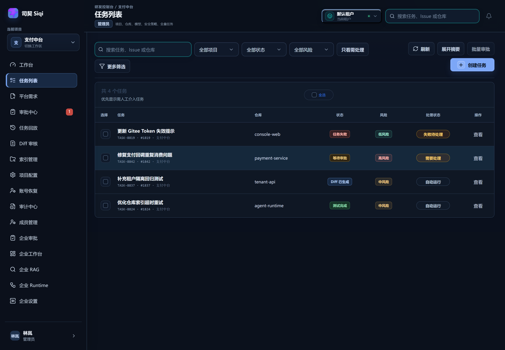
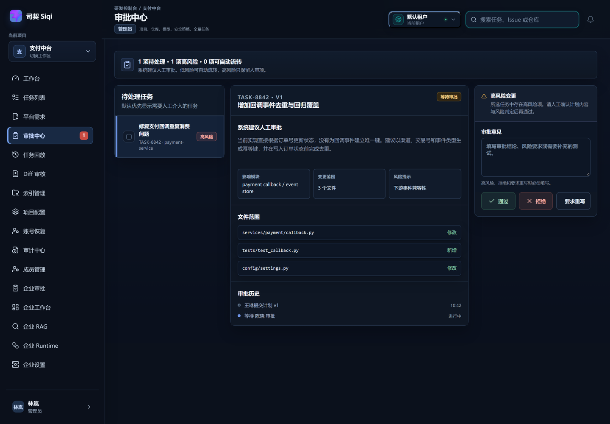
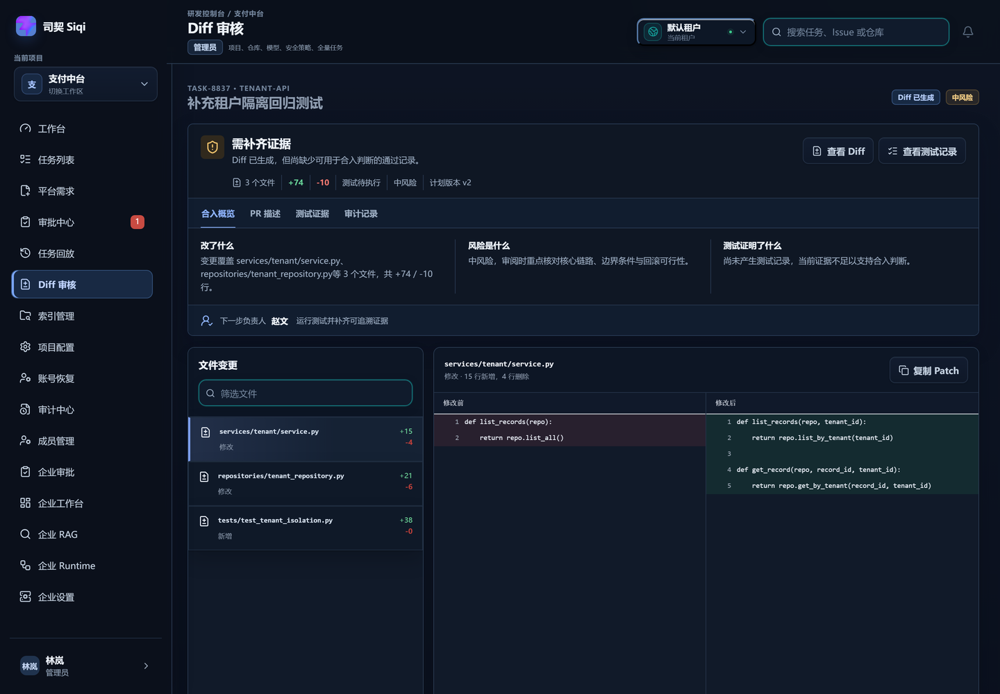
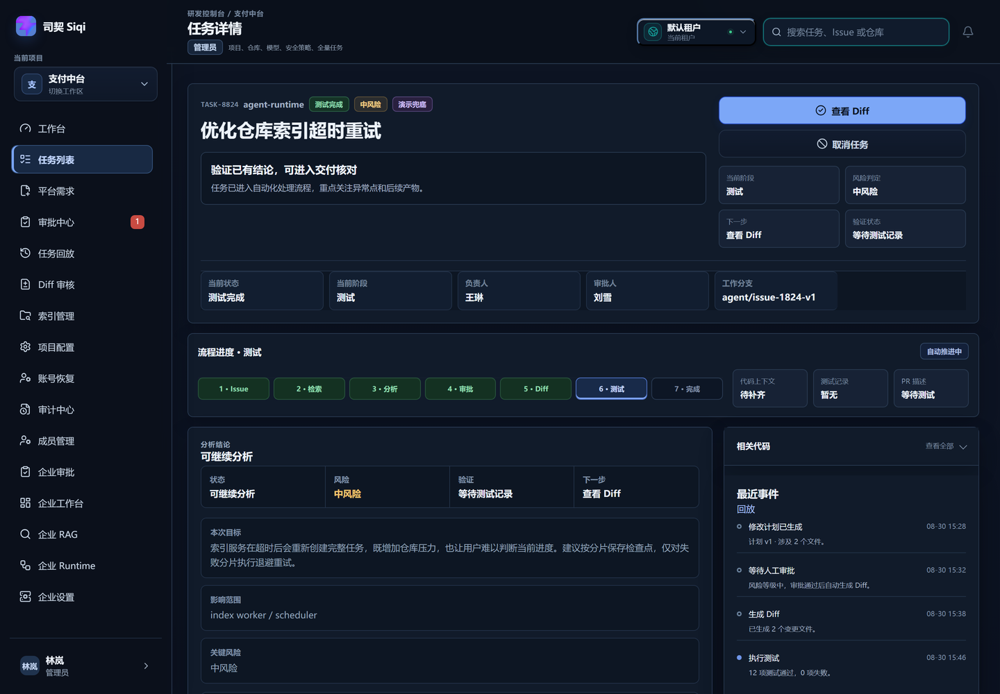
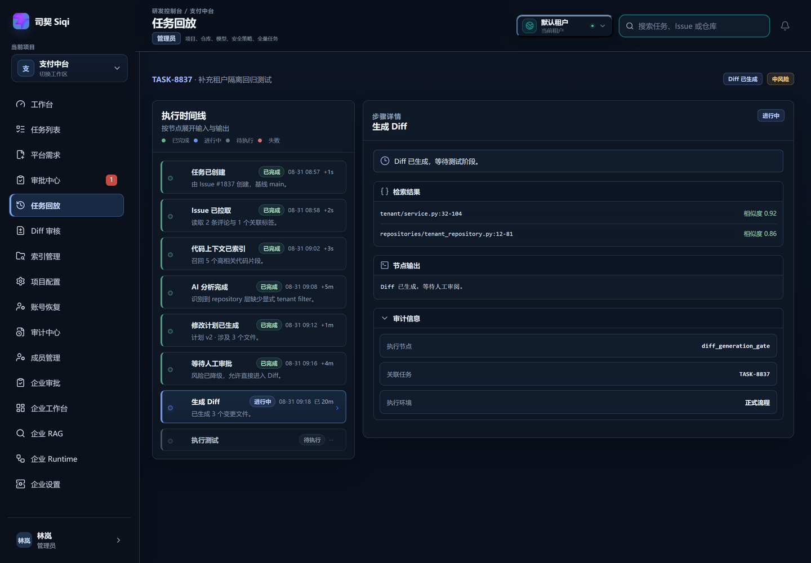

<p align="center">
  
</p>

<h1 align="center">司契 Siqi</h1>

<p align="center">
  面向企业研发团队的 AI Agent 任务协作与过程治理平台
</p>

<p align="center">
  从 Gitee Issue 到分析、检索、计划、审批、Diff、测试、PR 描述和任务回放，形成一条可控、可审计的研发闭环。
</p>

<p align="center">
  <a href="https://agentforge.ltd/"><strong>在线演示：agentforge.ltd</strong></a>
</p>

<p align="center">
  <sub>司契（Siqi）取自《道德经》「有德司契」：Agent 拟契，人成契，每一步都留底可查。执契不苛，落笔有据。</sub>
</p>

<p align="center">
  
  
  
  
  
</p>

<p align="center">
  <a href="#快速开始">快速开始</a>
  ·
  <a href="./docs/USER_GUIDE.md">使用说明书</a>
  ·
  <a href="#核心能力">核心能力</a>
  ·
  <a href="#系统如何工作">系统如何工作</a>
  ·
  <a href="./docs/README.md">完整文档</a>
  ·
  <a href="./CONTRIBUTING.md">贡献指南</a>
  ·
  <a href="./SECURITY.md">安全策略</a>
</p>

---

## 项目定位

很多 AI 编程工具可以生成代码，但企业研发真正需要的是一套**可解释、可审批、可回放、可追责**的任务系统。

本项目将 AI Agent 放进真实研发流程中：

- 以 Gitee Issue 作为研发任务入口；
- 用代码 RAG 为分析提供带来源的上下文；
- 用结构化修改计划和人工审批控制变更边界；
- 在受控环境中生成 Diff、运行测试并产出 PR 描述；
- 将每个关键节点写入事件日志，支持任务回放和审计；
- 将已完成任务沉淀为历史经验，为后续任务提供参考，但不自动套用旧 Diff。

> 当前仓库处于团队版与企业版 Runtime 持续演进阶段。部分能力支持真实服务接入，同时保留明确标注的本地规则兜底，便于开发、测试和演示。

## 为什么需要它

| 传统研发协作痛点 | 平台提供的解决方式 |
| --- | --- |
| Issue、代码、测试和 PR 分散在多个工具中 | 以任务为中心聚合完整研发过程 |
| AI 输出难以解释，修改范围不可控 | 先分析和生成计划，再经过风险判断与审批 |
| 失败后很难知道 Agent 做了什么 | 事件、产物、日志和状态变化全部进入回放 |
| 自动化容易绕过团队治理 | 审批门禁、命令白名单、权限校验和受控执行共同约束 |
| 解决过的问题无法复用 | 完成任务生成复用摘要，检索历史相似任务作为参考 |

## 核心能力

### 研发任务闭环

- Gitee Issue 快照与任务版本管理
- AI 需求分析、阻塞问题和风险识别
- LlamaIndex + Milvus 代码上下文检索
- 结构化修改计划、版本化重写和人工审批
- 受控 Diff 生成、测试执行和结果留存
- PR 描述生成与版本管理
- 任务回放、执行日志和审计事件

### 团队协作与治理

- 项目、仓库和默认研发规则配置
- 管理员、项目负责人、审批人、开发者和观察者角色
- 审批人指派、风险调整和审批门禁
- 任务评论、@ 提醒、通知和审批催办
- 平台需求草稿、Gitee Issue 同步和任务自动创建
- 历史任务复用摘要与相似任务参考

### 安全边界

- Agent 不能绕过审批直接进入代码执行阶段
- 测试命令必须通过项目或仓库命令白名单
- 危险命令会被拦截并写入任务记录
- Diff、测试和任务工作区支持受控执行
- Gitee Token 和模型 API Key 不回显到接口响应或日志
- 历史任务只作为参考，不会自动复制代码、计划或旧 Diff

## 产品界面

以下截图均来自当前仓库的真实运行页面。

<table>
  <tr>
    <td width="50%">
      
      <p align="center"><sub>审批中心：按权限处理需要人工判断的计划</sub></p>
    </td>
    <td width="50%">
      
      <p align="center"><sub>Diff 审核：查看变更范围、文件和风险信息</sub></p>
    </td>
  </tr>
  <tr>
    <td width="50%">
      
      <p align="center"><sub>测试结果：保留命令、状态、输出和执行记录</sub></p>
    </td>
    <td width="50%">
      
      <p align="center"><sub>任务回放：从时间线复盘 Agent 的完整过程</sub></p>
    </td>
  </tr>
</table>

## 系统如何工作

```mermaid
flowchart LR
    Issue["Gitee Issue"] --> Task["创建 Agent 任务<br/>backend/app/main.py"]
    Task --> Context["代码上下文检索<br/>backend/app/retrieval"]
    Context --> Analysis["AI 分析<br/>backend/app/agent/workflow.py"]
    Analysis --> Plan["生成修改计划<br/>backend/app/services"]
    Plan --> Gate{"风险与审批门禁"}
    Gate -->|通过| Diff["生成 Diff<br/>backend/app/main.py"]
    Gate -->|拒绝/重写| Plan
    Diff --> Test["受控执行测试<br/>backend/app/services/test_runner.py"]
    Test --> PR["PR 描述<br/>backend/app/services/pr_description_service.py"]
    PR --> Replay["回放与审计<br/>task_events"]
    Replay --> Reuse["历史任务复用摘要"]
    Reuse --> Search["后续任务参考检索"]
```



### 技术架构

| 层次 | 技术 | 主要职责 |
| --- | --- | --- |
| Web 管理台 | Vue 3、TypeScript、Vite、Pinia、Element Plus | 任务列表、详情、审批、Diff、测试、回放和设置 |
| API 与业务 | FastAPI、Pydantic、SQLAlchemy 2.0 | REST API、认证、权限、状态流转和事务 |
| Agent 编排 | LangGraph、LangChain、DeepAgents | 节点编排、暂停审批、恢复、重试和失败分流 |
| 知识检索 | LlamaIndex、Embedding、Milvus | 代码解析、切片、向量写入和相似检索 |
| 异步执行 | Redis、Celery | 仓库同步、索引、Agent 长任务和测试任务 |
| 业务持久化 | SQLite（本地）、MySQL 8（团队/生产） | 用户、项目、任务、审批、产物、事件和审计 |
| 受控运行 | Docker Runner | 隔离工作区、命令控制、超时和测试执行 |
| 外部服务 | Gitee OpenAPI、可配置 LLM Provider | Issue、仓库、模型分析和 Embedding |

## 快速开始

### 环境要求

- Windows PowerShell、macOS 或 Linux
- Node.js 与 npm
- Python 3.12+
- 本地开发默认使用 SQLite
- Redis、Celery、Milvus 和模型 API Key 可按需启用

### 一键启动

在项目根目录执行：

```powershell
.\start-dev.ps1
```

启动后访问：

- 前端：`http://127.0.0.1:5173/`
- 后端 OpenAPI：`http://127.0.0.1:8000/docs`
- 后端健康检查：`http://127.0.0.1:8000/api/health`

启动脚本会检查前后端端口、初始化本地运行环境，并在 Redis 可用时尝试启动 Celery Worker。

### 团队版启动

团队版使用 MySQL、Redis、Celery、Milvus 和 Docker Runner。先把 `deploy/env/team.env.example` 复制为 `backend/.env` 并填写本机配置，再在项目根目录执行：

```powershell
.\start-team.ps1
```

默认会同时启动团队版前端 `http://127.0.0.1:5177`、后端 `http://127.0.0.1:8002` 和真实 Celery Worker，并自动把前端 `/api` 代理到团队版后端。敏感配置不会写入脚本。

先检查配置但不启动服务：

```powershell
.\start-team.ps1 -DryRun
```

特殊场景可使用：

```powershell
.\start-team.ps1 -SkipWorker
.\start-team.ps1 -SkipFrontend
.\start-team.ps1 -BackendPort 8002 -FrontendPort 5177
# 数据库迁移或首次恢复较慢时，延长启动等待时间
.\start-team.ps1 -StartupTimeoutSeconds 180
```

团队版服务日志写入 `logs/team-backend.*.log` 和 `logs/team-frontend.*.log`。

### 分别启动前后端

前端：

```powershell
cd frontend
npm install
npm run dev
```

后端：

```powershell
cd backend
python -m uvicorn app.main:app --host 127.0.0.1 --port 8000 --reload
```

### 默认测试账号

| 角色 | 账号 | 密码 |
| --- | --- | --- |
| 管理员 | `admin@company.com` | `Admin123!` |
| 审批人 | `approver@company.com` | `Approver123!` |
| 开发者 | `developer@company.com` | `Dev123!` |
| 项目负责人 | `lead@company.com` | `Lead123!` |

这些账号只用于本地开发和验收，生产环境必须替换为真实身份体系和密钥配置。

## 配置说明

后端配置通过环境变量或 `backend/.env` 注入。完整配置模板位于 `deploy/env/`。

### 模型与检索

| 变量 | 说明 |
| --- | --- |
| `LLM_PROVIDER` | 文本模型提供商，默认 `deepseek` |
| `LLM_MODEL` | 文本模型名称 |
| `LLM_API_KEY` | 文本模型密钥；留空时使用规则兜底 |
| `EMBEDDING_PROVIDER` | 向量模型提供商，默认 `zhipu` |
| `ZHIPU_API_KEY` | 向量模型密钥；留空时使用本地兜底 |
| `USE_MILVUS` | 是否启用 Milvus |
| `RAG_MOCK_FALLBACK` | 本地或测试环境是否允许显式降级 |
| `RAG_RETRIEVAL_MODE` | 检索模式：`vector`（默认）或 `hybrid`（BM25 + 向量 RRF 融合） |
| `RAG_QUERY_EXPANSION` | Hybrid 模式是否开启 Query Rewrite / Multi-Query；默认 `false` |
| `RAG_RERANK_ENABLED` | Hybrid 模式是否开启 LLM rerank；默认 `false` |
| `RAG_RERANK_MAX_CANDIDATES` | LLM rerank 处理的最大候选数，默认 `20`，最大 `50` |

离线评测示例：

```powershell
cd backend
python scripts/evaluate_rag.py `
  --dataset evaluation/<repository>-<commit>.json `
  --repository-id <repository_id> `
  --index-id <index_id> `
  --mode hybrid `
  --query-expansion `
  --output .data/rag-evaluation-report.json
```

评测中可用 `--query-expansion`、`--rerank` 或对应的 `--no-query-expansion`、`--no-rerank` 固定实验变量。

### 持久化与异步任务

| 变量 | 本地开发 | 团队/生产 |
| --- | --- | --- |
| `DATABASE_URL` | `sqlite:///.data/app.db` | MySQL 连接串 |
| `USE_SQLALCHEMY` | `true` | `true` |
| `USE_CELERY` | 可按环境启用 | `true` |
| `CELERY_BROKER_URL` | Redis 地址 | 必须配置真实 Redis |
| `CELERY_RESULT_BACKEND` | Redis 地址 | 必须配置真实 Redis |
| `AUTH_JWT_SECRET` | 本地测试值 | 必须使用强随机密钥 |
| `AUTH_COOKIE_SECURE` | 按本地协议配置 | HTTPS 环境开启 |
| `REALTIME_ENABLED` | 是否启用 Redis Pub/Sub + SSE | 团队版默认按 `APP_ENV=team` 自动启用 |
| `REALTIME_REDIS_URL` | 实时事件 Redis 地址 | 留空时复用 `REDIS_URL` 或 Celery Broker |

> 本地无 Redis 时，项目会明确提示 Worker 未启动；生产和团队版不应依赖进程内降级。

团队版多人同步采用“先写 MySQL、再发 Redis 事件、SSE 通知在线页面”的方式。Redis 只负责广播资源变化，前端收到事件后重新请求受权限保护的接口；离线用户重新进入页面仍从 MySQL 读取最新数据。

## 主要页面

| 路由 | 页面 | 作用 |
| --- | --- | --- |
| `/dashboard` | 工作台 | 查看任务概览、自动化进度和待处理事项 |
| `/tasks` | 任务列表 | 筛选、查看和管理 Agent 任务 |
| `/tasks/new` | 创建任务 | 从 Gitee Issue 创建研发任务 |
| `/tasks/:id` | 任务详情 | 查看分析、上下文、计划、Diff、测试和历史参考 |
| `/approvals` | 审批中心 | 处理计划审批、风险调整和重写 |
| `/diff/:id` | Diff 审核 | 查看任务变更和 PR 产物 |
| `/replay/:id` | 任务回放 | 按时间线审计 Agent 执行过程 |
| `/indexes` | 索引管理 | 查看仓库代码索引状态和重建任务 |
| `/requests` | 平台需求 | 创建需求草稿并同步 Gitee Issue |
| `/settings` | 项目配置 | 管理仓库、默认分支、测试命令和权限相关配置 |

## 开发与验证

前端生产构建：

```powershell
cd frontend
npm run build
```

前端测试：

```powershell
cd frontend
npm test
```

后端测试：

```powershell
cd backend
pytest
```

建议提交前完成：

1. 前端类型检查和生产构建；
2. 前端组件与页面测试；
3. 后端接口、权限、持久化和工作流测试；
4. 使用真实运行页面验证截图；
5. 检查 `git diff --check`；
6. 同步更新对应的开发记录和验收文档。

## 文档导航

- [使用说明书](./docs/USER_GUIDE.md)
- [品牌定名方案 · 司契（Siqi）](./docs/品牌定名方案-司契.md)
- [贡献指南](./CONTRIBUTING.md)
- [安全策略](./SECURITY.md)
- [行为准则](./CODE_OF_CONDUCT.md)
- [文档总索引](./docs/README.md)
- [项目立项与产品定位](./docs/01-project-initiation.md)
- [MVP 业务流程](./docs/03-mvp-workflow.md)
- [技术架构](./docs/04-technical-architecture.md)
- [RAG 知识库设计](./docs/06-rag-design.md)
- [API 设计](./docs/08-api-design.md)
- [数据库设计](./docs/09-database-design.md)
- [AI 安全与边界](./docs/10-ai-safety.md)
- [测试与演示](./docs/11-test-and-demo.md)
- [团队版 PRD](./docs/team/01-team-prd.md)
- [团队版业务流程](./docs/team/02-team-workflow.md)
- [团队版 API](./docs/team/03-team-api-design.md)
- [团队版数据、权限与审计](./docs/team/04-team-data-permission.md)
- [项目开发记录](./docs/project-development/README.md)
- [部署说明](./deploy/README.md)

## 当前边界

- 当前第一阶段优先支持 Gitee，不把 GitHub、GitLab 等平台混入 MVP 主链路。
- MVP 以单仓库、单 Issue、单 Agent 任务为主要场景。
- 本地开发允许规则分析、Embedding 和 Runner 的显式兜底；生产环境应配置真实模型、Redis、Milvus、MySQL 和受控 Runner。
- PR 描述和 Diff 产物可以生成，但是否真正创建远端 Pull Request 取决于当前配置和接入状态。
- 仓库已补充贡献指南、安全策略、行为准则、`.editorconfig`、`.gitattributes` 和 [MIT License](./LICENSE)。

## 路线图

- [x] Gitee Issue 到 Agent 任务闭环
- [x] 代码上下文检索与索引管理
- [x] 修改计划、人工审批和风险门禁
- [x] Diff、测试、PR 描述和任务回放
- [x] 团队需求、评论、通知和权限基础能力
- [x] 历史任务复用摘要与相似任务参考
- [ ] 多租户与企业 SSO
- [x] BM25 + 向量混合检索、候选重排序和离线质量评估
- [ ] 按目标仓库扩充评测集、Query Expansion 灰度和更细粒度 MetadataFilters
- [ ] 更严格的生产级 Runner 隔离、监控和备份
- [ ] GitLab、GitHub 等代码托管平台适配

## 贡献

欢迎围绕以下方向提交 Issue 或 Pull Request：

- Agent 工作流和安全边界
- RAG 检索质量与来源可追溯性
- 企业权限、审批和审计
- 前端任务工作台与可访问性
- 测试、部署和运行稳定性

建议先阅读 [项目开发记录](./docs/project-development/README.md) 和 [团队版开发计划](./docs/team/00-team-development-plan.md)，再提出与现有架构一致的改动。

## 许可证

本项目采用 [MIT License](./LICENSE) 开源。
