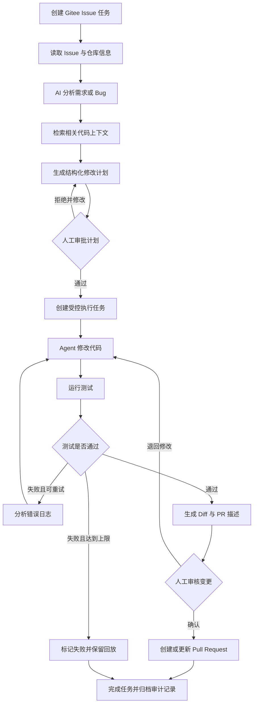
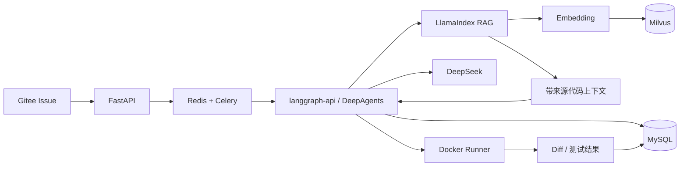
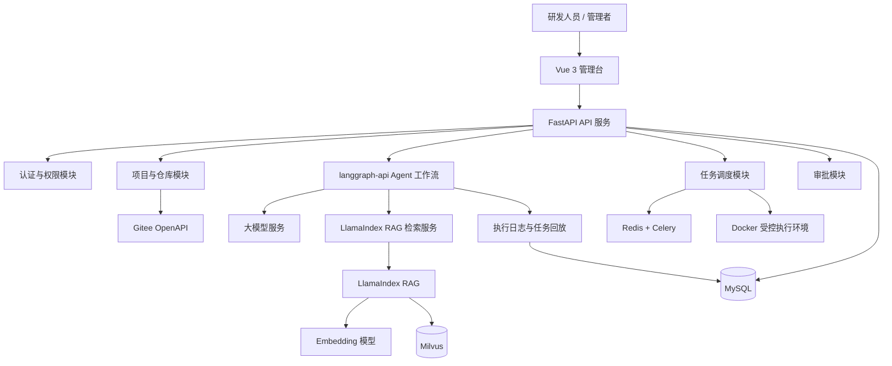
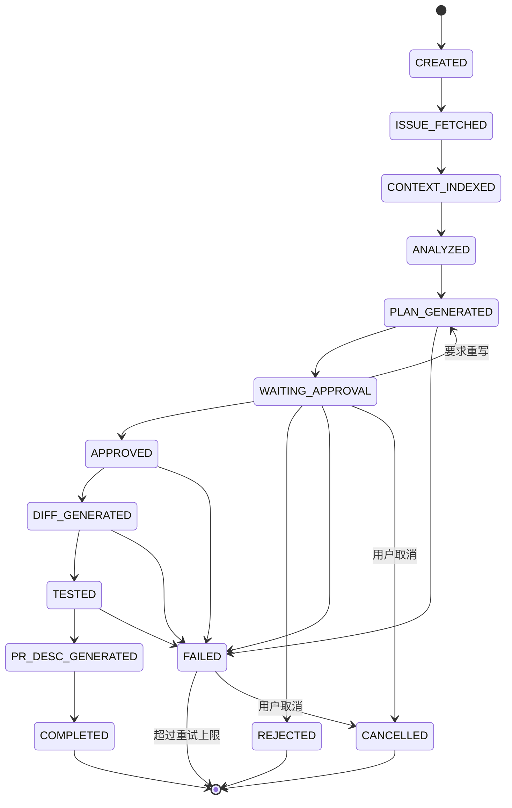
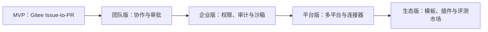

# 立项文档：司契（Siqi）

## 1. 项目概述

### 1.1 项目名称

司契（Siqi）——企业级 AI Agent 研发协作平台（Enterprise-Grade AI Agent R&D Collaboration Platform）。

- **「司」**：执掌、主管。古语「有司」即主管部门；「司契」即掌管契据之人——对应平台的受控执行与流程治理。
- **「契」**：契据、符契。古时符契一分为二、双方各执一半，合而验真才生效——对应「人工审批门禁」：合契才可落章。
- **出处**：《道德经》第七十九章「有德司契」——执契存证而不苛责于人；品牌叙事与主链路一一对应：拟契（AI 分析→修改计划）→ 成契（人工审批）→ 存契（Diff/测试/审计留底）→ 复契（任务回放与历史复用）。
- **标语**：「执契不苛，落笔有据」。

### 1.2 项目定位

本项目面向使用 Gitee（码云）的独立开发者和研发团队，构建一个以研发任务为中心的 AI Agent 工作流平台。

平台以 Gitee Issue 作为任务入口，围绕“需求分析、代码检索、修改计划、人工审批、受控执行、测试验证、Diff 审核、PR 协作和任务回放”建立完整闭环。

项目的重点不是重新训练代码生成模型，而是让 AI Agent 以更安全、更透明、更容易管理的方式参与真实研发流程。

MVP 以单智能体工作流为主，后续再扩展多智能体分工；界面主端以 Web 管理台为主，移动端仅预留扩展位，不作为第一阶段核心交付。

### 1.3 一句话描述

> 将 Gitee Issue 转化为可审核、可测试、可追踪的代码变更和 PR 协作任务。

### 1.4 项目边界

项目分阶段建设：

- **MVP 阶段**：验证 Gitee Issue-to-PR 核心闭环。
- **团队版阶段**：支持多人协作、角色权限和团队审批。
- **企业版阶段**：支持私有化部署、沙箱执行、统一审计、多平台接入和企业治理。

MVP 是企业级产品的可运行起点，不等同于完整商用平台。

## 2. 项目背景与问题

AI Agent 已经可以参与需求分析、代码阅读、代码修改、测试辅助和 PR 内容生成。但企业在引入 AI 研发工具时，仍然面临以下问题：

- Agent 的分析过程和决策依据不透明，出现问题后难以定位。
- AI 可能读取或修改超出任务范围的文件，代码变更边界不清晰。
- 关键操作缺少人工审批，无法满足团队研发规范。
- 测试失败后缺少结构化反馈和有限重试机制。
- 执行日志分散，无法完整回放一次任务。
- 代码托管、任务管理、测试结果和 AI 执行过程之间缺少统一入口。
- 企业关注代码隐私、操作权限和审计责任，纯聊天式工具难以直接满足这些要求。

因此，本项目将 AI 编程能力放入可管理的研发流程中，重点解决“企业如何放心使用 AI 参与研发”的问题。

## 3. 目标用户与典型场景

### 3.1 目标用户

- 独立开发者和小型研发团队
- 企业研发工程师
- 技术负责人和 Team Leader
- DevOps / 研发效能团队
- 需要代码安全、审批和审计能力的企业团队

### 3.2 典型使用场景

#### 场景一：Issue 分析与代码定位

开发者选择一个 Gitee Issue，Agent 分析需求或 Bug，检索项目目录和相关代码，输出影响范围、风险等级和建议修改文件。

#### 场景二：受控代码修改

Agent 先生成结构化修改计划，用户审核通过后，系统在受控执行环境中完成代码修改并运行测试。

#### 场景三：测试失败反馈

测试失败后，Agent 读取错误日志并给出修复建议；系统在限定次数内允许重新执行，每一轮结果都保留在任务回放中。

#### 场景四：变更审核与 PR 协作

系统展示代码 Diff、测试结果和 PR 描述草稿，用户确认后再创建或更新 Pull Request。

## 4. 项目目标

### 4.1 总体目标

构建一个面向国内研发团队的 AI Agent 研发协作平台，使 AI 能够参与真实研发任务，同时保留人工决策权、操作边界和完整过程记录。

### 4.2 MVP 目标

在第一阶段跑通以下闭环：

```text
Gitee Issue
→ AI 分析
→ 代码上下文检索
→ 生成修改计划
→ 人工审批
→ 受控执行或生成 Diff
→ 测试验证
→ PR 描述生成
→ 任务回放与审计
```

### 4.3 用户价值

- 减少研发人员理解 Issue 和定位代码的时间。
- 在 AI 修改代码前明确变更目标和执行边界。
- 通过人工审批降低 AI 误改代码和越权操作风险。
- 通过任务回放快速定位失败原因，便于复盘和优化。
- 通过统一的 Diff、测试结果和 PR 描述提高交付效率。

## 5. 核心业务流程



## 6. 功能范围

### 6.1 MVP 功能

| 模块 | 功能说明 |
| --- | --- |
| 用户与项目 | 基础登录、项目创建、项目成员和任务归属 |
| Gitee 接入 | 授权 Gitee、读取仓库、分支、Issue 和 Pull Request 信息 |
| Issue 分析 | 识别任务类型，提取目标、约束、影响范围和风险 |
| 代码 RAG | 使用 LlamaIndex 解析和切片仓库代码，将 Embedding 写入 Milvus，并按 Issue 检索相关上下文 |
| Agent 工作流 | 以状态机组织分析、计划、审批、执行、测试和交付 |
| 修改计划 | 输出结构化计划、目标文件、操作说明和风险提示 |
| 人工审批 | 审批、拒绝、补充意见和重新生成计划 |
| 受控执行 | 在受限环境中执行代码修改和测试命令 |
| Diff 审核 | 展示文件变更、修改前后对比和变更摘要 |
| 测试记录 | 保存测试命令、退出码、输出摘要和测试结论 |
| 任务回放 | 以时间线展示输入、输出、工具调用、状态和结果 |
| PR 协作 | 生成 PR 标题和描述，支持人工确认后提交 |

### 6.2 MVP 不做范围

- 第一阶段只支持 Gitee，不同时接入 GitHub、GitLab 和 Gitee 以外的平台。
- 第一阶段不做完全自动合并代码，主分支变更必须经过人工确认。
- 第一阶段不做复杂多 Agent 协同，以单任务工作流为主。
- 第一阶段不做通用企业知识库，仅支持面向研发任务的代码 RAG。
- 第一阶段不做计费、插件市场和开放平台。
- 第一阶段不做生产环境自动发布。
- 第一阶段不追求多租户企业版的全部能力，但数据模型要为后续扩展预留空间。

## 7. 核心竞争优势与创新点

### 7.1 流程驱动的 Agent 研发协作

项目不把 Agent 限定为聊天或代码补全工具，而是围绕研发任务建立完整工作流：

```text
Issue → 分析 → 计划 → 审批 → 执行 → 测试 → Diff → PR
```

这种设计使 AI 能力与企业现有研发流程结合，而不是脱离项目上下文单独生成代码。

### 7.2 修改计划前置审批

Agent 在执行代码修改前，必须先输出修改目标、涉及文件、执行步骤、风险和验证方式。用户可以在代码实际变更前纠正 Agent 对需求的理解，减少无效执行。

### 7.3 任务回放与过程审计

任务回放不是简单的成功或失败日志，而是记录一次任务的完整过程：

- Issue 和用户输入
- Agent 分析结果
- 检索到的文件和代码上下文
- 修改计划及审批结果
- 工具调用和命令执行
- 测试输出和失败原因
- 每一轮重试及其变更
- 最终 Diff 和 PR 描述

用户可以按时间线查看任务过程，定位 Agent 在哪一步做出了错误判断。

### 7.4 风险分级与受控执行

系统根据操作类型划分风险等级，并决定是否需要人工审批：

| 风险等级 | 示例 | 处理策略 |
| --- | --- | --- |
| 低风险 | 阅读代码、生成分析、修改文档 | 在权限范围内自动执行 |
| 中风险 | 修改业务代码、增加测试 | 审批计划后执行 |
| 高风险 | 删除文件、修改配置、执行部署命令 | 强制人工确认并限制命令 |

### 7.5 面向国内研发环境的适配

项目第一阶段优先适配 Gitee，后续可扩展 Gitee 企业版、GitLab、Gitee 以外的代码托管平台、禅道、飞书和钉钉。Gitee 适配是项目的场景切入口，核心差异化仍然是流程治理、任务回放和受控执行能力。

## 8. MVP 成功标准

### 8.1 功能验收

- 用户可以授权并选择一个 Gitee 仓库。
- 用户可以从 Issue 创建 Agent 任务。
- Agent 可以输出结构化需求或 Bug 分析。
- Agent 可以检索并展示相关代码文件。
- Agent 可以生成修改计划和风险提示。
- 用户可以审批、拒绝或要求重新生成计划。
- 审批后可以在受控环境中执行任务，或生成可审核 Diff。
- 系统可以记录测试命令、测试结果和失败原因。
- 系统可以生成 PR 标题和描述草稿。
- 用户可以查看一次任务的完整回放。

### 8.2 质量验收

以下指标用于 MVP 验证，不作为商用 SLA：

| 指标 | 目标 |
| --- | --- |
| 核心流程完成率 | 通过预设演示任务完成端到端流程 |
| 任务回放完整率 | 关键节点记录率达到 100% |
| 审批门禁有效性 | 未审批任务不得进入代码执行阶段 |
| 测试结果可追溯性 | 每次测试均保存命令、状态和输出摘要 |
| 任务状态一致性 | 任务状态与执行记录不出现明显冲突 |
| 部署可用性 | 可通过 Docker Compose 完成部署和启动 |

## 9. 技术方案概述

### 9.1 技术选型

```text
前端：Vue 3 + TypeScript + Vite + Pinia + Element Plus
后端：FastAPI + Python 3.11+
数据访问：SQLAlchemy 2.0
业务数据库：MySQL
RAG 框架：LlamaIndex
向量数据库：Milvus
异步任务：Redis + Celery
Agent 编排：langgraph-api + LangChain + DeepAgents
模型接入：兼容 OpenAI 接口的 DeepSeek 服务
Embedding：兼容 OpenAI Embeddings 接口的向量模型
代码托管：Gitee OpenAPI
代码执行：Docker 受控执行环境
实时通信：Server-Sent Events（SSE），必要时扩展 WebSocket
部署：Docker Compose + Nginx
```

### 9.2 技术职责说明

本项目采用“前端交互、接口服务、异步调度、Agent 编排、知识检索、业务存储、受控执行”分层设计。每项技术只负责自己擅长的边界，避免把业务状态、向量检索和代码执行混在同一层。

| 技术或组件 | 所属层 | 在本项目中的具体作用 | 关键产物或数据 | 明确不负责的内容 |
| --- | --- | --- | --- | --- |
| Vue 3 | 前端表现层 | 构建任务工作台、任务详情、AI 分析、修改计划、审批、Diff、测试结果和任务回放页面；通过组件化复用页面结构 | 页面组件、交互状态、表单和时间线视图 | 不直接调用 Gitee、LLM 或 Docker |
| TypeScript | 前端工程层 | 为任务状态、计划结构、Diff、测试结果和 API 响应提供静态类型，减少前后端字段不一致 | 类型定义、接口模型、枚举 | 不承担运行时权限校验 |
| Vite | 前端构建层 | 提供本地开发服务器、模块热更新和生产构建，缩短前端开发反馈周期 | 开发构建产物、静态资源 | 不负责后端服务和业务路由 |
| Pinia | 前端状态层 | 统一管理当前用户、项目、任务详情、审批状态、回放事件和页面筛选条件，避免组件各自维护重复状态 | Store、缓存状态、状态更新动作 | 不替代 MySQL 持久化 |
| Element Plus | 前端组件层 | 提供表格、表单、抽屉、标签、步骤条、通知和审批操作等后台管理台组件，保证页面交互一致 | UI 组件和主题配置 | 不定义业务流程和权限规则 |
| FastAPI | 后端接口层 | 提供 REST API、参数校验、认证鉴权、项目权限校验、任务状态查询、审批接口、RAG 索引接口和 SSE 事件流 | API 路由、Pydantic Schema、依赖注入 | 不在 HTTP 请求中执行长时间索引或测试任务 |
| Python 3.11+ | 后端运行时 | 承载业务服务、Agent 节点、RAG 管道、Gitee 适配器和 Docker Runner 调度逻辑 | Python 应用代码和任务处理逻辑 | 不决定具体模型能力 |
| SQLAlchemy 2.0 | 数据访问层 | 将用户、项目、任务、审批、事件、Diff、测试结果和索引元数据映射为 Python 模型，统一事务和查询 | ORM Model、Repository、事务 | 不存储 Milvus 向量 |
| MySQL | 业务数据层 | 持久化平台核心业务数据、任务状态、审批记录、任务回放事件、代码切片来源信息、索引版本和检索记录 | 业务表、JSON 产物、审计记录 | 不执行向量相似度检索和代码命令 |
| Redis | 基础设施层 | 作为 Celery Broker/Backend，承载异步任务队列、任务状态和短期缓存，降低长任务对 API 的影响 | 队列消息、任务结果、短期缓存 | 不作为长期业务数据库 |
| Celery | 异步任务层 | 执行仓库同步、代码索引、批量 Embedding、Milvus 写入、Agent 长任务和测试任务；支持重试、超时和任务拆分 | 异步任务、重试记录、任务执行状态 | 不负责 Agent 的业务状态机定义 |
| langgraph-api + LangChain + DeepAgents | Agent 编排层 | 将 Issue 分析、RAG 检索、计划生成、人工审批暂停、代码修改、测试、失败重试和 PR 描述组织成可恢复状态图 | Graph State、节点执行记录、恢复点 | 不负责向量存储和代码切片 |
| LlamaIndex | RAG 数据与检索编排层 | 接入仓库文件，解析代码和文档，按语义生成节点，补充文件路径、行号和 Commit 等元数据，调用 Embedding 并编排 Retriever | Document、Node、Retriever、检索上下文 | 不负责用户权限、审批状态和任务生命周期 |
| Embedding 模型 | 向量化层 | 将 Issue 查询和代码切片转换为同一向量空间中的数值表示，使系统能够进行语义相似度检索 | Query Vector、Code Chunk Vector | 不生成修改计划和最终代码 |
| Milvus | 向量检索层 | 保存代码切片向量及必要检索字段，按照相似度返回候选代码；通过项目、仓库和 Commit 条件实现向量数据隔离 | Collection、向量记录、Top-K 结果 | 不保存用户、审批和任务事务数据 |
| DeepSeek | 大模型服务层 | 根据 Issue、RAG 上下文、任务约束和安全策略生成分析结果、结构化修改计划、错误修复建议和 PR 描述 | 分析结果、计划 JSON、PR 描述 | 不直接访问数据库、Gitee 或宿主机命令 |
| Gitee OpenAPI | 外部代码托管适配层 | 拉取仓库、分支、Issue 和 PR 信息，后续负责创建或更新 PR；通过适配层隔离第三方接口变化 | Issue 快照、仓库元数据、PR 请求 | 不负责内部任务状态和审批记录 |
| Docker | 受控执行层 | 为每个任务创建隔离工作区，执行代码修改、依赖安装和测试命令，限制资源、网络和目录访问 | 容器、Diff、退出码、标准输出和错误输出 | 不替代权限系统和审计系统 |
| Nginx | 部署与网关层 | 承担前端静态资源服务、API 反向代理、统一入口和基础超时配置 | HTTP 路由、代理配置、静态资源 | 不承载核心业务逻辑 |
| SSE | 实时通信层 | 向前端推送索引进度、Agent 节点状态、测试日志摘要和任务完成通知，减少页面轮询 | 事件流、进度通知 | 不替代任务队列和事件持久化 |

### 9.3 技术协作边界



调用关系可以概括为：

1. FastAPI 接收用户操作，并把长时间任务交给 Redis + Celery。
2. langgraph-api / DeepAgents 管理 Agent 的业务状态，决定当前执行哪个节点以及何时暂停审批。
3. LlamaIndex 负责把仓库内容变成可检索节点，并从 Milvus 召回带来源的代码上下文。
4. DeepSeek 只根据经过筛选的 Issue、规则和代码上下文生成分析与计划。
5. Docker 负责执行代码修改和测试，MySQL 负责保存任务结果和全过程记录。

### 9.4 系统架构



### 9.5 Agent 状态流转



完整状态定义与重试、取消细则见 `02-prd.md` §11。

### 9.6 受控执行与安全边界

MVP 阶段至少采用 Docker 容器隔离执行任务，并遵循以下原则：

- 每个任务使用独立临时工作区。
- 容器默认不具备宿主机高权限。
- 限制可访问目录、网络能力和资源消耗。
- 对危险命令设置黑名单或人工审批门禁。
- 保存命令、参数、退出码、耗时和输出摘要。
- 任务结束后清理临时容器和工作目录。

Docker 隔离是 MVP 的安全起点，不代表已经达到高安全等级的生产环境。企业版需要进一步引入更严格的沙箱、网络隔离、密钥管理和安全审计能力。

## 10. 主要风险与应对措施

| 风险 | 影响 | 应对措施 |
| --- | --- | --- |
| Gitee API 权限、限流或接口变化 | 仓库和 Issue 数据无法稳定获取 | 封装 Gitee 适配层，统一错误处理，保留本地演示数据和重试机制 |
| 大模型输出质量不稳定 | 分析和修改计划可能不准确 | 使用结构化输出、代码上下文检索、人工审批和任务评测 |
| Agent 执行命令存在安全风险 | 可能破坏代码或污染宿主环境 | 使用 Docker 隔离、命令限制、资源限制和人工审批 |
| 代码 RAG 检索质量不足 | Agent 找不到真正相关的代码 | 使用 LlamaIndex 统一解析和检索，结合元数据过滤、结果数量限制和评测集 |
| Milvus 或索引版本异常 | 检索服务不可用或返回过期代码 | 保存索引版本和 Commit SHA，提供重试、重建和过期索引提示 |
| 长任务超时或中断 | 用户无法获得完整结果 | 使用异步任务队列、状态持久化、超时控制和有限重试 |
| 审计日志设计滞后 | 后续无法完整恢复任务过程 | 从 MVP 开始记录不可缺失的事件、输入输出和状态变化 |
| 模型或第三方服务不可用 | Agent 任务中断 | 支持模型配置、失败提示、任务暂停和人工接管 |
| 用户不理解流程化 Agent | 使用门槛和学习成本上升 | 提供模板任务、风险提示、执行预览和清晰的任务状态 |

## 11. 企业化发展路线



### 11.1 MVP 阶段：验证核心闭环

- 完成 Gitee Issue、代码检索、计划审批、受控执行、测试、Diff 和任务回放。
- 支持单用户或小团队使用。
- 通过预设任务验证流程稳定性和 Agent 输出质量。

### 11.2 团队版阶段：支持协作

- 团队空间和成员管理。
- 基础 RBAC 权限。
- 多项目管理。
- 审批人配置和任务评论。
- 飞书、钉钉通知。
- GitHub Actions / Jenkins 等 CI 结果接入。

### 11.3 企业版阶段：支持治理与私有化

- 企业 SSO 和组织架构同步。
- 完整 RBAC、数据隔离和项目级权限。
- 更严格的沙箱、网络隔离和密钥管理。
- 审计日志导出、告警和合规报表。
- 私有化部署和离线模型接入。
- 模型调用成本、成功率和研发效能统计。

### 11.4 平台版阶段：扩展研发场景

- 接入 GitLab、Gitee 企业能力和其他代码托管平台。
- 接入禅道、Jira、飞书、钉钉、SonarQube、Sentry 等系统。
- 扩展代码审查、测试生成、依赖升级、漏洞修复和 CI 失败分析。
- 提供连接器、Agent 工具和工作流模板机制。

## 12. 项目阶段计划

| 阶段 | 主要目标 | 交付物 |
| --- | --- | --- |
| 阶段一：方案设计 | 明确需求、流程、架构和数据模型 | 立项文档、需求文档、架构图、原型 |
| 阶段二：核心开发 | 跑通 Gitee Issue-to-PR 主流程 | 后端 API、前端页面、Agent 工作流 |
| 阶段三：安全与可观测性 | 补齐审批、回放、日志和受控执行 | 审批流、任务回放、Docker 执行环境 |
| 阶段四：部署与验收 | 完成联调、部署和演示 | Docker Compose、README、测试报告、演示脚本 |
| 阶段五：企业化迭代 | 根据真实使用反馈扩展团队和治理能力 | 团队版、企业版和多平台接入计划 |

## 13. 预期成果

### 13.1 产品成果

- 一个可部署运行的 Gitee AI 研发协作平台 MVP。
- 一套可演示的 Issue-to-PR Agent 工作流。
- 一套包含审批、日志、回放和 Diff 审核的管理台。

### 13.2 技术成果

- FastAPI 前后端分离服务。
- 基于 langgraph-api + LangChain + DeepAgents 的状态化 Agent 工作流。
- 基于 Redis 的异步任务执行机制。
- 基于 LlamaIndex + Milvus 的代码 RAG 检索能力，MySQL 保存业务数据和索引元数据。
- 基于 Docker 的受控代码执行环境。
- 可追踪的 Agent 事件日志和任务回放机制。

### 13.3 后续价值

项目完成 MVP 后，可以继续向企业研发效能、AI Agent 治理、私有化部署和多系统协作方向发展，逐步从单一研发助手演进为企业级 AI 研发协作平台。

## 14. 立项结论

本项目具有明确的研发场景、可拆分的 MVP 边界和持续企业化扩展空间。项目第一阶段以 Gitee 为切入口，不追求覆盖所有代码托管平台，而是优先验证“Issue 分析、计划审批、受控执行、测试验证、Diff 审核和任务回放”这一核心价值闭环。

项目的核心竞争力不在于训练出比现有产品更强的代码模型，而在于将 AI 编程能力与企业研发流程、权限控制、过程审计和任务复盘结合起来，使 Agent 的使用过程更加可控、透明和可管理。
