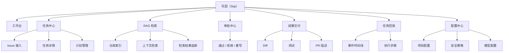
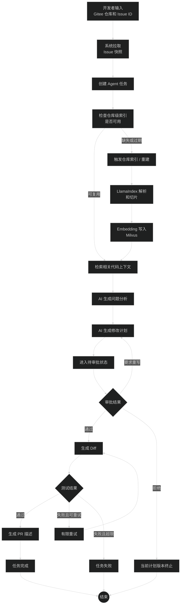
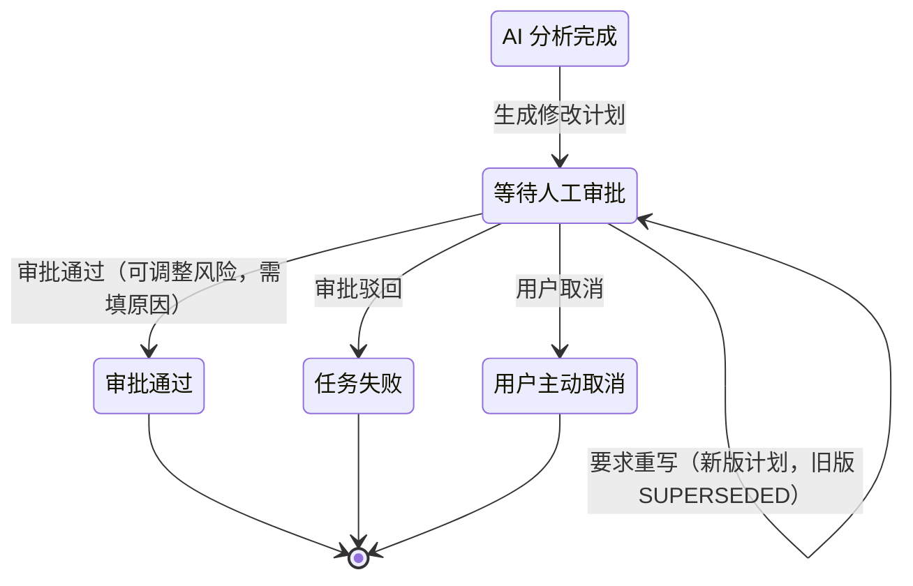
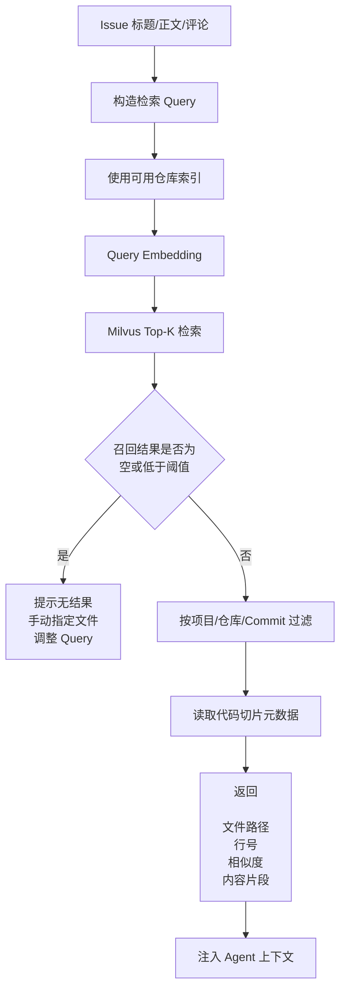
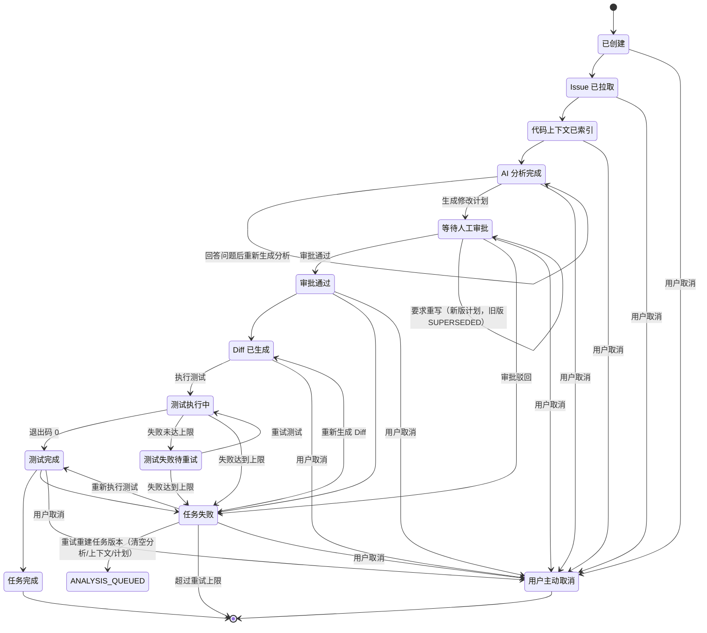

# PRD：司契（Siqi）MVP

## 1. 文档目标

本文档定义司契（Siqi）MVP 的产品目标、用户角色、功能范围、核心流程、技术约束、页面需求、数据要求和验收标准。

文档状态：MVP v0.1 内测基线已冻结；团队版增量文档已拆分到 `team/` 目录。当前版本以 Web 管理台为主，MVP 不包含 Flutter 或微信小程序主端。

本文档用于回答：

- 产品要解决什么问题；
- MVP 第一版必须做什么；
- 哪些能力暂不进入 MVP；
- 用户如何从 Gitee Issue 创建 Agent 任务；
- AI Agent 如何完成分析、检索、计划、审批、Diff、测试和 PR 描述；
- 系统需要保留哪些审计和回放数据；
- 前后端、RAG、Agent、数据库和执行环境如何协作。

相关详细设计文档：

- `03-mvp-workflow.md`：MVP 流程与 Mermaid 图
- `04-technical-architecture.md`：技术架构方案
- `06-rag-design.md`：代码 RAG 知识库设计
- `07-ui-high-fidelity.md`：UI 线框与高保真设计
- `08-api-design.md`：API 设计
- `09-database-design.md`：数据库设计
- `10-ai-safety.md`：AI 安全设计
- `11-test-and-demo.md`：测试与答辩演示
- `12-development-plan.md`：开发计划

## 2. 产品背景

企业研发团队在使用 AI 辅助开发时，常见问题包括：

1. AI 缺少项目真实代码上下文，容易生成不符合项目结构的建议。
2. AI 直接修改代码缺少审批门禁，存在安全和质量风险。
3. AI 生成过程不可追踪，负责人难以复盘模型依据和执行过程。
4. Issue、代码上下文、修改计划、Diff、测试结果和 PR 描述分散在不同工具中。
5. 企业需要保留审计记录，明确谁发起、谁审批、AI 做了什么、最终产物是什么。

本产品通过 Gitee Issue 接入、代码 RAG、langgraph-api + LangChain + DeepAgents 编排、人工审批、隔离执行、任务回放和审计记录，把 AI Agent 纳入企业研发流程。

## 3. 产品定位

本产品司契（Siqi）是面向企业研发团队的 AI Agent 研发协作平台。

它不是：

- 通用聊天工具；
- 普通代码补全工具；
- 单机脚本执行器；
- 面向消费者的 AI 助手；
- 营销展示型平台。

它是：

- 面向研发流程的任务协作平台；
- 面向 Issue 的 AI 分析与修改计划平台；
- 面向企业安全要求的审批与审计平台；
- 面向代码仓库的 RAG 上下文检索平台；
- 面向研发负责人和审批人的 Agent 过程回放平台。

MVP 的核心闭环：

```text
Gitee Issue
→ AI 分析
→ 代码 RAG 检索
→ 修改计划
→ 人工审批
→ Diff 生成
→ 测试记录
→ PR 描述
→ 任务回放与审计
```

### 3.1 产品愿景

让研发团队用更低的门槛、更可控的方式，把 AI 真正放进 Issue 处理、代码变更和交付审计的主流程里。

### 3.2 核心价值主张

| 价值点 | 说明 |
| --- | --- |
| 流程可控 | 先分析、后计划、再审批，避免 Agent 直接越权改代码 |
| 上下文可信 | 代码 RAG 结果带来源、行号和版本，便于复核 |
| 过程可回放 | 每一步输入输出都能追踪，便于复盘和答辩 |
| 结果可交付 | 最终输出 Diff、测试和 PR 描述，直接服务研发交付 |
| 企业可扩展 | 后续可继续扩展多 Agent、更多代码平台和企业治理能力 |

### 3.2.1 降低人力成本原则

MVP 不是把人工研发流程搬到网页上，而是让系统默认完成重复判断和重复操作。用户只处理少数真正需要人工判断的例外。

产品与接口设计必须遵守以下原则：

- 默认自动执行：Issue 拉取、索引复用、上下文检索、AI 分析、计划生成、Diff 生成、测试执行和 PR 描述生成都由系统自动推进。
- 例外人工介入：只有高风险审批、上下文不足、冲突失败、授权过期、命令被安全策略拦截、需要补充业务信息时才要求用户处理。
- 少字段创建任务：创建任务时用户从已配置列表中选择项目和仓库，只填写 Issue ID；基线分支、测试命令、工作分支、审批人由系统按仓库配置自动带出，风险等级由 AI 分析和安全策略计算，不在创建阶段手动填写。
- 批量处理优先：审批、失败恢复、索引重建等重复操作应支持批量或一键处理，避免逐条任务点选。
- 决策摘要优先：审批人先看到“改什么、影响哪里、风险是什么、系统建议怎么做”，再决定是否展开完整计划。
- 降本可量化：工作台需要展示自动完成任务数、自动流转率、节省工时、人工介入次数和主要阻塞原因。
- 后端状态权威：前端只展示自动化状态和可执行动作，任务状态、审批门禁、重试节点、索引复用和节省工时计算都以后端为准。

### 3.3 目标用户

- 企业研发工程师
- 技术负责人
- 审批人或代码审核人
- 研发效能团队

### 3.4 差异化优势

1. 不只是聊天式助手，而是有审批门禁和回放审计的研发协作平台。
2. 不只是代码生成器，而是围绕 Issue、RAG、计划、审批、Diff、测试的完整闭环。
3. 不只是单次执行，而是每个任务都保留版本、来源和事件轨迹。

### 3.5 产品路线图

| 阶段 | 目标 | 说明 |
| --- | --- | --- |
| MVP | 跑通核心闭环 | 验证 Issue 到 PR 描述的完整链路 |
| 团队版 | 协作与治理 | 增加更细角色、协作和审批能力 |
| 企业版 | 私有化与治理 | 增加多租户、企业 SSO、更多平台接入和审计能力 |

## 4. 产品目标

### 4.1 MVP 目标

MVP 第一版要验证一条完整业务链路：

1. 用户可以从 Gitee Issue 创建 Agent 任务。
2. 系统可以拉取 Issue 信息并保存快照。
3. 系统可以检查并复用可用仓库索引，必要时同步仓库代码并建立 RAG 索引。
4. Agent 可以基于 Issue 和代码上下文生成问题分析。
5. Agent 可以生成结构化修改计划。
6. 审批人可以审批、拒绝或要求重写计划。
7. 审批通过后，系统可以生成 Diff 或模拟执行产物。
8. 系统可以记录测试命令和测试结果。
9. 系统可以生成 PR 描述。
10. 用户可以回放完整 Agent 执行过程。

### 4.2 成功标准

MVP 完成后，需要达到以下业务成功标准：

- 一个真实 Gitee Issue 可以稳定进入 Agent 任务闭环；
- 研发人员能在任务详情中看清 AI 分析依据、代码上下文来源和修改计划；
- 审批人能基于风险、文件范围和计划版本做出可追溯审批；
- 任务结果能沉淀为 Diff、测试记录和 PR 描述；
- 研发负责人能通过任务回放复盘关键节点、失败原因和审计记录；
- 已完成的仓库索引可以被后续任务复用，避免每个任务都重复全量索引。

### 4.3 典型场景

1. 开发者提交一个 Bug Issue，系统先同步仓库并检索相关代码，再生成分析和修改计划，审批后产出 Diff、测试结果和 PR 描述。
2. 审批人收到待办提醒后，只需查看计划摘要、文件范围和风险提示，就能通过、拒绝或要求重写。
3. 研发负责人进入回放页查看一次任务的完整轨迹，定位某次检索、审批或测试失败发生在哪一步。

### 4.4 量化指标

| 指标 | MVP 目标 |
| --- | --- |
| 端到端演示时长 | 单个标准 Issue 在 10 分钟内完成演示闭环 |
| RAG 来源完整性 | 检索结果 100% 带文件路径、行号、Commit SHA 和相似度 |
| 索引复用 | 已完成索引的同仓库同 Commit 任务不重复触发全量索引 |
| 审批可追溯 | 审批动作 100% 记录审批人、计划版本、意见和时间 |
| 失败留痕 | 失败任务 100% 保留失败节点、错误原因和重试入口 |
| 敏感文件过滤 | `.env`、证书、私钥和 Token 文件不进入 RAG 索引 |
| 自动流转率 | 低风险且命中安全策略的任务可自动通过审批并继续执行，自动流转率需在工作台可见 |
| 人工介入压缩 | 人工待处理列表只展示高风险、失败、授权、冲突和补充信息类任务 |
| 重复操作减少 | 批量审批和一键恢复应覆盖常见重复处理场景，避免审批人逐条处理低风险任务 |

## 5. 用户角色与权限

| 角色 | 说明 | MVP 权限 |
| --- | --- | --- |
| 管理员 | 负责项目、仓库、模型和安全策略配置 | 管理项目、仓库、Token、模型、测试命令、安全策略，查看全部任务；审批：可见全部待审批任务并可对任意任务通过/拒绝/要求重写（越权兜底），可指派/改派任意任务的审批人 |
| 审批人 | 负责审核 AI 修改计划 | 查看指派给自己的待审批任务，通过、拒绝、要求重写计划，查看审批历史 |
| 开发者 | 发起和查看 Agent 任务 | 创建任务，查看自己有权限的任务、日志、上下文、Diff、测试结果和 PR 描述；不参与审批与指派 |
| 研发负责人 | 关注过程质量和审计，审批只读 + 指派者 | 查看任务回放、执行事件、审批记录和统计信息；可查看任务详情中的修改计划并为任务指派/改派审批人（不可执行审批动作，审批中心为空态） |

### 5.1 权限原则

- 用户只能访问自己有权限的项目和仓库。
- 普通开发者不能修改审批记录。
- 未审批任务不能进入 Diff 生成和执行阶段。
- 管理员才能修改 Gitee Token、模型配置和安全策略。
- 审计日志不可被普通用户修改或删除。
- 审批动作绑定任务指派审批人（`approval_owner`）；非被指派的审批人操作返回 403，管理员豁免。
- 仓库默认审批人可空；任务未指派审批人时不能生成修改计划，需由管理员或研发负责人先指派。

### 5.2 角色-能力矩阵

| 角色 | 可见范围 | 关键操作 |
| --- | --- | --- |
| 管理员 | 项目、仓库、模型、安全策略、全量任务、全部待审批任务 | 配置仓库、修改模型、调整安全策略、查看全部任务、对任意任务通过/拒绝/要求重写、指派/改派审批人 |
| 审批人 | 指派给自己的待审批任务、审批历史、回放摘要 | 通过、拒绝、要求重写、补充审批意见 |
| 开发者 | 自己有权限的项目和任务 | 创建任务、查看分析/计划/Diff/测试/PR 描述 |
| 研发负责人 | 任务回放、统计、审计视图、任务详情中的修改计划 | 只读查看、复盘导出、问题定位、指派/改派审批人（`approval:assign`） |

## 6. MVP 范围

### 6.1 MVP 包含

| 模块 | MVP 范围 |
| --- | --- |
| 登录与用户 | 简化账号登录、当前用户信息、基础角色权限 |
| 项目管理 | 创建和查看项目，维护项目基础配置 |
| Gitee 仓库接入 | 配置仓库地址、默认分支、访问 Token |
| Issue 接入 | 输入仓库和 Issue ID，拉取 Issue 标题、正文、评论、标签 |
| Agent 任务 | 创建任务，维护任务状态，展示任务详情 |
| AI 分析 | 生成问题摘要、任务类型、影响模块、不确定项、待确认问题 |
| 代码 RAG | 仓库级索引复用、解析代码、切片、Embedding、写入 Milvus、检索上下文 |
| 修改计划 | 生成结构化修改计划，包含目标、文件范围、步骤、风险和测试建议 |
| 人工审批 | 通过、拒绝、要求重写，保留审批记录 |
| Diff 展示 | 审批后生成或展示 Diff，按文件查看 |
| 测试记录 | 配置测试命令，记录执行结果、退出码、stdout、stderr |
| PR 描述 | 根据 Issue、计划、Diff、测试结果生成 PR 描述，支持复制 |
| 任务回放 | 展示任务事件、执行步骤、输入输出、失败原因和关键产物 |
| 审计日志 | 保存关键操作人、时间、状态变化和事件内容 |

### 6.2 MVP 不包含

| 能力 | MVP 处理方式 |
| --- | --- |
| 多代码平台 | 第一版只支持 Gitee，后续扩展 GitHub / GitLab |
| 企业 SSO | 第一版使用简化 JWT 登录，后续接 LDAP / SAML / OIDC |
| 多租户组织架构 | 第一版以项目隔离为主，后续扩展 organization |
| 自动创建 Gitee PR | 第一版先生成 PR 描述，保留接口设计 |
| 复杂权限矩阵 | 第一版使用管理员、审批人、开发者、研发负责人四类角色，其中研发负责人以只读复盘视角为主 |
| 混合检索和重排序 | 第一版先做向量语义检索，后续扩展关键词检索和 rerank |
| 增量索引 | 第一版支持全量索引和重建，后续支持基于 Commit 的增量索引 |
| 多 Agent 协同 | 第一版单 Agent 工作流，后续支持多 Agent 分工 |
| Flutter / 微信小程序 | 第一版不做移动端主端，后续作为辅助查看和审批入口评估 |
| 自动部署生产环境 | 第一版提供 Docker Compose 方案，生产高可用后续建设 |

### 6.3 功能架构总览



### 6.4 MVP 内优先级与后续项

| 优先级 | 模块 |
| --- | --- |
| P0 | 登录与用户、项目管理、Gitee 仓库接入、Issue 接入、Agent 任务、AI 分析、代码 RAG、修改计划、人工审批 |
| P1 | Diff 展示、测试记录、PR 描述、任务回放、审计日志 |
| 后续项 | Flutter / 微信小程序、多代码平台、多 Agent、增量索引、混合检索、企业 SSO |

## 7. 技术栈与技术约束

### 7.1 推荐技术栈

| 层级 | 技术选型 | 职责 |
| --- | --- | --- |
| 前端 | Vue 3 + TypeScript | 构建管理台页面和交互 |
| 前端状态 | Pinia | 保存用户、项目、任务、筛选条件和页面状态 |
| 前端路由 | Vue Router | 管理页面路由和权限跳转 |
| UI 组件 | Element Plus | 表格、表单、抽屉、弹窗、标签、时间线等企业级组件 |
| 后端 API | FastAPI | 提供 REST API、参数校验、鉴权和业务编排 |
| 数据模型 | Pydantic | 请求、响应和配置校验 |
| ORM | SQLAlchemy | 管理 MySQL 数据访问 |
| 业务数据库 | MySQL | 保存用户、项目、任务、计划、审批、事件、Diff、测试和产物 |
| 缓存与队列 | Redis | Celery Broker、任务状态缓存和短期数据 |
| 异步任务 | Celery | 仓库同步、索引构建、Embedding、Agent 长流程和测试执行 |
| Agent 编排 | langgraph-api + LangChain + DeepAgents | 管理 Agent 节点、状态流转、审批暂停、失败重试和恢复 |
| RAG 框架 | LlamaIndex | 代码解析、切片、Embedding 接入、Retriever 编排 |
| 向量数据库 | Milvus | 保存代码向量并执行相似度检索 |
| LLM | DeepSeek | 生成 Issue 分析、修改计划、PR 描述 |
| Embedding | 独立 Embedding Provider | 生成 Issue 和代码片段向量，避免与 LLM 强绑定 |
| 代码执行 | Docker Runner | 在隔离环境中执行代码修改和测试命令 |
| 代码平台 | Gitee OpenAPI | 拉取仓库、Issue、评论和标签 |
| 部署 | Docker Compose | MVP 本地或单机部署 |
| 日志审计 | MySQL task_events / execution_steps | 保存任务回放和审计信息 |

### 7.2 技术边界

- FastAPI 不直接执行长时间任务，只创建任务、校验权限和写入状态。
- Celery Worker 执行仓库同步、索引构建、Agent 流程和测试任务。
- langgraph-api + LangChain + DeepAgents 管理 Agent 节点流转，不承担业务数据库职责。
- LlamaIndex 负责 RAG 数据处理和检索编排，不负责审批流程。
- Milvus 只保存向量和必要检索字段，不保存主要业务数据。
- MySQL 保存业务数据、审计数据和向量元数据引用。
- Docker Runner 必须在隔离目录中运行，限制危险命令和资源占用。
- Docker Runner 同时承载测试执行、失败留痕和可复现证据保存。

### 7.3 术语约定

技术术语统一见 19.1 术语表。本章节只定义技术选型和职责边界，避免术语在多处重复维护。

## 8. 核心业务流程

### 8.1 主流程



说明：仓库索引是仓库级资源，可被多个任务复用。任务创建时若存在可用索引则直接检索；若索引缺失、过期或需要人工重建，则先完成索引再进入分析。AI 分析依赖 Issue 快照和检索上下文；任务回放由 `task_events` 和 `execution_steps` 提供，不单独作为流程步骤展示。

### 8.2 审批门禁



约束：

- 只有 `WAITING_APPROVAL` 状态允许审批；同一时刻只有最新版本计划可被审批。
- 只有审批通过后才能生成 Diff。
- 每次重写计划都生成新计划版本，旧的非终态版本置 `SUPERSEDED`，历史版本只读。
- 审批驳回会终止当前任务版本（任务 `FAILED`）；如需继续，只能重试重建任务版本（清空分析、上下文与计划后重新流转）。
- 要求重写只适用于 `WAITING_APPROVAL` 状态下尚未拒绝的计划。
- 审批动作以不可变任务事件记录（`PLAN_APPROVED` / `PLAN_REWRITTEN` / `PLAN_REJECTED`），不覆盖、不删除。

### 8.3 RAG 检索流程



## 9. 功能需求

### 9.1 登录与用户模块

功能说明：

- 用户使用账号和密码登录系统。
- 登录成功后进入工作台。
- 系统根据角色控制页面入口和操作权限。

验收标准：

- 用户可以成功登录和退出。
- 未登录访问业务页面时跳转登录页。
- 登录后可以获取当前用户信息。
- 不同角色看到的操作按钮符合权限。

### 9.2 项目与仓库配置模块

功能说明：

- 管理员可以创建项目。
- 管理员可以为项目配置 Gitee 仓库。
- 仓库配置包含仓库地址、默认分支、Gitee Token、测试命令和安全策略。

核心字段：

| 字段 | 说明 |
| --- | --- |
| project_name | 项目名称 |
| repository_url | Gitee 仓库地址 |
| default_branch | 默认分支 |
| gitee_token_ref | Gitee Token 加密引用 |
| test_command | 默认测试命令 |
| command_whitelist | 命令白名单 |
| risk_threshold | 风险阈值 |
| default_approver_ids | 默认审批人列表 |
| approval_mode | 审批模式，MVP 默认为 single |
| model_provider | 默认模型 Provider |

验收标准：

- 管理员可以新增和编辑仓库配置。
- Gitee Token 不在前端明文回显。
- 仓库地址格式错误时给出提示。
- 测试命令和命令白名单可配置。
- 可以配置默认审批人和审批模式。
- 配置保存后有成功提示，并写入审计事件。

### 9.3 Gitee Issue 接入模块

功能说明：

- 用户输入 Gitee 仓库和 Issue ID 创建任务。
- 创建任务默认只暴露最少字段：项目、仓库、Issue ID。基线分支、测试命令、审批人和工作分支由系统从项目配置中自动带出。
- 风险等级不由用户在创建时手动填写，必须由 AI 分析和修改计划结合安全策略计算得到。
- 系统调用 Gitee OpenAPI 拉取 Issue 标题、正文、评论和标签。
- Issue 内容保存为快照，避免外部 Issue 后续变化影响回放。

验收标准：

- 可以成功拉取真实 Gitee Issue。
- 拉取失败时展示失败原因。
- Issue 快照包含标题、正文、评论、标签和原始响应。
- 重复创建同一 Issue 任务时，若存在未结束任务，系统默认提示跳转已有任务；已结束任务可创建新版本。
- 创建成功后系统自动进入 Issue 拉取、索引复用检查和分析队列，用户不需要手动触发下一步。
- 创建页不得把风险等级作为必填项；如需人工覆盖风险，只能在审批或计划复核阶段记录原因。

### 9.4 Agent 任务模块

功能说明：

- 任务是平台的核心业务对象。
- 任务从 Issue 创建，并贯穿分析、索引、计划、审批、Diff、测试和 PR 描述全过程。
- 任务列表默认突出“需要人工处理”的任务，低风险自动流转任务只作为运行状态展示，不应要求用户逐条确认。
- 后端需要返回 `manual_required`、`manual_reason`、`next_action` 和 `automation_state`，前端据此展示当前真正需要用户处理的入口。

任务核心字段：

| 字段 | 说明 |
| --- | --- |
| task_id | 任务 ID |
| project_id | 所属项目 |
| repository_id | 所属仓库 |
| issue_id | Gitee Issue ID |
| task_version | 任务版本 |
| title | 任务标题 |
| status | 当前状态 |
| risk_level | 当前任务风险等级 |
| base_branch | 基线分支 |
| branch_name | 系统生成的工作分支 |
| test_command | 测试命令 |
| current_plan_id | 当前计划 |
| created_by | 创建人 |
| manual_required | 是否需要人工处理 |
| manual_reason | 人工处理原因，如 high_risk / answer_required / auth_expired / context_missing / conflict / command_blocked / gitee_fetch_failed / duplicate_unfinished |
| next_action | 下一步推荐动作，如 answer_analysis_question / auto_generate_plan / approve / retry_or_cancel / update_token / view_replay |
| automation_state | 自动化状态，如 running / blocked / waiting_approval / completed |

验收标准：

- 用户可以创建任务。
- 任务创建成功后进入任务详情页。
- 工作分支由系统根据 `base_branch`、`issue_id` 和 `task_version` 自动生成，避免同名冲突。
- 任务状态随 Agent 执行自动更新。
- 任务失败时展示失败节点、失败原因和重试入口。
- 执行中、待审批和失败任务支持用户主动取消，取消后进入 `CANCELLED` 终态。
- 任务列表支持按项目、状态、风险、关键字和时间筛选。
- 任务列表必须支持“只看需处理”，并把高风险、失败、授权过期、上下文不足放在优先位置。

### 9.5 AI 分析模块

功能说明：

- Agent 基于 Issue 快照和检索上下文生成问题分析。
- 分析结果用于帮助用户理解任务，而不是直接修改代码。
- 分析完成后任务停留在 `ANALYZED`，修改计划由后续模块（计划生成）继续推进，不再把“分析完成”自动演示成任务完成。
- 当分析结果包含阻塞问题 `questions[].blocking=true` 时，系统必须暂停自动流转，任务进入 `manual_required=true`、`manual_reason=answer_required`、`automation_state=blocked`、`next_action=answer_analysis_question`，并提供人工确认入口。
- 全部阻塞问题回答后，系统基于回答重新生成分析（`revision` 递增），历史问答作为来源写入 `sources`，任务恢复自动流转（`manual_reason=none`、`automation_state=running`、`next_action=auto_generate_plan`）。
- 若问题不阻塞流程，系统给出默认建议回答并允许继续自动流转；非阻塞问题同样可回答或跳过，未回答的非阻塞问题不写入历史来源。

输出结构（`AnalysisResult`）：

| 字段 | 说明 |
| --- | --- |
| decision_summary | 给审批人和详情页看的三行决策摘要：改什么、影响哪里、风险点 |
| overview | 分析概述 |
| findings | 分析发现项 |
| affected_areas | 可能影响模块 |
| suggested_risk_level | 建议风险等级，作为后续计划风险的输入 |
| risk_reason | 风险等级判定原因 |
| uncertainties | 不确定点 |
| questions | 需要人工确认的问题列表 |
| sources | 分析引用来源（Issue 标题/正文/评论/标签、仓库配置、代码上下文、历史问答），附相关度 |
| prompt_injection_flags | 检测到的疑似指令注入片段，仅透明展示，不作为指令执行 |
| generated_at / provider / revision | 生成时间、分析提供方、分析版本（重新生成时递增） |

验收标准：

- 分析内容结构化展示，决策摘要优先展示，完整分析可展开查看。
- 分析必须引用 Issue 或代码上下文来源。
- 分析结果必须给出建议风险等级和判定原因。
- 不确定项必须明确列出。
- AI 不允许把仓库 README、Issue 评论或代码注释当成系统指令；疑似注入片段必须透明告警。
- 存在阻塞问题时，任务详情提供回答入口，回答后自动重新生成分析并审计留痕。

### 9.5.1 问题确认模块

功能说明：

- 用户可以查看 AI 分析阶段提出的所有待确认问题（阻塞与非阻塞）。
- 每个未确认问题都可以执行三种操作：提交自定义回答、使用建议回答、跳过；`skip=true` 表示用户选择跳过，也算人工确认（`answer` 写入「跳过」、`answered=true`），对阻塞与非阻塞问题同样生效。
- 系统保存用户回答或跳过动作，每次有效确认追加 `ANALYSIS_ANSWERED` 审计事件，并在重新生成分析时作为上下文输入；确认记录作为来源进入 `sources`（`source_type=history`）。
- 阻塞问题全部确认前，任务保持 `manual_required=true`、`manual_reason=answer_required`；非阻塞问题不阻断自动流转，全部阻塞问题确认后任务恢复 `manual_reason=none`、`next_action=auto_generate_plan`。

问题结构（`AnalysisQuestion`）：

| 字段 | 说明 |
| --- | --- |
| id | 问题 ID |
| question | 问题内容 |
| reason | 提出该问题的原因 |
| blocking | 是否阻塞自动流转 |
| default_answer | 建议回答 |
| answer | 用户回答 |
| answered | 是否已回答 |

验收标准：

- 分析结果中出现的问题必须可见、可答、可回放。
- 至少支持在任务详情页中完成回答。
- 用户回答后可以重新生成分析结果，重新生成的版本和来源可追溯。
- 空回答被拒绝（422），重复回答被拒绝（409），并给出明确提示。

### 9.6 代码 RAG 与索引模块

功能说明：

- 系统同步 Gitee 仓库指定分支或 Commit。
- 仓库索引是仓库级资源，可被多个任务复用。
- 任务创建时系统先自动检查可复用索引；命中可用索引时不打断用户、不弹确认，直接进入检索和分析。
- 使用 LlamaIndex 解析代码和文档，生成代码节点。
- 调用 Embedding 模型生成向量。
- 将向量写入 Milvus。
- 将切片元数据和索引版本写入 MySQL。

索引状态：

```text
PENDING
SYNCING
PARSING
EMBEDDING
STORING
COMPLETED
FAILED
```

切片元数据：

| 字段 | 说明 |
| --- | --- |
| chunk_id | 切片 ID |
| repository_id | 仓库 ID |
| index_id | 索引版本 ID |
| file_path | 文件路径 |
| language | 编程语言 |
| symbol_name | 函数、类或标题名称 |
| start_line | 起始行号 |
| end_line | 结束行号 |
| commit_sha | Commit SHA |
| milvus_pk | Milvus 向量主键 |

验收标准：

- 可以触发仓库索引。
- 任务创建时若存在可用索引则直接复用；索引缺失、过期或手动重建时，系统自动创建索引任务。
- 可以查看索引状态、Commit SHA、文件数、切片数、失败原因。
- 检索结果必须带文件路径、行号、Commit SHA 和相似度。
- 默认 Top-K 为 5，注入 Agent 的切片数上限为 8。
- 召回结果为空或低于阈值时，页面必须提示无结果并允许手动指定文件或重建索引。
- 检索必须按项目、仓库和 Commit 过滤。
- 索引失败时可以重试。
- 过期索引不能默认用于自动代码修改。
- 索引重建应默认异步执行，前端只展示进度、影响范围、失败原因和恢复入口，不要求用户停留等待。

模型接入（MVP 可选）：

- Embedding 优先使用智谱 `embedding-3`（2048 维向量）；未配置 `ZHIPU_API_KEY` 时回退本地 token-hash（64 维），检索从余弦相似度降级为关键词重合度，保证无 Key 时本地闭环仍可运行。
- 文本大模型使用 DeepSeek，仅负责生成分析叙述字段 `overview` / `findings` / `uncertainties`；未配置 `LLM_API_KEY` 或调用失败时回退规则生成（`provider=mvp-rule-based`），风险等级、阻塞问题、注入识别、来源引用、`decision_summary` 等安全/决策字段始终由规则计算，模型不得参与。

### 9.6.1 索引状态与任务状态关系

| 仓库索引状态 | 任务处理方式 |
| --- | --- |
| COMPLETED 且 Commit 匹配 | 任务直接复用该索引，进入检索和 `CONTEXT_INDEXED` |
| COMPLETED 但 Commit 过期 | 提示索引过期，用户可重建索引；旧索引只能用于人工查看检索来源，不允许进入自动 Diff 生成 |
| PENDING / SYNCING / PARSING / EMBEDDING / STORING | 任务等待索引完成，前端展示索引进度 |
| FAILED | 任务停留在可重试状态，提示索引失败原因 |

说明：`RepositoryIndex.status` 是仓库级索引任务状态；`AgentTask.status = CONTEXT_INDEXED` 表示当前任务已经获得可用于分析的代码上下文，不等同于重新完成一次全量索引。

### 9.7 修改计划模块

功能说明：

- Agent 根据 Issue 分析（9.5）和 RAG 代码上下文（9.6）生成结构化修改计划。
- 计划按版本管理：任务处于 `WAITING_APPROVAL` 时可被审批，同一时刻只有最新版本可被审批；生成新版本或重写时，旧的非终态计划（待审批/已通过）自动置为 `SUPERSEDED`，历史版本只读可查。
- 修改计划的风险等级是后端规则基于计划内容（文件范围、变更类型、关键词、步骤）对分析初判的**再计算**结果，不复用分析初判；审批人可以在确认时调整风险等级，调整时必须填写原因（必填校验，后端 422）。
- 无代码上下文（RAG 未配置/未命中）时仍允许生成计划，但计划必须声明低置信度；索引过期产生的上下文不允许用于计划生成。

计划结构：

| 字段 | 说明 |
| --- | --- |
| id | 计划 ID，格式 `PLAN-{task_id 序号}-{version}` |
| task_id / version | 所属任务与计划版本（从 1 递增） |
| goal | 修改目标（一句话） |
| file_scope | 文件范围：每项含 `file_path`、`change_type`（modify / add / delete / unknown）、`reason`（改动理由，可溯源到文件行号）与 `risk_hint`（命中风险关键词） |
| steps | 变更步骤：按序执行，每项含 `order`、`title`、`description`、`target_files`、`risk_hint` |
| risk_level / risk_reason | 风险重算结果与依据（命中的关键词、文件数、变更类型） |
| test_suggestions | 建议测试项 |
| assumptions | 假设与说明（含阻塞问题默认答案；无代码上下文时声明低置信度） |
| rollback_plan | 回滚计划 |
| generated_from_analysis_revision | 生成时引用的分析版本 |
| generated_from_context_ids | 生成时使用的代码上下文标识 |
| provider | `deepseek`（模型草拟叙述内容）/ `mvp-rule-based`（规则生成），风险重算与门禁始终由规则完成 |
| status | DRAFT / WAITING_APPROVAL / APPROVED / REJECTED / SUPERSEDED |
| created_by / created_by_name / created_at | 生成或重写触发人与时间 |
| risk_adjust_reason | 审批人调整风险时填写的原因 |
| risk_adjust_from | 审批人调整风险时记录的原档位（high / medium / low），`risk_level` 保持为调整后的档位 |
| approved_by_id / approved_by_name | 审批通过时的审批人（非空即表示该版本已被通过） |
| approved_at | 审批通过时间 |
| approval_comment | 审批意见；拒绝与要求重写时必填 |

风险重算规则：

- 任一文件为 `delete` 变更，或内容命中高危关键词（数据库迁移、DDL、Schema、密钥、API Key、审批、RBAC、审计等）→ `high`。
- 命中中危关键词（状态机、跨模块、兼容、重构、协议）或涉及文件 ≥ 4 个 → `medium`。
- 其余 → `low`。
- 重算结果同步为任务风险等级（`risk_source=plan`）；审批调整后任务风险以调整值为准（`risk_source=plan_approval`）。

验收标准：

- 计划必须包含目标、文件范围、步骤、风险、测试建议、假设与回滚计划。
- 生成计划只允许在任务 `ANALYZED` 且无未确认阻塞问题时进行；生成即进入 `WAITING_APPROVAL`。
- 要求重写时生成新版本计划，旧版本置 `SUPERSEDED`。
- 页面可以查看历史计划版本，历史版本只读。
- 计划生成事件与重写事件必须写入任务审计回放。

### 9.8 审批模块

功能说明：

- 审批人审核 Agent 生成的修改计划，审批结果决定任务是否可以进入 Diff 生成阶段。
- 每个任务绑定一个指派审批人（创建时继承仓库默认审批人）：approve / reject / rewrite 仅被指派的审批人可执行（操作者必须等于任务 `approval_owner_id`，非本人返回 403）；管理员拥有全量可见可操作的兜底权限，不受指派限制。
- 审批中心按「指派给我」展示待审批任务：审批人（approver）只看到指派给自己的任务，管理员（admin）看到全部；研发负责人（lead）是只读 + 指派者角色，可查看任务详情中的修改计划并指派/改派审批人，但不执行审批动作，审批中心对其展示空态说明。
- 审批人未配置（仓库未设默认审批人）的任务必须先指派审批人才能生成修改计划，否则请求被 409 拦截并提示；指派/改派入口在任务详情页，仅管理员与研发负责人可见（权限 `approval:assign`），指派人选限定 admin / approver，操作写入审计事件。
- 任务进入待审批后，系统通过站内待办（审批中心角标）和任务列表高亮提醒审批人；计划等待审批超过 24 小时时，审批中心列表显示逾期角标、详情页追加逾期强提示，工作台出现催办条目；后续可扩展邮件或 Webhook。
- 低风险任务支持审批人「一键通过」批量操作；实现上由前端对每个低风险待审批计划逐项调用通过接口（MVP 后端无自动策略决策，审批动作一律署名审批人，保证可审计）。
- 审批中心支持多选批量审批，逐项调用接口并汇总每项结果；非待审批任务不得被静默处理或兜底替换。

审批动作：

| 动作 | 说明 |
| --- | --- |
| approve | 审批通过，任务进入 `APPROVED`（下一动作：生成 Diff）；可同时调整风险等级，必须填写调整原因 |
| reject | 拒绝当前计划版本并终止当前任务版本（任务 `FAILED`，可重试重建任务版本） |
| rewrite | 要求重写计划并生成新版本，旧版本置 `SUPERSEDED` |

审批记录：

- 审批结果落在计划 `status`、计划审批记录字段与任务审计事件（`PLAN_APPROVED` / `PLAN_REWRITTEN` / `PLAN_REJECTED`）上；审批通过时计划落库 `approved_by_id / approved_by_name / approved_at / approval_comment`，调整风险时落库 `risk_adjust_from`（原档位）与 `risk_adjust_reason`，历史计划版本只读可见。
- 事件携带计划版本、审批人、审批意见（或拒绝/重写原因）、风险调整前后值，作为不可修改的审计轨迹。
- 审批拒绝后再追加 `TASK_FAILED` 事件，`manual_reason=plan_rejected`，任务失败原因对用户可见。

验收标准：

- 审批人可以通过、拒绝或要求重写；拒绝与要求重写时，审批意见必填。
- 审批动作绑定指派审批人：非被指派的审批人对指派给他人的任务执行 approve / reject / rewrite 返回 403 且任务状态不变；管理员越权操作返回 200（兜底，同样落审计）。
- 审批前必须展示计划摘要、文件范围、步骤与风险提示（含重算原因与调整记录）。
- 调整风险等级时必须填写原因，否则请求被拒绝（422）。
- 每次审批必须记录审批人、审批时间、审批意见和计划版本，普通用户不可修改。
- 审批通过后任务才能进入 Diff 生成；未审批任务不能生成 Diff。
- 审批记录不可被普通用户修改。
- 审批拒绝后不自动回到计划生成；任务置为失败，如需继续推进，只能重试重建任务版本（清空分析、上下文与计划后重新跑一轮）。
- 要求重写只适用于任务仍处于 `WAITING_APPROVAL` 且计划尚未被拒绝时。
- 批量审批时必须返回每个任务的处理结果；非待审批任务不得被静默处理或兜底替换为全部待审批任务。
- 审批操作都署名具体审批人；风险调整与原因必须在任务详情和审计回放中可见。
- 计划等待审批超过 24 小时时，审批中心列表展示逾期角标、计划详情展示逾期强提示，工作台展示催办条目。

### 9.8.1 审批人分配规则

MVP 使用仓库级默认审批人（单指派人），暂不支持多人会签。

| 规则 | 说明 |
| --- | --- |
| 默认来源 | 仓库配置中的 `approval_owner_id`（默认审批人），字段可空；存量仓库不受影响 |
| 分配方式 | 任务创建时继承仓库默认审批人，绑定到 `task.approval_owner_id` |
| 兜底方式 | 仓库未配置默认审批人时（ownerless），任务详情页提供指派入口：拥有权限 `approval:assign` 的管理员与研发负责人可为任务指派审批人；任务已进入 `WAITING_APPROVAL` 时同样支持改派 |
| 指派人选 | 只允许角色为 admin / approver 的用户（被指派人需具备审批权限 `approval:manage`），lead 与 developer 不可作为审批人 |
| 越权兜底 | 管理员拥有 `approval:manage`，审批中心可见全部待审批任务并对任意任务执行审批动作（不受指派限制，动作同样署名落审计） |
| 审批模式 | MVP 默认 `single`，指定审批人审批后即生效 |
| 后续扩展 | 企业版可扩展多人会签、按风险等级分配和按目录负责人分配 |

验收标准：

- 待审批任务必须绑定明确审批人；未指派的任务在生成修改计划时被 409 拦截，提示先指派审批人。
- 审批中心只展示当前用户可审批的任务：审批人（approver）= 指派给自己的任务，管理员（admin）= 全部待审批任务，研发负责人（lead）= 空列表（只读角色，附空态说明）。
- 审批动作校验操作者是否为指派审批人；非本人返回 403（管理员豁免）。
- 审批人变更（指派/改派）必须写入审计事件（`APPROVAL_OWNER_CHANGED`），事件携带新旧审批人与原因。

### 9.8.2 通知机制

MVP 采用站内通知和任务列表高亮，邮件与 Webhook 作为后续扩展。

| 通知场景 | MVP 方式 |
| --- | --- |
| 任务进入待审批 | 审批中心新增待办，任务列表高亮 |
| 高风险任务待审批 | 待办和任务详情显示强提示 |
| 审批超过 24 小时未处理 | 工作台显示催办入口 |
| 审批完成 | 任务发起人可在任务详情和通知中心查看结果 |

### 9.9 Diff 生成与展示模块

功能说明：

- 审批通过后，Agent 生成代码修改 Diff。
- 页面按文件展示新增、删除和修改内容。
- MVP 可先支持生成 Diff 或使用模拟执行产物完成闭环，模拟执行产物包含固定结构的 patch 草稿、测试摘要和 PR 描述草案。

模拟执行产物触发条件：

| 触发条件 | 处理方式 |
| --- | --- |
| Demo 现场模型不可用 | 使用预置样例生成模拟 Diff |
| Docker Runner 不可用 | 展示模拟测试摘要，并标记为兜底 |
| 仓库权限或网络异常 | 使用缓存 Issue 和样例上下文演示流程 |
| 真实 Diff 生成失败 | 保留失败原因，同时允许展示模拟 patch 草稿 |

约束：模拟执行产物必须在页面和回放中明确标记为“演示兜底”，不能覆盖真实执行记录。

Diff 字段：

| 字段 | 说明 |
| --- | --- |
| file_path | 文件路径 |
| change_type | add / modify / delete |
| patch | patch 内容 |
| added_lines | 新增行数 |
| deleted_lines | 删除行数 |

验收标准：

- 审批通过前不能生成 Diff。
- Diff 必须关联任务、计划版本和执行步骤。
- 模拟执行产物需要明确标识为演示兜底，不可伪装成真实执行结果。
- 用户可以按文件查看 Diff。
- 用户可以复制代码块或 Patch 内容。
- Diff 生成失败时展示失败原因。

当前 MVP 实现口径：

- `POST /api/tasks/{task_id}/diffs/generate` 只允许最新 `APPROVED` 计划生成，成功后任务进入 `DIFF_GENERATED`。
- MVP 未接入 Docker Runner 时生成固定结构的 `DEMO_FALLBACK` 产物，包含 `add / modify / delete` 三类文件、Patch、测试摘要和 PR 描述草案。
- 演示兜底产物在 Diff 页面和任务回放中显示“演示兜底”，并通过 `is_demo_fallback` 与 `execution_mode` 和真实执行记录隔离。
- 真实执行失败原因保存在 `real_failure_reason`；真实执行和兜底都失败时任务进入 `FAILED`。

### 9.10 测试执行模块

功能说明：

- 系统在隔离目录与 Docker Runner 中执行测试命令，MVP 默认使用演示执行器（`mocked_runner`）并保留真实 Runner seam。
- 测试命令来源于任务创建时继承的仓库测试命令（不允许前端在执行请求中任意传命令以绕过安全策略）。
- 测试结果进入任务详情、Diff 页与任务回放。

运行规则：

- 只有 `DIFF_GENERATED`（首轮）与 `TEST_FAILED`（重试）状态且存在最新成功 Diff 产物的任务可执行测试。
- 执行中任务进入 `TEST_RUNNING`；退出码 0 进入 `TESTED`；失败且未达上限进入 `TEST_FAILED`（人工可重试）；失败达到上限（默认 2 次）进入 `FAILED` 终态。
- 危险命令（删除根目录、格式化、关机、下载管道执行等）在执行前拦截：任务不流转，写入 `skipped` 测试记录与拦截审计事件，并返回可读提示。
- 执行环境不可用记为 `skipped` 且不消耗失败次数，任务回到执行前状态待重试。
- 测试失败不覆盖已有 Diff 产物，也不把测试失败当作 Diff 失败展示。

测试字段：

| 字段 | 说明 |
| --- | --- |
| command | 测试命令 |
| exit_code | 退出码 |
| stdout | 标准输出 |
| stderr | 标准错误 |
| status | passed / failed / skipped / running |
| duration | 执行耗时 |
| runner_mode | docker / mocked_runner / unavailable |
| blocked_reason | 拦截原因（dangerous command / 环境不可用） |
| failure_reason | 失败原因摘要 |

验收标准：

- 测试在隔离目录和容器环境中运行。
- 保存命令、退出码、stdout、stderr 和状态。
- 测试失败不覆盖已有 Diff。
- 页面展示测试通过或失败状态。
- 危险命令被拦截并记录原因。
- 测试失败后允许有限重试，超过上限后进入失败终态。
- 测试执行全过程写入任务回放事件（TEST_RUN_STARTED / TEST_RUN_PASSED / TEST_RUN_FAILED / TEST_BLOCKED）。

### 9.11 PR 描述生成模块

功能说明：

- Agent 根据 Issue、分析、计划、Diff 和测试结果生成结构化 PR 描述。
- MVP 不要求自动创建 Gitee PR，生成结果支持一键复制全文。

PR 描述结构（六个必填字段）：

| 字段 | 说明 |
| --- | --- |
| background | 背景 |
| change_summary | 修改内容 |
| impact_scope | 影响范围 |
| test_result | 测试结果 |
| risk_notes | 风险说明 |
| rollback_notes | 回滚建议 |

模块状态与版本语义：

- 生成状态为记录级：`PENDING`（任务尚无记录）/ `GENERATING`（生成中瞬态）/ `GENERATED`（已生成）/ `FAILED`（生成失败，含失败原因），挂在 PR 描述记录与任务级总览上，**不改变任务状态**（任务在 `TESTED` 或 `TEST_FAILED` 时均可触发生成）。
- 每次生成追加新版本（记录 `version` 递增），不覆盖旧版；记录绑定生成时的修改计划版本、Diff 产物与测试记录。
- 仅当任务状态为 `TESTED` 或 `TEST_FAILED`、且存在最新成功 Diff 产物与最新测试结论（通过或失败）时允许生成；无变化时重复请求返回提示，不产生新版本。
- 过期判定（stale）：已有 `GENERATED` 记录与最新产物基线不一致（计划版本、Diff 产物或测试结果任一变化）即过期，需重新生成。
- 生成失败只追加 `FAILED` 记录并写入失败原因，不打断任务流程。

页面入口：任务详情（摘要 + 待重新生成提示）、Diff 审核页（生成、复制全文、版本历史切换）、任务回放（`PR_DESC_GENERATED` / `PR_DESC_FAILED` 事件，含版本、关联计划、Diff 产物与测试记录）。

验收标准：

- 可以生成结构化 PR 描述（六个必填字段齐全，来源可核对）。
- 支持复制 PR 描述全文。
- PR 描述绑定任务和当前计划版本，按版本保留历史。
- Diff 或测试结果变化后标记过期并支持重新生成（保留旧版本）。
- 生成失败有明确失败原因，可重试，且不影响任务主流程。
- 生成与失败写入任务回放事件。

### 9.12 任务回放与审计模块

功能说明：

- 系统记录 Agent 执行全过程。
- 用户可以按时间线查看每个步骤的输入、输出、状态、失败原因和产物。
- `task_events` 用于记录状态变化、审批、重试、索引完成等可审计事件。
- `execution_steps` 用于记录 Agent 节点级输入输出、耗时和失败原因。
- 一个 `task_event` 可以对应多个 `execution_steps`，但两者职责不同。

回放内容：

| 内容 | 说明 |
| --- | --- |
| task_events | 状态变化和关键事件（含审批动作：PLAN_APPROVED / PLAN_REWRITTEN / PLAN_REJECTED） |
| execution_steps | Agent 节点输入输出 |
| retrieval_records | RAG 检索 Query 和召回结果 |
| plans | 修改计划（版本化，含审批结果落点） |
| diff_files | Diff 产物 |
| test_runs | 测试记录 |
| artifacts | AI 分析和 PR 描述 |

验收标准：

- 每个关键节点必须写入事件。
- 失败节点可以展开查看失败原因。
- 审批事件、计划版本和 Diff 能在回放中关联。
- 普通用户不能修改审计日志。

### 9.13 异常与边界

| 场景 | 处理方式 |
| --- | --- |
| Issue 不存在或无权限 | 阻止创建任务，并提示原因 |
| 仓库为空或超大仓库 | 提示索引范围受限，允许分批索引或缩小分支 |
| Embedding 失败 | 索引任务进入失败态，可重试 |
| 审批人长期未处理 | 任务保持待审批，列表高亮并可催办 |
| 同一 Issue 重复创建 | 有未结束任务时跳转已有任务，已结束任务可新建版本 |
| Gitee Token 过期 | 仓库同步和 Issue 拉取失败，并提示重新授权 |
| 重写次数超限 | 进入人工终止或新任务版本流程 |
| 失败重试 | 从最近失败节点续跑，不自动新建 task_version；若失败涉及新的计划范围，则生成新计划版本后再继续 |
| 并发创建同一 Issue | 以 `repository_id + issue_id + 未结束状态` 做幂等检查，优先返回已有任务 |
| 并发审批同一计划 | 只接受第一条有效审批动作，后续请求返回状态冲突 |
| 并发重建同一索引 | 同一仓库同一 Commit 只允许一个索引任务运行，重复请求返回当前索引任务 |
| 低风险一键通过 | 审批人主动发起，对风险为 low 的待审批计划逐项调用通过接口，动作署名具体审批人并写入事件；real 模式下逐项落审计，mock 模式仅演示态更新前端状态 |
| 任务需要补充信息 | 只把阻塞问题放入人工待处理，其余问题不阻断流转，用户可回答或跳过 |
| 授权过期 | 当前 MVP 中仓库同步或 Issue 拉取失败直接返回 502 并提示重新授权；后续可扩展为进入 `manual_required=true` 并提供更新授权入口 |
| 失败重试 | 当前 MVP 通过任务重试入口重建任务轮次，清空分析、上下文与计划后重新流转；后续可扩展“从最近失败节点续跑” |

## 10. 页面需求

| 页面 | 核心内容 | 关键操作 |
| --- | --- | --- |
| 登录页 | 品牌、账号、密码、登录按钮 | 登录 |
| 工作台首页 | 自动化率、节省工时、人工待处理、失败恢复、最近任务、趋势图、日志摘要 | 查看需处理事项、进入审批、恢复失败任务 |
| 任务列表 | 任务状态、Issue、仓库、风险、审批人、更新时间、是否需人工处理、下一步动作 | 创建任务、筛选、批量处理、查看详情 |
| 创建任务 | 项目、仓库、Issue ID、自动带出的分支和测试命令 | 一键创建任务 |
| 任务详情 | Issue 信息、AI 决策摘要、问题确认、代码上下文、计划、审批、Diff 概览、测试、PR 描述、下一步动作 | 审批、回答阻塞问题、恢复失败、查看产物 |
| 审批中心 | 需人工审批列表、AI 决策摘要、文件范围、风险提示、审批历史、可自动流转列表 | 批量通过、拒绝、要求重写、一键通过低风险 |
| 任务回放 | 时间线、步骤详情、工具调用、命令结果、失败原因 | 跳转节点、展开失败步骤 |
| Diff 审核 | 文件列表、Diff 对比、变更统计、风险信息、审阅意见 | 切换文件、复制代码、提交审阅意见 |
| 项目配置 | 仓库配置、模型配置、测试命令、审批策略、安全策略 | 保存、重置、保存草稿 |
| 索引管理 | 索引状态、Commit SHA、文件数、切片数、失败原因、复用状态 | 创建索引、重建索引、重试 |

页面状态要求：

- 加载中；
- 空状态；
- 成功态；
- 错误态；
- 权限不足态。

### 10.1 UI/UX 设计要点

- 以桌面端控制台为主，默认突出任务、审批和回放。
- 工作台首屏优先回答“今天我必须处理什么”，其次展示自动完成和节省工时。
- 任务详情页优先展示 AI 决策摘要、当前阻塞点和下一步动作，不把次要信息挤在首屏。
- 审批中心要让批量处理和自动通过策略一眼可见，风险提示放在操作前。
- Diff 和回放页要支持快速定位、折叠和跳转。
- 配置类页面要强调安全感，重要字段需要显式提示和二次确认。
- 所有页面都应减少重复按钮，同一动作只保留一个主入口；自动进行中的步骤展示状态，不要求用户反复确认。

## 11. 核心状态设计

### 11.1 任务状态

| 状态 | 说明 |
| --- | --- |
| CREATED | 任务已创建 |
| ISSUE_FETCHED | Issue 已拉取 |
| CONTEXT_INDEXED | 代码上下文已索引 |
| ANALYZED | AI 分析完成 |
| WAITING_APPROVAL | 等待人工审批（生成修改计划后进入） |
| APPROVED | 审批通过 |
| DIFF_GENERATED | Diff 已生成 |
| TEST_RUNNING | 测试执行中（基于最新成功 Diff 产物执行仓库测试命令） |
| TEST_FAILED | 测试失败，未达上限可重试（达到上限后任务进入 FAILED 终态） |
| TESTED | 测试完成 |
| COMPLETED | 任务完成 |
| FAILED | 任务失败（含审批驳回） |
| CANCELLED | 用户主动取消 |

说明：`PLAN_GENERATED` 为历史枚举保留值，当前实现生成计划直接进入 `WAITING_APPROVAL`；「拒绝」不再是任务状态，审批驳回对应计划 `REJECTED` + 任务 `FAILED`（见 9.7/9.8）。`PR_DESC_GENERATED` 同样不是任务状态：PR 描述生成状态为记录级（`PENDING/GENERATING/GENERATED/FAILED`，见 9.11），任务在 `TESTED`/`TEST_FAILED` 即可生成，生成动作不改变任务状态。以上历史取值仅用于兼容展示旧快照。

### 11.2 状态流转



取消说明：可取消状态包括 `CREATED`、`ISSUE_FETCHED`、`CONTEXT_INDEXED`、`ANALYZED`、`WAITING_APPROVAL`、`APPROVED`、`DIFF_GENERATED`、`TEST_RUNNING`、`TEST_FAILED`、`TESTED` 和 `FAILED`。`COMPLETED`、`CANCELLED` 为终态，不允许再次取消。

### 11.3 风险等级

| 风险等级 | 说明 |
| --- | --- |
| low | 低风险，主要为文档、测试、局部小改 |
| medium | 中风险，涉及业务逻辑或多个文件 |
| high | 高风险，涉及权限、支付、数据删除、安全策略、基础设施或大范围修改 |

- AI 分析阶段输出的是建议风险等级。
- 修改计划阶段会结合文件范围、命令和安全策略重新计算风险。
- 当前任务的展示风险以最新计划风险为准。
- `risk_threshold` 是项目级告警阈值；当最新计划风险达到或超过阈值时，审批中心必须显示强提示；当 `risk_threshold` 为 `medium` 时，`medium` 与 `high` 级任务都需要高亮，当为 `high` 时仅 `high` 级任务需要强提示。
- 审批人调整风险等级时必须填写调整原因；拒绝与要求重写时审批意见必填。

## 12. 数据对象要求

MVP 至少包含以下核心数据对象：

| 对象 | 说明 |
| --- | --- |
| User | 用户 |
| Project | 项目 |
| Repository | Gitee 仓库配置 |
| IssueSnapshot | Issue 快照 |
| AgentTask | Agent 任务（含 task_version） |
| RepositoryIndex | 仓库索引版本 |
| CodeChunkMetadata | 代码切片元数据 |
| RetrievalRecord | RAG 检索记录 |
| AnalysisQuestion | AI 分析阶段提出的待确认问题和用户回答 |
| TaskPlan | 修改计划（版本化，审批结果落在计划状态上） |
| TaskEvent | 任务事件（含审批动作事件） |
| ExecutionStep | 执行步骤 |
| DiffFile | Diff 文件 |
| TestRun | 测试执行记录 |
| Artifact | AI 分析、PR 描述等产物 |

### 12.1 关键枚举

| 枚举 | 取值 |
| --- | --- |
| task_type | demand / bug / refactor / test / doc |
| plan_status | DRAFT / WAITING_APPROVAL / APPROVED / REJECTED / SUPERSEDED |
| change_type | add / modify / delete / unknown |
| risk_level | low / medium / high |
| index_status | PENDING / SYNCING / PARSING / EMBEDDING / STORING / COMPLETED / FAILED |
| test_status | passed / failed / skipped / running |
| answer_status | pending / answered / skipped |
| task_status | CREATED / ISSUE_FETCHED / CONTEXT_INDEXED / ANALYSIS_QUEUED / ANALYZED / PLAN_GENERATED / WAITING_APPROVAL / APPROVED / DIFF_GENERATED / TEST_RUNNING / TEST_FAILED / TESTED / COMPLETED / FAILED / CANCELLED（其中 PLAN_GENERATED 与 PR_DESC_GENERATED 为历史保留值，仅兼容展示旧快照；PR_DESC_GENERATED 从不是任务状态，而是记录级生成状态，见 9.11） |

### 12.1.1 枚举中文展示

| 枚举 | 枚举值 | 中文展示 |
| --- | --- | --- |
| task_type | demand | 需求 |
| task_type | bug | Bug |
| task_type | refactor | 重构 |
| task_type | test | 测试 |
| task_type | doc | 文档 |
| plan_status | DRAFT | 草稿 |
| plan_status | WAITING_APPROVAL | 等待审批 |
| plan_status | APPROVED | 已通过 |
| plan_status | REJECTED | 已驳回 |
| plan_status | SUPERSEDED | 已被取代 |
| change_type | add | 新增 |
| change_type | modify | 修改 |
| change_type | delete | 删除 |
| change_type | unknown | 不确定 |
| risk_level | low | 低风险 |
| risk_level | medium | 中风险 |
| risk_level | high | 高风险 |
| index_status | PENDING | 待处理 |
| index_status | SYNCING | 同步中 |
| index_status | PARSING | 解析中 |
| index_status | EMBEDDING | 向量生成中 |
| index_status | STORING | 写入中 |
| index_status | COMPLETED | 索引完成 |
| index_status | FAILED | 索引失败 |
| test_status | passed | 测试通过 |
| test_status | failed | 测试失败 |
| test_status | skipped | 已跳过 |
| test_status | running | 测试运行中 |
| answer_status | pending | 待回答 |
| answer_status | answered | 已回答 |
| answer_status | skipped | 已跳过 |
| task_status | CREATED | 已创建 |
| task_status | ISSUE_FETCHED | Issue 已拉取 |
| task_status | CONTEXT_INDEXED | 代码上下文已索引 |
| task_status | ANALYSIS_QUEUED | 已进入 AI 分析队列 |
| task_status | ANALYZED | AI 分析完成 |
| task_status | PLAN_GENERATED | 修改计划已生成（历史保留值，当前实现直接进入 WAITING_APPROVAL） |
| task_status | WAITING_APPROVAL | 等待人工审批 |
| task_status | APPROVED | 审批通过 |
| task_status | DIFF_GENERATED | Diff 已生成 |
| task_status | TEST_RUNNING | 测试执行中 |
| task_status | TEST_FAILED | 测试失败待重试 |
| task_status | TESTED | 测试完成 |
| task_status | COMPLETED | 任务完成 |
| task_status | FAILED | 任务失败 |
| task_status | CANCELLED | 用户主动取消 |

数据原则：

- Issue 必须保存快照。
- 修改计划必须版本化，历史版本不可覆盖。
- 审批动作以任务事件记录，只追加、不可修改；计划上的审批结果（APPROVED / REJECTED / SUPERSEDED）同步流转。
- Diff、测试结果和 PR 描述必须同时关联 `task_version` 和 `plan_id / plan_version`。
- RAG 检索结果必须可追溯到文件路径、行号和 Commit。
- 任务事件和执行步骤必须支持回放。

版本绑定规则：

- `task_version` 表示同一 Issue 的第几次任务尝试，主要处理拒绝后重新发起、历史任务复盘和并发幂等。
- `plan_version` 表示同一任务内第几版修改计划，主要处理“要求重写”。
- 审批、Diff、测试、PR 描述和回放事件必须同时记录任务版本和计划版本，避免产物归属混乱。

### 12.2 关系说明

| 关系 | 说明 |
| --- | --- |
| User 1:N Project | 一个用户可拥有多个项目 |
| Project 1:N Repository | 一个项目可配置多个仓库 |
| Repository 1:N IssueSnapshot | 一个仓库可保存多个 Issue 快照 |
| Repository 1:N RepositoryIndex | 一个仓库可拥有多个索引版本 |
| RepositoryIndex 1:N CodeChunkMetadata | 一个索引版本对应多个代码切片 |
| AgentTask 1:N AnalysisQuestion | 一个任务可产生多个待确认问题 |
| AgentTask 1:N TaskPlan | 一个任务可生成多个计划版本 |
| AgentTask 1:N Approval | 一个任务可产生多次审批记录 |
| AgentTask 1:N TaskEvent | 一个任务可记录多个事件 |
| AgentTask 1:N ExecutionStep | 一个任务可包含多个执行步骤 |
| AgentTask 1:N RetrievalRecord | 一个任务可产生多次 RAG 检索记录 |
| AgentTask 1:N DiffFile | 一个任务可生成多个 Diff 文件 |
| AgentTask 1:N TestRun | 一个任务可产生多次测试运行 |
| AgentTask 1:N Artifact | 一个任务可保存多个产物 |
| AgentTask N:1 Project | 一个任务属于一个项目 |
| AgentTask N:1 Repository | 一个任务属于一个仓库 |
| AgentTask 1:1 IssueSnapshot | 一个任务使用一个 Issue 快照 |
| TaskEvent 1:N ExecutionStep | 一个业务事件可关联多个 Agent 执行步骤 |
| TaskPlan 1:N Approval | 一个计划版本可对应多次审批动作 |

## 13. API 范围

### 13.1 认证与用户

| 方法 | 路径 | 功能 |
| --- | --- | --- |
| POST | `/api/auth/login` | 登录 |
| POST | `/api/auth/logout` | 登出 |
| GET | `/api/auth/me` | 当前用户信息 |

### 13.2 项目与仓库

| 方法 | 路径 | 功能 |
| --- | --- | --- |
| GET | `/api/projects` | 项目列表 |
| POST | `/api/projects` | 创建项目 |
| GET | `/api/projects/{project_id}` | 项目详情 |
| PUT | `/api/projects/{project_id}` | 更新项目 |
| GET | `/api/repositories` | 仓库列表 |
| POST | `/api/repositories` | 添加仓库 |
| PUT | `/api/repositories/{repository_id}` | 更新仓库配置 |
| POST | `/api/repositories/{repository_id}/index` | 创建 RAG 索引任务 |
| POST | `/api/repositories/{repository_id}/index/rebuild` | 重建 RAG 索引任务，MVP 阶段为全量重建 |
| GET | `/api/repositories/{repository_id}/indexes` | 查看仓库索引历史与状态 |
| GET | `/api/repositories/{repository_id}/indexes/{index_id}` | 查看单个索引详情 |
| POST | `/api/repositories/{repository_id}/indexes/{index_id}/retry` | 重试失败状态的索引任务 |

### 13.3 任务

| 方法 | 路径 | 功能 |
| --- | --- | --- |
| POST | `/api/tasks` | 创建任务 |
| GET | `/api/tasks` | 任务列表 |
| GET | `/api/tasks/{task_id}` | 任务详情 |
| POST | `/api/tasks/{task_id}/refresh-issue` | 重新拉取 Issue |
| GET | `/api/tasks/{task_id}/events` | 任务回放事件 |
| GET | `/api/tasks/{task_id}/timeline` | 任务时间线 |
| GET | `/api/tasks/{task_id}/contexts` | 任务检索上下文，返回 `contexts`、空结果原因、新鲜度和 Top-K 元信息 |
| POST | `/api/tasks/{task_id}/contexts/manual` | 手动指定文件生成人工核对上下文 |
| POST | `/api/tasks/{task_id}/retry` | 从失败节点重试任务 |
| POST | `/api/tasks/{task_id}/cancel` | 取消任务 |

### 13.4 分析、计划与审批

| 方法 | 路径 | 功能 |
| --- | --- | --- |
| POST | `/api/tasks/{task_id}/analysis/generate` | 生成 AI 分析 |
| GET | `/api/tasks/{task_id}/analysis/questions` | 查看待确认问题 |
| POST | `/api/tasks/{task_id}/analysis/questions/{question_id}/answer` | 提交问题回答 |
| POST | `/api/tasks/{task_id}/plans/generate` | 生成修改计划 |
| GET | `/api/tasks/{task_id}/plans` | 计划列表 |
| GET | `/api/tasks/{task_id}/plans/{plan_id}` | 计划详情 |
| GET | `/api/approvals/pending` | 待审批列表 |
| POST | `/api/tasks/{task_id}/approve` | 审批通过 |
| POST | `/api/tasks/{task_id}/reject` | 审批拒绝 |
| POST | `/api/tasks/{task_id}/revise` | 要求重写 |
| GET | `/api/tasks/{task_id}/approvals` | 审批记录 |

### 13.5 Diff、测试与 PR 描述

| 方法 | 路径 | 功能 |
| --- | --- | --- |
| GET | `/api/tasks/{task_id}/diffs` | Diff 文件列表 |
| GET | `/api/tasks/{task_id}/diffs/{file_id}` | 单个 Diff |
| POST | `/api/tasks/{task_id}/tests/run` | 运行测试 |
| GET | `/api/tasks/{task_id}/tests` | 测试记录 |
| GET | `/api/tasks/{task_id}/pr-description` | PR 描述总览（状态 + 当前版 + 是否过期 + 全部版本） |
| POST | `/api/tasks/{task_id}/pr-description/generate` | 生成 / 重新生成 PR 描述（追加新版本） |
| GET | `/api/tasks/{task_id}/pr-description/versions/{version_id}` | 单个历史版本 |

## 14. 安全与审计需求

### 14.1 AI 安全

- AI 不能绕过审批直接生成或执行 Diff。
- AI 不能把 Issue、README、代码注释或检索内容当成系统指令。
- AI 输出必须区分事实、推测和不确定项。
- 高风险任务必须明确提示审批人。
- 模型调用输入和输出需要记录摘要，便于排查问题。

### 14.2 代码与执行安全

- `.env`、密钥、证书、Token 文件不能进入 RAG 索引。
- Docker Runner 需要限制 CPU、内存、网络和工作目录。
- 测试命令必须经过白名单或安全策略检查。
- 代码执行失败必须记录命令、退出码和错误输出。

命令白名单规则：

- MVP 使用精确匹配和前缀匹配，不开放任意正则。
- 默认只允许项目配置中的固定测试命令，例如 `npm test`、`pytest`、`pnpm test`。
- 禁止包含删除、网络探测、权限提升、系统目录写入等高风险命令片段。
- 被拦截命令必须写入 `task_events`，并展示给任务发起人和审批人。

### 14.3 权限与审计

- 所有关键操作写入审计事件。
- 审批记录不可修改。
- Token 加密存储或通过服务端安全配置引用。
- 普通用户不能访问无权限项目的任务、仓库和向量检索结果。
- 删除、重建索引等高风险操作需要记录操作人和时间。

### 14.4 密钥管理

- Gitee Token、模型 API Key、Embedding Provider Key 只允许服务端保存。
- 前端只展示密钥别名、更新时间和可用状态，不回显明文。
- 密钥必须加密存储，MVP 可使用服务端环境变量或 KMS 兼容加密方案。
- 密钥更新、禁用、删除和轮换必须写入审计事件。
- 模型调用、RAG 日志和错误日志不得记录完整密钥。

### 14.5 数据脱敏与审计导出

- RAG 入库前需要过滤 `.env`、证书、私钥、Token、构建产物和依赖目录。
- 模型调用日志只保存摘要和必要追踪字段，不保存完整敏感上下文。
- 回放页默认脱敏展示疑似密钥、邮箱、手机号和访问 Token。
- 审计日志和任务回放支持按任务导出，MVP 可导出 JSON 或 Markdown。
- 审计日志与任务回放记录默认保留 180 天，后续支持项目级配置。

## 15. 非功能需求

### 15.1 性能

- 任务列表默认分页，单页默认 20 条。
- 普通列表接口响应目标小于 1 秒。
- Agent、索引、Embedding、测试等长任务必须异步执行。
- 任务详情允许分块加载 Diff、日志和测试结果。

### 15.2 稳定性

- Worker 中断后，任务状态不能丢失。
- 失败任务必须保留失败节点和错误信息。
- 外部服务失败时，系统应进入可重试状态。
- 索引失败不应影响历史任务回放。

### 15.3 可观测性

- 每个任务节点记录开始时间、结束时间、状态和错误原因。
- 每次 RAG 检索记录 Query、Top-K、索引版本和召回结果。
- 每次模型调用记录用途、模型、耗时和结果摘要。
- 每次测试执行记录命令、耗时、退出码和输出。

### 15.4 可扩展性

- 模型接入需要保留 Provider 抽象。
- 代码平台接入需要保留 Connector 抽象。
- RAG 检索后续可扩展混合检索和重排序。
- 权限模型后续可扩展组织、多租户和 RBAC。

### 15.5 安全合规

- Token、密码和敏感配置必须加密存储，不得明文落库或前端回显。
- 日志和回放内容必须支持脱敏展示，避免泄露密钥、Token 和敏感命令。
- 审计日志与任务回放记录应保留可配置期限，MVP 默认至少保留 180 天。
- 代码索引和测试产物不得包含 `.env`、证书和密钥文件。
- 高风险任务的审批意见、重试记录和重建索引记录必须可追溯。

## 16. MVP 验收清单

### 16.1 端到端验收

- 可以配置一个 Gitee 仓库。
- 可以输入真实 Gitee Issue 创建任务。
- 系统成功保存 Issue 快照。
- 系统可以复用已有仓库索引，缺失或过期时再创建 RAG 索引。
- Agent 生成结构化 Issue 分析。
- Agent 生成结构化修改计划。
- 审批人可以通过、拒绝或要求重写。
- 审批通过后可以生成 Diff 或模拟执行产物。
- 系统可以执行或记录测试结果。
- 系统可以生成 PR 描述。
- 任务回放页面可以看到完整时间线和关键产物。

### 16.2 功能验收

- 任务列表支持状态、风险、项目、关键字筛选。
- 任务详情展示 Issue、AI 分析、上下文、计划、审批、Diff、测试和 PR 描述。
- 审批中心只展示待审批或相关审批任务。
- 待审批任务可以正确分配审批人并产生站内通知。
- Diff 页面可以按文件切换。
- 索引管理页面展示索引状态、Commit SHA、处理文件数、切片数和失败原因。
- 项目配置页面可以保存仓库、模型、测试命令和安全策略。
- 执行中、待审批和失败任务可以主动取消，并进入 `CANCELLED` 终态。

### 16.3 安全验收

- 未审批任务不能生成 Diff。
- 普通用户不能修改审批记录。
- 无权限用户不能访问其他项目任务。
- Gitee Token 不明文回显。
- 敏感文件不会进入 RAG 索引。
- 危险测试命令会被拦截。
- 命令白名单按精确匹配或前缀匹配生效。
- 模型调用日志和回放内容可以脱敏展示。

### 16.4 审计验收

- 任务状态变化写入 `task_events`。
- Agent 节点输入输出写入 `execution_steps`。
- 审批动作写入 `approvals`。
- RAG 检索写入 `retrieval_records`。
- Diff、测试和 PR 描述能追溯到任务和计划版本。
- 审批人变更、任务取消、索引重建、密钥更新都写入审计事件。
- 单任务审计记录可以导出。

### 16.5 性能验收

- 任务列表默认分页为 20 条。
- 常规列表接口在本地或单机环境下应能在 1 秒内返回。
- 任务详情允许分块加载 Diff、日志和测试结果，不要求一次性加载全部产物。
- 仓库索引完成后，多任务复用同一索引时不应重复触发全量重建。
- 同一 Issue 并发创建时只能产生一个未结束任务。
- 同一计划并发审批时只能有一个有效审批结果。

## 17. 后续版本规划

### 17.1 团队版 V0.2

- 平台内创建需求/缺陷，并同步创建 Gitee Issue。
- 自动拉齐 Issue、仓库、Commit、代码上下文和历史回放。
- 低风险任务自动推进，高风险、敏感文件、命令拦截、上下文不足进入人工处理。
- 自动生成修改计划、Diff、测试摘要、PR 描述和回放摘要。
- 已完成任务沉淀为可复用历史任务索引。
- MySQL、Redis、Milvus 持久化替代 MVP 内存态。
- Docker Runner 真实集成验证。

### 17.2 团队版 V0.3

- 支持自动创建 Gitee PR。
- 支持任务重试和局部步骤重跑。
- 支持更细的审批策略。
- 支持索引增量更新。
- 支持混合检索和 rerank。
- 支持 RAG 质量评估集。
- 支持模型调用成本统计。

### 17.3 企业版

- 多租户组织管理。
- 企业 SSO。
- 完整 RBAC 权限模型。
- 高可用部署。
- 多 Agent 协同。
- 更完整的安全审计和合规导出。

## 18. 风险与应对

### 18.1 外部依赖

| 外部依赖 | 依赖内容 | 风险 |
| --- | --- | --- |
| Gitee OpenAPI | Issue、评论、标签、仓库代码拉取 | 限流、Token 过期、接口变更 |
| DeepSeek | Issue 分析、修改计划、PR 描述生成 | 延迟、超时、输出不稳定 |
| Embedding Provider | 代码切片与 Query 向量生成 | 服务不可用、向量维度变化 |
| Milvus | 向量写入和相似度检索 | 部署复杂、连接失败、索引损坏 |
| Docker Runner | 测试命令和执行隔离 | 镜像缺失、资源限制、命令失败 |

### 18.2 风险应对

| 风险 | 影响 | 应对 |
| --- | --- | --- |
| Gitee 接口变化或限流 | Issue / 仓库拉取失败 | 封装适配层，保留缓存和失败兜底 |
| RAG 召回质量不足 | 分析和计划偏差 | 增加来源展示、阈值判断和手动指定文件 |
| 审批长期未处理 | 任务停留过久 | 待办高亮、站内提醒、后续扩展通知渠道 |
| 测试命令不稳定 | 结果不可靠 | 允许配置固定命令、限制白名单和失败重试 |
| 模型输出不稳定 | 计划质量波动 | 结构化输出、版本化计划和人工审批 |
| 任务版本混乱 | 回放和审计难追踪 | 使用 `task_version + plan_version` 双版本绑定，审批 / Diff / 测试 / PR 描述都记录归属 |

## 19. 附录

### 19.1 术语表

| 术语 | 说明 |
| --- | --- |
| Agent | 自动完成任务分析、计划生成和执行编排的智能体 |
| RAG | 检索增强生成，先检索上下文再生成结果 |
| langgraph-api | 承载 Agent 状态图与流程编排的运行层 |
| DeepAgents | 用于封装和执行 Agent 任务步骤的智能体框架 |
| Milvus | 向量数据库，用于保存代码切片向量并执行相似度检索 |
| Embedding Provider | 生成 Issue 和代码切片向量的独立服务 |
| Commit SHA | 仓库提交版本标识 |
| Top-K | 检索返回的前 N 条结果 |
| Docker Runner | 隔离执行测试命令和记录结果的运行环境 |
| Issue 快照 | 创建任务时保存的 Issue 标题、正文、评论、标签和原始响应 |
| 模拟执行产物 | 用于演示或兜底的固定结构结果，不等同真实执行 |

### 19.2 关联文档

- `03-mvp-workflow.md`
- `04-technical-architecture.md`
- `06-rag-design.md`
- `07-ui-high-fidelity.md`
- `08-api-design.md`
- `09-database-design.md`
- `10-ai-safety.md`
- `11-test-and-demo.md`
- `12-development-plan.md`

## 20. 版本记录

| 版本 | 变更人 | 日期 | 说明 |
| :-: | :-: | :-: | :-: |
| v0.1 | 小泽 | - | 初稿，定义 MVP 核心闭环 |
| v0.2 | 小泽 | - | 对齐指导文档技术栈，统一 MySQL 和 Agent Runtime 口径 |
| v0.3 | 小泽 | 2026-08-31 | 补充移动端边界、验收重点、术语表和异常边界 |
| v0.4 | 小泽 | 2026-08-31 | 拆分审批子流程与完整状态机，补取消状态、双版本绑定和枚举展示映射 |
| v0.5 | 小泽 | 2026-09-02 | 同步降低人力成本方向，补充默认自动流转、人工例外处理、批量审批、低风险自动通过和前后端联调字段 |
| v0.6 | 小泽 | 2026-09-04 | 按最新 MVP 实现同步 RAG 索引与上下文接口口径：移除独立仓库同步旧接口，补索引历史、详情、失败重试和手动上下文接口 |
| v0.7 | 小泽 | 2026-09-04 | 接入真实模型能力：文本大模型 DeepSeek、向量模型智谱 embedding-3，保留无 Key 时规则/token-hash 兜底；分析叙述字段由模型生成，风险等级、阻塞问题、注入识别、来源引用等安全/决策字段仍由规则计算 |
| v0.8 | 小泽 | 2026-09-05 | 同步 DEV-011 Diff 生成与展示实现：补最新审批计划门禁、三类文件 Patch、演示兜底字段、真实失败留痕和回放事件口径 |
| v0.9 | 小泽 | 2026-09-05 | 同步 DEV-012 测试执行模块实现：状态机补充 `TEST_RUNNING/TEST_FAILED` 与重试上限语义，9.10 补运行守卫、命令来源约束、危险命令拦截与回放事件，取消说明同步 |
| v1.0 | 小泽 | 2026-09-05 | 同步 DEV-013 PR 描述生成模块实现：9.11 补记录级生成状态、版本化、过期判定、页面入口与事件口径；11/12/13 章将 `PR_DESC_GENERATED` 从任务状态（枚举、状态图、中文映射、取消说明）中移除，改为记录级状态；13.5 接口同步为总览 / generate / versions 三端点 |
| v1.1 | 小泽 | 2026-09-05 | 同步 DEV-014 任务回放与审计模块和异常边界专项验收：9.12 补 task_events / execution_steps 分工、回放聚合与只读审计；9.13 对齐低风险一键通过、授权过期、失败重试的当前 MVP 行为口径 |
| v1.2 | 小泽 | 2026-09-05 | 冻结 MVP v0.1 内测基线，补充公开 Gitee 仓库无 Token 读取和空 Issue 转人工补充口径；新增 `mvp/` 与 `team/` 版本化文档目录，团队版路线改为平台内创建 Issue、自动分级、真实执行、持久化和复用沉淀 |
