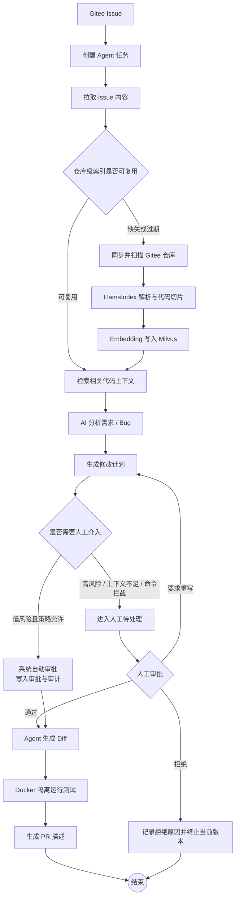
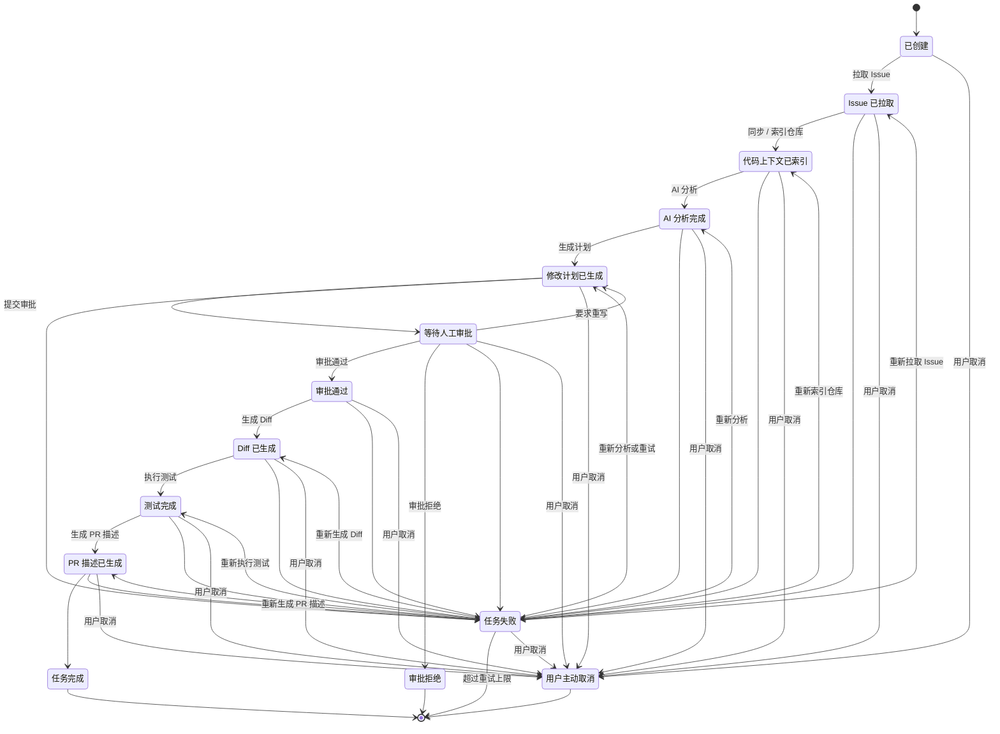
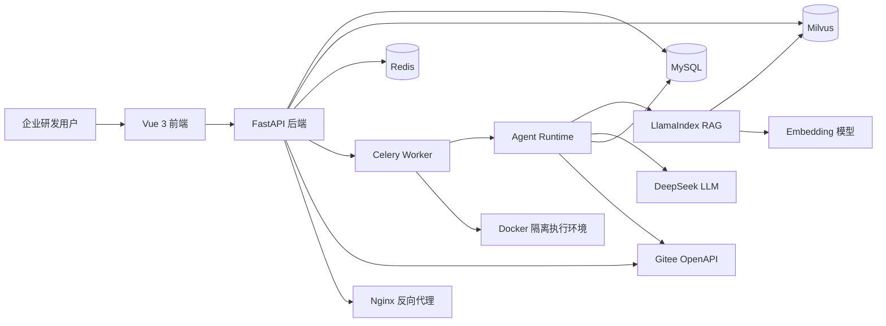
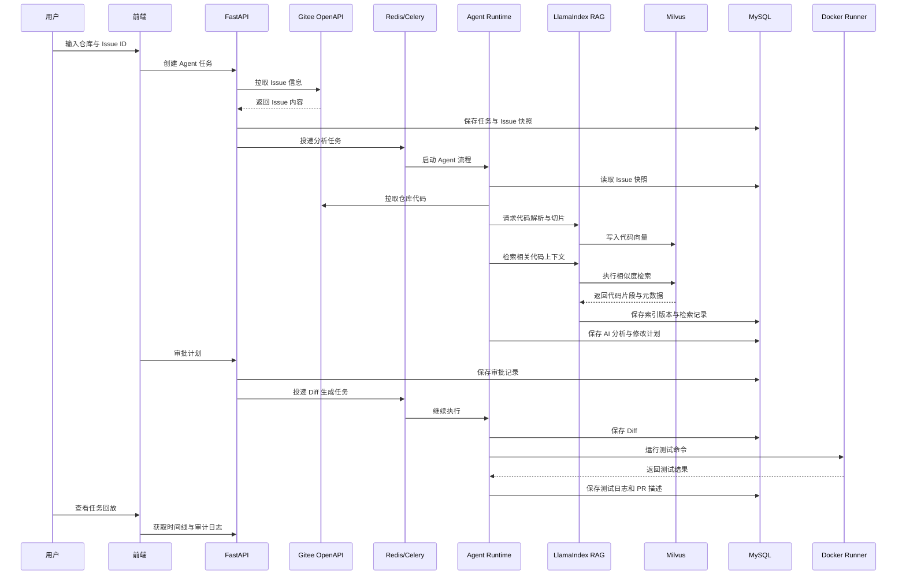
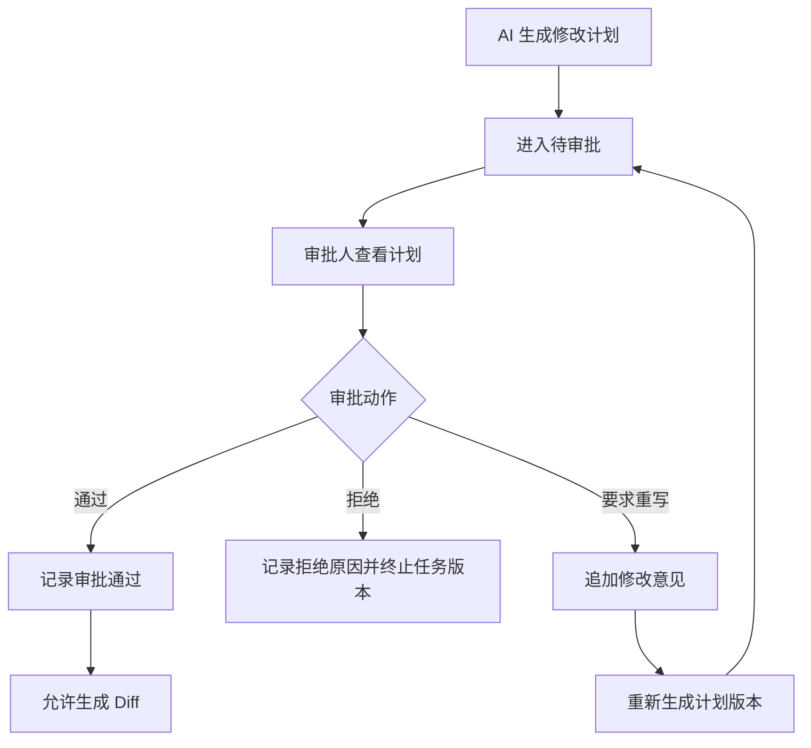
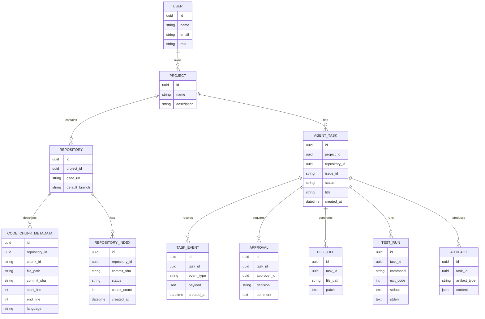

# MVP 流程与 Mermaid 图

## 1. 产品闭环流程

流程默认由系统自动推进。用户只在以下节点介入：高风险审批、需要补充业务信息、授权过期、索引或检索失败、命令被安全策略拦截、并发冲突。低风险且通过安全策略检查的任务可以按项目策略自动通过审批，并继续生成 Diff、执行测试和生成 PR 描述。

前端联调口径：

- 工作台默认展示人工待处理项和自动化收益，不要求用户确认每个自动节点。
- 任务详情页只保留一个主动作，由后端 `next_action` 决定。
- 审批中心默认优先展示高风险与阻塞任务，低风险任务进入可批量或自动通过区域。
- 失败任务必须返回 `failed_node`、`failed_reason`、`retry_count` 和 `next_action=retry` 或 `update_token`。

## 2. Agent 执行状态机

## 3. 系统上下文图

## 4. 任务时序图

## 5. 审批流程图

说明：拒绝终止当前任务版本（`REJECTED` 终态），继续推进需新建任务版本；“要求重写”只在 `WAITING_APPROVAL` 状态下可用，生成新计划版本后重新进入待审批。

## 6. 数据关系草图

