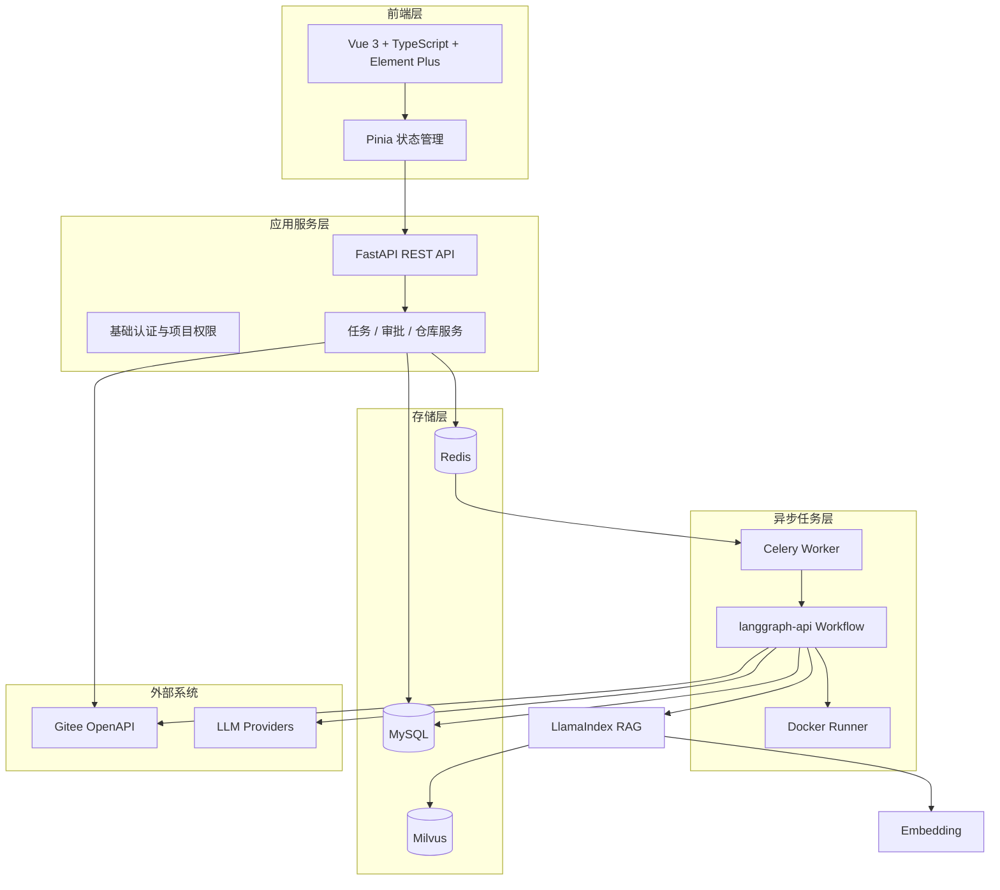
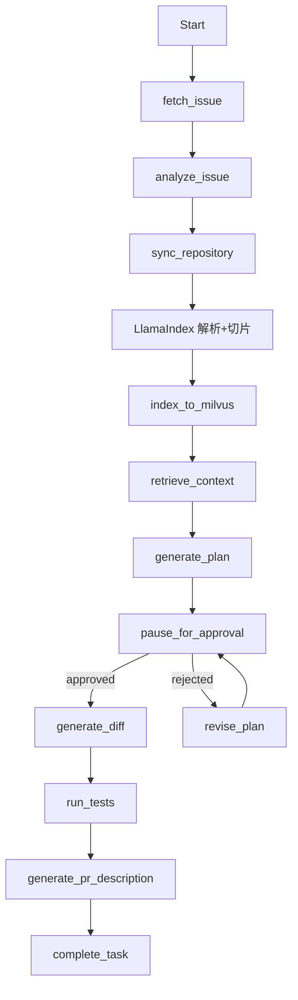
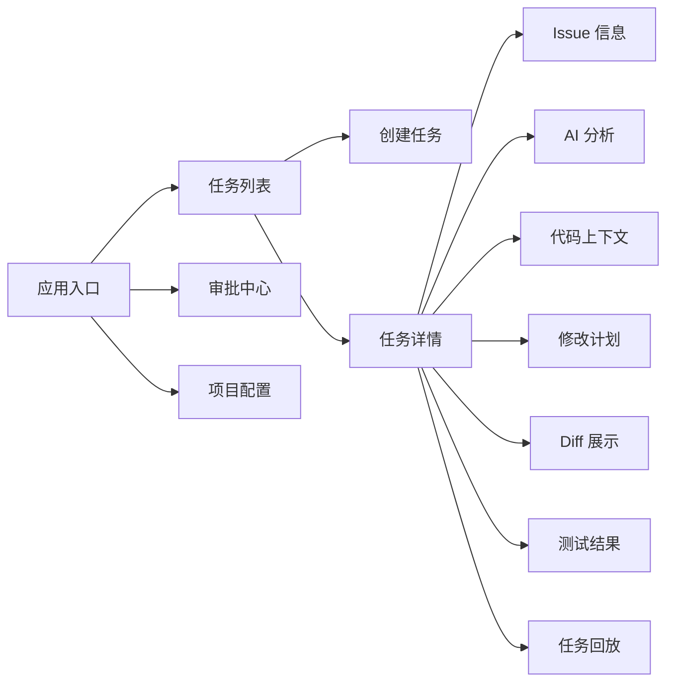

# 技术架构方案

## 1. 总体架构

MVP 采用前后端分离、后台任务队列、langgraph-api + LangChain + DeepAgents Agent 编排和 LlamaIndex + Milvus 代码 RAG 的架构。

当前代码落地已覆盖：

- `backend/app/retrieval/llamaindex_backend.py`：LlamaIndex + Milvus 检索适配
- `backend/app/agent/workflow.py`：LangGraph 工作流与 DeepAgents 入口
- `backend/app/db/*`：SQLAlchemy 持久化层
- `backend/app/workers/*`：Celery 任务入口

技术职责划分：

- Vue 3：负责任务列表、任务详情、修改计划、审批、Diff 和任务回放等管理台页面。
- FastAPI：负责 REST API、认证鉴权、业务规则、任务状态管理和配置管理。
- SQLAlchemy（默认 SQLite，生产可切 MySQL）：负责保存用户、项目、仓库、任务、计划、审批、事件、Diff、测试结果、团队请求和索引元数据。
  - 落地方式：SQLAlchemy 为唯一真源，模块级 dict 只是「启动缓存 + 写透」（P0，见 `docs/project-development/21-business-persistence.md`）；
  - **读路径口径（路径 A）**：持久化开启（USE_SQLALCHEMY=true，生产）时核心可变业务读（任务/项目/仓库/团队需求/审批队列）经统一读层
    `app/db/reads.py` 从 **DB 真源**（`load_*` 重建 pydantic）返回；main.py 不直接碰 dict；dict 仅本地/测试（持久化关闭）分支兜底。
    已实证「dict 退位」：清空 `TASKS/PROJECTS/TEAM_REQUESTS` 后，`GET /api/tasks /projects /team/requests` 仍从 DB 读出
    （见 `docs/project-development/27-read-convergence-and-mysql.md` 与 `tests/test_reads_layer.py::test_core_reads_are_db_backed_after_dict_clear`）。
  - 本地默认 `sqlite:///.data/app.db`（开发/测试）；**team/production 必须以 MySQL 承载**：`DATABASE_URL` 未配 mysql 或误给 sqlite 时启动报错，不静默回退（`scripts/init_mysql.py` 建库建表，`scripts/migrate.py` 或 alembic 建表）。
  - **本地凭据**：可放 `<backend>/.env`（git-ignored，`app/core/runtime_config.py` 启动时零依赖加载，仅当环境变量未设置时填充）——例如 `LLM_API_KEY / LLM_BASE_URL / LLM_MODEL / LLM_PROVIDER`、`ZHIPU_API_KEY / ZHIPU_MODEL / ZHIPU_BASE_URL`、`MODEL_MOCK_FALLBACK=false`。真实环境覆盖可设 `ENV_FILE=<path>`。
- Redis + Celery（可选）：负责仓库同步、索引构建、Embedding、Agent 长任务和测试任务，避免阻塞 HTTP 请求。
  - 落地方式：`app/workers/tasks.py` + `app/workers/dispatch.py::enqueue_or_run`（P1a）；
  - 未配置 Redis 时**仅允许测试/本地 eager 降级**，响应/日志明确标记 `mode="eager(test)"`；生产接真实 broker。
  - **生产/团队版必须 `USE_CELERY=true` + `CELERY_BROKER_URL`/`CELERY_RESULT_BACKEND` 真实 Redis + 启动 Worker**；
    多 Worker 配 `REDIS_URL` 作分布式锁；缺 broker 时启动强告警/报错，不静默 eager。
  - 失败重试语义：`run_agent` 等任务非最后尝试不置终态 FAILED（保留可恢复态供重试续跑），仅最后尝试才 `mark_task_failed`+审计
    （见 `docs/project-development/22-celery-async.md` 专项）。
  - **Worker 独立 restore**：worker 进程不经 FastAPI lifespan，`app/workers/runtime.py` 在 worker 启动（`on_after_configure→_worker_init`）
    与每个任务开头 `ensure_worker_runtime_ready()`（幂等、失败不硬崩）自行 `create_schema + restore_from_db`，运行时缓存由 DB 重灌；
    真实消费实体不再 missing/404（见 `tests/test_celery_worker_runtime.py`）。
- LangGraph + LangChain + DeepAgents：负责 Agent 状态流转、节点编排、审批暂停/恢复、失败分流（P1b，`app/agent/workflow.py`）。
  - **DeepAgents 真实进入主链路（非死代码）**：配置 LLM 时 `ai_analyze` 节点经 `_deep_agent→_analyze_with_agent→agent.invoke()` 真实调用深度代理（provider=deepagents）；无 LLM / 代理输出非法 / 代理异常 → 显式回退 `mvp-rule-based` 并写 `[agent] ...回退规则分析` 日志（可观测、可测）。见 `docs/project-development/23`，测试 `tests/test_workflow_graph.py`。
- LlamaIndex：负责 CodeFile→Document 的**代码解析 + 切片（CodeSplitter/SentenceSplitter → TextNode）**、Embedding 接入（Adapter）、Retriever 编排；`CodeMetadataAdapter` 回填 start_line/end_line/symbol_name/chunk_index/checksum 等业务元数据。
- Milvus：负责保存代码向量并执行相似度检索，不承担业务事务数据。
  - 落地方式：Milvus 为生产首选（`USE_MILVUS`）；不可用且 `RAG_MOCK_FALLBACK=true`（测试/本地）时显式降级为内存/关键词，
    结果 `source` 诚实标注为 `manual` 并告警，不再谎报 `milvus`；生产 `RAG_MOCK_FALLBACK=false` 时失败即抛错（P2a）。
- DeepSeek：根据 Issue 和 RAG 上下文生成需求分析、修改计划和 PR 描述。
- Docker Runner：在隔离环境中执行代码修改和测试命令。

技术边界可以概括为：

| 处理环节 | 主要技术 | 处理内容 |
| --- | --- | --- |
| 用户操作 | Vue 3 + Pinia + Element Plus | 展示任务状态、计划、审批、Diff、测试和回放 |
| 接口与业务规则 | FastAPI + SQLAlchemy | 参数校验、鉴权、任务状态、审批门禁和数据事务 |
| 长任务调度 | Redis + Celery | 仓库同步、索引构建、Agent 执行和测试任务 |
| Agent 流程 | langgraph-api + LangChain + DeepAgents | 节点编排、状态持久化、审批暂停、重试和恢复 |
| 知识处理 | LlamaIndex + CodeMetadataAdapter | Document 解析+切片(CodeSplitter/Sentence)、Embedding、Retriever；业务元数据由 adapter 回填 |
| 向量检索 | Embedding + Milvus | 生成向量、保存向量并召回相关代码片段 |
| 代码生成 | DeepSeek | 需求分析、修改计划、修复建议和 PR 描述 |
| 代码执行 | Docker Runner | 在隔离工作区中修改代码和运行测试 |
| 业务与审计 | MySQL | 保存业务数据、事件、产物、来源和索引版本 |

## 2. 后端模块划分

| 模块 | 职责 |
| --- | --- |
| auth | 用户、角色、基础鉴权 |
| projects | 项目和仓库配置 |
| gitee | Gitee OpenAPI 封装 |
| tasks | Agent 任务生命周期（含计划审批门禁与状态流转） |
| plans | 修改计划版本管理与审批动作：生成、重写、通过、拒绝，风险重算与门禁守卫 |
| agent | langgraph-api + LangChain + DeepAgents 节点和状态定义 |
| retrieval | LlamaIndex 解析+切片(Document→CodeSplitter/Sentence) + Embedding + Retriever；CodeMetadataAdapter 回填元数据 |
| vector_store | Milvus Collection、向量写入、过滤和相似度检索 |
| model_clients | 真实模型客户端抽象：DeepSeek 文本生成、智谱 Embedding，统一超时/重试/错误封装，绝不泄漏 API Key |
| services | Embedding 服务（真实/兜底切换、相似度与关键词重合度）、AI 分析服务（DeepSeek 叙述字段 + 规则兜底）、修改计划服务（DeepSeek 结构化草稿 + 规则兜底，风险重算/门禁判定由规则完成，见 services/plan_service.py） |
| diffs | Diff 存储与展示数据 |
| runner | Docker 隔离执行测试（seam：MVP 默认 mocked_runner，`TEST_RUNNER_MODE=docker` 走真实 Docker） |
| pr_description | PR 描述生成：以最新成功 Diff、测试结论与计划为输入组装六段式描述，版本化记录（见 `backend/app/services/pr_description_service.py`），生成动作不改变任务状态 |
| audit | 事件日志、任务回放 |

MVP 的测试执行采用可注入 Runner seam（见 `backend/app/services/test_runner.py`）：入口先做危险命令规则检查，命中即落 `skipped` 记录并拦截；真实执行在临时目录中挂载到容器（`docker run --rm -v <workdir>:/workspace`）完成，带 120s 超时与目录清理。MVP 默认 `mocked_runner`（演示 exit 0），测试与文档一致，不伪造 Docker 执行成功。

## 3. RAG 与 Agent Runtime 节点设计

关键点：

- `pause_for_approval` 是 MVP 的核心安全门。
- 每个节点都写入 `task_events`，支持回放。
- Agent 状态需要可持久化，避免 Worker 中断后任务丢失。
- 计划、Diff、测试结果和 PR 描述都作为任务产物保存。

## 4. 数据库核心表

| 表 | 说明 |
| --- | --- |
| users | 用户 |
| projects | 项目 |
| repositories | Gitee 仓库配置 |
| tasks | Agent 任务主表 |
| task_events | 任务事件日志 |
| code_chunks | 代码切片元数据，向量存储在 Milvus |
| repository_indexes | 仓库索引版本与处理状态 |
| retrieval_records | 每次检索使用的代码片段记录 |
| plans | 修改计划（版本化；审批通过落库 `approved_*` 与 `risk_adjust_from/reason`，审批动作写入任务事件） |
| diffs | Diff 产物（files 以 JSON 列保存 + pr_description_draft 字段） |
| test_runs | 测试执行记录 |
| pr_descriptions | PR 描述版本；AI 分析存 `tasks.analysis`(JSON) |

> 表名为源码 ORM 物理名（与 docs/09 一致）；历史设计名 `agent_tasks/diff_files/artifacts/code_chunks_metadata` 已废弃、不再使用。

## 5. API 草案

| 方法 | 路径 | 说明 |
| --- | --- | --- |
| POST | /api/tasks | 创建 Agent 任务 |
| GET | /api/tasks | 任务列表 |
| GET | /api/tasks/{task_id} | 任务详情 |
| GET | /api/tasks/{task_id}/events | 任务回放事件 |
| POST | /api/tasks/{task_id}/plans | 生成修改计划（ANALYZED 后，生成即提交审批） |
| GET | /api/tasks/{task_id}/plans | 修改计划列表（按版本倒序） |
| POST | /api/tasks/{task_id}/plans/{plan_id}/approve | 审批通过（可调整风险等级，需填原因） |
| POST | /api/tasks/{task_id}/plans/{plan_id}/reject | 拒绝计划（任务失败，可重试重建版本） |
| POST | /api/tasks/{task_id}/plans/{plan_id}/rewrite | 要求重写（生成新版本，旧版 SUPERSEDED） |
| GET | /api/approvals/pending | 审批中心待审批队列（admin 全量 / approver 指派范围 / lead 空） |
| GET | /api/approvals/candidates | 审批人候选列表（admin / approver） |
| POST | /api/tasks/{task_id}/approval-owner | 指派 / 改派任务审批人（admin / lead，写审计事件） |
| POST | /api/tasks/{task_id}/diffs/generate | 生成最新审批通过计划的 Diff（默认演示兜底；scratch 白名单可产**真实变更** `e2e_scratch_real_change`——真实 Diff 已在 scratch 仓验证，见 docs/29） |
| GET | /api/tasks/{task_id}/diffs | 获取 Diff |
| GET | /api/tasks/{task_id}/diffs/{file_id} | 获取单个 Diff 文件 |
| GET | /api/tasks/{task_id}/tests | 获取测试结果（按开始时间倒序） |
| GET | /api/tasks/{task_id}/tests/{test_id} | 获取单条测试记录 |
| POST | /api/tasks/{task_id}/tests/run | 执行测试（DIFF_GENERATED / TEST_FAILED，危险命令拦截） |
| GET | /api/tasks/{task_id}/pr-description | PR 描述总览（状态 + 当前版 + 是否过期 + 全部版本） |
| POST | /api/tasks/{task_id}/pr-description/generate | 生成 / 重新生成 PR 描述（追加新版本，TESTED / TEST_FAILED） |
| GET | /api/tasks/{task_id}/pr-description/versions/{version_id} | 单个历史版本 |
| POST | /api/repositories/{repository_id}/index | 创建 RAG 索引任务 |
| POST | /api/repositories/{repository_id}/index/rebuild | 重建 RAG 索引任务 |
| GET | /api/repositories/{repository_id}/indexes | 查看仓库索引历史与状态 |
| GET | /api/repositories/{repository_id}/indexes/{index_id} | 查看单个索引详情 |
| POST | /api/repositories/{repository_id}/indexes/{index_id}/retry | 重试失败状态的索引任务 |
| GET | /api/tasks/{task_id}/contexts | 获取 RAG 检索上下文 |
| POST | /api/tasks/{task_id}/contexts/manual | 手动指定文件补充上下文 |

## 6. 前端信息架构

## 7. 安全与审计原则

- Agent 不能绕过人工审批直接改代码。
- 任务每一步都必须写入事件日志。
- Gitee Token 加密存储，MVP 可先通过环境变量或服务端配置注入。
- Docker Runner 限制 CPU、内存、网络和工作目录。
- 测试执行和代码修改运行在隔离目录中。
- 审批动作与审计事件不可被普通用户修改。

### 7.1 审批权限模型

审批相关能力以权限码表达，后端在 `main.py` 的 `ROLE_PERMISSIONS` 中按角色收敛（前端 `stores/auth.ts` 镜像同一张表）：

| 权限码 | 能力 | admin | approver | lead | developer |
| --- | --- | --- | --- | --- | --- |
| `approval:view` | 查看审批中心待审批队列与任务详情计划 | 有 | 有 | 有 | - |
| `approval:manage` | 对计划执行通过 / 拒绝 / 要求重写 | 有（全量任务） | 有（仅指派给自己的任务） | - | - |
| `approval:assign` | 指派 / 改派任务审批人 | 有 | - | 有 | - |

规则说明：

- **动作绑定指派审批人**：approve / reject / rewrite 前校验操作者 == 任务 `approval_owner_id`，不一致返回 403；管理员（admin）豁免，作为越权兜底。审批中心列表按同样语义过滤：admin 全量、approver 仅自己指派的任务、lead 恒空。
- **审批人候选收敛**：仓库默认审批人与指派目标只允许 admin / approver 角色（`approval_candidate` 过滤），lead 与 developer 不能作为审批人，避免「指派了却无 manage 无法审批」的死锁。
- **仓库默认审批人可空**（`approval_owner_id: str | None`）：任务创建时继承，为空时任务在生成修改计划前必须由 admin / lead 通过 `POST /api/tasks/{task_id}/approval-owner` 指派，指派 / 改派均写 `APPROVAL_OWNER_CHANGED` 审计事件。
- **审批记录字段落库计划**：通过时写 `approved_by_id / approved_by_name / approved_at / approval_comment`，风险调整先记 `risk_adjust_from` 再覆盖 `risk_level`，配合任务事件构成不可修改的审计轨迹。

## 8. MVP 技术取舍

- 第一版先支持单仓库、单 Issue、单 Agent 流程。
- 第一版采用 LlamaIndex + Milvus 实现代码 RAG，MySQL 只保存索引状态、代码切片元数据和检索记录。
- 第一版先实现向量语义检索，混合检索和重排序放到企业化阶段。
- 第一版 PR 可先生成描述和 Diff，不强制自动创建 Pull Request。
- 第一版认证可以使用简化 JWT，后续再接企业 SSO。
- 第一版模型接入保留 Provider 抽象，默认接入 DeepSeek；Embedding 模型单独抽象，避免与 LLM 模型绑定。
