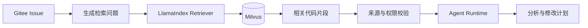
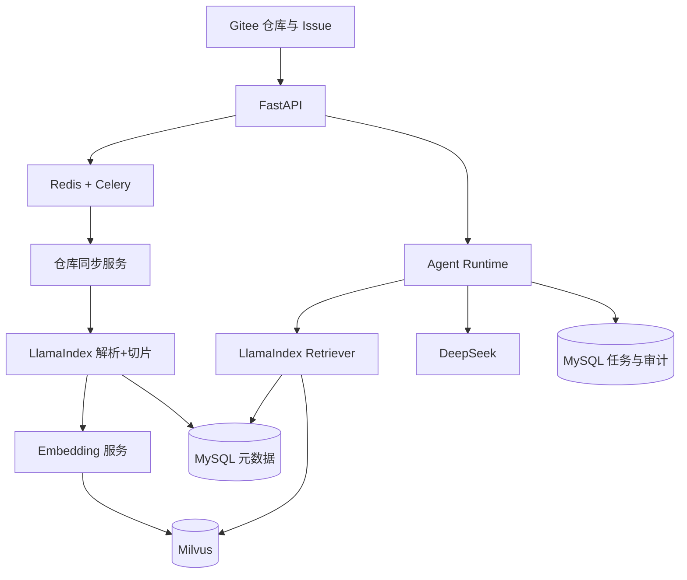
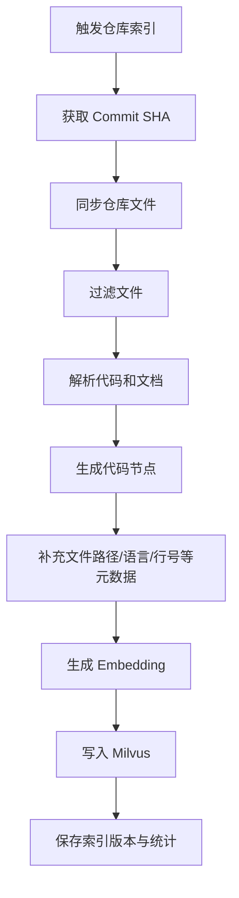
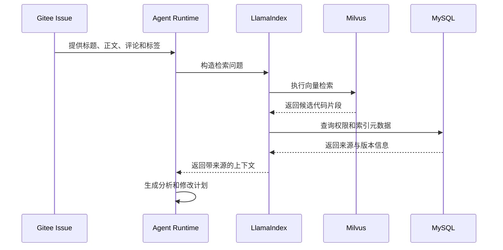
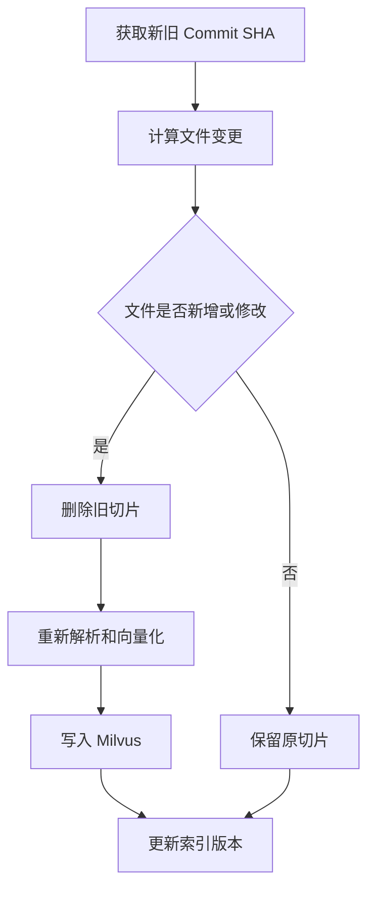

# RAG 知识库设计文档

## 1. 文档目标

本文档定义平台中代码 RAG（Retrieval-Augmented Generation，检索增强生成）模块的职责、数据流程、技术选型和开发边界。

RAG 模块的目标不是让模型直接读取整个仓库，而是：

1. 同步指定版本的 Gitee 仓库代码。
2. 过滤不应进入知识库的文件。
3. 用 LlamaIndex 解析和切分代码（Document → CodeSplitter/SentenceSplitter → TextNode），项目用 CodeMetadataAdapter 回填业务元数据。
4. 为代码片段生成 Embedding。
5. 将向量和检索字段写入 Milvus。
6. 根据 Gitee Issue 检索相关文件、函数和代码片段。
7. 将经过权限和来源校验的上下文交给 Agent Runtime。

核心原则：

> LlamaIndex 负责 RAG 数据处理和检索编排，Milvus 负责向量存储与相似度检索，Agent Runtime 负责任务状态和业务流程。

## 1.1 当前落地状态

当前代码已经落地到：

- `backend/app/retrieval/llamaindex_backend.py`
- `backend/app/main.py` 的索引 / 检索主链路
- `backend/app/models/orm.py` 与 `backend/app/db/*` 的检索持久化

实现口径：

- Milvus 为生产首选（`USE_MILVUS`）；生产/团队形态 `MILVUS_URI=http://127.0.0.1:19530`（**Standalone v2.3.10 已验证**，Attu 可见），本地开发才用 Milvus Lite（.data/milvus）。
- **parse/chunk 归属（PRD 落地）**：**LlamaIndex 已覆盖 解析 + 切片 + Embedding + Retriever**——`retrieval/parsing.py` 把 CodeFile 转为 `llama_index.core.Document`（metadata: repository_id/index_id/file_path/language/commit_sha）→
  `CodeSplitter`（代码，tree-sitter）或 `SentenceSplitter`（markdown/文本）→ `TextNode`；`CodeMetadataAdapter` 负责**业务元数据增强**（切片后回填 `start_line/end_line/symbol_name/chunk_index/checksum`，拼装 CodeChunkRecord）。
  项目保留 metadata adapter 处理业务元数据，不丢代码感知能力。
- **Milvus 真实主路径已验证（2026-09-07）**：本机可用 Milvus Lite 时，`build_vector_store` 构造出 `MilvusVectorStore`，
  向量写入→召回返回 `source=milvus` + 真实余弦得分排序（`tests/test_rag_milvus_realtime.py` 实跑）。检索主路径先走 Milvus
  （`main.run_task_retrieval→query_index_from_chunks`），内存 `CODE_VECTOR_STORE`/关键词仅作显式降级兜底。
- **跨进程/重启后查询须先 load 已存在 collection**：`query_index_from_chunks` 在构建
  `VectorStoreIndex.from_vector_store` 前，对 `backend_milvus` 调用 `ensure_milvus_collection_loaded(vector_store, collection)`
  （幂等、容错级联旧 `client`/`_milvus_client`/`pymilvus.utility`），避免「collection in state released」。
  跨进程写入→单独进程查询不再报 released、稳定返回 `source=milvus`（`test_cross_process_query_existing_collection`）。
- **降级显式标注（P2a）**：Milvus 不可用且 `RAG_MOCK_FALLBACK=true`（测试/本地）时，
  显式降级为内存 `SimpleVectorStore` 或关键词检索，检索结果 `source` 诚实标注为 `manual`
  并告警；生产设置 `RAG_MOCK_FALLBACK=false` 时 Milvus 失败直接抛错，**不再静默降级、不再谎报 milvus**。
- LlamaIndex 负责节点 / Retriever 编排，业务状态仍由平台任务状态机管理。

## 2. RAG 在项目中的作用

如果不使用 RAG，Agent 只能依赖用户输入或一次性读取有限文件，容易出现：

- 找不到真正相关的代码；
- 把无关文件放入上下文；
- 超出模型上下文窗口；
- 消耗过多 Token；
- 无法说明答案来自哪些文件。

加入代码 RAG 后，Agent 可以先根据 Issue 检索与任务相关的代码，再基于检索结果生成分析和修改计划。



## 3. 技术栈与职责

| 技术 | 在本项目中的职责 | 不负责的内容 |
| --- | --- | --- |
| LlamaIndex | 节点化（chunks→TextNode）、索引（VectorStoreIndex）、Embedding 接入（Adapter）、Retriever 编排、检索结果封装；**解析+切片 = Document → CodeSplitter/SentenceSplitter → TextNode，`CodeMetadataAdapter` 回填业务元数据** | 不负责任务状态机和审批流程 |
| Milvus | 保存代码片段向量，按照相似度检索候选代码 | 不负责用户、任务、审批等业务数据 |
| MySQL | 保存用户、项目、仓库、索引任务、检索记录和审计数据 | 不保存主要代码向量 |
| Agent Runtime | 编排 Issue 分析、RAG 检索、计划生成、审批暂停、执行和重试 | 不替代向量数据库 |
| Embedding 模型 | 将 Issue 和代码片段转换为向量 | 不生成最终代码修改计划 |
| DeepSeek | 根据 Issue 和检索上下文生成分析、计划和 PR 描述 | 不直接管理代码索引 |
| FastAPI | 提供索引、检索、任务和管理接口 | 不在 HTTP 请求中运行长时间任务 |
| Redis + Celery | 执行仓库同步、索引构建、批量 Embedding 和异步检索任务 | 不作为持久化业务数据库 |

## 4. 总体架构



## 5. 代码知识库数据流程

### 5.1 仓库索引流程



### 5.2 Issue 检索流程



## 6. 代码切片策略

### 6.1 文件过滤

默认不进入代码知识库：

- `.env`、`.env.*`
- 私钥、证书和 Token 文件
- `node_modules`
- `dist`、`build`、`.git`
- 二进制文件
- 大于设定大小的单个文件
- 依赖缓存和构建产物

### 6.2 切片优先级

优先采用语义切片，无法解析时再降级：

1. 类和函数级切片。
2. Markdown 标题和段落级切片。
3. 配置文件按键值区块切片。
4. 普通文本按固定行数和重叠窗口切片。

每个切片应保留：

- 文件路径
- 起止行号
- 编程语言
- 符号名称
- 所属模块
- 分支名称
- Commit SHA
- 代码内容摘要

### 6.3 切片大小建议

MVP 阶段可以采用以下可配置参数：

```text
目标切片长度：300-800 tokens
相邻切片重叠：50-100 tokens
单次检索 Top-K：默认 5
注入 Agent 的最大代码片段数：不超过 8 个
```

这些参数不是固定标准，应通过实际仓库和任务样本进行调整。

## 7. Milvus Collection 设计

建议 MVP 建立一个按项目或环境隔离的代码向量 Collection，向量数据和业务数据分开存储。

### 7.1 字段设计

| 字段 | 类型 | 说明 |
| --- | --- | --- |
| chunk_id | VarChar | 代码切片唯一标识 |
| repository_id | VarChar | 仓库标识 |
| project_id | VarChar | 项目标识 |
| commit_sha | VarChar | 代码版本 |
| file_path | VarChar | 文件路径 |
| language | VarChar | 编程语言 |
| symbol_name | VarChar | 类名、函数名或标题 |
| start_line | Int64 | 起始行号 |
| end_line | Int64 | 结束行号 |
| embedding | FloatVector | 代码向量 |

代码正文建议保存于 MySQL 或对象存储，Milvus 只保存必要元数据和向量；如果为了检索展示需要保存正文，也必须限制长度并做好权限控制。

### 7.2 检索过滤

检索时至少按以下条件过滤：

- `project_id`
- `repository_id`
- `commit_sha` 或有效索引版本
- 用户可访问的项目范围

## 8. 检索策略

### 8.1 MVP 检索

MVP 先实现向量语义检索：

```text
Issue 标题 + Issue 正文
→ Query Embedding
→ Milvus Top-K
→ 元数据过滤
→ 来源去重
→ 上下文拼接
```

Embedding 提供商（MVP）：

- 配置 `ZHIPU_API_KEY` 时使用智谱 `embedding-3`（2048 维），检索用余弦相似度。
- 未配置 Key 时回退本地 token-hash（64 维），检索降级为关键词重合度，保证无外部依赖时仍可跑通闭环。
- 向量维度和相似度算法由服务层按是否已配置统一切换，调用方与 API 响应结构保持不变。

### 8.2 当前检索增强

团队版已经落地：

- BM25 关键词检索与 Milvus 向量检索并行执行；
- 使用 RRF 融合两路候选，提升关键词命中和语义命中的互补性；
- 对候选结果按 `chunk_id`、文件和版本做去重；
- 可选 Query Expansion / Multi-Query；
- 可选 LLM rerank，且只允许重排已有候选 `chunk_id`，不能凭空生成来源；
- 通过 `RAG_RETRIEVAL_MODE`、`RAG_QUERY_EXPANSION`、`RAG_RERANK_ENABLED` 控制灰度。

当前团队版默认 `hybrid + rerank`，Query Expansion 默认关闭。复杂的多阶段 `MetadataFilters` 仍未作为默认主链路；当前元数据主要承担来源展示、仓库/版本隔离和检索结果校验。

> **默认值口径（以 `deploy/env/*.env.example` 为准，2026-09-24 核对）**
>
> | 环境 | `RAG_RETRIEVAL_MODE` | `RAG_QUERY_EXPANSION` | `RAG_RERANK_ENABLED` |
> | --- | --- | --- | --- |
> | MVP（`mvp.env.example`） | `vector` | `false` | `false` |
> | 团队版（`team.env.example`） | `hybrid` | `false` | `true` |
> | 企业版（`enterprise.env.example`） | `hybrid` | `false` | **`false`** |
>
> 企业版 rerank **安全默认关闭**（`docs/project-development/103-enterprise-e3-03-rag-rerank.md` §6）。
> 企业实测最优 provider 是 `cross_encoder`，但 `RAG_CROSS_ENCODER_ENABLED` 默认同为 `false`，属已登记的可选增强项，**不等同于生产已启用**。

### 8.3 检索结果格式

```json
{
  "chunk_id": "chunk_001",
  "file_path": "src/auth/login.py",
  "start_line": 20,
  "end_line": 68,
  "language": "python",
  "symbol_name": "login",
  "content": "...",
  "score": 0.87,
  "commit_sha": "abc123",
  "source": "milvus"
}
```

Agent 使用的每个代码片段都应带来源，页面中可以展示文件路径、行号、Commit 和相似度。

## 9. 增量索引

仓库代码更新后，不建议每次都全量重建：



MVP 可以先实现全量索引和基础版本记录，企业版再补基于 Commit 的增量索引。

## 10. 索引状态

仓库索引至少包含以下状态：

```text
PENDING
SYNCING
PARSING
EMBEDDING
STORING
COMPLETED
FAILED
```

页面需要展示：

- 当前状态
- 当前 Commit
- 已处理文件数
- 已生成切片数
- 已写入向量数
- 失败原因
- 最近更新时间

## 11. RAG 安全边界

- 索引前过滤密钥、证书、环境变量和敏感配置。
- 检索时绑定项目、仓库和 Commit 版本。
- 不允许普通用户读取无权限仓库的向量。
- README、Issue 和代码注释都可能包含提示词注入内容，不能直接视为系统指令。
- Agent 只能把检索内容作为参考上下文，不能让仓库文本覆盖系统安全规则。
- RAG 返回结果必须展示来源，不能只返回无出处的自然语言结论。
- 索引删除和重建需要记录操作人和操作时间。

## 12. RAG 质量评估

### 12.1 评估指标

| 指标 | 含义 |
| --- | --- |
| Recall@K | 前 K 个结果中是否包含真正相关文件 |
| Precision@K | 前 K 个结果中真正相关代码的占比 |
| MRR | 正确结果在检索列表中的排序位置 |
| NDCG@K | 同时考虑相关性与排序位置的归一化指标 |
| 来源完整率 | Agent 使用的代码是否都能追溯到文件和行号 |
| 无关召回率 | 返回无关代码的比例 |
| 上下文有效率 | 注入模型的代码片段中真正被使用的比例 |
| 任务成功率 | 使用 RAG 后任务分析或计划是否完成 |

### 12.2 评估样本

先准备 10-20 个带有已知相关文件的 Issue，记录：

- Issue 内容
- 预期相关文件
- Top-K 检索结果
- Agent 最终引用文件
- 人工评价

当前落地：

- 版本化评测集：`backend/evaluation/rag_eval_cases.json`；真实评测集应绑定 `repository_id + index_id + commit_sha`，避免跨仓库或跨版本误用标注。
- 指标模块：`backend/app/retrieval/evaluation.py`
- 执行脚本：`python backend/scripts/evaluate_rag.py --repository-id <id> --index-id <id> --mode hybrid`；可通过 `--query-expansion`、`--rerank` 分别控制实验变量。
- 输出指标：`Recall@K`、`Precision@K`、`MRR`、`NDCG@K`，以及逐样本首个相关结果的排名。

当前灰度策略：

- 本地/MVP：保留 `vector` 默认值，避免演示环境因额外模型调用产生不可控时延。
- 团队模板（`deploy/env/team.env.example`）：`RAG_RETRIEVAL_MODE=hybrid` + `RAG_RERANK_ENABLED=true`，`Query Expansion` 保持关闭。
- 企业模板（`deploy/env/enterprise.env.example`）：`RAG_RETRIEVAL_MODE=hybrid` + **`RAG_RERANK_ENABLED=false`**（安全默认关）+ `Query Expansion` 关闭。
  → **「团队/企业模板统一启用 hybrid + rerank」的旧口径不成立**：企业版 rerank 默认关，见 §8.2 的默认值对照表。
- 每个目标仓库必须先用绑定 `repository_id + index_id + commit_sha` 的评测集复验；当前样本结果不能直接代表所有仓库。

## 13. 失败与降级策略

| 故障 | 处理 |
| --- | --- |
| Milvus 不可用 | 任务进入待重试状态，页面显示检索服务异常 |
| Embedding 失败 | 记录失败文件，允许重新索引 |
| 没有召回结果 | 返回明确提示，并允许用户手动指定文件 |
| 索引版本过期 | 先提示重新同步，不使用旧版本自动修改代码 |
| 代码片段过多 | 按得分、来源和文件数量进行裁剪 |

## 14. 开发阶段

### 阶段一：RAG 基础链路

- 接入 LlamaIndex。
- 接入 Milvus。
- 完成仓库文件过滤。
- 完成基础代码切片。
- 完成 Embedding 入库。

### 阶段二：检索与 Agent 集成

- 根据 Issue 生成检索 Query。
- 返回带来源的代码片段。
- 将上下文注入 Agent Runtime。
- 在任务回放中记录检索条件和结果。

### 阶段三：质量与企业化

- 增量索引。
- 混合检索与 RRF 融合（团队版已落地）。
- 候选集 rerank（团队版已落地，按仓库评测集灰度）。
- Query Expansion（已提供开关，默认关闭，需按目标仓库评测）。
- Recall@K、Precision@K、MRR、NDCG@K 离线评测集。
- 多项目隔离。
- 索引权限和审计。
