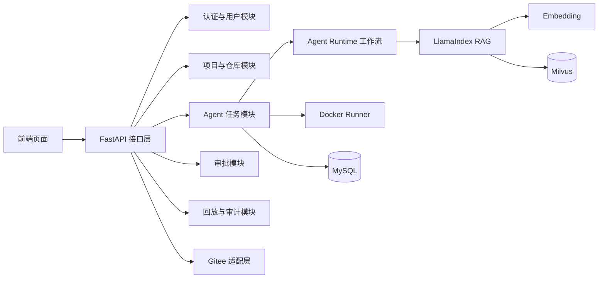
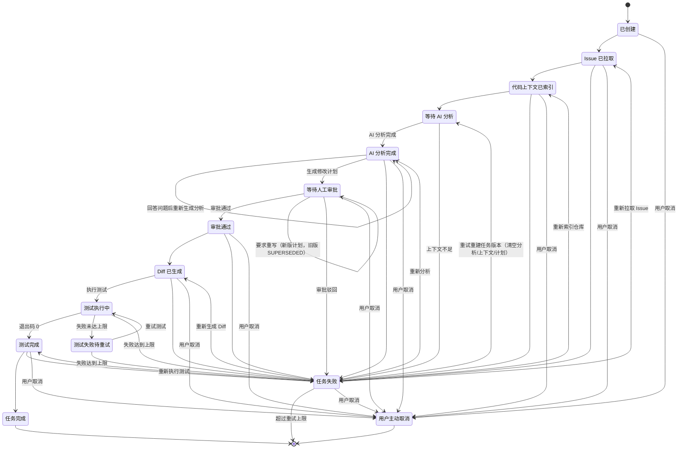
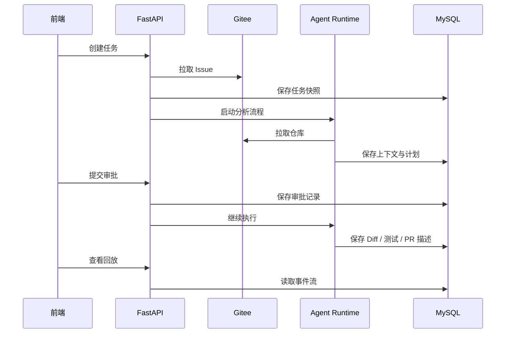

# API 设计文档

## 1. 文档目标

本文档定义司契（Siqi）MVP 的核心接口边界，重点覆盖：

- 用户与项目管理
- Gitee 仓库接入
- Issue 任务创建
- AI 分析与修改计划
- 审批、Diff、测试与 PR 描述
- 任务回放与审计

接口设计原则：

1. 统一响应结构。
2. 任务流转以状态为中心。
3. 高风险动作必须受控。
4. 所有关键过程都要可追踪。
5. MVP 先保证闭环，不追求接口过多。
6. 默认自动执行，只有例外进入人工处理。
7. 后端必须显式返回下一步动作和人工介入原因，前端不能靠状态字符串猜业务。

## 2. 接口分层



接口层只负责接收请求、校验权限和创建任务；代码索引、Embedding、Milvus 检索、Agent 长流程和测试执行均通过异步任务或工作流完成。这样可以避免请求超时，也能让任务状态和执行记录保持一致。

## 3. 通用约定

### 3.1 统一响应格式

```json
{
  "code": 0,
  "message": "success",
  "data": {}
}
```

约定：

- `code = 0` 表示成功。
- `code != 0` 表示失败。
- `message` 只写简短可读信息。
- `data` 承载实际业务数据。

### 3.2 分页格式

```json
{
  "list": [],
  "total": 0,
  "page": 1,
  "pageSize": 20
}
```

### 3.3 状态字段

任务状态统一使用字符串枚举，前后端完全一致：

```text
CREATED
ISSUE_FETCHED
CONTEXT_INDEXED
ANALYSIS_QUEUED
ANALYZED
WAITING_APPROVAL
APPROVED
DIFF_GENERATED
TEST_RUNNING
TEST_FAILED
TESTED
COMPLETED
FAILED
CANCELLED
```

说明：`PLAN_GENERATED` 与 `PR_DESC_GENERATED` 为历史枚举保留值：当前实现中生成计划直接进入 `WAITING_APPROVAL`（见 5.3）；「拒绝」不再是任务状态——审批驳回对应计划 `REJECTED` + 任务 `FAILED`（见 5.4）；PR 描述生成不改变任务状态，其生成状态为记录级（`PENDING/GENERATING/GENERATED/FAILED`，见 5.5.2）。历史取值仅用于兼容展示旧快照。

### 3.4 自动化与人工介入字段

任务、待办、详情和工作台接口都需要保留以下字段，方便前端把“自动跑”和“需要人处理”分开展示：

| 字段 | 取值示例 | 说明 |
| --- | --- | --- |
| `automation_state` | running / blocked / waiting_approval / completed | 当前自动化状态 |
| `manual_required` | true / false | 是否需要人工处理 |
| `manual_reason` | none / gitee_fetch_failed / duplicate_unfinished / command_blocked / auth_expired / high_risk / approval_required / context_missing / test_failed / answer_required / plan_rejected | 人工处理原因 |
| `next_action` | wait_analysis / wait_index / check_index / auto_queue_analysis / answer_analysis_question / auto_generate_plan / review_plan / auto_generate_diff / retry_or_cancel / view_replay | 前端主按钮应执行的推荐动作 |
| `risk_source` | pending_ai_analysis / ai_analysis / plan / plan_approval | 任务风险等级的来源：分析初判、计划重算或审批调整 |

约束：

- 自动化只推进到「计划生成」为止：阻塞问题确认、计划生成触发、审批与风险调整均必须由人操作。低风险任务的「一键通过」是审批人发起的批量操作（逐项调用计划审批接口，见 5.4），后端不存在自动绕过审批的实现。
- 高风险、授权过期、上下文不足、命令拦截和并发冲突必须进入人工待处理。
- 分析阶段存在阻塞待确认问题时，任务进入 `manual_required=true`、`manual_reason=answer_required`、`automation_state=blocked`、`next_action=answer_analysis_question`；阻塞问题全部回答并重新生成分析后，恢复 `manual_reason=none`、`automation_state=running`、`next_action=auto_generate_plan`。
- 生成修改计划后任务进入 `manual_reason=approval_required`、`next_action=review_plan`；审批通过后进入 `next_action=auto_generate_diff`（Diff 为后续模块）；审批驳回后任务 `FAILED`，通过重试重建任务版本重新流转。
- 前端只负责展示和触发动作，不能自行判断是否绕过审批门禁。

## 4. 接口分组

### 4.1 认证与用户

| 方法 | 路径 | 功能 |
| --- | --- | --- |
| POST | `/api/auth/login` | 登录 |
| POST | `/api/auth/logout` | 登出 |
| GET | `/api/auth/me` | 当前用户信息 |
| POST | `/api/auth/password/forgot` | 提交密码找回申请 |
| POST | `/api/auth/password/emergency-reset` | 管理员应急恢复密码 |
| GET | `/api/auth/password/requests` | 管理员查看找回申请 |
| POST | `/api/auth/password/requests/{request_id}/reset` | 管理员重置成员密码 |
| GET | `/api/users` | 用户列表 |
| GET | `/api/users/{user_id}` | 用户详情 |

说明：

- 登录成功后由后端签发 `httpOnly` Cookie 会话，前端不保存明文密码，也不把密码写入本地存储；
- `remember_me` 只影响会话时长，不改变认证方式；
- 前端首屏加载后需要先调用 `/api/auth/me` 恢复当前用户，再渲染权限和导航；
- 路由和按钮都应基于 `permissions` 过滤，避免未授权入口露出。

当前 MVP 会话约束：

| 项目 | 规则 |
| --- | --- |
| Cookie 名称 | `agent_session` |
| 普通会话 | 8 小时 |
| 保持登录 | 7 天 |
| Cookie 安全属性 | `HttpOnly`、`SameSite=Lax`、`Path=/` |
| 生产环境 | HTTPS 下设置 `Secure=true` |
| 未登录 | HTTP 401，前端跳转 `/login?redirect=原路径` |
| 已登录但无权限 | HTTP 403 或路由权限提示，不允许前端绕过 |

登录、刷新恢复、退出和角色权限的已实现记录见：

`docs/project-development/02-login-authentication.md`

密码恢复责任边界：

- 普通账号由本人提交企业邮箱申请，管理员负责设置临时密码并通过企业内部渠道通知；
- 管理员账号由部署负责人或平台安全联系人提供应急恢复码；
- 应急恢复码通过 `AUTH_RECOVERY_CODE` 配置，不通过前端展示，也不写入普通找回申请；
- 当前 MVP 不接入邮件自动发送，避免把未实现的邮件能力误当成可用承诺。

### 4.2 项目与仓库

| 方法 | 路径 | 功能 |
| --- | --- | --- |
| GET | `/api/projects` | 项目列表 |
| POST | `/api/projects` | 创建项目 |
| GET | `/api/projects/{project_id}` | 项目详情 |
| PUT | `/api/projects/{project_id}` | 更新项目 |
| GET | `/api/repositories` | 仓库列表 |
| POST | `/api/repositories` | 添加仓库 |
| PUT | `/api/repositories/{repository_id}` | 更新仓库配置 |
| GET | `/api/audit-events` | 查询审计事件 |
| POST | `/api/repositories/{repository_id}/index` | 创建 RAG 索引任务（同 Commit 已有运行中/完成索引时直接返回现有任务） |
| POST | `/api/repositories/{repository_id}/index/rebuild` | 重建 RAG 索引（始终创建新版本任务） |
| GET | `/api/repositories/{repository_id}/indexes` | 查看仓库索引历史与状态（Commit SHA、文件数、切片数、失败原因） |
| GET | `/api/repositories/{repository_id}/indexes/{index_id}` | 查看单个索引详情 |
| POST | `/api/repositories/{repository_id}/indexes/{index_id}/retry` | 重试失败状态的索引任务 |

当前已实现的项目与仓库配置约束：

- 新增和编辑项目、仓库配置需要 `project:manage` 权限；
- Gitee Token 只允许在请求中提交，后端放入私有密钥存储，接口响应不返回明文，只返回 `token_configured`、`token_alias`、`token_updated_at`；
- 仓库地址仅支持 Gitee HTTPS 或 SSH 地址；
- `test_command` 必须匹配 `command_whitelist`，避免前端绕过命令白名单；
- `approval_owner_id` 可空（未配置时任务在详情页手动指派）；提供时必须对应已有 admin / approver 用户（被指派人需具备审批权限），lead 与 developer 不可作为审批人；
- 保存项目或仓库配置后写入审计事件，可通过 `/api/audit-events?resource_type=repository` 查询。
- MVP 不提供独立的 `/api/repositories/sync` 接口；仓库代码快照同步由创建或重建索引流程内部触发。

仓库配置请求示例：

```json
{
  "project_id": "proj_payment",
  "name": "payment-service",
  "url": "https://gitee.com/company/payment-service.git",
  "default_branch": "main",
  "gitee_token": "只在请求中提交，响应不回显",
  "test_command": "pytest tests/ -q",
  "command_whitelist": ["pytest", "npm test", "pnpm test"],
  "approval_owner_id": "user_approver",
  "approval_mode": "single",
  "risk_threshold": "medium",
  "max_files": 12,
  "max_retries": 2,
  "blocked_paths": [".env", "infra/production/", "secrets/"]
}
```

### 4.3 Gitee Issue 与任务

| 方法 | 路径 | 功能 |
| --- | --- | --- |
| POST | `/api/tasks` | 创建 Agent 任务 |
| GET | `/api/tasks` | 任务列表，支持项目、状态、风险、关键字、时间和需处理筛选 |
| GET | `/api/tasks/{task_id}` | 任务详情 |
| POST | `/api/tasks/{task_id}/refresh-issue` | 重新拉取 Issue |
| GET | `/api/tasks/{task_id}/events` | 任务回放事件 |
| GET | `/api/tasks/{task_id}/timeline` | 任务时间线摘要 |
| GET | `/api/tasks/{task_id}/contexts` | 获取本次任务的 RAG 检索上下文（含空结果原因、新鲜度、Top-K/阈值元信息） |
| POST | `/api/tasks/{task_id}/contexts/manual` | 手动指定文件生成人工核对上下文 |
| POST | `/api/tasks/{task_id}/retry` | 从失败节点重试任务 |
| POST | `/api/tasks/{task_id}/cancel` | 取消任务 |
| GET | `/api/dashboard/automation-summary` | 获取自动化率、节省工时和人工介入统计 |

### 4.4 计划与审批

| 方法 | 路径 | 功能 |
| --- | --- | --- |
| POST | `/api/tasks/{task_id}/analysis/generate` | 生成 AI 分析 |
| GET | `/api/tasks/{task_id}/analysis` | 查看任务 AI 分析结果 |
| GET | `/api/tasks/{task_id}/analysis/questions` | 查看待确认问题 |
| POST | `/api/tasks/{task_id}/analysis/questions/{question_id}/answer` | 提交问题回答 |
| POST | `/api/tasks/{task_id}/plans` | 生成修改计划（任务处于 `ANALYZED`，生成即提交审批） |
| GET | `/api/tasks/{task_id}/plans` | 计划列表（按版本倒序） |
| GET | `/api/tasks/{task_id}/plans/{plan_id}` | 计划详情 |
| POST | `/api/tasks/{task_id}/plans/{plan_id}/rewrite` | 要求重写（生成新版本，旧版 SUPERSEDED） |
| POST | `/api/tasks/{task_id}/plans/{plan_id}/approve` | 通过审批（可调整风险等级，需填原因） |
| POST | `/api/tasks/{task_id}/plans/{plan_id}/reject` | 拒绝计划（任务置失败，可重试重建任务版本） |
| GET | `/api/approvals/pending` | 审批中心待审批队列（按「指派给我」范围过滤，见 5.4.1） |
| GET | `/api/approvals/candidates` | 审批人候选列表（admin / approver，供指派下拉，权限 `approval:assign`） |
| POST | `/api/tasks/{task_id}/approval-owner` | 指派 / 改派任务审批人（权限 `approval:assign`，见 5.4.1） |

### 4.5 Diff、测试与 PR 描述

| 方法 | 路径 | 功能 |
| --- | --- | --- |
| POST | `/api/tasks/{task_id}/diffs/generate` | 生成最新审批通过计划的 Diff |
| GET | `/api/tasks/{task_id}/diffs` | Diff 文件列表 |
| GET | `/api/tasks/{task_id}/diffs/{file_id}` | 单个 Diff |
| GET | `/api/tasks/{task_id}/tests` | 测试记录 |
| GET | `/api/tasks/{task_id}/tests/{test_id}` | 单条测试记录 |
| POST | `/api/tasks/{task_id}/tests/run` | 触发测试 |
| GET | `/api/tasks/{task_id}/pr-description` | PR 描述总览：任务级状态（PENDING/GENERATED/FAILED）+ 当前版 + 是否过期 + 全部版本（新→旧） |
| POST | `/api/tasks/{task_id}/pr-description/generate` | 生成 / 重新生成 PR 描述（追加新版本，不覆盖旧版） |
| GET | `/api/tasks/{task_id}/pr-description/versions/{version_id}` | 单个历史版本 |

### 4.6 配置与安全

| 方法 | 路径 | 功能 |
| --- | --- | --- |
| GET | `/api/projects/{project_id}` | 项目配置（含 `default_test_command`，项目级默认测试命令） |
| PUT | `/api/projects/{project_id}` | 更新项目配置（`ProjectPayload` 可改 `default_test_command`） |
| POST | `/api/projects` | 创建项目（可填项目级默认测试命令） |
| GET | `/api/settings/safety/{project_id}` | 安全策略 |
| PUT | `/api/settings/safety/{project_id}` | 更新安全策略 |

## 5. 关键接口说明

### 5.1 创建任务

`POST /api/tasks`

请求示例：

```json
{
  "project_id": "proj_payment",
  "repository_id": "repo_payment_service",
  "issue_id": "I8ABC1"
}
```

说明：

- 创建页从已配置列表中选择项目和仓库，用户只填写 Issue ID。
- `base_branch`、`test_command`、默认审批人、审批模式和工作分支由仓库配置自动带出。
- 创建阶段不接收 `risk_level`，风险等级由 AI 分析、修改计划和安全策略共同计算；人工覆盖只能在审批或计划复核阶段记录原因。
- 后端会调用 Gitee OpenAPI 拉取 Issue 标题、正文、评论和标签，并保存不可变快照。
- 工作分支按 `agent/{base_branch}/issue-{issue_id}-v{task_version}` 生成，避免重复 Issue 任务分支冲突。

响应示例：

```json
{
  "code": 0,
  "message": "任务已创建，Issue 已拉取并进入分析队列",
  "data": {
    "id": "TASK-8801",
    "version": 1,
    "project_id": "proj_payment",
    "repository_id": "repo_payment_service",
    "issue_id": "I8ABC1",
    "title": "修复回调重复记账",
    "status": "ANALYSIS_QUEUED",
    "risk_level": null,
    "risk_source": "pending_ai_analysis",
    "base_branch": "main",
    "test_command": "pytest tests/ -q",
    "approval_owner_id": "user_approver",
    "approval_owner_name": "陈晓",
    "work_branch": "agent/main/issue-I8ABC1-v1",
    "issue_snapshot": {
      "title": "修复回调重复记账",
      "body": "Issue 正文",
      "comments": [],
      "labels": ["bug"],
      "raw_response": {
        "issue": {},
        "comments": []
      },
      "fetched_at": "2026-09-03T10:00:00Z"
    },
    "automation_state": "running",
    "manual_required": false,
    "manual_reason": "none",
    "next_action": "wait_analysis",
    "failure_node": null,
    "failure_reason": null,
    "retry_count": 0
  }
}
```

任务列表筛选：

```text
GET /api/tasks?project_id=proj_payment&status=FAILED&risk=high&keyword=token&manual_only=true&time_range=7d
```

| 参数 | 说明 |
| --- | --- |
| `project_id` | 按项目筛选 |
| `status` | 按任务状态筛选 |
| `risk` | `pending`、`low`、`medium`、`high` |
| `keyword` | 匹配任务 ID、标题、Issue ID、项目或仓库 |
| `manual_only` | 只返回需要人工处理的任务 |
| `time_range` | `all`、`today`、`7d`、`30d` |

任务操作：

- `POST /api/tasks/{task_id}/cancel`：非终态任务可取消，成功后进入 `CANCELLED`。
- `POST /api/tasks/{task_id}/retry`：仅失败任务可重试，成功后重新进入 `ANALYSIS_QUEUED`。
- `GET /api/tasks` 和 `GET /api/tasks/{task_id}` 为**只读接口**：持久化开启时经 DB 读层返回最新状态，不做有副作用的状态推进。任务推进由 Celery Worker / LangGraph 主链承载（历史 MVP 的"GET 触发内联状态机推进"已废弃；仅 `persistence_enabled()` 为假的内存/本地态才保留旧的内联轮询推进兜底）。

重复创建规则：

- 如果同一仓库、同一 Issue 已存在未结束任务，返回 `409`，并在 `detail.data.existing_task` 中返回已有任务，前端提示跳转继续处理。
- 如果旧任务已经处于 `COMPLETED`、`FAILED` 或 `CANCELLED`，允许创建新版本，`version` 自动递增。

失败规则：

- 仓库未配置 Gitee Token：返回 `409`。
- Gitee 接口失败：返回 `502` 或 `504`，错误信息透传到前端提示。
- 默认测试命令不在命令白名单：返回 `409`，要求先修正仓库配置。

### 5.2 AI 分析接口

`GET /api/tasks/{task_id}/analysis`

返回任务最近一版 AI 分析结果。未生成分析时 `data` 为 `null`。

响应示例：

```json
{
  "code": 0,
  "message": "success",
  "data": {
    "task_id": "TASK-8801",
    "task_version": 1,
    "decision_summary": ["改什么：…", "影响哪里：…", "风险点：…"],
    "overview": "基于 Issue 快照完成分析…",
    "findings": ["发现项 1"],
    "affected_areas": ["回调链路"],
    "suggested_risk_level": "high",
    "risk_reason": "命中高风险关键词：支付",
    "uncertainties": ["复现步骤不完整"],
    "questions": [
      {
        "id": "q_xxx",
        "question": "该改动是否需要保持对旧版本的兼容？",
        "reason": "Issue 文本包含「兼容」表述…",
        "blocking": true,
        "default_answer": "仅兼容当前主版本…",
        "answer": null,
        "answered": false
      }
    ],
    "sources": [
      {
        "source_type": "issue_body",
        "source_ref": "Issue #IDEMO001 正文",
        "content": "…",
        "relevance": "medium"
      }
    ],
    "prompt_injection_flags": [],
    "generated_at": "2026-09-04T09:26:00Z",
    "provider": "mvp-rule-based",
    "revision": 1
  }
}
```

问题回答：`POST /api/tasks/{task_id}/analysis/questions/{question_id}/answer`

```json
{ "answer": "仅兼容当前主版本。", "skip": false }
```

规则：

- `skip=true` 表示用户选择跳过，对阻塞与非阻塞问题都生效，视为人工确认：后端把 `answer` 记为「跳过」、`answered=true`，并追加 `ANALYSIS_ANSWERED` 审计事件。
- `skip=false` 时 `answer` 去掉首尾空格后不能为空，为空返回 `422`（提示「请填写回答内容，不能为空；如无需补充，可选择跳过」）。
- 问题不存在返回 `404`；问题已回答再次提交返回 `409`。
- 每次有效确认（回答或跳过）都追加 `ANALYSIS_ANSWERED` 审计事件；事件 `summary` 区分「已回答问题/已跳过问题」，`diff_summary` 记录问题 ID、问题类型（阻塞/非阻塞）、处理方式（跳过/提交回答）、回答内容与剩余阻塞问题数。
- 仍存在未确认阻塞问题时，任务保持 `manual_required=true`、`manual_reason=answer_required`、`automation_state=blocked`、`next_action=answer_analysis_question`。
- 所有阻塞问题确认后，后端自动重新生成分析：`revision` 加 1，所有已确认问题（含「跳过」）作为 `source_type=history` 的来源写入 `sources`，任务恢复自动流转并追加 `ANALYSIS_REGENERATED` 审计事件。
- 非阻塞问题不阻断流转，前端同样提供回答/建议回答/跳过三种操作；未回答的非阻塞问题不写入历史来源。
- `GET /api/tasks/{task_id}/analysis` 在任务失败且无分析时返回 `409`，`detail.data` 携带 `failure_node` 与 `failure_reason`，供前端展示真实失败原因。
- Issue 内容只作为数据分析，检测到疑似指令注入片段时写入 `prompt_injection_flags` 并在前端透明展示，不作为指令执行。
- `provider` 字段：配置 `LLM_API_KEY` 且 DeepSeek 成功时返回 `deepseek`（`overview` / `findings` / `uncertainties` 由模型生成）；未配置或调用失败时回退 `mvp-rule-based`（规则生成）。无论取值如何，`suggested_risk_level`、`risk_reason`、`questions`、`prompt_injection_flags`、`sources`、`decision_summary` 均由规则计算，模型不参与。

### 5.3 生成计划

`POST /api/tasks/{task_id}/plans`

请求体为空。修改计划基于任务 AI 分析结果（见 5.2）与 RAG 代码上下文生成，返回完整任务对象（`data.plans` 为计划列表，按版本倒序，首个为最新版）。

前置守卫（按序返回错误）：

- 任务不存在返回 `404`；需要 `task:operate` 权限。
- 任务状态不是 `ANALYZED` 返回 `409`（「任务尚未完成 AI 分析，不能生成修改计划」）。
- 任务未指派审批人（`approval_owner_id` 为空）返回 `409`（「仓库未配置审批人，请先在任务详情指派审批人后再生成计划」）。
- 分析结果缺失返回 `409`；仍存在未确认的阻塞问题时返回 `409`，提示先到问题确认接口（见 5.2）处理。
- 代码上下文存在且其中任一上下文 `fresh=false` 时返回 `409`，提示索引过期需先重新检索；无代码上下文时放行，但生成的计划在 `assumptions` 中补充「缺少代码上下文，本计划为低置信度」说明。

生成规则：

- 版本化：计划 `version` 从 1 递增；生成或重写时，旧的非终态计划（`WAITING_APPROVAL` / `APPROVED`）置为 `SUPERSEDED`，仅最新版本可被审批。
- 生成即提交审批（`status=WAITING_APPROVAL`）；`DRAFT` 枚举保留给未来的草稿流程。生成成功后任务同步流转：`status=WAITING_APPROVAL`、`automation_state=waiting_approval`、`manual_required=true`、`manual_reason=approval_required`、`next_action=review_plan`，并追加 `PLAN_GENERATED` 审计事件（`actor=agent-system`）。
- 计划 `created_by` / `created_by_name` 记录触发生成的用户；`generated_from_analysis_revision` 引用生成时分析版本，`generated_from_context_ids` 记录生成时使用的代码上下文（无独立 ID 时用 `file_path:start_line-end_line`）。
- 风险重算：计划风险等级由后端规则基于计划内容**重新计算**，不复用分析初判（DEV-007 只做分析级初判）。扫描范围为 Issue 文本、文件范围（`file_path` / `reason` / `risk_hint`）、步骤标题与描述：
  - 任一 `change_type=delete` 或命中高危关键词（数据库迁移、DDL、Schema、密钥、API Key、审批、RBAC、审计等）→ `high`；
  - 命中中危关键词（状态机、跨模块、兼容、重构、协议）或涉及文件 ≥ 4 个 → `medium`；
  - 其余 → `low`。
  - `risk_reason` 输出命中的关键词与档位依据。重算值同步到任务 `risk_level` 与 `risk_source=plan`。
- `provider` 字段：配置 `LLM_API_KEY` 且 DeepSeek 成功时返回 `deepseek`（`goal` / `file_scope` / `steps` / `test_suggestions` / `assumptions` / `rollback_plan` 草稿由模型生成）；未配置或调用失败（非法 JSON、超时等）时回退 `mvp-rule-based`（规则生成）。无论取值如何，风险重算、`risk_reason` 与所有守卫判定均由规则完成，模型不参与。

响应示例（节选 `data.plans[0]`，即最新计划）：

```json
{
  "code": 0,
  "message": "修改计划已生成并提交审批",
  "data": {
    "id": "TASK-8801",
    "status": "WAITING_APPROVAL",
    "risk_level": "high",
    "risk_source": "plan",
    "automation_state": "waiting_approval",
    "manual_required": true,
    "manual_reason": "approval_required",
    "next_action": "review_plan",
    "plans": [
      {
        "id": "PLAN-8801-1",
        "task_id": "TASK-8801",
        "version": 1,
        "goal": "为支付回调增加幂等键，重复回调直接返回可审计的忽略结果。",
        "file_scope": [
          {
            "file_path": "services/payment/callback.py",
            "change_type": "modify",
            "reason": "回调处理入口（services/payment/callback.py:42-58）缺少幂等检查",
            "risk_hint": "支付"
          },
          {
            "file_path": "tests/test_callback_idempotent.py",
            "change_type": "add",
            "reason": "为幂等逻辑补充回归测试",
            "risk_hint": null
          }
        ],
        "steps": [
          {
            "order": 1,
            "title": "回调入口增加幂等校验",
            "description": "按订单号+事件类型查询处理记录，命中则直接返回并记录忽略审计。",
            "target_files": ["services/payment/callback.py"],
            "risk_hint": "支付"
          },
          {
            "order": 2,
            "title": "补充幂等回归测试",
            "description": "模拟重复回调，断言只处理一次且返回可审计的忽略结果。",
            "target_files": ["tests/test_callback_idempotent.py"],
            "risk_hint": null
          }
        ],
        "risk_level": "high",
        "risk_reason": "命中高风险关键词：支付；涉及金额与外部回调",
        "test_suggestions": ["重复回调只处理一次", "并发到达时无重复记账"],
        "assumptions": ["回调为同步 HTTP 接口", "缺少代码上下文，本计划为低置信度"],
        "rollback_plan": ["回滚改动并保留处理记录表结构", "灰度发布并观察重复记账告警"],
        "generated_from_analysis_revision": 1,
        "generated_from_context_ids": ["services/payment/callback.py:42-58"],
        "provider": "mvp-rule-based",
        "status": "WAITING_APPROVAL",
        "created_by": "user_dev001",
        "created_by_name": "开发者A",
        "created_at": "2026-09-04T10:00:00Z",
        "risk_adjust_reason": null
      }
    ]
  }
}
```

### 5.4 审批接口

审批操作以单个计划为对象，需要 `approval:manage` 权限。三个动作的统一前置规则：

- 计划不存在或不属于该任务返回 `404`。
- 动作绑定任务指派审批人：任务 `approval_owner_id` 非空且不等于当前用户时返回 `403`（「仅被指派的审批人可执行此操作」），任务状态不变；管理员（admin）豁免，可对任意任务执行审批动作（越权兜底）。任务未指派审批人时只允许 admin 操作。
- 计划为旧版本时：审批动作返回 `409`（「只能审批最新版本计划，请刷新后操作」），要求重写与拒绝同样仅接受最新待审批计划。
- 任务或计划不处于 `WAITING_APPROVAL` 时按动作语义返回 `409`。
- 审批记录落库在计划字段与任务事件上：通过时写计划 `approved_by_id / approved_by_name / approved_at / approval_comment`；事件 `PLAN_APPROVED` / `PLAN_REWRITTEN` / `PLAN_REJECTED` 的 `actor` 为审批人。无独立审批记录表。

通过审批：

`POST /api/tasks/{task_id}/plans/{plan_id}/approve`

请求示例：

```json
{
  "comment": "范围可控，注意幂等键落库时机。",
  "risk_level": "medium",
  "risk_adjust_reason": "改动集中在回调入口且带自动回归测试，降为中风险"
}
```

规则：

- `comment`（审批意见）、`risk_level`、`risk_adjust_reason` 均选填；但**提供 `risk_level` 且与计划重算值不一致时，`risk_adjust_reason` 必填**，为空返回 `422`（「调整风险等级时必须填写调整原因」）。
- 审批通过后：计划 `status=APPROVED` 并落库 `approved_by_id / approved_by_name / approved_at / approval_comment`；若调整风险，先记录 `risk_adjust_from`（原档位）再覆盖 `risk_level` 为调整值、写入 `risk_adjust_reason`；任务 `status=APPROVED`、`automation_state=blocked`、`manual_required=false`、`manual_reason=none`、`next_action=auto_generate_diff`（提示后续 Diff 生成模块）；若调整了风险，任务 `risk_level` 同步为调整值、`risk_source=plan_approval`。
- 追加 `PLAN_APPROVED` 审计事件，`diff_summary` 记录版本、风险原值或「原值 → 调整值（审批调整）」、审批人姓名与审批意见。
- 低风险一键通过是前端批量语义：对 `risk_level=low` 的待审批计划逐项调用本接口（不带意见与调整），后端无独立批量端点。

要求重写：

`POST /api/tasks/{task_id}/plans/{plan_id}/rewrite`

请求示例：

```json
{ "reason": "缺少回滚策略与兼容性说明，请补充后重新提交" }
```

规则：

- `reason` 必填，为空返回 `422`（「请填写重写原因，说明对当前计划的意见」）。
- 重写基于同一任务分析结果生成新版本（`version` 加 1），旧计划置 `SUPERSEDED`；任务保持 `WAITING_APPROVAL`（automation 字段同 5.3 生成成功后的任务字段），追加 `PLAN_REWRITTEN` 审计事件（`actor` 与新版计划 `created_by` 均为触发重写的审批人）。
- 仅待审批中的最新计划可要求重写，否则返回 `409`。

拒绝计划：

`POST /api/tasks/{task_id}/plans/{plan_id}/reject`

请求示例：

```json
{ "reason": "方案与现有链路冲突，需要重新设计后再提交" }
```

规则：

- `reason` 必填，为空返回 `422`（「拒绝计划时必须填写原因，说明驳回理由」）。
- 拒绝后计划 `status=REJECTED`，任务置为 `FAILED`（`failure_node=审批驳回`、`failure_reason` 携带计划版本与拒绝原因、`manual_reason=plan_rejected`），事件顺序为 `[PLAN_REJECTED, TASK_FAILED]`。
- 被拒绝任务的重试入口是「重建任务版本」：调用 `POST /api/tasks/{task_id}/retry`（见 5.1）会清空分析、代码上下文与全部计划并重新进入 `ANALYSIS_QUEUED`，符合「拒绝后只能新建任务版本」的 PRD 语义。

### 5.4.1 审批中心队列与审批人指派

审批中心待审批队列：

`GET /api/approvals/pending`

- 权限 `approval:view`；developer 无此权限返回 `403`。
- 返回 `status=WAITING_APPROVAL` 任务列表（完整 TaskRecord 序列化，`plans` 内嵌、按版本倒序），响应结构与 `GET /api/tasks` 一致（`data` 为数组）。
- 范围语义（owner 过滤）：admin 返回全部待审批任务；approver 仅返回 `approval_owner_id == 当前用户` 的任务；lead 恒返回空数组（只读角色无「我可审批」任务，由前端空态说明承载）。
- 排序由前端负责（逾期优先 → 风险档位 → 更新时间倒序）。

审批人候选列表：

`GET /api/approvals/candidates`

- 权限 `approval:assign`（admin / lead），供任务详情页指派下拉使用；返回角色为 admin / approver 的全部用户（public_user 结构，含 `id / name / role / role_label`）。
- 该接口解决 lead 无 `user:view` 时无法自行获取候选列表的问题；approver / developer 无 `approval:assign` 返回 `403`。

指派 / 改派审批人：

`POST /api/tasks/{task_id}/approval-owner`

请求示例：

```json
{
  "user_id": "user_approver",
  "reason": "仓库未配置默认审批人，指派陈晓处理本次修改"
}
```

规则：

- 权限 `approval:assign`（admin / lead），否则 `403`。
- 任务不存在返回 `404`；`user_id` 对应不存在或角色不在 {admin, approver} 返回 `422`（「被指派人需具备审批权限」）。
- 状态守卫：任务状态 ∈ {APPROVED, DIFF_GENERATED, TESTED, COMPLETED, CANCELLED} 时返回 `409`（「任务当前阶段无需指派审批人」）；合法时机为 `ANALYZED`（生成计划前指派）与 `WAITING_APPROVAL`（改派，事件留痕）。
- 成功：`task.approval_owner_id / approval_owner_name` 更新为被指派人，追加 `APPROVAL_OWNER_CHANGED` 审计事件（`diff_summary` 含「旧值 → 新值」与原因），返回更新后的完整任务对象（`code=0`）。
- 审批中心队列随指派结果立即变化：改派后原审批人不再看到该任务，新审批人出现在其待审批队列。

### 5.5 Diff 生成与展示

`POST /api/tasks/{task_id}/diffs/generate`

生成当前任务最新审批通过计划对应的 Diff。接口要求 `task:operate` 权限。

规则：

- 任务不存在返回 `404`。
- 任务不是 `APPROVED` 返回 `409`；未审批、失败或取消任务不能生成 Diff。
- 没有计划、最新计划不是 `APPROVED` 或存在更新版本计划时返回 `409`。
- 同一计划版本已有非失败 Diff 产物时返回 `409`，不覆盖已有执行记录。
- 成功后任务置为 `DIFF_GENERATED`，`next_action=auto_run_test`。
- 当前 MVP 默认使用 `DEMO_FALLBACK`，产物 `is_demo_fallback=true`，页面和回放必须显示“演示兜底”。
- 真实执行失败原因保存到 `real_failure_reason`，兜底触发或构造原因保存到 `fallback_reason`，两者不能相互覆盖。
- 真实执行与兜底都失败时，产物状态为 `FAILED`，任务置为 `FAILED`，并追加 `DIFF_GENERATION_FAILED` 与 `TASK_FAILED` 事件。

成功响应中的 `DiffArtifact` 至少包含：

```json
{
  "id": "DIFF-8805-v1",
  "task_id": "TASK-8805",
  "plan_id": "PLAN-8805-1",
  "plan_version": 1,
  "execution_step": "步骤 3：补充测试并自检",
  "generation_status": "FALLBACK",
  "execution_mode": "DEMO_FALLBACK",
  "is_demo_fallback": true,
  "fallback_reason": "MVP 未接入真实代码执行环境",
  "real_failure_reason": null,
  "files": []
}
```

`GET /api/tasks/{task_id}/diffs` 返回该任务的 Diff 产物列表，按计划版本倒序；`GET /api/tasks/{task_id}/diffs/{file_id}` 返回单个文件的 `file_path`、`change_type`、`patch`、`added_lines`、`deleted_lines`、`before` 和 `after`。

### 5.5.1 测试执行接口

`POST /api/tasks/{task_id}/tests/run`

基于任务最新成功 Diff 产物与任务继承的仓库测试命令执行测试。请求无业务 body（不允许前端传测试命令，命令一律取自任务/仓库配置，防止绕过安全策略）。接口要求 `task:operate` 权限。

规则：

- 任务不存在返回 `404`。
- 任务不是 `DIFF_GENERATED` 或 `TEST_FAILED` 返回 `409`；`TEST_RUNNING` 时返回“测试正在执行中”。
- 没有最新成功 Diff 产物返回 `409`。
- 执行前先做危险命令检查：命中拦截规则（删除根目录、格式化、关机重启、mkfs、`curl/wget | sh`、`iwr | iex` 等）时，任务不流转，落一条 `skipped` 测试记录并追加 `TEST_BLOCKED` 事件，返回 `409` 与可读提示。
- 执行中任务进入 `TEST_RUNNING` 并追加 `TEST_RUN_STARTED` 事件；随后就地更新同一条 running 记录为终态（不产生僵尸 running 记录）。
- 退出码 0：记录置 `passed`，任务进入 `TESTED`，`next_action=watch_test_result`，追加 `TEST_RUN_PASSED`。
- 退出码非 0：记录置 `failed` 并提取 `failure_reason`；失败次数（只计 `failed` 状态记录）未达上限（默认 `TEST_MAX_ATTEMPTS=2`）时任务进入 `TEST_FAILED`，`next_action=retry_test`，追加 `TEST_RUN_FAILED`（含剩余重试次数）；已达上限时任务进入 `FAILED` 终态（失败节点=测试执行）。
- 执行环境不可用：记录置 `skipped`（`runner_mode=unavailable`，`blocked_reason` 说明原因），不消耗失败次数，任务回到执行前状态（`manual_reason=command_blocked`）。
- MVP 默认 `runner_mode=mocked_runner`（演示执行器，exit 0）；`TEST_RUNNER_MODE=docker` 时走隔离目录 + Docker Runner 真实执行（临时 workdir、`docker run --rm`、120s 超时、退出后清理目录）。

测试记录字段（`TestRun`）：

```json
{
  "id": "TEST-9001-1",
  "task_id": "TASK-9001",
  "diff_artifact_id": "DIFF-9001-v1",
  "plan_id": "PLAN-9001-1",
  "plan_version": 1,
  "command": "pytest tests/",
  "exit_code": 0,
  "stdout": "3 passed in 1.02s",
  "stderr": "",
  "status": "passed",
  "duration": 1.02,
  "attempt": 1,
  "started_at": "2026-09-04T10:00:00Z",
  "finished_at": "2026-09-04T10:00:02Z",
  "failure_reason": null,
  "blocked_reason": null,
  "runner_mode": "mocked_runner"
}
```

`GET /api/tasks/{task_id}/tests` 返回该任务全部测试记录（含 running/skipped），按开始时间倒序；`GET /api/tasks/{task_id}/tests/{test_id}` 返回单条记录，不属于该任务时返回 `404`。两者均要求 `diff:view` 权限。

### 5.5.2 PR 描述生成接口

PR 描述是任务产物模块（非任务状态）：以最新成功 Diff 产物、最新测试结论（通过或失败）和关联修改计划为输入，生成六段式结构化描述并按版本保留历史；MVP 不自动创建 Gitee PR。

`POST /api/tasks/{task_id}/pr-description/generate`

生成 / 重新生成 PR 描述。接口要求 `task:operate` 权限。

规则：

- 任务不存在返回 `404`。
- 任务状态不是 `TESTED` 或 `TEST_FAILED` 返回 `409`（需先有 Diff 与测试结论）。
- 没有可用 Diff 产物、测试结果或有效计划时返回 `409` 并说明缺哪个输入。
- 已有最新版为 `GENERATED` 且未过期时返回 `409`，提示「无需重复生成，产物变化后再重新生成」。
- 每次生成追加新版本（`version` 递增，id 形如 `PRD-{任务序号}-{版本}`），不覆盖旧版。
- 成功追加 `PR_DESC_GENERATED` 事件；内容组装失败只追加 `FAILED` 记录（含 `failure_reason`）与 `PR_DESC_FAILED` 事件，任务状态与主流程不受影响。

`GET /api/tasks/{task_id}/pr-description`

PR 描述总览（任务级状态 + 当前版 + 过期判定 + 全部版本）。要求 `diff:view` 权限。响应：

```json
{
  "code": 0,
  "message": "success",
  "data": {
    "task_id": "TASK-9001",
    "status": "GENERATED",
    "stale": true,
    "stale_reason": "修改计划已更新（记录 v1，当前 v2）；测试结果已变化（最近记录 TEST-9001-2）",
    "current": { "...": "PrDescriptionRecord，无记录时为 null" },
    "versions": ["PrDescriptionRecord，按版本倒序"]
  }
}
```

- `status`：`PENDING`（任务无任何记录）/ `GENERATED` / `FAILED`（取最新版记录状态）。
- `stale`：仅对最新版为 `GENERATED` 的记录计算；与最新成功 Diff 产物 / 最新完成测试 / 计划版本任一不一致即过期。
- `versions`：全部历史版本，新 → 旧。详情 / Diff 页直接消费该总览，无需逐条拉取。

`GET /api/tasks/{task_id}/pr-description/versions/{version_id}`

返回单个历史版本记录，记录不属于该任务时返回 `404`。要求 `diff:view` 权限。

`PrDescriptionRecord` 字段：

```json
{
  "id": "PRD-9001-1",
  "task_id": "TASK-9001",
  "plan_id": "PLAN-9001-1",
  "plan_version": 1,
  "diff_artifact_id": "DIFF-9001-v1",
  "test_run_id": "TEST-9001-1",
  "version": 1,
  "background": "背景说明（来源：Issue #IDEMO001）…",
  "change_summary": "改动说明（来源：审批通过的修改计划 v1）…",
  "impact_scope": "影响范围（来源：计划文件范围）…",
  "test_result": "测试情况（来源：测试记录）…",
  "risk_notes": "风险提示（来源：计划风险）…",
  "rollback_notes": "回滚方案（来源：计划回滚方案 + 工作分支）…",
  "generation_status": "GENERATED",
  "failure_reason": null,
  "generated_at": "2026-09-04T10:05:00Z",
  "generated_by": "user_developer",
  "generated_by_name": "周航"
}
```

- 六个描述字段（background / change_summary / impact_scope / test_result / risk_notes / rollback_notes）为必填内容，文案标注各段来源（Issue 快照、计划版本、Diff 产物、测试记录），便于验收核对。
- `generation_status` 记录级状态：`GENERATED` / `FAILED`；`PENDING`、`GENERATING`（瞬态）不落库，只出现在任务级总览状态上。

### 5.6 任务回放事件

`GET /api/tasks/{task_id}/events`

返回内容建议按时间排序：

```json
{
  "code": 0,
  "message": "success",
  "data": [
    {
      "event_type": "ISSUE_FETCHED",
      "summary": "Issue 已拉取",
      "payload": {},
      "created_at": "2026-08-27T10:30:00Z"
    }
  ]
}
```

### 5.7 触发 RAG 索引

`POST /api/repositories/{repository_id}/index`

请求示例：

```json
{
  "base_branch": "main",
  "commit_sha": "abc123",
  "force_rebuild": false
}
```

响应示例：

```json
{
  "code": 0,
  "message": "索引任务已创建，处理异步进行",
  "data": {
    "index_id": "index_001",
    "repository_id": "repo_001",
    "repository_name": "payment-service",
    "status": "PENDING",
    "commit_sha": "abc123",
    "mode": "full"
  }
}
```

索引接口只负责创建和查询任务，实际的解析、切片、Embedding 和 Milvus 写入由 Redis + Celery 异步执行。

重建索引必须返回当前被操作的仓库和 Commit，避免前端在多仓库场景中回退到默认第一项：

```json
{
  "code": 0,
  "message": "索引重建任务已创建，完成后旧索引仍保留供人工查看来源",
  "data": {
    "index_id": "index_002",
    "repository_id": "repo_001",
    "repository_name": "payment-service",
    "status": "PENDING",
    "commit_sha": "abc123",
    "rebuild_mode": "full"
  }
}
```

MVP 阶段只支持全量重建（`rebuild_mode` 恒为 `full`），增量索引为后续版本能力。

如果同一仓库同一 Commit 已有运行中的索引任务，接口应返回该任务而不是新建重复任务。

### 5.8 RAG 检索上下文

`GET /api/tasks/{task_id}/contexts`（默认 Top-K=5，上限 8）

返回示例：

```json
{
  "code": 0,
  "message": "success",
  "data": {
    "task_id": "TASK-8801",
    "query_text": "修复支付回调重复记账 …",
    "top_k": 5,
    "threshold": 0.3,
    "index_id": "index_001",
    "index_status": "COMPLETED",
    "commit_sha": "abc123",
    "fresh": true,
    "mode": "auto",
    "empty_reason": null,
    "retrieval_id": "rtv_…",
    "contexts": [
      {
        "chunk_id": "chunk_001",
        "file_path": "src/auth/login.py",
        "start_line": 20,
        "end_line": 68,
        "language": "python",
        "symbol_name": "login",
        "content": "...",
        "score": 0.87,
        "commit_sha": "abc123",
        "index_id": "index_001",
        "fresh": true,
        "source": "milvus"
      }
    ]
  }
}
```

召回为空或低于相似度阈值时 `contexts` 为空数组、`empty_reason` 返回明确原因；`fresh=false` 表示索引 Commit 落后于任务基线，仅供人工核对，不进入自动分析。

## 6. 错误码建议

| 错误码 | 含义 |
| --- | --- |
| 40001 | 参数缺失或格式错误 |
| 40101 | 未登录或 token 失效 |
| 40301 | 无权限访问项目或任务 |
| 40401 | 资源不存在 |
| 40901 | 任务状态冲突 |
| 42201 | 计划未通过审批 |
| 50001 | Gitee 接口异常 |
| 50002 | AI 服务异常 |
| 50003 | Docker 执行异常 |
| 50004 | Milvus 连接或检索异常 |
| 50005 | RAG 索引任务异常 |

## 7. 状态流转约束



## 8. 接口调用顺序



## 9. 版本与兼容

- MVP 只支持一套前后端响应结构。
- 接口路径统一以 `/api` 开头。
- 后续若扩展 GitLab / GitHub，优先复用任务、审批、回放接口模型。
- 重大字段变更必须同步更新 PRD 和数据库设计。
- 2026-09-05：DEV-011 已落地 Diff 生成接口、演示兜底产物字段、最新审批计划门禁和 Diff 回放事件字段。
- 2026-09-05：DEV-012 已落地测试执行接口（`POST /tests/run` 无 body、危险命令拦截落 skipped 记录、`TEST_MAX_ATTEMPTS=2`）、测试记录查询接口（列表/单条）与 `TEST_RUN_STARTED/PASSED/FAILED/BLOCKED` 回放事件。
