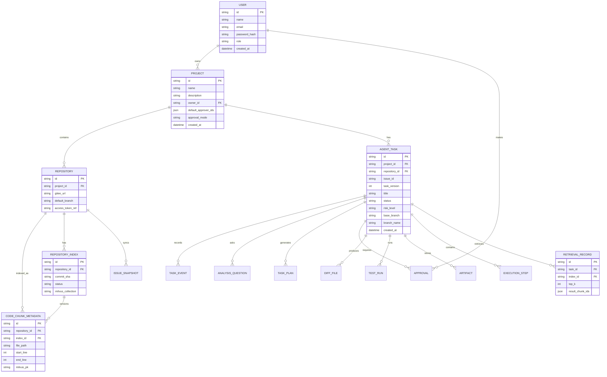
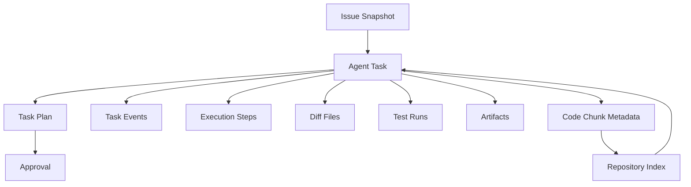
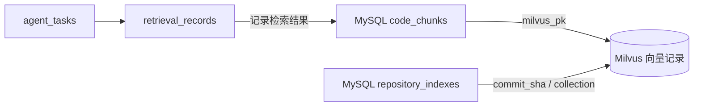

# 数据库设计文档

## 1. 文档目标

本文档定义司契（Siqi）MVP 的核心数据结构，重点支持：

- 用户与项目管理
- Gitee 仓库接入
- Agent 任务执行
- 修改计划审批
- 任务事件回放
- Diff、测试结果与 PR 描述存储
- 代码切片元数据与 Milvus 向量索引关联

设计原则：

1. 任务主表清晰。
2. 事件流可追踪。
3. 产物与事件分离。
4. 可扩展到企业版多租户。
5. 便于回放、审计和统计。

## 2. 数据模型总览



## 3. 核心表设计

### 3.1 users

用户基础表。

| 字段 | 类型 | 说明 |
| --- | --- | --- |
| id | string | 主键 |
| name | string | 用户名 |
| email | string | 邮箱 |
| password_hash | string | 密码哈希 |
| role | string | 用户角色 |
| created_at | datetime | 创建时间 |

建议索引：

- `email` 唯一索引
- `role` 普通索引

### 3.2 projects

项目表，承载一个研发协作空间。

| 字段 | 类型 | 说明 |
| --- | --- | --- |
| id | string | 主键 |
| name | string | 项目名称 |
| description | string | 项目描述 |
| owner_id | string | 所属用户 |
| default_approver_ids | json | 默认审批人列表 |
| approval_mode | string | 审批模式，MVP 默认为 single |
| created_at | datetime | 创建时间 |

### 3.3 repositories

仓库配置表。

| 字段 | 类型 | 说明 |
| --- | --- | --- |
| id | string | 主键 |
| project_id | string | 所属项目 |
| gitee_url | string | Gitee 仓库地址 |
| default_branch | string | 默认分支 |
| access_token_ref | string | Token 引用或加密引用 |
| created_at | datetime | 创建时间 |

### 3.4 issue_snapshots

Issue 快照表，避免后续外部 Issue 变化影响任务回放。

| 字段 | 类型 | 说明 |
| --- | --- | --- |
| id | string | 主键 |
| repository_id | string | 所属仓库 |
| issue_id | string | 外部 Issue ID |
| title | string | Issue 标题 |
| body | text | Issue 内容 |
| comments_json | json | 评论快照 |
| labels_json | json | 标签快照 |
| raw_json | json | 原始响应 |
| fetched_at | datetime | 拉取时间 |

### 3.5 agent_tasks

任务主表，是整个系统最核心的数据表。

| 字段 | 类型 | 说明 |
| --- | --- | --- |
| id | string | 主键 |
| project_id | string | 项目 ID |
| repository_id | string | 仓库 ID |
| issue_id | string | 外部 Issue ID |
| task_version | int | 任务版本 |
| title | string | 任务标题 |
| status | string | 当前状态 |
| risk_level | string | 风险等级 |
| base_branch | string | 基线分支 |
| branch_name | string | 系统生成的工作分支 |
| test_command | string | 测试命令 |
| current_plan_id | string | 当前计划 |
| manual_required | bool | 是否需要人工处理 |
| manual_reason | string | 人工处理原因 |
| next_action | string | 下一步推荐动作 |
| automation_state | string | 自动化状态 |
| created_by | string | 创建人 |
| created_at | datetime | 创建时间 |
| updated_at | datetime | 更新时间 |

建议索引：

- `(project_id, created_at)`
- `(repository_id, issue_id)`
- `(repository_id, issue_id, task_version)` 唯一约束
- `(status, updated_at)`

### 3.6 analysis_questions

AI 分析阶段提出的待确认问题和用户回答。

| 字段 | 类型 | 说明 |
| --- | --- | --- |
| id | string | 主键 |
| task_id | string | 任务 ID |
| content | text | 问题内容 |
| required | bool | 是否必答 |
| answer | text | 用户回答 |
| answer_status | string | pending / answered / skipped |
| answered_by | string | 回答人 |
| answered_at | datetime | 回答时间 |
| created_at | datetime | 创建时间 |

### 3.7 task_plans

修改计划表，支持计划版本化。

| 字段 | 类型 | 说明 |
| --- | --- | --- |
| id | string | 主键 |
| task_id | string | 关联任务 |
| version | int | 版本号 |
| summary | text | 计划摘要 |
| target_files_json | json | 目标文件 |
| steps_json | json | 步骤列表 |
| risk_notes | text | 风险说明 |
| status | string | plan 状态 |
| created_at | datetime | 创建时间 |

### 3.8 approvals

审批记录表。

| 字段 | 类型 | 说明 |
| --- | --- | --- |
| id | string | 主键 |
| task_id | string | 任务 ID |
| plan_id | string | 计划 ID |
| approver_id | string | 审批人 |
| decision | string | approve / reject / revise |
| comment | text | 审批意见 |
| decision_source | string | user / system_policy |
| created_at | datetime | 审批时间 |

### 3.9 task_events

任务事件表，用于任务回放和审计。

| 字段 | 类型 | 说明 |
| --- | --- | --- |
| id | string | 主键 |
| task_id | string | 任务 ID |
| event_type | string | 事件类型 |
| step_name | string | 步骤名 |
| summary | string | 简短摘要 |
| payload_json | json | 事件内容 |
| created_at | datetime | 创建时间 |

事件类型示例：

- ISSUE_FETCHED
- CONTEXT_INDEXED
- ANALYZED
- PLAN_GENERATED
- APPROVED
- REJECTED
- DIFF_GENERATED
- TESTED
- PR_DESC_GENERATED
- COMPLETED
- FAILED

### 3.10 execution_steps

执行步骤表，记录 Agent 的节点级过程。

| 字段 | 类型 | 说明 |
| --- | --- | --- |
| id | string | 主键 |
| task_id | string | 任务 ID |
| step_name | string | 节点名 |
| input_json | json | 输入 |
| output_json | json | 输出 |
| status | string | success / failed / skipped |
| started_at | datetime | 开始时间 |
| finished_at | datetime | 结束时间 |

### 3.11 code_chunks

代码切片元数据表。代码向量存储在 Milvus，本表保存用于来源追踪、权限过滤和回放展示的信息。

| 字段 | 类型 | 说明 |
| --- | --- | --- |
| id | string | 主键 |
| repository_id | string | 仓库 ID |
| index_id | string | 索引版本 ID |
| file_path | string | 文件路径 |
| chunk_index | int | 切片序号 |
| content | text | 代码片段正文或受控引用 |
| language | string | 编程语言 |
| symbol_name | string | 函数、类或标题名称 |
| start_line | int | 起始行号 |
| end_line | int | 结束行号 |
| commit_sha | string | Commit SHA |
| milvus_collection | string | 所属 Milvus Collection |
| milvus_pk | string | Milvus 中的向量记录 ID |
| checksum | string | 内容校验 |
| updated_at | datetime | 更新时间 |

### 3.12 diff_files

Diff 文件表。

| 字段 | 类型 | 说明 |
| --- | --- | --- |
| id | string | 主键 |
| task_id | string | 任务 ID |
| task_version | int | 任务版本 |
| plan_id | string | 关联计划 ID |
| file_path | string | 文件路径 |
| patch | text | 补丁内容 |
| change_type | string | add / modify / delete |
| created_at | datetime | 创建时间 |

### 3.13 test_runs

测试记录表。

| 字段 | 类型 | 说明 |
| --- | --- | --- |
| id | string | 主键 |
| task_id | string | 任务 ID |
| task_version | int | 任务版本 |
| plan_id | string | 关联计划 ID |
| command | string | 测试命令 |
| exit_code | int | 退出码 |
| stdout | text | 标准输出 |
| stderr | text | 标准错误 |
| status | string | passed / failed |
| created_at | datetime | 创建时间 |

### 3.14 artifacts

产物表，用于统一存放 AI 生成的摘要类内容。

| 字段 | 类型 | 说明 |
| --- | --- | --- |
| id | string | 主键 |
| task_id | string | 任务 ID |
| task_version | int | 任务版本 |
| plan_id | string | 关联计划 ID |
| artifact_type | string | analysis / pr_description / summary |
| content_json | json | 结构化内容 |
| created_at | datetime | 创建时间 |

### 3.15 repository_indexes

仓库 RAG 索引任务和版本表。

| 字段 | 类型 | 说明 |
| --- | --- | --- |
| id | string | 主键 |
| repository_id | string | 仓库 ID |
| commit_sha | string | 索引对应的 Commit |
| status | string | PENDING / SYNCING / PARSING / EMBEDDING / STORING / COMPLETED / FAILED |
| total_files | int | 文件总数 |
| processed_files | int | 已处理文件数 |
| chunk_count | int | 代码切片数量 |
| milvus_collection | string | Milvus Collection 名称 |
| error_message | text | 失败原因 |
| created_at | datetime | 创建时间 |
| updated_at | datetime | 更新时间 |

### 3.16 retrieval_records

RAG 检索记录表，用于任务回放和质量评估。

| 字段 | 类型 | 说明 |
| --- | --- | --- |
| id | string | 主键 |
| task_id | string | 关联任务 |
| query_text | text | 检索问题 |
| index_id | string | 使用的索引版本 |
| top_k | int | 召回数量 |
| result_chunk_ids_json | json | 召回切片 ID |
| created_at | datetime | 检索时间 |

## 4. 任务数据流



## 5. 状态设计

### 5.1 任务状态

建议使用以下状态：

```text
CREATED
ISSUE_FETCHED
CONTEXT_INDEXED
ANALYZED
PLAN_GENERATED
WAITING_APPROVAL
APPROVED
REJECTED
DIFF_GENERATED
TESTED
PR_DESC_GENERATED
COMPLETED
FAILED
CANCELLED
```

### 5.2 审批状态

- approve
- reject
- revise

### 5.3 测试状态

- passed
- failed
- skipped
- running

## 6. 索引与约束建议

| 表 | 建议索引 |
| --- | --- |
| users | `email UNIQUE` |
| projects | `owner_id`, `created_at` |
| repositories | `project_id`, `gitee_url UNIQUE` |
| issue_snapshots | `repository_id`, `issue_id` |
| agent_tasks | `project_id`, `repository_id`, `status` |
| agent_tasks | `manual_required`, `automation_state` |
| analysis_questions | `task_id`, `answer_status` |
| task_plans | `task_id`, `version` |
| approvals | `task_id`, `approver_id`, `decision_source` |
| task_events | `task_id`, `created_at` |
| execution_steps | `task_id`, `started_at` |
| code_chunks | `repository_id`, `file_path`, `commit_sha`, `milvus_pk` |
| repository_indexes | `repository_id`, `commit_sha`, `status` |
| retrieval_records | `task_id`, `index_id`, `created_at` |
| diff_files | `task_id`, `task_version`, `plan_id`, `file_path` |
| test_runs | `task_id`, `task_version`, `plan_id`, `created_at` |
| artifacts | `task_id`, `task_version`, `plan_id`, `artifact_type` |

## 7. 审计与回放原则

- 所有关键事件都必须进入 `task_events`。
- 回放页默认读取 `task_events` 和 `execution_steps`。
- 计划、Diff、测试结果和 PR 描述都要保留版本，并同时与 `task_version` 和 `plan_id` 关联。
- 审批记录不可覆盖，只能新增。
- 产物表与事件表分开，避免混在一起。

## 7.1 实现对照（实际落地模式，2026-09-07）

设计文档定义的是规范化的关系模型；当前代码落地为 **可运行、可往返** 的 SQLAlchemy 模型
（表名/结构见 `backend/app/models/orm.py`，建表入口 `scripts/migrate.py` 或 alembic baseline）。
下表把本文档的每个设计表映射到实际 ORM 表，并注明为「往返精确」而做的合并决策。

| 设计表（本文档） | 实际 ORM 表 | 落地说明 |
| --- | --- | --- |
| users | `users` | 一致 |
| projects | `projects` | 一致；`owner_id / default_approver_ids / approval_mode` 在团队版由仓库/项目配置承载 |
| repositories | `repositories` | 一致；`access_token_ref` 落地为 `token_alias / token_configured` + 内存 `REPOSITORY_TOKENS` |
| issue_snapshots | `tasks.issue_snapshot`(JSON) | 快照并入任务 JSON，保证回放往返精确 |
| agent_tasks | `tasks` | 任务主表；`current_plan_id` 由按版本排序的最大 plan 承担 |
| analysis_questions | `tasks.analysis`(JSON) | 待确认问题与回答随分析 JSON 落库、精确往返 |
| task_plans | `plans` | 计划表（版本化） |
| approval_records | `plans`(approval_* 列) + `task_events` | 审批决策落在 plan 的 `status / approved_by / approved_at / comment`，审计事件留痕 |
| task_events | `task_events` | 一致（任务回放/审计） |
| execution_steps | `execution_steps` | 一致 |
| code_chunks | `code_chunks` | 一致（含 `milvus_collection / milvus_pk / checksum`） |
| repository_indexes | `repository_indexes` | 一致 |
| retrieval_records | `retrieval_records` | 一致 |
| diff_files | `diffs`(files JSON) | Diff 产物并入 `diffs` 表，文件列表以 JSON 列保存 |
| test_runs | `test_runs` | 一致 |
| artifacts(PR 描述) | `pr_descriptions` | 与 Diff/测试分离保存、版本化 |

其他业务表：`password_resets`（密码找回申请）、`audit_events`（全局审计，跨任务事件留存）。

设计优先「多个窄表」，实现优先「主表 + 必要子表 + 深层嵌套走 JSON」，二者追求同一目标：
**来源可追踪、版本可回放、服务重启后可恢复**。列演进一步（如需拆分窄表）走 alembic。

## 8. 企业化扩展预留

Milvus 中的向量记录至少包含：

- `chunk_id`
- `project_id`
- `repository_id`
- `commit_sha`
- `file_path`
- `language`
- `start_line`
- `end_line`
- `embedding`

MySQL 与 Milvus 的关系：



后续若进入企业版，建议增加：

- `organizations`
- `memberships`
- `roles`
- `permissions`
- `audit_logs`
- `model_calls`
- `connector_configs`

这样可以平滑支持多租户、RBAC、模型审计和连接器扩展。
