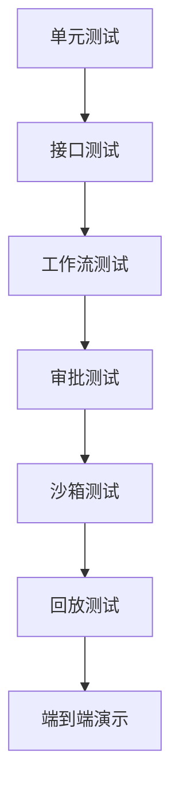
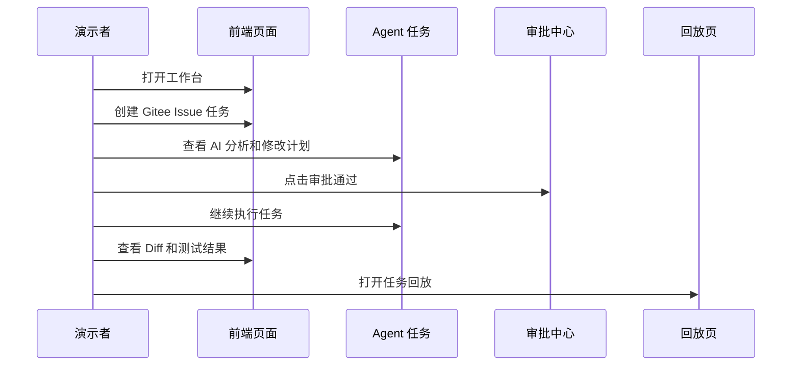

# 测试与答辩演示文档

## 1. 文档目标

本文档用于说明项目如何测试、如何验收、如何演示。

重点回答：

- 测什么
- 怎么测
- 哪些步骤最容易出问题
- 演示时如何保证流程稳定
- 答辩时如何讲清楚项目价值

## 2. 测试策略

### 2.1 单元测试

测试对象：

- 任务状态流转
- 计划结构化生成
- 风险分级函数
- 回放事件组装
- Diff 解析

### 2.2 接口测试

测试对象：

- 登录
- 创建任务
- 拉取 Issue
- 提交审批
- 获取 Diff
- 获取测试结果
- 获取任务回放

### 2.3 工作流测试

测试对象：

- Issue 拉取
- AI 分析
- 代码检索
- 计划生成
- 审批等待
- Diff 生成
- 测试执行
- PR 描述生成

### 2.4 沙箱测试

测试对象：

- 命令是否在隔离环境中执行
- 危险命令是否被拦截
- 测试失败时是否保留日志
- 容器是否按任务清理

### 2.5 RAG 测试

测试对象：

- LlamaIndex 是否正确解析和切片代码
- 敏感文件是否在入库前被过滤
- Embedding 是否成功生成
- Milvus Collection 是否可以写入和查询
- Issue 是否能召回预期文件
- 返回结果是否包含文件路径、行号和 Commit SHA
- 不同项目和仓库的向量数据是否隔离
- 索引版本过期时是否阻止自动使用
- Milvus 不可用时是否可以重试或提示降级

## 3. 核心测试场景

| 场景 | 输入 | 期望结果 |
| --- | --- | --- |
| 正常任务流 | 一个普通 Issue | 能完整走完分析、审批、Diff、测试、回放 |
| 审批拒绝 | 审批人点击拒绝 | 当前计划版本终止，不自动回到计划生成 |
| 高风险任务 | 包含删除或配置修改 | 触发高风险审批提示 |
| 测试失败 | 测试命令返回非 0 | 记录错误日志并进入失败状态 |
| 模型失败 | 模型接口超时 | 显示失败提示并保留已完成步骤 |
| Gitee 拉取失败 | Token 错误或接口异常 | 任务停止并展示错误原因 |
| RAG 无结果 | Issue 与仓库代码没有明显匹配 | 提示未找到相关上下文，并允许手动指定文件 |
| RAG 召回错误 | 返回无关文件 | 记录检索结果，允许重新索引或调整 Query |
| 索引版本过期 | 仓库已更新但索引未更新 | 阻止进入代码修改阶段，提示同步仓库 |

### 3.1 验证口径

每个场景都要同时验证三件事：

- 页面状态是否正确变化；
- 关键产物是否保存并可回放；
- 出错时是否有明确兜底提示。

## 4. 演示数据建议

为了保证答辩稳定，建议准备以下演示数据：

- 一个真实或模拟 Gitee 仓库
- 一个 Bug 类型 Issue
- 一个功能优化类型 Issue
- 一个轻量测试命令
- 一个可展示 Diff 的样例分支
- 一份已经写好的 PR 描述模板

### 4.1 演示前检查清单

- 仓库索引状态已完成；
- 至少准备 1 条待审批任务；
- 至少准备 1 条审批通过样例；
- 至少准备 1 条审批拒绝样例；
- 测试命令有可成功执行的基线；
- 模拟执行产物已准备好作为兜底；
- 回放页能完整展开时间线和关键步骤。

## 5. 演示流程

建议答辩时按以下顺序讲解：

### 5.1 演示话术顺序

1. 介绍项目定位。
2. 展示工作台首页。
3. 创建任务。
4. 展示 AI 分析和修改计划。
5. 展示审批。
6. 展示 Diff 和测试结果。
7. 打开任务回放。
8. 展示 RAG 检索来源。
9. 总结安全与企业化价值。

## 6. 答辩重点

答辩时建议重点讲这几个点：

- 为什么不是普通聊天机器人
- 为什么要先审批计划再执行
- 为什么要做任务回放
- 为什么企业会关心沙箱和审计
- LlamaIndex 和 Milvus 分别解决什么问题
- 为什么 RAG 结果必须带文件来源和版本
- 为什么这个项目更适合研发团队

## 7. 失败兜底方案

### 7.1 模型不可用

兜底策略：

- 显示已完成的任务状态
- 给出失败提示
- 支持切换模型或稍后重试

### 7.2 Gitee 接口异常

兜底策略：

- 使用本地缓存的 Issue 快照
- 演示时切换到模拟执行产物
- 保留任务主流程不变

### 7.3 沙箱执行异常

兜底策略：

- 记录错误日志
- 允许展示计划、Diff 草稿和回放记录
- 让演示流程不被单点失败打断

## 8. 验收清单

- [ ] 能创建任务
- [ ] 能拉取 Issue
- [ ] 能生成分析结果
- [ ] 能生成修改计划
- [ ] 能审批、拒绝和重写
- [ ] 能展示 Diff
- [ ] 能记录测试结果
- [ ] 能展示任务回放
- [ ] 能输出 PR 描述
- [ ] 能完成一次完整演示
- [ ] 能展示 RAG 检索来源、Commit SHA 和相似度
- [ ] 能展示审批拒绝后当前版本终止、重写后生成新版本
- [ ] 能在异常时切换到模拟执行产物兜底

## 9. 演示页面建议

建议现场优先演示以下页面：

- 工作台首页
- 任务详情页
- 审批中心页
- Diff 审核页
- 任务回放页

这五个页面最能说明项目价值，也最能体现企业级控制台风格。
