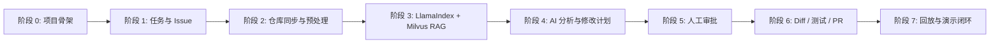
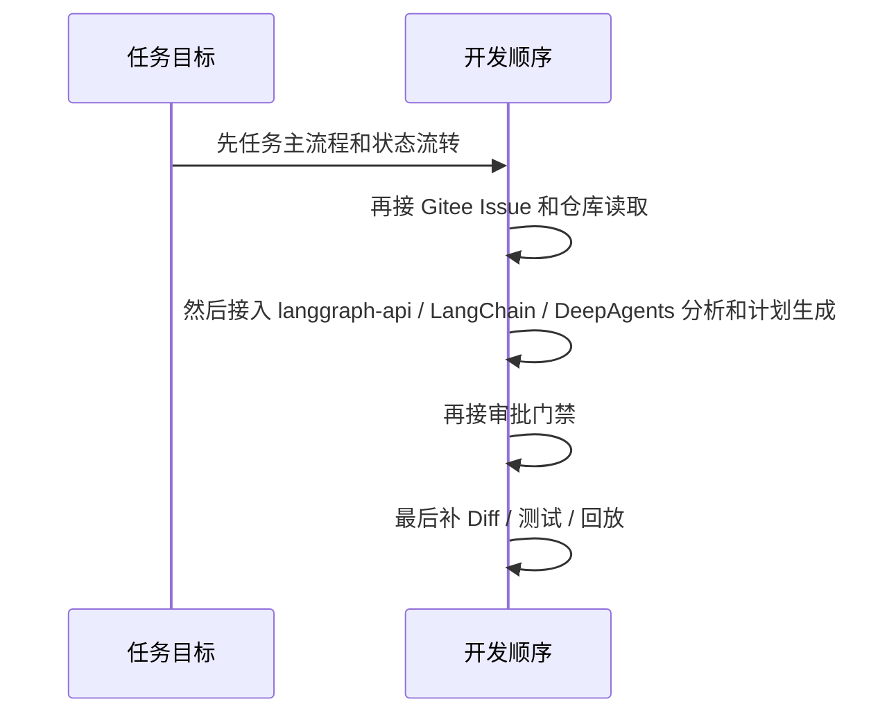
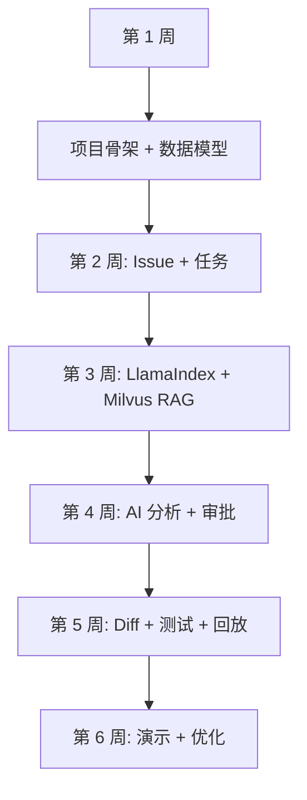

# 开发计划文档

## 1. 文档目标

本文档说明项目从文档到落地的执行顺序，重点回答：

- 先做什么
- 后做什么
- 每阶段交付什么
- 哪些内容必须先打通
- 哪些内容可以后置

MVP 第一版以 Web 管理台和单 Agent 闭环为主，不把 Flutter / 微信小程序或多 Agent 协同放进主线。

## 2. 开发路线图

## 3. 阶段拆分

### 3.1 阶段 0：项目骨架

目标：把项目跑起来。

交付物：

- Vue 3 前端工程
- FastAPI 后端工程
- MySQL
- Redis
- Milvus
- Docker Compose
- Nginx
- 基础 README

验收：

- 前后端可启动
- 数据库可连接
- 首页可访问

### 3.2 阶段 1：任务与 Issue

目标：让系统能接入 Gitee Issue。

交付物：

- 项目 / 仓库 / 任务数据模型
- Gitee Issue 拉取
- 创建任务接口
- 任务列表页
- 任务详情基础页

验收：

- 能创建一个真实任务
- 能看到 Issue 快照
- 能在列表页看到任务状态

### 3.3 阶段 2：仓库同步与代码预处理

目标：为 LlamaIndex + Milvus RAG 建立干净、可追溯的代码输入。

交付物：

- 仓库同步
- 文件过滤
- Commit 版本记录
- 代码解析与切片规则准备
- 索引任务状态
- Milvus Collection 和索引版本规划
- 仓库级索引复用规则

验收：

- 能检索到相关文件
- 能展示引用片段
- 已完成索引的仓库再次创建任务时，不重复触发全量索引

### 3.4 阶段 3：LlamaIndex + Milvus RAG 实现

目标：完成代码知识库，让 Agent 能检索与 Issue 相关的代码上下文。

交付物：

- LlamaIndex 代码解析和节点切片
- Embedding 模型接入
- Milvus Collection 初始化
- 向量批量写入和查询
- 文件路径、行号、语言、Commit SHA 元数据
- RAG 检索结果展示
- 索引失败重试和基础重建
- MySQL 元数据与 Milvus 向量记录关联

验收：

- 指定仓库可以完成一次索引
- Issue 可以召回相关代码片段
- 结果可以追溯到文件和行号
- 用户无权访问的仓库不会被召回
- 索引缺失、过期和失败三种状态有明确提示和重试入口

### 3.5 阶段 4：AI 分析与修改计划

目标：让单 Agent 先分析再动手。

交付物：

- langgraph-api + LangChain + DeepAgents 流程
- Issue 分析节点
- LlamaIndex RAG 检索节点
- DeepSeek 结构化输出适配
- 修改计划生成节点
- 计划详情页

验收：

- 能生成结构化计划
- 能显示风险和文件范围

### 3.6 阶段 5：人工审批

目标：建立执行门禁。

交付物：

- 审批 API
- 审批中心页面
- 通过 / 拒绝 / 重写
- 审批记录
- 待审批状态恢复

验收：

- 未审批任务不能执行
- 审批动作可追踪

### 3.7 阶段 6：Diff、测试与 PR 描述

目标：把研发产物跑出来。

交付物：

- Diff 生成
- Diff 展示
- Docker 隔离测试
- 测试结果记录
- PR 描述生成

验收：

- 能看到文件级 Diff
- 能看到测试结果

### 3.8 阶段 7：任务回放与演示闭环

目标：让任务过程可视化。

交付物：

- 任务时间线
- 节点输入输出摘要
- 审批、Diff、测试、PR 回放
- 演示数据
- 演示脚本

验收：

- 能完整回放一次任务
- 演示时流程不被中断

## 4. 推荐执行顺序

### 4.1 为什么这样排

1. 先让骨架可跑。
2. 再让任务有来源。
3. 再让单 Agent 看到代码并生成分析和计划。
4. 再让审批卡住风险。
5. 最后把结果产物和回放补齐。

## 5. 每阶段完成标准

| 阶段 | 主要输出 | 是否可演示 |
| --- | --- | --- |
| 阶段 0 | 可运行骨架 | 否 |
| 阶段 1 | 任务列表与 Issue | 基础可演示 |
| 阶段 2 | 仓库预处理 | 可演示 |
| 阶段 3 | RAG 检索 | 可演示 |
| 阶段 4 | 修改计划 | 可演示 |
| 阶段 5 | 审批门禁 | 可演示 |
| 阶段 6 | Diff / 测试 / PR | 强演示 |
| 阶段 7 | 回放闭环 | 完整演示 |

## 6. 里程碑建议

## 7. 风险控制

### 7.1 开发风险

- Gitee 接口不稳定
- AI 输出不一致
- 沙箱测试不稳定
- UI 与流程不匹配

### 7.2 应对策略

- 先做模拟执行产物兜底
- 计划输出必须结构化
- 沙箱先做最小隔离
- UI 页面先跟流程一致，再追求美观

## 8. 文档与代码同步规则

- PRD 变更后，UI 和 API 必须同步。
- 数据模型变更后，接口和测试文档必须同步。
- 安全策略变更后，审批和沙箱文档必须同步。
- 回放字段变更后，任务事件表和前端时间线必须同步。

## 9. 结论

这个项目的最优推进方式不是“先把所有功能都堆上”，而是：

1. 先打通任务闭环。
2. 再做可视化回放。
3. 再补安全和审批。
4. 最后再扩企业化能力。
