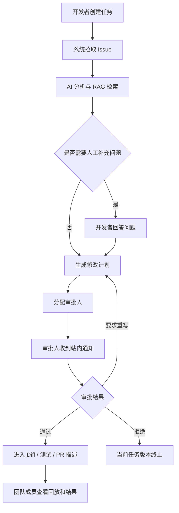

# 团队版权限与协作文档

> 迁移说明：团队版权限、协作、通知和审计口径已整理到 `team/04-team-data-permission.md`，业务流程见 `team/02-team-workflow.md`。本文保留为旧入口，避免历史引用失效。

## 1. 文档定位

本文档定义团队版的角色权限、协作流程、通知入口和审计边界。

## 2. 权限矩阵

| 功能 | 团队管理员 | 项目负责人 | 开发者 | 审批人 | 观察者 |
| --- | --- | --- | --- | --- | --- |
| 查看项目 | 是 | 是 | 是 | 是 | 是 |
| 创建任务 | 是 | 是 | 是 | 可选 | 否 |
| 查看全部任务 | 是 | 是 | 否 | 仅可审批任务 | 是 |
| 审批任务 | 可选 | 可选 | 否 | 是 | 否 |
| 指定审批人 | 是 | 是 | 否 | 否 | 否 |
| 修改项目配置 | 是 | 部分 | 否 | 否 | 否 |
| 查看审计日志 | 是 | 是 | 否 | 部分 | 只读 |
| 管理成员 | 是 | 否 | 否 | 否 | 否 |

## 3. 协作流程

## 4. 审批人分配规则

- 优先使用任务创建时指定的审批人。
- 未指定时使用项目默认审批人。
- 默认审批人未配置时，由项目负责人补充指定。
- MVP 后的团队版默认采用单人审批模式。

## 5. 通知规则

| 场景 | 通知对象 | 入口 |
| --- | --- | --- |
| 任务等待审批 | 审批人 | 顶栏通知、审批中心 |
| 审批超过 24 小时未处理 | 审批人、项目负责人 | 审批中心催办 |
| 任务执行失败 | 任务负责人、项目负责人 | 任务列表高亮、站内通知 |
| 有人 @ 成员 | 被 @ 成员 | 顶栏通知、任务详情 |
| 高风险任务提交审批 | 审批人、项目负责人 | 强提示通知 |

## 6. 评论与事件

- 评论必须绑定 `task_id`。
- 评论可选绑定 `plan_id`、`diff_file_id` 或 `execution_step_id`。
- 评论新增、修改、删除都写入任务事件。
- 删除评论只做软删除，保留审计记录。

## 7. 验收标准

- 权限矩阵中的限制能在前端按钮和后端接口同时生效。
- 非审批人不能审批任务。
- 被指定审批人能收到待办提醒。
- 评论能在任务详情和任务回放中关联展示。
