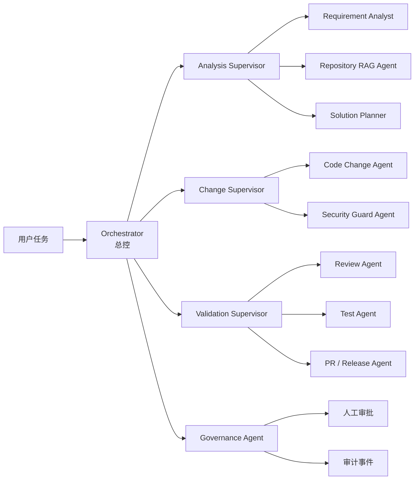
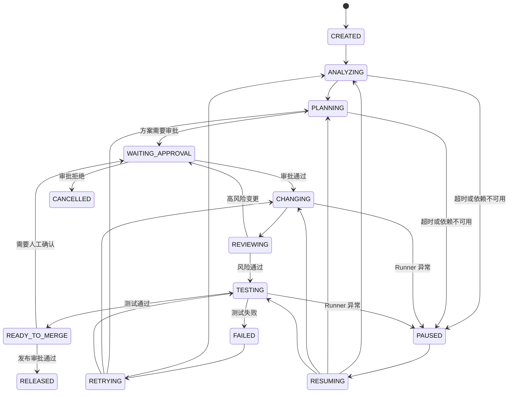
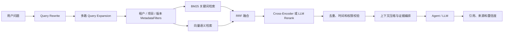
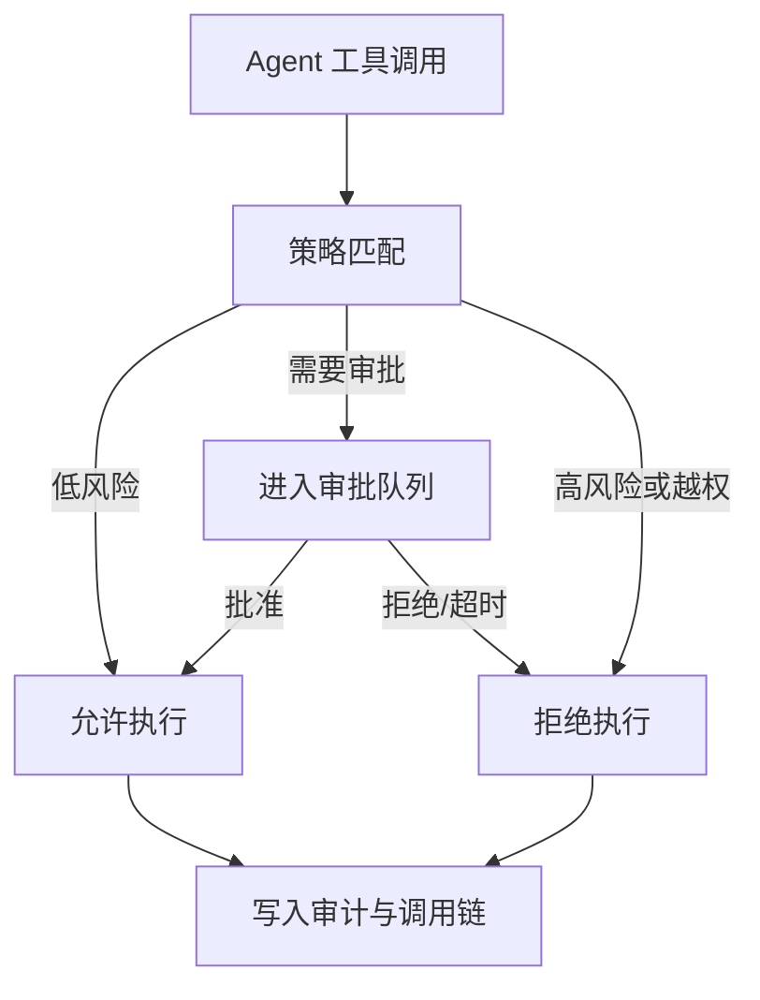
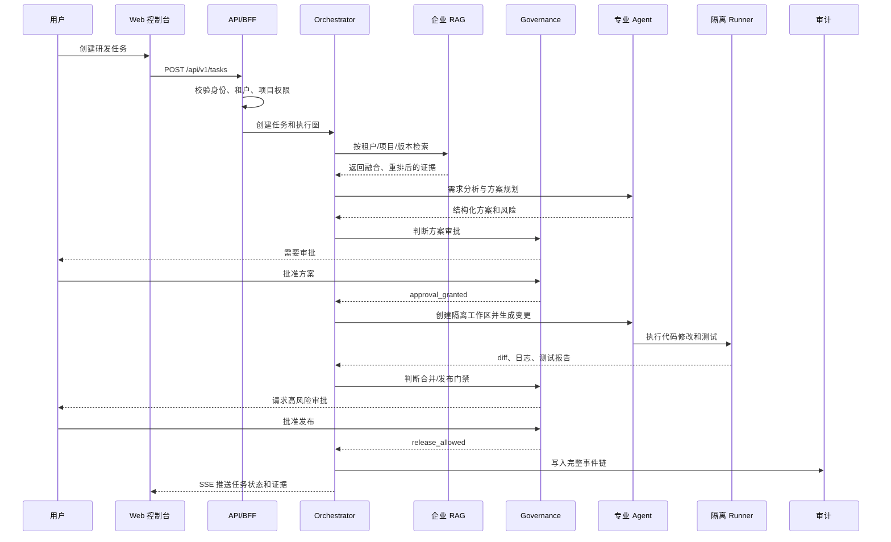

# 企业版产品需求文档（PRD）

> ⚠️ **历史兼容入口（已冻结）**：本文与 `docs/enterprise/01-enterprise-prd.md` 当前内容一致，属早期入口。
> **请以 `docs/enterprise/01-enterprise-prd.md` 为准**，本文不再更新，仅保留用于旧链接不失效。
> 已知过时点：§7.1 角色表为 9 类设计目标，实际实现 7 类（见 `enterprise/01` §7.1）。

> 文档状态：企业版架构与产品需求基线
> 文档版本：1.0.0
> 编制日期：2026-09-14
> 适用项目：司契（Siqi）——企业级 AI Agent 研发协作平台（Enterprise-Grade AI Agent R&D Collaboration Platform）
> 当前基线：团队版已完成一条可运行的研发协作与 RAG 链路；本文档定义从团队版升级到企业版所需的产品、技术和交付要求。

## 1. 文档目的

本文档用于统一企业版的产品目标、业务边界、模块职责、核心流程、接口约定、数据模型、非功能要求和验收标准，作为产品评审、架构设计、开发拆分、测试验收和私有化交付的共同依据。

本文档中的状态定义：

| 状态 | 含义 |
| --- | --- |
| 团队版已具备 | 当前项目已经存在并完成过联调验证的能力 |
| 企业版增强 | 在现有能力上进行增强，不能破坏团队版已有链路 |
| 企业版新增 | 当前团队版没有，需要独立设计、开发和验收 |
| 后续规划 | 不纳入企业版第一阶段的交付门槛 |

## 2. 当前团队版基线

### 2.1 已具备能力

| 范围 | 当前能力 | 企业版处理方式 |
| --- | --- | --- |
| 项目管理 | 项目、任务、仓库和研发协作基础流程 | 增加租户、组织、部门和项目级权限 |
| RAG | 文档解析、代码切片、向量检索和基础混合检索链路 | 增加企业级过滤、BM25、RRF、重排和离线评测 |
| 代码理解 | 基于仓库内容生成任务上下文 | 增加版本一致性、权限过滤和 Agent 调度 |
| 前后端链路 | 团队版前后端能够完成基础联调 | 增加 SSE 事件、审批状态和失败恢复 |
| 测试 | 后端和前端已有自动化测试 | 增加租户隔离、安全、并发、恢复和评测测试 |
| 云端运行 | 已有云服务器部署基线 | 增加 HTTPS、独立依赖、备份、监控和升级回滚 |

### 2.2 团队版已验证事实

- 企业平台仓库已有可部署代码和部署文档。
- 团队版云端可访问地址为 `http://<production-host>:8080`。
- 团队版后端测试基线为 `529 passed, 16 skipped`，前端测试基线为 `219 passed`。
- `health-middle` 示例仓库已完成索引，索引状态为 `COMPLETED`，并能返回 5 条 `source=hybrid` 且 `fresh=true` 的 RAG 上下文。

以上内容仅作为开发基线，不代表企业版已经完成。企业版验收必须以企业版部署环境中的真实运行结果为准。

## 3. 产品定位

企业版定位为：

> 面向企业研发团队的多租户 AI 研发协作平台，通过企业级 RAG、受治理的 Multi-Agent 协同和代码变更审批，帮助研发团队完成“需求理解、方案设计、代码修改、审查测试、交付发布”的闭环。

企业版不是单纯的聊天机器人，也不是无约束的 Agent 集群，而是一个具有权限边界、数据隔离、人工审批、可观测和可追溯能力的研发生产系统。

## 4. 目标客户与使用场景

### 4.1 目标客户

| 客户类型 | 典型需求 |
| --- | --- |
| 中大型软件企业 | 多团队协作、代码安全、统一 AI 研发入口 |
| 政企和金融客户 | 私有化、内网部署、审计留痕、数据不可出域 |
| 研发外包和交付团队 | 多项目隔离、项目知识库、标准化交付 |
| 有内部研发平台的企业 | 将 AI 能力接入现有 Git、CI/CD、SSO 和工单体系 |

### 4.2 核心使用场景

1. 用户提交一个研发任务，平台自动理解需求和代码上下文。
2. RAG Agent 从当前授权项目中检索相关文档、代码、历史任务和提交记录。
3. Planner Agent 生成结构化实现方案、影响范围和风险清单。
4. 用户审批方案后，Code Agent 在隔离工作区生成代码变更。
5. Review Agent 进行代码审查、安全检查和变更影响分析。
6. Test Agent 执行测试并汇总结果。
7. 用户审批后，PR/Release Agent 创建合并请求或进入发布流程。
8. 全部关键事件写入审计日志，任务可暂停、恢复、重试或人工接管。

## 5. 产品目标与非目标

### 5.1 企业版目标

- 支持多个租户、组织、部门、项目和研发团队并行使用。
- 建立强制的租户隔离、项目隔离和索引隔离机制。
- 建立可审批、可暂停、可恢复、可审计的 Multi-Agent 研发流程。
- 将 RAG 从“能检索”提升为“可过滤、可评测、可解释、可持续更新”。
- 支持企业身份认证、RBAC、敏感操作保护和密钥治理。
- 支持私有化部署、独立依赖、监控、备份、恢复和版本回滚。
- 在不破坏团队版既有功能的前提下，形成可演示、可试点、可交付的企业版本。

### 5.2 第一阶段非目标

- 不替代企业现有的完整 Git、CI/CD、项目管理或 ITSM 平台。
- 不承诺完全自动修改和发布生产代码。
- 不在第一阶段实现任意 Agent 自由发现、自由递归和无限调用。
- 不在第一阶段实现复杂计费、市场插件生态和多云一键编排。
- 不在第一阶段承诺所有行业的合规认证，只提供可审计和可配置基础能力。

## 6. 总体产品架构

```mermaid
flowchart TB
    U[企业用户 / 管理员 / 审批人] --> UI[Web 控制台<br/>frontend/src]
    UI --> API[API Gateway / BFF<br/>backend/app/api]
    API --> AUTH[认证与租户上下文<br/>backend/app/auth]
    API --> ORCH[Agent Orchestrator<br/>backend/app/agents/orchestrator]
    API --> RAG[RAG Service<br/>backend/app/rag]
    API --> GOV[审批与治理<br/>backend/app/governance]
    API --> AUDIT[审计与可观测<br/>backend/app/audit]

    ORCH --> RA[Requirement Analyst]
    ORCH --> RU[Repository Understanding]
    ORCH --> SP[Solution Planner]
    ORCH --> CA[Code Agent]
    ORCH --> RV[Review / Security Agent]
    ORCH --> TA[Test Agent]
    ORCH --> PR[PR / Release Agent]

    RAG --> PARSER[文档与代码解析]
    RAG --> BM25[BM25 索引]
    RAG --> VECTOR[向量索引 / Milvus]
    RAG --> FUSION[RRF 融合]
    RAG --> RERANK[Cross-Encoder / LLM Rerank]
    RAG --> EVAL[Recall@K / MRR / NDCG]

    GOV --> DB[(MySQL)]
    AUTH --> DB
    AUDIT --> DB
    ORCH --> REDIS[(Redis)]
    RAG --> VECTOR
    CA --> RUNNER[隔离 Runner / 工作区]
    PR --> SCM[Git 服务 / 企业代码平台]
    API --> OBS[日志、指标、链路追踪]
```

架构约束：

- 所有请求必须先建立可信的 `tenant_id`、`organization_id`、`user_id` 上下文。
- 所有 Agent 调用必须经过 Orchestrator，不允许业务代码直接形成隐式递归调用。
- 所有代码写入、合并、发布操作必须经过治理门禁。
- 所有 RAG 查询必须携带项目、仓库、分支或版本范围，禁止跨授权边界检索。

## 7. 用户角色与组织模型

### 7.1 企业角色

| 角色 | 主要职责 | 关键权限 |
| --- | --- | --- |
| Tenant Owner | 租户所有者 | 租户配置、成员、计费预留、全局安全策略 |
| Tenant Admin | 企业管理员 | 组织、部门、角色、项目和模型配置 |
| Security Admin | 安全管理员 | 密钥、SSO、MFA、审计、风险策略 |
| Project Owner | 项目负责人 | 项目成员、知识库、Agent 流程和审批规则 |
| Tech Lead | 技术负责人 | 方案审批、代码变更审批、风险确认 |
| Developer | 开发人员 | 创建任务、查看授权代码、执行受限 Agent |
| Reviewer | 审查人 | 代码审查、安全审查、测试结果确认 |
| Operator | 运维人员 | 部署、监控、备份和恢复 |
| Auditor | 审计人员 | 只读查看审计和操作证据 |

### 7.2 组织层级

```text
Tenant
└── Organization
    ├── Department
    │   └── Member
    ├── Project
    │   ├── Repository
    │   ├── Knowledge Base
    │   ├── Agent Workflow
    │   └── Approval Policy
    └── Role Assignment
```

实体关系要求：

- 一个用户可以属于多个租户，但每次请求只能激活一个租户上下文。
- 一个项目只能归属一个租户和一个组织。
- 仓库、任务、索引、工作区、审计记录都必须带 `tenant_id`。
- 项目成员权限不能自动扩展为租户全局权限。
- 离职、禁用或移除成员后，立即阻断其新请求；已运行任务按策略暂停或交给指定接管人。

## 8. Multi-Agent 产品设计

### 8.1 Agent 关系

企业版采用“两层调度 + 专业 Agent 平级协作”的关系：

- 第一层：`Orchestrator`，负责任务拆解、状态机、依赖关系、重试和人工接管。
- 第二层：阶段性 `Supervisor`，负责分析、变更、验证阶段的局部编排。
- 专业 Agent 平级协作，通过结构化输入、输出和事件传递，不直接互相递归调用。
- `Governance Agent` 作为策略执行点，对高风险工具调用进行拦截和审批判断。



### 8.2 Agent 职责

| Agent | 输入 | 输出 | 是否允许写入 |
| --- | --- | --- | --- |
| Orchestrator | 用户任务、租户上下文 | 任务图、状态、事件 | 仅写任务状态 |
| Requirement Analyst | 需求文本、历史任务 | 需求摘要、验收标准、澄清问题 | 否 |
| Repository RAG Agent | 查询、项目、版本、权限 | 引用片段、来源、置信度 | 写索引任务状态 |
| Solution Planner | 需求、RAG 上下文 | 方案、文件清单、风险、测试计划 | 否 |
| Code Change Agent | 已审批方案、隔离工作区 | patch、变更说明 | 仅写隔离工作区 |
| Security Guard Agent | patch、依赖、策略 | 风险等级、阻断理由 | 否 |
| Review Agent | diff、方案、规范 | 审查结论、问题清单 | 否 |
| Test Agent | 测试计划、工作区 | 测试结果、日志、覆盖率 | 仅写测试产物 |
| PR/Release Agent | 审批结果、测试结果 | PR、发布候选或阻断原因 | 受治理门禁控制 |
| Governance Agent | 工具调用、风险策略 | allow、deny、approval_required | 写审计事件 |

### 8.3 结构化 Agent 契约

每个 Agent 必须实现统一契约：

```json
{
  "task_id": "task-id",
  "run_id": "run-id",
  "tenant_id": "tenant-id",
  "project_id": "project-id",
  "agent_type": "solution_planner",
  "input": {},
  "context_refs": [],
  "expected_output_schema": "solution_plan.v1",
  "idempotency_key": "task-id:step-id:attempt",
  "deadline_seconds": 300
}
```

输出必须包含：

- `status`：`succeeded`、`failed`、`waiting_approval`、`cancelled`。
- `artifacts`：方案、patch、测试报告或引用结果的资源地址。
- `citations`：RAG 证据来源和版本信息。
- `risks`：风险等级、风险类型、阻断条件。
- `usage`：模型、输入输出 Token、耗时和估算成本。
- `next_actions`：下一步可执行动作，不能直接隐式触发任意 Agent。

### 8.4 调度状态机



调度规则：

- 同一 `idempotency_key` 只能产生一个有效步骤结果。
- 单步骤默认最多重试 2 次，重试必须记录原因和退避时间。
- 模型超时、依赖不可用、Runner 异常和策略拒绝必须区分。
- 连续失败达到阈值后自动暂停，要求人工接管。
- 任务恢复必须从 checkpoint 继续，不能重新执行已经确认成功的写操作。

## 9. 企业级 RAG 需求

### 9.1 RAG 目标

企业级 RAG 的目标不是单纯增加召回数量，而是在授权边界内提高相关性、时效性、可解释性和稳定性。

### 9.2 检索链路



### 9.3 RAG 功能要求

| 能力 | 要求 | 优先级 |
| --- | --- | --- |
| Query Rewrite | 根据任务类型重写为代码、文档、接口或故障查询 | P0 |
| Query Expansion | 生成同义词、符号名、文件路径和历史术语多路查询 | P1 |
| MetadataFilters | 强制过滤租户、组织、项目、仓库、分支、commit、文档类型 | P0 |
| BM25 | 对函数名、类名、错误码、接口名和精确术语提供关键词召回 | P0 |
| 向量检索 | 保留语义相似召回，支持 top-k 配置 | P0 |
| RRF | 融合多路召回结果，避免单一检索方式失效 | P0 |
| Rerank | 对候选上下文进行 Cross-Encoder 或 LLM 重排 | P1 |
| 去重 | 按文档、文件、函数、窗口和内容指纹去重 | P0 |
| Freshness | 校验索引 commit 与当前仓库 commit 是否一致 | P0 |
| 引用 | 返回文件路径、行号、版本、来源类型和相关分数 | P0 |
| 评测集 | 支持 Recall@K、Precision@K、MRR、NDCG 和命中证据分析 | P0 |

### 9.4 RAG 数据隔离

每次查询必须至少带有：

```json
{
  "tenant_id": "tenant-id",
  "organization_id": "organization-id",
  "project_id": "project-id",
  "repository_id": "repository-id",
  "ref": "main",
  "commit_sha": "commit-sha",
  "allowed_source_types": ["code", "document", "issue"],
  "metadata_filters": {}
}
```

任何缺失租户或项目边界的查询都必须拒绝，不得降级为全库检索。

### 9.5 RAG 评测要求

企业版至少建立以下离线评测集：

- 每个核心项目不少于 50 条真实研发问题。
- 每条问题包含期望文件、期望代码片段或期望文档证据。
- 覆盖精确符号查询、自然语言需求、错误排查、跨文件依赖和版本差异。
- 每次索引策略或模型变更后自动运行评测。
- P0 目标：Recall@5、MRR、NDCG 相比团队版基线不得下降。
- P1 目标：核心问题集 Recall@10 达到项目设定阈值，并输出失败样本。

## 10. 任务、审批与治理

### 10.1 风险分级

| 风险级别 | 示例 | 默认策略 |
| --- | --- | --- |
| L0 | 只读问答、查看已授权文档 | 自动执行并记录 |
| L1 | 生成方案、生成测试、创建临时分支 | 自动执行，结果可追溯 |
| L2 | 修改代码、修改配置、更新索引 | 项目负责人或技术负责人审批 |
| L3 | 合并主分支、修改生产配置、发布 | 多人审批 + 测试门禁 |
| L4 | 删除数据、修改安全策略、导出敏感数据 | 安全管理员审批 + 二次确认 |

### 10.2 审批要求

- 审批记录必须包含审批人、时间、意见、输入摘要、风险等级和最终结果。
- 审批对象必须绑定任务版本或 Agent 输出版本，输出变化后审批自动失效。
- 审批拒绝、超时和撤回都必须形成可查询事件。
- 高风险操作不能仅由发起人自审批。
- 所有审批规则支持按租户、组织、项目和操作类型配置。

### 10.3 治理门禁



## 11. 多租户、权限与数据隔离

### 11.1 隔离层级

企业版采用应用层、数据库层、缓存层、向量层、工作区和日志层的多层隔离：

| 层级 | 隔离要求 |
| --- | --- |
| API | 从认证令牌解析租户，不信任客户端提交的 `tenant_id` |
| 应用服务 | 所有 Service 方法接收并校验租户上下文 |
| MySQL | 业务表统一包含 `tenant_id`，查询默认追加租户条件 |
| Redis | Key 使用 `tenant:{tenant_id}:...` 命名空间 |
| 向量库 | collection 或 partition 包含租户和项目维度 |
| 文件存储 | 路径包含租户、项目和资源类型 |
| Runner | 每个任务使用独立临时工作区和最小权限凭据 |
| 审计 | 记录租户、用户、项目、来源和请求追踪 ID |

### 11.2 权限模型

第一阶段采用 RBAC，保留 ABAC 扩展点：

- RBAC：用户通过角色获得项目、组织或租户级权限。
- ABAC 预留：未来可基于数据分类、网络位置、设备、时间和风险等级追加策略。
- 默认拒绝：未明确授予的资源和操作均不可访问。
- 最小权限：Agent 使用独立服务身份，不能复用管理员令牌。

### 11.3 身份认证

企业版必须支持：

- 用户名密码登录和安全会话管理。
- OIDC SSO；企业客户有要求时支持 SAML。
- MFA 配置和强制策略。
- 企业微信、钉钉或其他企业身份源的可扩展接入。
- access token 短时有效、refresh token 可撤销。
- 密码、JWT 密钥、恢复码和第三方 Token 不得写入代码库、日志或文档。

## 12. 安全与合规

### 12.1 密钥治理

- 模型 API Key、Git Token、数据库密码和部署密钥统一通过环境变量或密钥管理服务注入。
- 密钥在页面、日志、错误堆栈和审计导出中必须脱敏。
- 支持创建、轮换、禁用和过期检查。
- 密钥按租户、项目和用途分级，禁止跨租户复用。
- 代码扫描发现疑似密钥时，阻断提交或进入安全告警。

### 12.2 数据安全

- 传输使用 HTTPS/TLS。
- 数据库、对象存储和备份使用加密能力。
- 支持敏感字段脱敏和日志留存周期配置。
- 对外部模型调用提供数据出域开关。
- 当租户关闭外部模型调用时，只允许配置的内网模型端点。

### 12.3 安全审查

企业版至少覆盖：

- 越权访问测试。
- 跨租户数据泄漏测试。
- Prompt Injection 和恶意指令识别。
- 工具调用白名单。
- 代码、依赖和容器镜像扫描。
- SSRF、命令注入、路径穿越和任意文件访问防护。
- Runner 资源、网络和文件系统限制。

## 13. 审计与可观测性

### 13.1 审计事件

审计事件至少记录：

```json
{
  "event_id": "event-id",
  "trace_id": "trace-id",
  "tenant_id": "tenant-id",
  "organization_id": "organization-id",
  "project_id": "project-id",
  "actor_type": "user|agent|system",
  "actor_id": "actor-id",
  "action": "agent.tool.call",
  "resource_type": "task",
  "resource_id": "task-id",
  "risk_level": "L2",
  "result": "allowed|denied|approved|failed",
  "created_at": "2026-09-14T00:00:00Z"
}
```

禁止把完整密码、Token、恢复码、原始隐私数据和完整模型密钥写入审计。

### 13.2 指标

平台至少提供：

- 请求量、成功率、错误率、P95/P99 延迟。
- Agent 各步骤成功率、重试率、暂停率和人工接管率。
- RAG 命中率、空结果率、索引新鲜度和评测指标。
- 模型 Token、耗时、估算成本和按租户/项目统计。
- Runner 排队、运行、失败、资源占用和超时。
- 数据库、Redis、向量库和对象存储健康状态。

### 13.3 追踪

一次用户任务必须能够通过 `trace_id` 关联：

```text
用户请求 -> API -> Orchestrator -> Agent Step -> RAG -> 工具调用
         -> 审批 -> Runner -> 测试 -> PR/发布 -> 审计事件
```

## 14. 企业部署与运维

### 14.1 部署形态

第一阶段支持：

- 单机 Docker Compose 私有化部署。
- 企业内网或专有网络部署。
- 外置 MySQL、Redis、Milvus 或兼容向量服务。
- HTTPS 反向代理。
- 独立配置文件和环境变量模板。

后续支持：

- Kubernetes 部署。
- 多副本 API 和 Worker。
- 高可用数据库、Redis 和向量服务。
- 多云和灾备区域部署。

### 14.2 生产组件

| 组件 | 生产要求 |
| --- | --- |
| Web/API | 健康检查、无状态、可水平扩展 |
| Worker | Agent 和索引任务异步执行，支持重试和优雅停止 |
| MySQL | 独立持久化、迁移脚本、备份和恢复 |
| Redis | 持久化或高可用配置，命名空间隔离 |
| Milvus/向量库 | 持久化、备份和索引重建策略 |
| Object Storage | 代码切片、报告、日志和导出文件存储 |
| Reverse Proxy | TLS、限流、请求大小和安全响应头 |
| Observability | 日志、指标、告警和追踪 |

### 14.3 备份恢复

- 每日全量备份，关键数据按策略增量备份。
- 备份内容包括 MySQL、Redis 关键状态、向量索引元数据、配置和审计数据。
- 备份必须加密并独立于主机保存。
- 每月至少完成一次恢复演练。
- 交付文档中必须给出 RPO、RTO、恢复步骤和失败处理。

### 14.4 升级与回滚

- 数据库迁移必须可重复执行并提供回滚或前向修复方案。
- 应用镜像使用明确版本号，不使用不可追踪的 `latest`。
- 升级前自动备份并执行健康检查。
- 启动失败、核心依赖不可用或关键测试失败时，阻断发布。
- 支持回滚到上一稳定版本，并保留升级日志。

## 15. 核心业务流程



异常分流：

- 身份或权限失败：返回 `401/403`，不创建执行任务。
- RAG 无结果：任务继续前必须提示证据不足，禁止伪造引用。
- 版本过期：要求重新索引或切换到明确 commit。
- Agent 超时：重试，达到阈值后暂停并提示人工接管。
- 审批拒绝：任务结束为 `CANCELLED`，保留审批原因。
- Runner 失败：保留工作区日志和 checkpoint，支持重试或下载诊断包。

## 16. API 需求

统一前缀：`/api/v1`。

### 16.1 认证与租户

| 方法 | 路径 | 说明 |
| --- | --- | --- |
| `POST` | `/auth/login` | 登录并建立会话 |
| `POST` | `/auth/refresh` | 刷新访问令牌 |
| `POST` | `/auth/logout` | 撤销会话 |
| `GET` | `/tenants` | 获取当前用户可访问租户 |
| `POST` | `/tenants` | 创建租户 |
| `GET` | `/tenants/{tenant_id}/members` | 查询成员 |
| `POST` | `/tenants/{tenant_id}/members` | 邀请或添加成员 |

### 16.2 项目与知识库

| 方法 | 路径 | 说明 |
| --- | --- | --- |
| `GET/POST` | `/projects` | 项目查询和创建 |
| `GET/PATCH` | `/projects/{project_id}` | 项目详情和配置 |
| `POST` | `/projects/{project_id}/repositories` | 绑定代码仓库 |
| `POST` | `/projects/{project_id}/indexes` | 创建或重建索引 |
| `GET` | `/projects/{project_id}/indexes/{index_id}` | 查询索引状态 |
| `POST` | `/projects/{project_id}/rag/search` | 执行带过滤的 RAG 查询 |
| `POST` | `/projects/{project_id}/rag/evaluations` | 执行离线评测 |

### 16.3 Agent 任务与审批

| 方法 | 路径 | 说明 |
| --- | --- | --- |
| `POST` | `/projects/{project_id}/tasks` | 创建研发任务 |
| `GET` | `/tasks/{task_id}` | 查询任务状态 |
| `GET` | `/tasks/{task_id}/events` | SSE 推送任务事件 |
| `POST` | `/tasks/{task_id}/pause` | 暂停任务 |
| `POST` | `/tasks/{task_id}/resume` | 从 checkpoint 恢复 |
| `POST` | `/tasks/{task_id}/cancel` | 取消任务 |
| `GET` | `/approvals` | 查询待审批项 |
| `POST` | `/approvals/{approval_id}/approve` | 审批通过 |
| `POST` | `/approvals/{approval_id}/reject` | 审批拒绝 |

### 16.4 审计与运维

| 方法 | 路径 | 说明 |
| --- | --- | --- |
| `GET` | `/audit/events` | 按条件查询审计事件 |
| `POST` | `/audit/exports` | 创建审计导出任务 |
| `GET` | `/ops/health` | 服务健康状态 |
| `GET` | `/ops/metrics` | 指标摘要 |
| `POST` | `/ops/backups` | 创建备份任务 |
| `GET` | `/ops/jobs/{job_id}` | 查询运维任务 |

API 统一要求：

- 失败响应包含 `code`、`message`、`request_id` 和可选 `details`。
- 写操作支持 `Idempotency-Key`。
- 所有接口执行租户和项目级权限校验。
- 分页使用统一的 `page`、`page_size`、`total`、`items` 结构。
- SSE 事件包含 `event_id`、`task_id`、`step_id`、`status` 和 `created_at`。

## 17. 核心数据模型

以下为逻辑模型，最终字段以数据库设计和迁移脚本为准：

| 表 | 关键字段 | 说明 |
| --- | --- | --- |
| `tenants` | `id`, `name`, `status`, `settings` | 租户 |
| `organizations` | `id`, `tenant_id`, `name` | 组织 |
| `departments` | `id`, `tenant_id`, `organization_id`, `parent_id` | 部门树 |
| `users` | `id`, `external_id`, `status` | 用户 |
| `memberships` | `tenant_id`, `user_id`, `department_id`, `status` | 租户成员 |
| `roles` | `id`, `tenant_id`, `scope`, `permissions` | 角色 |
| `projects` | `id`, `tenant_id`, `organization_id`, `owner_id` | 项目 |
| `repositories` | `id`, `tenant_id`, `project_id`, `url`, `ref` | 仓库 |
| `knowledge_indexes` | `id`, `tenant_id`, `project_id`, `commit_sha`, `status` | 索引 |
| `agent_tasks` | `id`, `tenant_id`, `project_id`, `status`, `checkpoint` | Agent 任务 |
| `agent_steps` | `id`, `task_id`, `agent_type`, `status`, `attempt` | Agent 步骤 |
| `approvals` | `id`, `tenant_id`, `task_id`, `risk_level`, `status` | 审批 |
| `audit_events` | `id`, `tenant_id`, `trace_id`, `action`, `result` | 审计 |
| `secrets` | `id`, `tenant_id`, `scope`, `secret_ref`, `status` | 密钥引用，不保存明文 |
| `rag_evaluation_cases` | `id`, `tenant_id`, `project_id`, `query`, `expected_refs` | 评测样本 |
| `rag_evaluation_runs` | `id`, `index_id`, `metrics`, `created_at` | 评测结果 |

所有租户业务表必须具备：

- `tenant_id`；
- 创建时间和更新时间；
- 软删除或可审计删除策略；
- 必要的唯一约束和索引；
- 与审计追踪关联的 `request_id` 或 `trace_id`。

## 18. 前端产品模块

企业版前端至少包含以下模块：

| 模块 | 页面能力 |
| --- | --- |
| 租户工作台 | 当前租户、组织、项目切换和系统状态 |
| 组织管理 | 组织、部门、成员、角色和邀请 |
| 项目管理 | 项目配置、仓库、索引、成员和策略 |
| 研发任务 | 任务创建、Agent 时间线、证据引用、产物下载 |
| 审批中心 | 待审批、审批详情、风险、diff、测试结果 |
| 知识库 | 索引状态、版本、文档来源、重建和评测 |
| 审计中心 | 条件查询、详情、导出和留存策略 |
| 安全中心 | SSO、MFA、密钥引用、模型出域策略 |
| 运维中心 | 服务健康、任务队列、备份、告警和版本 |

交互要求：

- 所有任务状态必须可解释，不能只显示“处理中”。
- Agent 输出必须区分生成内容、检索证据和系统判断。
- 审批页面必须能看到变更范围、风险、测试结果和审批历史。
- 错误页面必须提供 `request_id`，方便联调和排障。
- 租户和项目切换后，页面数据必须重新加载并显示当前上下文。

## 19. 非功能需求

### 19.1 性能

- 常规只读 API P95 小于 500ms，不含外部模型和长任务。
- 任务创建 API P95 小于 1s，并快速返回任务 ID。
- SSE 首个事件在任务创建后 3s 内返回。
- RAG 查询在已完成索引下 P95 小于 5s，具体阈值按模型配置调整。
- 支持至少 50 个并发在线用户和 10 个并发 Agent 任务作为第一阶段验收基线。

### 19.2 可用性

- 核心 API、任务队列、RAG 查询和审批链路具备健康检查。
- 单个 Agent 失败不能导致整个服务进程崩溃。
- 任务可以暂停、恢复、重试和人工接管。
- 依赖不可用时必须返回明确降级状态。

### 19.3 安全性

- 默认拒绝跨租户访问。
- 所有敏感写操作必须可审计。
- 生产环境禁止明文 HTTP。
- 生产镜像和依赖必须固定版本并可追溯。
- 不得在日志、截图、文档或测试夹具中出现真实密码、Token、JWT 密钥和恢复码。

### 19.4 可维护性

- 后端核心模块必须有单元测试和接口测试。
- 前后端联调功能必须有端到端测试或可重复的验收脚本。
- 数据库迁移必须有升级验证。
- RAG 策略必须可配置，不能把模型和索引参数硬编码在页面逻辑中。

## 20. 商业试点范围

企业版第一阶段建议以一个真实研发团队和一个示范项目完成闭环：

### 必须交付

- 一个租户、多个组织/项目和成员权限。
- 一个完整 Multi-Agent 任务链路。
- 企业级 RAG 的过滤、混合召回、重排和引用。
- 方案审批、代码变更审批和发布门禁。
- 审计查询和导出。
- HTTPS 私有化部署。
- 备份恢复演练和基础监控。
- 一套可复现的演示数据、测试账号和部署手册。

### 试点成功指标

- 研发任务端到端成功率达到约定阈值。
- 核心 RAG 评测集指标不低于团队版基线并有可解释报告。
- 跨租户越权测试全部通过。
- 高风险操作无法绕过审批。
- 失败任务可恢复，且不会重复执行已成功的写操作。
- 演示环境能够从空环境按文档完成部署。

## 21. 企业版路线图

### Phase 0：架构准备

- 固化租户上下文、RBAC、任务状态机和事件模型。
- 建立数据库迁移、配置管理和统一错误码。
- 为团队版接口增加兼容层和弃用策略。

### Phase 1：企业基础能力

- 多租户、组织、成员、项目和权限。
- 审计日志、密钥引用、审批中心。
- HTTPS、独立依赖、健康检查和备份。

### Phase 2：企业 RAG

- MetadataFilters、BM25、向量检索、RRF 和重排。
- commit freshness、来源引用和索引任务治理。
- 评测集、Recall@K、MRR、NDCG 和回归报告。

### Phase 3：Multi-Agent 协同

- Orchestrator、Supervisor、专业 Agent 和结构化契约。
- checkpoint、重试、幂等、暂停、恢复和人工接管。
- 代码变更、审查、测试和 PR 门禁。

### Phase 4：私有化交付

- Docker Compose 生产配置、HTTPS、备份恢复。
- 监控告警、升级回滚、交付验收和运维手册。
- 一个真实企业试点项目的端到端验收。

### Phase 5：后续商业化

- 计费、配额、成本中心和租户级用量报表。
- Kubernetes 高可用、多云和灾备。
- SAML、SCIM、ABAC、DLP 和行业合规增强。

## 22. 验收标准

### 22.1 功能验收

- 不同租户无法通过 API、页面、缓存、文件、向量库或审计接口互相读取数据。
- 用户可以创建任务，看到 Agent 分阶段状态、RAG 证据和最终产物。
- 方案、代码变更和发布能够按风险级别进入审批。
- 审批拒绝、超时、取消、重试和恢复状态正确。
- 代码变更在隔离工作区完成，未经门禁不能直接写入主分支。
- RAG 查询能够返回过滤条件、来源、版本和引用信息。
- 审计日志可以按租户、用户、项目、任务、时间和操作筛选并导出。

### 22.2 RAG 验收

- 关键词、语义、混合和重排链路均有可观测结果。
- 查询缺少租户或项目边界时明确拒绝。
- 索引 commit 与目标仓库不一致时提示过期，不返回未经确认的旧上下文。
- 离线评测可重复运行，生成 Recall@K、Precision@K、MRR、NDCG 和失败样本。
- RAG 无证据时，Agent 必须明确说明证据不足，不得生成虚假引用。

### 22.3 安全验收

- OIDC 或企业身份源登录可用。
- MFA、会话撤销、敏感操作二次确认可用。
- 真实密钥不会出现在日志、数据库明文、前端响应和文档中。
- 越权、跨租户、路径穿越、命令注入和工具绕过测试通过。

### 22.4 部署验收

- 在全新 Ubuntu 环境按部署文档完成启动。
- API、前端、Worker、MySQL、Redis、向量库和反向代理健康检查通过。
- 重启后数据、索引状态和任务状态保持正确。
- 完成一次备份恢复演练。
- 完成一次版本升级和失败回滚演练。
- 真实页面截图来自当前运行版本，并作为交付证据归档；不得使用示意图代替。

## 23. 开发拆分与完成定义

### 23.1 模块边界

| 模块 | 主要源码边界 | 交付物 |
| --- | --- | --- |
| Tenant/Auth | `backend/app/auth`、`backend/app/tenancy` | 身份、租户和权限 |
| Governance | `backend/app/governance` | 风险策略、审批和门禁 |
| Agent Runtime | `backend/app/agents` | Orchestrator、状态机和契约 |
| Enterprise RAG | `backend/app/rag` | 混合检索、过滤、重排和评测 |
| Audit/Observability | `backend/app/audit`、`backend/app/observability` | 审计、指标和追踪 |
| Runner | `backend/app/runner` | 隔离工作区和测试执行 |
| Frontend Enterprise | `frontend/src` | 企业控制台和审批交互 |
| Deployment | `deploy`、`docker-compose*.yml` | 私有化部署、备份和升级 |
| Documentation | `docs` | 架构、接口、联调、交付和验收文档 |

### 23.2 每个功能的完成定义

一个企业版功能只有同时满足以下条件，才可以标记为完成：

1. 产品范围、接口和状态已确定。
2. 后端、前端和数据迁移已实现。
3. 核心逻辑有自动化测试。
4. 前后端真实联调通过。
5. 异常、权限和边界场景通过验证。
6. 文档包含目标、Mermaid 主流程、源码位置、联调注意点和真实运行截图。
7. 不影响团队版已有功能。
8. 在目标部署环境中完成一次可复现验证。

### 23.3 最终判断

当前项目可以以团队版为基础进入企业版架构实施，但不能把现有团队版直接宣称为“完整企业版”。企业版的关键增量集中在：

- 真正的多租户和强隔离；
- 受治理的 Multi-Agent 调度；
- 企业级 Hybrid RAG 和离线评测；
- 审批、审计、安全和密钥治理；
- 私有化部署、备份恢复、监控和升级回滚。

只有上述能力完成并通过本 PRD 的功能、安全、RAG、部署和交付验收，项目才具备企业试点交付条件。计费、SLA、行业合规认证、多云高可用和生态插件属于商业化后续阶段，不应在第一阶段用“已完成”表述。
