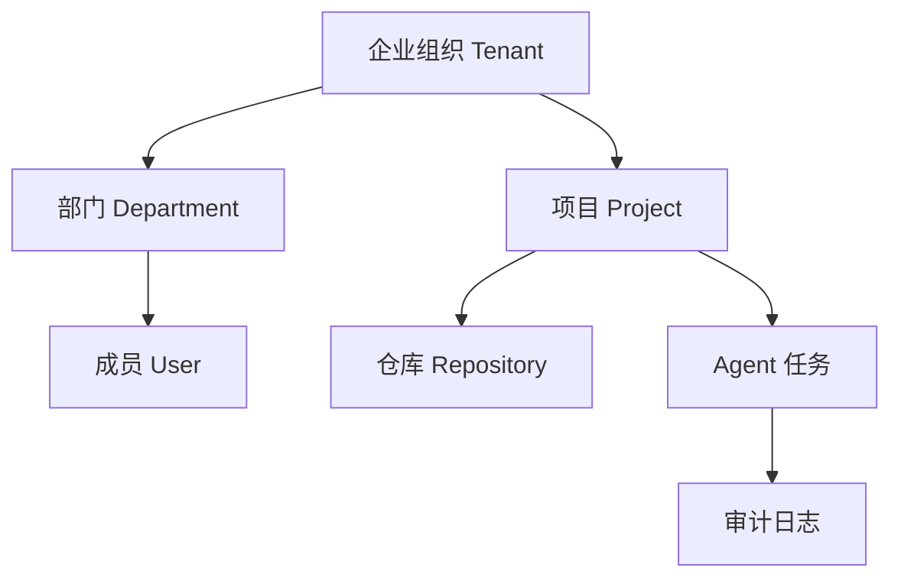

# 企业版多租户、权限与安全合规文档

> ⚠️ **历史兼容入口（已冻结）**：本文是企业版早期草稿，内容已被 `docs/enterprise/05-tenant-permission-security.md` 取代。
> **请以 `enterprise/` 目录为准**，本文仅保留用于追溯早期设计决策，不再更新。
> 已知过时点：§4 角色表为 6 类草案，实际实现为 7 类（见 `enterprise/05` §4）。

## 1. 文档定位

本文档定义企业版的组织隔离、权限模型、安全策略和合规要求。

> **权威文档**：`docs/enterprise/05-tenant-permission-security.md`

## 2. 多租户模型

## 3. 数据隔离原则

- 所有业务数据必须带 `tenant_id`。
- 项目、仓库、任务、审批、日志、索引元数据都必须归属组织。
- 查询接口必须默认按 `tenant_id` 过滤。
- Milvus Collection 需要按组织或项目隔离。
- 文件存储路径需要包含组织和项目标识。

## 4. 企业权限模型（早期草案 6 类 · 已过时）

> **已过时**：实际实现为 7 类角色，权威表见 `docs/enterprise/05-tenant-permission-security.md` §4。
> 下表仅保留早期设计原貌，**不要**用于接口、前端或验收脚本。

| 角色（草案） | 说明 |
| --- | --- |
| 企业管理员 | 管理组织、部门、成员、全局策略 |
| 安全管理员 | 管理密钥、审计、风险规则 |
| 项目管理员 | 管理项目成员、仓库、审批策略 |
| 审批链节点 | 按审批链处理任务 |
| 普通成员 | 创建和查看授权范围内任务 |
| 审计观察员 | 只读查看审计与回放 |

## 5. 审批链规则

- 低风险任务可走单人审批。
- 中风险任务至少需要项目审批人审批。
- 高风险任务需要项目审批人和安全管理员审批。
- 涉及命令白名单外操作时，必须阻断并进入人工确认。

## 6. 密钥与敏感信息

- Gitee Token、模型 Key、数据库密码不得明文回显。
- 密钥必须加密存储或接入企业 KMS。
- 日志中不得输出密钥、Token、私钥、Cookie。
- RAG 入库前必须过滤 `.env`、证书、私钥和构建产物。

## 7. 审计与留存

| 数据 | 默认留存 |
| --- | --- |
| 操作审计 | 180 天 |
| 审批记录 | 365 天 |
| 模型调用摘要 | 90 天 |
| 任务回放事件 | 180 天 |
| 安全告警 | 365 天 |

## 8. 验收标准

- 不同组织用户不能互查数据。
- 高风险任务能触发多级审批。
- 密钥字段不在接口和页面明文返回。
- 审计日志能导出。
- 敏感文件不会进入 RAG 索引。
