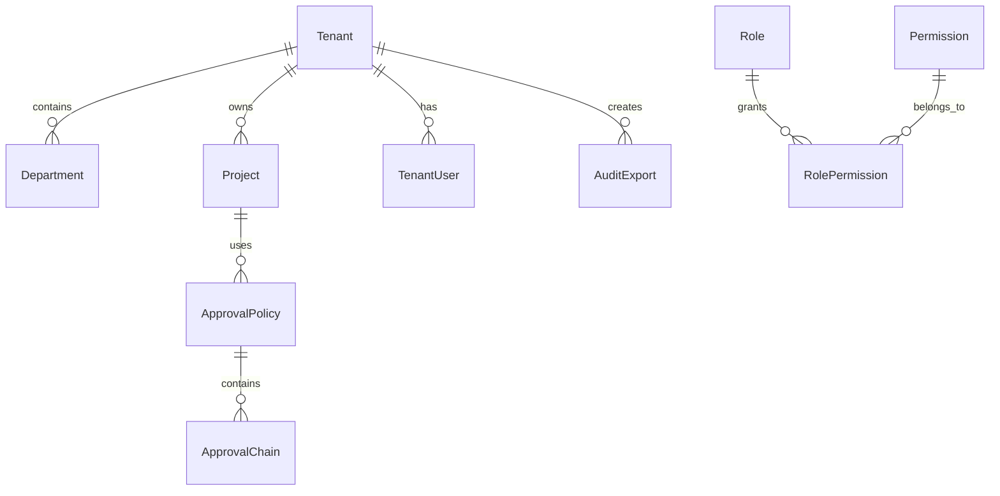

# 企业版 API、数据库与迁移文档

> ⚠️ **历史兼容入口（已冻结）**：本文是企业版早期草稿，内容已被 `docs/enterprise/07-api-database-migration.md` 取代。
> **请以 `enterprise/` 目录为准**，本文仅保留用于追溯早期设计决策，不再更新。

## 1. 文档定位

本文档记录企业版相对 MVP 和团队版新增的接口、数据对象和迁移原则。

> **权威文档**：`docs/enterprise/07-api-database-migration.md`

## 2. 新增数据对象

| 对象 | 说明 |
| --- | --- |
| Tenant | 企业组织 |
| Department | 部门 |
| TenantUser | 组织成员关系 |
| Role | 角色 |
| Permission | 权限点 |
| RolePermission | 角色权限关系 |
| ApprovalPolicy | 审批策略 |
| ApprovalChain | 审批链 |
| SecurityPolicy | 安全策略 |
| AuditExport | 审计导出任务 |

## 3. 企业版核心关系

## 4. 新增 API

| 方法 | 路径 | 说明 |
| --- | --- | --- |
| GET | `/api/tenants` | 获取组织列表 |
| POST | `/api/tenants` | 创建组织 |
| GET | `/api/tenants/{tenant_id}/departments` | 获取部门 |
| POST | `/api/tenants/{tenant_id}/departments` | 创建部门 |
| GET | `/api/roles` | 获取角色 |
| POST | `/api/roles` | 创建角色 |
| PATCH | `/api/roles/{role_id}/permissions` | 修改角色权限 |
| GET | `/api/audit-logs` | 查询审计日志 |
| POST | `/api/audit-logs/export` | 创建审计导出任务 |
| GET | `/api/security/policies` | 查询安全策略 |
| PATCH | `/api/security/policies/{policy_id}` | 修改安全策略 |

## 5. 迁移原则

- MVP 表结构向企业版演进时，优先新增字段，不破坏历史数据。
- 企业版核心业务表需要补 `tenant_id`。
- 所有迁移脚本必须可重复检查。
- 迁移前必须备份数据库。
- 大字段和日志表迁移需要分批执行。

## 6. 验收标准

- 企业版新增接口都带租户权限校验。
- 旧 MVP 数据可以迁移到默认组织。
- 审计导出任务可查询进度和下载结果。
- 数据库迁移过程可回滚或可恢复。
