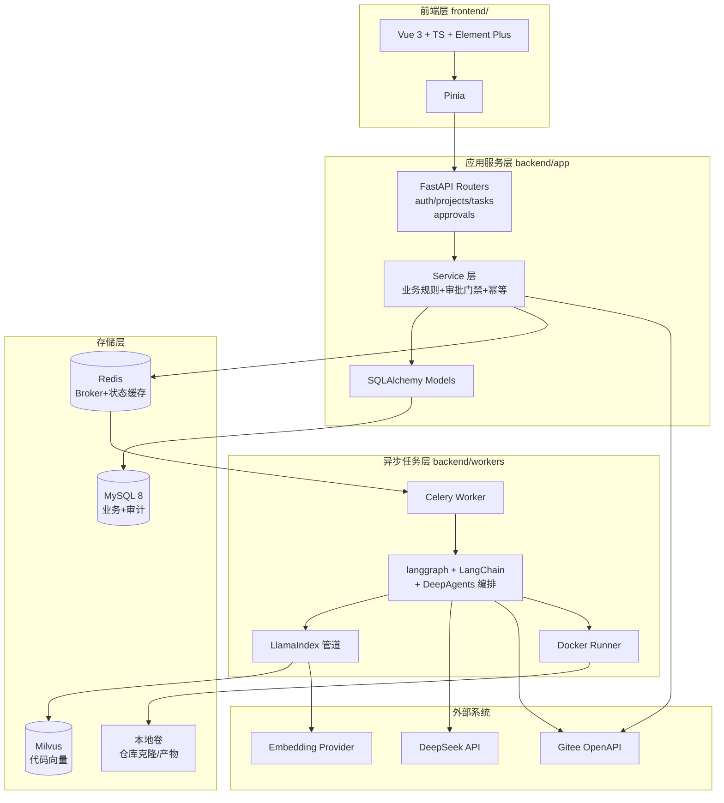
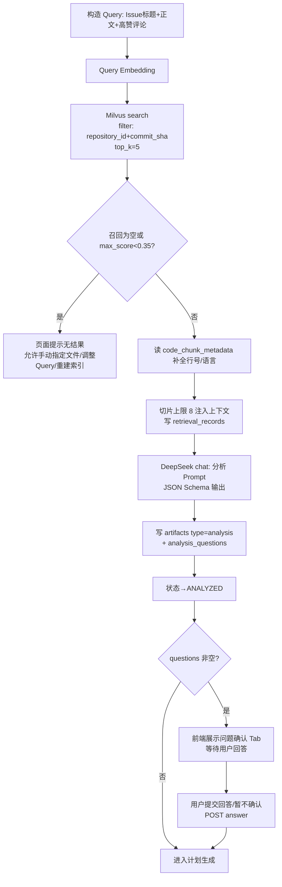
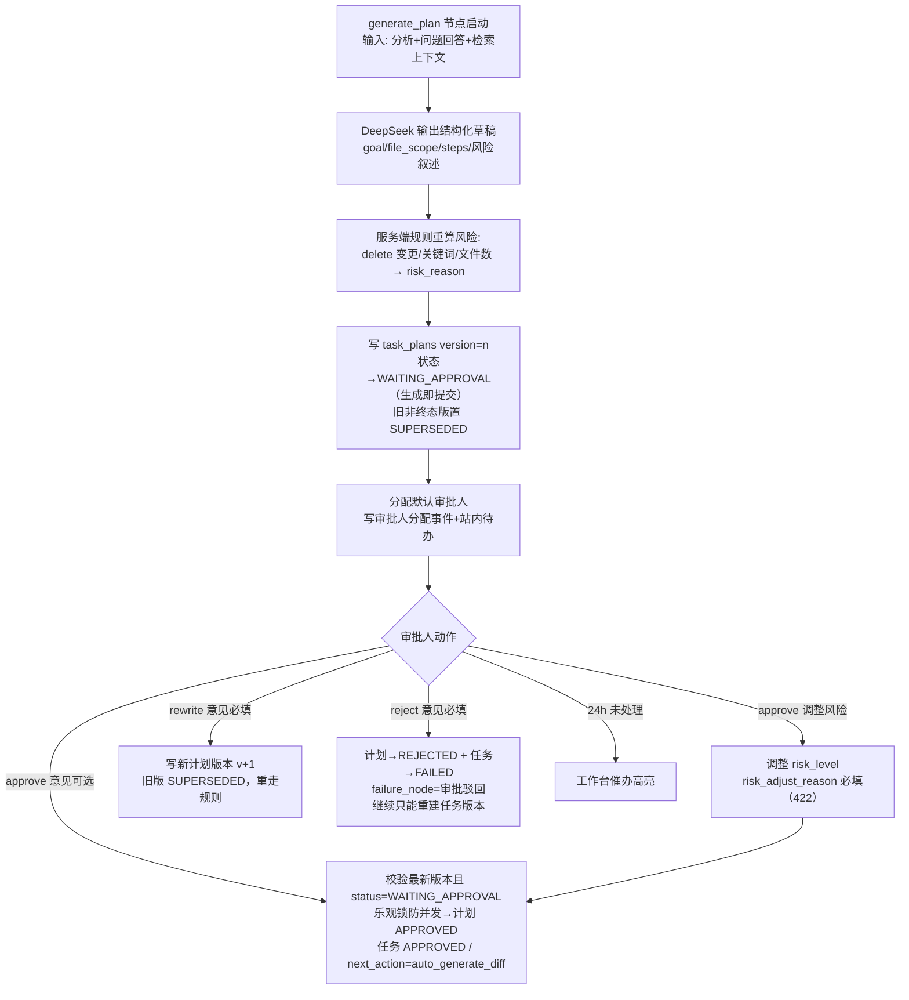
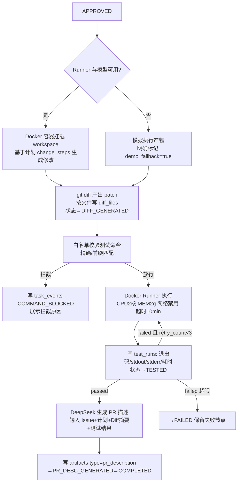
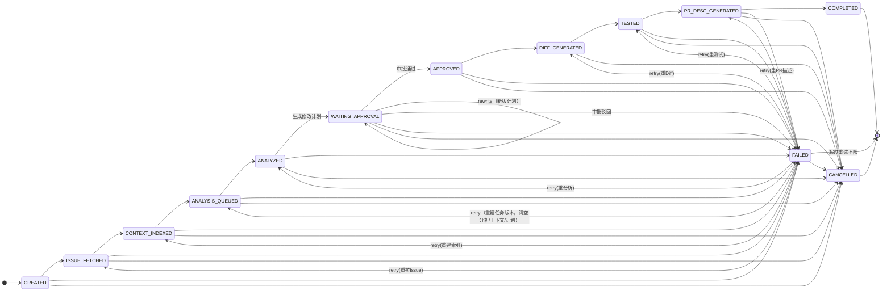

# 司契（Siqi）MVP — 功能细化拆解文档

| 项 | 内容 |
| --- | --- |
| 文档版本 | v1.0 |
| 编制日期 | 2026-08-31 |
| 对应 PRD | `02-prd.md`（v0.4） |
| 关联文档 | `03-mvp-workflow.md`、`04-technical-architecture.md`、`06-rag-design.md`、`07-ui-high-fidelity.md`、`08-api-design.md`、`09-database-design.md`、`10-ai-safety.md` |
| 适用对象 | 后端开发、前端开发、Agent/RAG 工程师、测试与答辩演示人员 |
| 文档性质 | 功能细化与开发指导，可直接作为迭代排期和任务领取依据 |

> **命名口径注记（2026-09-08 补充）**：本文档为 MVP 设计期快照，其中逻辑表名 `agent_tasks / diff_files / artifacts / code_chunk_metadata` 及第 8 节 DDL 均为设计期命名，不可直接照建。现行物理表名以 `docs/04-technical-architecture.md`（§4 核心表）、`docs/09-database-design.md`（含映射表）与源码 `backend/app/models/orm.py` 为准：对应为 `tasks / diffs / pr_descriptions / code_chunks`（历史设计名已废弃）。

> **检查点口径注记（2026-10-16 复核）**：§2.5 / §3 / §5.2 中「检查点持久化到 MySQL」「langgraph checkpoint 序列化图状态、审批后投递 resume_agent 从 checkpoint 恢复」为设计期口径，现行实现为——① 检查点落 `agent_checkpoints` 表（`backend/app/models/orm.py（AgentCheckpointORM）`），存储介质随环境为 MySQL 或 SQLite（本地默认 SQLite），非固定 MySQL；② `backend/app/agent/workflow.py（_checkpoint）` 仅存 `{status, next_action}` 摘要作暂停留痕，**不做整图状态序列化**；③ 恢复语义为「审批通过 → 任务状态置 `APPROVED` → 同图对应节点继续推进」（`backend/app/agent/workflow.py（node_wait_approval / node_generate_diff）`），真源是任务记录本身，不做反序列化恢复；④ 落检查点为 best-effort，失败不阻断主链（无 `resume_agent` 任务名，Worker 恢复入口为 `backend.run_agent`）。

---

## 目录

- [1. 系统概述与技术架构总览](#1-系统概述与技术架构总览)
- [2. 技术栈选型详解](#2-技术栈选型详解)
- [3. 技术栈差异分析与演进路线](#3-技术栈差异分析与演进路线)
- [4. 业务流程图](#4-业务流程图)
- [5. 任务编排方案](#5-任务编排方案)
- [6. API 接口定义](#6-api-接口定义)
- [7. 异常处理与重试策略](#7-异常处理与重试策略)
- [8. 数据库扩展方案（DDL）](#8-数据库扩展方案ddl)
- [9. 附录](#9-附录)

---

## 1. 系统概述与技术架构总览

**一句话定位**：司契（Siqi），面向企业研发团队的 AI Agent 研发协作平台——把 Gitee Issue 转化为「AI 分析 → RAG 检索 → 修改计划 → 人工审批 → Diff → 测试 → PR 描述」的全程可回放、可审计的交付闭环。

### 1.1 核心闭环

```text
Gitee Issue
  → 拉取 Issue 快照（Gitee OpenAPI）
  → 检查/复用仓库级 RAG 索引（Milvus）
  → AI 分析（DeepSeek，结构化输出 + 待确认问题）
  → 生成修改计划（版本化 TaskPlan）
  → 人工审批（approve / reject / revise 门禁）
  → 生成 Diff（Docker Runner 隔离执行）
  → 测试执行（白名单命令，记录 stdout/stderr）
  → 生成 PR 描述
  → 任务回放与审计（task_events + execution_steps）
```

### 1.2 架构分层图



### 1.3 关键架构决策（不可绕过）

1. **审批即门禁**：`WAITING_APPROVAL` 之前的一切产物只读展示；`generate_diff` 节点执行前必须校验最新计划 `status='APPROVED'`（审批动作同时写入 `task_events`，事件与计划状态均不可修改）。
2. **仓库索引是仓库级资源**：`RepositoryIndex` 按 `repository_id + commit_sha` 幂等复用，多个任务共享，避免重复全量索引（对应 PRD 量化指标「索引复用」）。
3. **双版本绑定**：所有产物（审批/Diff/测试/PR 描述/回放事件）同时记录 `task_version` 和 `plan_id`，这是回放归属清晰的根基。
4. **事件与步骤分离**：`task_events` 记业务级可审计事件（状态变化、审批、拦截），`execution_steps` 记 Agent 节点级输入输出；一个 event 可关联多个 steps。
5. **自动化优先**：系统默认自动执行 Issue 拉取、索引复用、分析、计划、Diff、测试和 PR 描述；只有高风险、授权过期、上下文不足、命令拦截、冲突和需要补充信息时才打断用户。
6. **人工入口收敛**：前端不展示一堆“下一步”按钮让用户猜，后端统一返回 `manual_required`、`manual_reason`、`next_action` 和 `automation_state`，前端据此只给一个主处理入口。
7. **降本指标可计算**：自动完成数、自动流转率、节省工时、失败自恢复次数、人工介入次数必须由后端事件和步骤数据计算，不能长期硬编码。

---

## 2. 技术栈选型详解

### 2.1 前端技术栈

| 项 | 选型 | 选型理由 |
| --- | --- | --- |
| 框架 | Vue 3 + TypeScript（Vite） | PRD 指定；管理台类应用生态成熟，组合式 API 适合任务详情等复杂页面 |
| 状态 | Pinia | 轻量官方方案，模块化 store（user/project/task/approval） |
| 路由 | Vue Router 4 | 路由守卫做登录拦截 + 角色入口控制 |
| UI | Element Plus | 表格/抽屉/时间线/标签/Diff 展示所需组件全覆盖，中文文档好 |
| Diff 渲染 | `diff` + `vue-diff`（或自研 hunk 组件） | 按 PRD 9.9 文件级分块展示，支持复制 patch |
| 请求 | Axios + 统一拦截器 | JWT 注入、401 跳登录、错误统一 toast |
| 图表 | ECharts（按需引入） | 工作台风险总览/趋势图 |

**页面与 PRD 模块映射**（对应 PRD 第 10 节，全部为 MVP 待实现）：

| 路由 | 页面 | 对应 PRD 模块 | 优先级 |
| --- | --- | --- | --- |
| `/login` | 登录页 | 9.1 登录与用户 | P0 |
| `/` | 工作台首页 | 10 工作台（风险总览/待办/趋势） | P0 |
| `/tasks` | 任务列表 | 9.4 Agent 任务（筛选/分页 20） | P0 |
| `/tasks/new` | 创建任务 | 9.3 Issue 接入 + 9.4 | P0 |
| `/tasks/:id` | 任务详情（Tab 化） | 9.5 分析 / 9.5.1 问题确认 / 9.6 上下文 / 9.7 计划 / 9.9-9.11 产物 | P0 |
| `/approvals` | 审批中心 | 9.8 审批 + 9.8.1/9.8.2 分配与通知 | P0 |
| `/tasks/:id/replay` | 任务回放 | 9.12 回放与审计 | P1 |
| `/tasks/:id/diffs` | Diff 审核 | 9.9 Diff 展示 | P1 |
| `/projects/:id/settings` | 项目配置 | 9.2 项目与仓库配置 | P0 |
| `/repositories/:id/index` | 索引管理 | 9.6 代码 RAG 与索引 | P0 |

任务详情页 Tab 结构建议：`Issue 概览 | AI 分析（含问题确认）| 代码上下文 | 修改计划 | 审批记录 | Diff | 测试 | PR 描述`，配合分块懒加载（PRD 15.1）。

### 2.2 后端服务架构

| 项 | 选型 | 理由 |
| --- | --- | --- |
| Web 框架 | FastAPI（uvicorn） | PRD 指定；异步、自动 OpenAPI 文档、Pydantic 校验 |
| 校验 | Pydantic v2 + pydantic-settings | 请求/响应模型 + 环境配置类型安全 |
| ORM | SQLAlchemy 2.0（async engine 可选，MVP 用同步 + Celery 并发足够） | 现有 `pyproject.toml` 已锁定 |
| 数据库 | MySQL 8.0（utf8mb4，`pymysql` 驱动） | PRD 指定；业务+审计同库分表 |
| 缓存/队列 | Redis 7 + Celery 5.6 | 现有依赖已含；Broker 用 db=0，任务状态缓存 db=1 |
| 执行隔离 | Docker SDK for Python（`docker` 包）+ 每任务独立容器 | CPU/内存/网络限制，工作目录挂载临时卷 |

**演进方案**：MVP 单机单 Worker 进程即可跑通闭环；V1.1 拆分 `worker-agent` / `worker-index` / `worker-runner` 三类队列，避免索引 Embedding 长任务阻塞 Agent 流程。

**后端目录结构**（在现有 `backend/` 脚手架上增量建设）：

```text
backend/
├── app/
│   ├── main.py               # FastAPI 入口，挂载路由/中间件/启动建表
│   ├── core/
│   │   ├── config.py          # pydantic-settings 配置
│   │   ├── security.py        # JWT 签发校验、密码 bcrypt、AES-GCM Token 加密
│   │   ├── permissions.py     # 角色-能力矩阵（PRD 5.2）依赖注入
│   │   └── errors.py          # 统一异常与错误码
│   ├── api/                   # 路由层（薄，只做校验和调用 service）
│   │   ├── auth.py  projects.py  repositories.py  tasks.py
│   │   ├── analysis.py  plans.py  approvals.py
│   │   └── diffs.py  tests.py  pr_description.py  replay.py
│   ├── models/                # SQLAlchemy 模型（对应 16 张表）
│   ├── schemas/               # Pydantic 请求/响应模型
│   ├── services/              # 业务规则：审批门禁、幂等、状态机流转、审计写入
│   │   ├── task_service.py  approval_service.py  index_service.py ...
│   ├── agent/                 # langgraph 图定义、节点、检查点
│   │   ├── graph.py  nodes/  prompts/  checkpoint.py
│   ├── retrieval/             # 后续拆分：代码解析、切片、检索、敏感过滤
│   │   ├── parsers.py  chunker.py  retriever.py  filters.py
│   ├── runner/                # Docker Runner：容器执行、白名单、资源限制
│   ├── gitee/                 # Gitee OpenAPI 适配层（Connector 抽象）
│   ├── model_clients/         # DeepSeek / 智谱 embedding 客户端抽象
│   └── workers/               # Celery 任务入口
│       ├── celery_app.py  agent_tasks.py  index_tasks.py  test_tasks.py
├── tests/
├── alembic/                   # 迁移（MVP 可 init 后统一 baseline）
├── pyproject.toml
└── main.py                    # （现有脚手架占位，后续删除或改造）
```

### 2.3 AI 模型选型矩阵

| 用途 | 模型/服务 | 调用方式 | 结构化输出 | 说明 |
| --- | --- | --- | --- | --- |
| Issue 分析叙述字段 | DeepSeek（默认 `deepseek-chat`） | Chat Completions，要求返回 JSON 对象 | 是（解析 `overview` / `findings` / `uncertainties`） | 只生成叙述字段；风险等级、阻塞问题、注入识别、来源引用仍由规则计算 |
| 复杂计划复核（后续增强） | DeepSeek 推理模型或企业指定模型 | 同上 | 是 | MVP 暂不启用，不进入验收范围 |
| 代码/Query Embedding | 智谱 `embedding-3`（默认 2048 维） | REST `/embeddings`，批量输入 | — | PRD 要求与 LLM 解耦；无 Key 时回退本地 64 维 token-hash |
| Gitee 数据 | Gitee OpenAPI v5 | REST + Token | — | 适配层封装，限流退避 |

**Provider 抽象约束**（PRD 15.4）：`backend/app/model_clients/base.py` 定义 `TextModelClient.generate(...)` 与 `EmbeddingClient.embed_texts(...)`；`backend/app/services/ai_analysis_service.py` 和 `backend/app/services/embedding_service.py` 负责业务侧接入与兜底。MVP 固定接入 DeepSeek 与智谱 embedding-3，启停、模型名、Base URL、维度、超时和重试均通过环境变量配置，不允许业务代码散落具体 API 调用。

### 2.4 数据库与缓存方案

| 存储 | 内容 | 关键约定 |
| --- | --- | --- |
| MySQL | 16 张业务/审计表（见第 8 节 DDL） | `utf8mb4`；所有枚举用 `VARCHAR + CHECK`；ID 用 `CHAR(36)` UUID（MySQL 8 函数索引友好）；时间 `DATETIME(3)` |
| Redis | Celery Broker（db=0）、任务状态缓存（db=1，TTL 5min，用于列表高频刷新）、索引幂等锁（`SETNX lock:index:{repo}:{sha}`） | 不存业务真相，只做加速 |
| Milvus | Collection `code_chunks`：`id`（自增 PK）、`embedding`（FLOAT_VECTOR）、标量字段 `repository_id/index_id/file_path/commit_sha/language` | 只存向量+过滤字段，业务元数据在 MySQL `code_chunk_metadata` |
| 本地卷 | 仓库克隆 `{DATA_DIR}/repos/{repository_id}/`、容器工作区 `{DATA_DIR}/workspaces/{task_id}/`、导出产物 `{DATA_DIR}/exports/{task_id}/` | 容器工作区任务结束后保留供回放复现，可配置清理策略 |

### 2.5 部署与运维方案（Docker Compose）

MVP 单机 Compose 服务清单：

| 服务 | 镜像/构建 | 端口 | 说明 |
| --- | --- | --- | --- |
| web | 前端静态 + Nginx（反代 `/api`） | 8000 | 合并部署降低演示复杂度 |
| api | `backend` 镜像，uvicorn | 8000（内） | 只做短请求 |
| worker | 同 backend 镜像，`celery -A app.workers.celery_app worker` | — | Agent/索引/测试队列（MVP 共队列） |
| mysql | mysql:8.0 | 3306 | 卷持久化，初始化 SQL 挂载 |
| redis | redis:7-alpine | 6379 | — |
| milvus-standalone | milvusdb/milvus + etcd + minio（标准三件套） | 19530 | 演示环境用 standalone |
| langgraph（可选） | 后续若拆独立 langgraph-api 服务再引入 | — | MVP 以进程内 langgraph 图 + MySQL 检查点实现，保留拆分边界 |

> 与现有 `deploy/docker-compose.ports.example.yml` 的关系：该文件是 mvp/team/enterprise 三阶段端口规划示例（8001/8002/8003），MVP 落地时新增 `deploy/docker-compose.mvp.yml`，对外端口沿用 8001。

环境变量（`deploy/env/mvp.env.example`）：`DATABASE_URL`、`REDIS_URL`、`MILVUS_URI`、`DEEPSEEK_API_KEY`、`EMBEDDING_API_KEY`、`EMBEDDING_DIM`、`JWT_SECRET`、`TOKEN_ENC_KEY`、`DATA_DIR`、`RUNNER_CPU_LIMIT=2`、`RUNNER_MEM_LIMIT=2g`、`RUNNER_NETWORK=none`。

---

## 3. 技术栈差异分析与演进路线

现状审查结论（2026-08-31）：`backend/` 为 uv 初始化脚手架（`main.py` 为 hello world），已锁定 fastapi/celery/sqlalchemy/redis/pymysql/pydantic-settings；**无前端工程、无 Agent/RAG/执行依赖、无数据库 schema、无 Compose 主文件**。

| # | 差异点 | PRD 要求 | 现状 | 处理建议 | 阶段 |
| --- | --- | --- | --- | --- | --- |
| 1 | Agent 编排依赖 | langgraph-api + LangChain + DeepAgents | 未安装 | 增量加入 `langgraph`、`langchain`、`deepagents`；MVP 图运行于 worker 进程内，检查点持久化到 MySQL，保留拆 langgraph-api 的边界 | 迭代一 |
| 2 | RAG 依赖 | LlamaIndex + Milvus | 未安装 | 增加 `llama-index-core`、`llama-index-readers-file`、`pymilvus` | 迭代一 |
| 3 | LLM 依赖 | DeepSeek | 未安装 | 增加 `openai`（DeepSeek 兼容 OpenAI SDK，无需专用包） | 迭代一 |
| 4 | Docker 执行 | Docker Runner | 未安装 | 增加 `docker` SDK；runner 独立模块，测试可 mock | 迭代三 |
| 5 | 前端工程 | Vue 3 + TS + Element Plus | 不存在 | 新建 `frontend/`（Vite 脚手架），不阻塞后端先行 | 迭代二 |
| 6 | 部署编排 | Docker Compose | 仅端口示例 | 新增 `docker-compose.mvp.yml` + env 模板 | 迭代四 |
| 7 | 入口占位 | FastAPI app | `main.py` 为脚本 | 将 `app/main.py` 作为真实入口，根 `main.py` 保留为 CLI 工具入口或删除 | 迭代一 |
| 8 | ORM 用法 | SQLAlchemy 2.0 | 已锁定版本但无代码 | 统一 2.0 style（`DeclarativeBase` + `Mapped[]`） | 迭代一 |

**分阶段演进路线**（不推翻任何已有工作，全部为增量）：

```text
迭代一：后端骨架 —— app/ 结构、配置、JWT 登录、projects/repositories CRUD、建表迁移
迭代二：任务主线 —— Issue 拉取快照、任务创建幂等、状态机、事件表落库、前端工程启动 + 登录/任务列表
迭代三：Agent 与 RAG —— Celery worker、langgraph 图、索引管道、检索、分析/计划生成、审批门禁 API
迭代四：执行与交付 —— Docker Runner、Diff、测试、PR 描述、回放页、审计导出、Compose 收口
```

---

## 4. 业务流程图

### 4.1 全链路总览（可执行视角）

```mermaid
flowchart TD
    START((用户点击创建任务)) --> A[POST /api/tasks<br/>幂等检查 repository+issue+未结束]
    A --> B[Celery: fetch_issue<br/>Gitee OpenAPI 拉取]
    B --> C[写 issue_snapshots 快照<br/>状态→ISSUE_FETCHED]
    C --> D{查 repository_indexes<br/>COMPLETED 且 commit 匹配?}
    D -->|是| H[Celery: retrieve_context<br/>Milvus Top-5 检索]
    D -->|否| E[Celery: build_index<br/>git clone→解析→切片→Embedding→写 Milvus]
    E --> F[索引状态机流转<br/>写 code_chunk_metadata]
    F --> H
    H --> I[Celery: analyze_issue<br/>DeepSeek JSON 输出<br/>写 artifacts + analysis_questions]
    I --> J[Celery: generate_plan<br/>写 task_plans v1<br/>状态→WAITING_APPROVAL]
    J --> K[审批人操作<br/>POST plans/{id}/approve<br/>/reject /rewrite]
    K -->|approve| L[Celery: generate_diff<br/>校验 plan.status=APPROVED 后执行]
    K -->|rewrite| J2[生成新计划版本 v+1<br/>旧版 SUPERSEDED] --> J
    K -->|reject| Z1[计划 REJECTED + 任务 FAILED<br/>继续只能重建任务版本]
    L --> M[Celery: run_tests<br/>Docker Runner 白名单执行]
    M -->|passed| N[Celery: generate_pr_description]
    M -->|failed 重试<3次| L
    M -->|超限| Z2[状态→FAILED]
    N --> O[状态→COMPLETED<br/>全链 task_events 可回放]
```

### 4.2 环节一：Issue 拉取与快照

```mermaid
flowchart TD
    A[开发者填 项目/仓库/IssueID/分支] --> B[POST /api/tasks]
    B --> C{存在未结束同源任务?}
    C -->|是| D[409 返回已有 task_id<br/>前端跳转详情页]
    C -->|否| E[写 agent_tasks<br/>status=CREATED<br/>生成 branch_name]
    E --> F[投递 fetch_issue 任务]
    F --> G[GET gitee.com/api/v5/repos/{owner}/{repo}/issues/{id}]
    G -->|404/403| H[任务→FAILED<br/>记录 Gitee 错误码]
    G -->|成功| I[拉取评论+标签]
    I --> J[写 issue_snapshots<br/>标题/正文/评论/标签/raw_response]
    J --> K[状态→ISSUE_FETCHED<br/>写 task_event]
```

要点：branch_name 生成规则 `agent/{base_branch}-{issue_id}-v{task_version}`（截断 60 字符防超限）；幂等唯一键见第 8 节 `agent_tasks` 索引。

### 4.3 环节二：仓库索引（RAG 入库）

```mermaid
flowchart TD
    A[fetch_issue 完成] --> B{repository_indexes 有<br/>COMPLETED 且 commit_sha 匹配?}
    B -->|有| Z[直接复用<br/>任务→CONTEXT_INDEXED]
    B -->|无| C[创建索引记录 status=PENDING<br/>SETNX 幂等锁]
    C --> D[SYNCING: git clone --depth 1<br/>指定分支到 repos/{repo_id}]
    D --> E[PARSING: LlamaIndex 遍历文件<br/>filters.py 过滤 .env/证书/私钥/token/构建产物/依赖目录]
    E --> F[按语言 AST/函数级切片<br/>记录 symbol/行号]
    F --> G[EMBEDDING: 批量调 Provider<br/>每批 32 条，失败退避]
    G --> H[STORING: Milvus insert<br/>+ MySQL 写 code_chunk_metadata]
    H --> I[status=COMPLETED<br/>记录 file_count/chunk_count]
    G -->|失败| J[status=FAILED<br/>记录 error_msg，可重试]
```

### 4.4 环节三：检索与分析



### 4.5 环节四：计划生成与审批门禁



### 4.6 环节五：Diff 生成、测试与 PR 描述



### 4.7 环节六：任务回放

回放页数据装配（同步查询，无新流程）：`GET /api/tasks/{id}/timeline` 返回按时间排序的 `task_events`，每个 event 携带关联的 `execution_steps`（输入/输出摘要/耗时/失败原因）；侧栏聚合 `task_plans`（含审批事件）、`diff_files`、`test_runs`、`artifacts`、`retrieval_records`。脱敏在响应序列化层完成（正则掩码密钥/邮箱/手机号/token）。

---

## 5. 任务编排方案

### 5.1 任务状态机（完整，与 PRD 11.2 一致）



实现约定：状态流转统一收敛在 `services/task_service.py` 的 `transition(task, to_status, actor, reason)`——校验合法迁移（白名单表驱动）、乐观锁 `WHERE status = :expected`、写 `task_events`，三步同一事务；任何节点代码不得直接 `UPDATE agent_tasks.status`。审批动作不改任务状态机入口（通过计划端点落地到计划 `status` 并同步任务状态）。

### 5.2 Agent 节点配置表（langgraph 图）

| 节点 | Celery 队列 | 输入 | 输出（落库） | 失败语义 | 超时 |
| --- | --- | --- | --- | --- | --- |
| `fetch_issue` | default | task_id | `issue_snapshots` 行 | 可重试（网络/Token） | 60s |
| `build_index`* | default | repository_id, commit_sha | `repository_indexes` + `code_chunk_metadata` + Milvus | 可重试（独立索引状态机） | 30min |
| `retrieve_context` | default | task_id, query | `retrieval_records` | 可重试 | 30s |
| `analyze_issue` | default | 快照+上下文+问题回答 | `artifacts(analysis)` + `analysis_questions` | 可重试 | 120s |
| `generate_plan` | default | 分析+上下文 | `task_plans` | 可重试 | 120s |
| `pause_for_approval` | —（中断点） | plan_id | 图挂起，checkpoint 持久化 | 等待人工 | 无 |
| `generate_diff` | default | plan_id, workspace | `diff_files` | 可重试 | 10min |
| `run_tests` | runner | diff, test_command | `test_runs` | 有限重试（≤3） | 10min/次 |
| `generate_pr_description` | default | 全部产物 | `artifacts(pr_description)` | 可重试 | 120s |

\* `build_index` 是仓库级旁路节点：多个任务可等待同一索引任务，通过轮询/回调解除阻塞。

`pause_for_approval` 实现：langgraph checkpoint（MySQL 表 `agent_checkpoints`）序列化图状态；审批 approve 后由 API 侧投递 `resume_agent` 任务从 checkpoint 恢复执行——这是 Worker 中断后任务不丢失的关键（PRD 15.2）。

### 5.3 数据流转映射表

| 节点 → 表 | 写入字段要点 |
| --- | --- |
| fetch_issue → issue_snapshots | title/body/comments/labels/raw_response(JSON)/issue_url/commit_sha |
| build_index → repository_indexes, code_chunk_metadata | 索引状态机字段 + chunk 的 file_path/language/symbol/行号/commit_sha/milvus_pk |
| retrieve_context → retrieval_records | query/top_k/index_id/result_chunk_ids/scores |
| analyze_issue → artifacts, analysis_questions | artifact_type=analysis + JSON content；question content/required/answer_status |
| generate_plan → task_plans | version 自增、goal/file_scope(JSON)/steps(JSON)/risk_level/risk_reason/test_suggestions/assumptions/rollback_plan/generated_from_*/status |
| 审批动作 → task_events + task_plans.status | PLAN_APPROVED / PLAN_REWRITTEN / PLAN_REJECTED 事件（version/审批人/意见/风险调整），审批结果落计划状态（只新增） |
| generate_diff → diff_files | file_path/change_type/patch/added_lines/deleted_lines/is_fallback |
| run_tests → test_runs | command/exit_code/stdout/stderr/status/duration/retry_count |
| generate_pr_description → artifacts | artifact_type=pr_description，结构见 6.9 |
| 所有节点 → execution_steps, task_events | step 输入输出摘要/耗时/错误；事件类型见 9.1 |

---

## 6. API 接口定义

约定：鉴权头 `Authorization: Bearer <jwt>`；错误统一结构 `{"error": {"code": "STRING", "message": "中文说明", "detail": {}}}`；分页参数 `page`（默认 1）、`page_size`（默认 20）；列表响应统一 `{"items": [], "total": n, "page": p, "page_size": s}`。

### 6.1 认证

**POST `/api/auth/login`**

```json
// Request
{ "email": "dev@example.com", "password": "Passw0rd!" }
// Response 200
{ "token": "eyJhbGciOi...", "user": { "id": "u-8f2c...", "name": "小泽", "role": "developer" } }
// Response 401
{ "error": { "code": "AUTH_FAILED", "message": "账号或密码错误" } }
```

**POST `/api/auth/logout`** → `{"ok": true}`（JWT 无状态，前端清 token + 服务端写审计事件）。
**GET `/api/auth/me`** → 同 login 响应中的 `user` 结构。

### 6.2 项目与仓库

**POST `/api/projects`**（管理员）

```json
// Request
{ "name": "电商平台研发", "description": "主力业务仓库协作",
  "default_approver_ids": ["u-9a01"], "approval_mode": "single",
  "model_provider": "deepseek" }
// Response 201
{ "id": "p-3d10...", "name": "电商平台研发", "owner_id": "u-8f2c...",
  "default_approver_ids": ["u-9a01"], "approval_mode": "single",
  "model_provider": "deepseek", "created_at": "2026-08-31T16:00:00.123" }
```

**POST `/api/repositories`**（管理员）

```json
// Request
{ "project_id": "p-3d10...", "repository_url": "https://gitee.com/team/shop-server",
  "default_branch": "main", "gitee_token": "明文Token仅此一次传输",
  "test_command": "pytest -q", "command_whitelist": ["npm test", "pytest", "pnpm test"],
  "risk_threshold": "medium" }
// Response 201（Token 加密入库，只回显别名与状态）
{ "id": "r-7b22...", "project_id": "p-3d10...", "repository_url": "https://gitee.com/team/shop-server",
  "default_branch": "main", "gitee_token_ref": "enc:7b22...a91f",
  "gitee_token_status": "valid", "test_command": "pytest -q",
  "command_whitelist": ["npm test", "pytest", "pnpm test"], "risk_threshold": "medium" }
```

**POST `/api/repositories/{id}/index`**（创建索引，幂等：同 repo+commit 已有运行中索引则返回该索引）

```json
// Request（body 可为空）
{}
// Response 202
{ "index_id": "idx-1c44...", "repository_id": "r-7b22...", "commit_sha": "a1b2c3d...",
  "status": "PENDING" }
```

**GET `/api/repositories/{id}/indexes`**（索引历史与状态）

```json
// Response 200
[
  { "id": "idx-1c44...", "repository_id": "r-7b22...", "commit_sha": "a1b2c3d...",
    "status": "EMBEDDING", "mode": "full", "total_files": 412,
    "processed_files": 128, "chunk_count": 3860, "error_message": null,
    "error_stage": null, "retry_count": 0, "started_at": "2026-08-31T15:40:11.000",
    "finished_at": null }
]
```

**GET `/api/repositories/{id}/indexes/{index_id}`** 返回单个索引详情；**POST `/api/repositories/{id}/indexes/{index_id}/retry`** 仅允许重试 `FAILED` 状态索引。

`POST /index/rebuild`、`GET /api/projects`、`GET /api/repositories` 等为同构 CRUD/异步触发接口。MVP 不提供独立的 `/api/repositories/sync` 接口，仓库代码快照同步由索引创建或重建流程内部触发。

### 6.3 任务

**POST `/api/tasks`**

```json
// Request
{ "project_id": "p-3d10...", "repository_id": "r-7b22...",
  "issue_id": "1024", "base_branch": "main", "test_command": "pytest -q" }
// Response 201
{ "task_id": "t-5e88...", "project_id": "p-3d10...", "repository_id": "r-7b22...",
  "issue_id": "1024", "task_version": 2, "title": "订单列表分页参数校验缺失",
  "status": "CREATED", "risk_level": null, "base_branch": "main",
  "branch_name": "agent/main-1024-v2", "test_command": "pytest -q",
  "created_by": "u-8f2c...", "created_at": "2026-08-31T16:05:00.000" }
// Response 409（存在未结束同源任务）
{ "error": { "code": "TASK_DUPLICATE_ACTIVE", "message": "该 Issue 已有进行中任务",
  "detail": { "existing_task_id": "t-4a10..." } } }
```

创建任务联调约束：

- 前端默认只要求项目、仓库和 Issue ID；`base_branch`、`test_command` 可由项目/仓库配置自动补齐。
- 请求体不传 `risk_level`，风险等级由 AI 分析和计划生成阶段计算。
- 创建成功后后端自动投递 `fetch_issue`，并继续检查索引、检索上下文、生成分析和计划。
- 如果存在同仓库同 Issue 的未结束任务，返回 409 和 `existing_task_id`，前端提示跳转已有任务，避免重复创建。

**GET `/api/tasks`**（筛选：`project_id`、`status`、`risk_level`、`keyword`、`created_from`/`created_to`）

```json
// Response 200
{ "items": [ { "task_id": "t-5e88...", "title": "订单列表分页参数校验缺失",
     "status": "WAITING_APPROVAL", "risk_level": "medium", "issue_id": "1024",
     "approver_ids": ["u-9a01"], "manual_required": true,
     "manual_reason": "high_risk", "next_action": "approve",
     "automation_state": "waiting_approval",
     "updated_at": "2026-08-31T16:22:10.500" } ],
   "total": 1, "page": 1, "page_size": 20 }
```

**GET `/api/tasks/{task_id}`**：返回任务全字段 + `issue_snapshot` 摘要 + `current_plan_id` + 各产物是否就绪的布尔标记（`has_analysis/has_diff/has_test/has_pr_description`），Diff/测试/日志按需分块拉取。

任务详情还必须返回 `manual_required`、`manual_reason`、`next_action`、`automation_state`、`failed_node`、`failed_reason` 和 `retry_count`，前端用这些字段展示“当前为什么停住”和“一键恢复”。

**POST `/api/tasks/{task_id}/retry`**

```json
// Request
{ "from_node": "run_tests" }   // 缺省自动取最近失败节点
// Response 202
{ "task_id": "t-5e88...", "status": "TESTED", "retry_node": "run_tests",
  "retry_count": 2, "max_retry": 3 }
// Response 409（终态不可重试）
{ "error": { "code": "TASK_TERMINAL", "message": "任务已结束，无法重试" } }
```

**POST `/api/tasks/{task_id}/cancel`** → 可取消状态返回 `{"task_id": "...", "status": "CANCELLED"}`；终态返回 409 `TASK_TERMINAL`。`refresh-issue`、`events`、`timeline`、`contexts` 为只读/重触发接口，结构从略。

### 6.4 分析与问题确认

**POST `/api/tasks/{task_id}/analysis/generate`**（异步触发，需任务 ≥ `ISSUE_FETCHED`）

```json
// Response 202
{ "artifact_id": "a-2f00...", "status": "PENDING" }
```

**GET `/api/tasks/{task_id}/analysis/questions`**

```json
// Response 200
{ "items": [ { "question_id": "q-11ab...", "content": "分页参数缺失时应抛 400 还是返回空列表？",
    "required": true, "answer": null, "answer_status": "pending",
    "answered_by": null, "answered_at": null } ] }
```

**POST `/api/tasks/{task_id}/analysis/questions/{question_id}/answer`**

```json
// Request
{ "answer": "按团队规范返回空列表并记录 warn 日志" }
// 或
{ "answer_status": "skipped" }
// Response 200
{ "question_id": "q-11ab...", "answer_status": "answered",
  "answered_by": "u-8f2c...", "answered_at": "2026-08-31T16:30:00.000" }
```

### 6.5 计划

**POST `/api/tasks/{task_id}/plans`**（生成修改计划，需任务 `ANALYZED`、分析存在且无未确认阻塞问题；请求体为空，生成即提交审批）

```json
// Response 200（完整任务对象，data.plans 为计划列表按版本倒序）
{ "code": 0, "message": "修改计划已生成并提交审批",
  "data": { "id": "TASK-8801", "status": "WAITING_APPROVAL",
    "risk_level": "high", "risk_source": "plan",
    "next_action": "review_plan", "plans": [ { ... } ] } }
```

```json
// Response 409（状态不符 / 阻塞问题未答 / 上下文过期，按序返回）
{ "error": { "code": "TASK_STATE_CONFLICT", "message": "任务尚未完成 AI 分析，不能生成修改计划" } }
```

**GET `/api/tasks/{task_id}/plans`**：计划列表，按 `version` 倒序（首个为最新版）。

**GET `/api/tasks/{task_id}/plans/{plan_id}`**：单计划详情；不存在或不属于该任务返回 404。

```json
// Response 200
{ "id": "PLAN-8801-1", "task_id": "TASK-8801", "version": 1,
  "goal": "为订单列表接口补充分页参数边界校验",
  "file_scope": [
    { "file_path": "app/schemas/pagination.py", "change_type": "modify",
      "reason": "分页参数缺省校验入口（pagination.py:12-30）", "risk_hint": "兼容" },
    { "file_path": "app/api/orders.py", "change_type": "modify",
      "reason": "list_orders 注入依赖并校验 page/page_size", "risk_hint": null } ],
  "steps": [
    { "order": 1, "title": "新增 PageParams 校验模型",
      "description": "对 page/page_size 做边界与缺省校验。", "target_files": ["app/schemas/pagination.py"], "risk_hint": "兼容" },
    { "order": 2, "title": "接入订单列表接口",
      "description": "list_orders 使用校验结果。", "target_files": ["app/api/orders.py"], "risk_hint": null } ],
  "risk_level": "medium", "risk_reason": "命中中危关键词：兼容；涉及公共查询参数模型",
  "test_suggestions": ["pytest tests/test_orders.py -q", "越界与缺省参数用例"],
  "assumptions": ["仅兼容当前主版本", "缺少代码上下文，本计划为低置信度"],
  "rollback_plan": ["单分支提交，可直接 git revert"],
  "generated_from_analysis_revision": 1,
  "generated_from_context_ids": ["app/schemas/pagination.py:12-30"],
  "provider": "mvp-rule-based", "status": "WAITING_APPROVAL",
  "created_by": "user_dev001", "created_by_name": "开发者A",
  "created_at": "2026-09-04T10:00:00Z", "risk_adjust_reason": null }
```

计划规则：

- 版本从 1 递增；生成或重写时旧的非终态计划（`WAITING_APPROVAL` / `APPROVED`）置 `SUPERSEDED`，只有最新版本可被审批。
- 风险等级为后端规则基于计划内容的重算结果（`delete` 变更或高危关键词 → high；中危关键词或 ≥ 4 文件 → medium；否则 low），同步到任务 `risk_level` / `risk_source=plan`。
- 无代码上下文放行但声明低置信度；任一上下文 `fresh=false` 时返回 409。
- 生成成功任务进入 `WAITING_APPROVAL`（`manual_reason=approval_required`、`next_action=review_plan`）并追加 `PLAN_GENERATED` 事件。
- `provider=deepseek` 仅当配置 `LLM_API_KEY` 且模型成功返回结构化草稿；否则 `mvp-rule-based`。

### 6.6 审批

审批操作以单计划为对象：**POST `/api/tasks/{task_id}/plans/{plan_id}/approve`**、**`/reject`**、**`/rewrite`**（需 `approval:manage`）。待审批列表由前端基于任务列表筛选（`GET /api/tasks` 的 `manual_required=true` 项）并对目标任务加载计划（`GET /api/tasks/{task_id}/plans`），后端无独立批量端点。

**POST `/api/tasks/{task_id}/plans/{plan_id}/approve`**

```json
// Request（comment 选填；调整风险时 risk_adjust_reason 必填）
{ "comment": "范围可控，同意执行", "risk_level": "low",
  "risk_adjust_reason": "校验逻辑独立且带回归用例，降为低风险" }
// Response 200
{ "code": 0, "message": "计划已通过（风险等级由规则建议调整为 low）",
  "data": { "id": "TASK-8801", "status": "APPROVED", "risk_level": "low",
    "risk_source": "plan_approval", "next_action": "auto_generate_diff", "plans": [ { ... } ] } }
```

- 提供 `risk_level` 且与计划不一致但未填原因 → 422「调整风险等级时必须填写调整原因」。
- 仅最新版本计划可审批；任务/计划不处于 `WAITING_APPROVAL` 或旧版本 → 409。

**POST `/api/tasks/{task_id}/plans/{plan_id}/rewrite`**（要求重写，生成新版本）

```json
// Request（reason 必填，为空 422）
{ "reason": "缺少回滚策略与兼容性说明，请补充后重新提交" }
```

- 新计划 `version` 加 1，旧计划置 `SUPERSEDED`，任务保持 `WAITING_APPROVAL`；追加 `PLAN_REWRITTEN` 事件（actor 为新版计划创建人）。

**POST `/api/tasks/{task_id}/plans/{plan_id}/reject`**（拒绝计划）

```json
// Request（reason 必填，为空 422）
{ "reason": "方案与现有链路冲突，需重新设计后再提交" }
// Response 200
{ "code": 0, "message": "计划已拒绝，任务已终止；如需继续，请重试重建任务版本",
  "data": { "id": "TASK-8801", "status": "FAILED",
    "failure_node": "审批驳回", "manual_reason": "plan_rejected", "plans": [ { ... } ] } }
```

- 拒绝后计划 `REJECTED`，任务 `FAILED`（`failure_node=审批驳回`、`manual_reason=plan_rejected`），事件顺序 `[PLAN_REJECTED, TASK_FAILED]`。
- 被拒绝任务只能 `POST /api/tasks/{task_id}/retry` 重建任务版本（清空分析、上下文与计划后重新流转）。

批量审批和低风险一键通过（前端语义）：

- 多选批量动作：对每个目标任务取最新 `WAITING_APPROVAL` 计划，逐项调用 approve / rewrite / reject，用 `Promise.allSettled` 汇总每项结果；失败项与「非待审批已跳过」项必须展示，不能静默处理或兜底替换为全部待审批任务。
- 「一键通过低风险」：对风险为 `low` 的待审批计划逐项调用 approve（不带意见），动作署名审批人并写入事件；real 模式下每项都会写审计，mock 模式仅演示态更新前端状态。

### 6.7 Diff

**GET `/api/tasks/{task_id}/diffs`**

```json
// Response 200
{ "items": [ { "file_id": "d-4b77...", "file_path": "app/api/orders.py",
    "change_type": "modify", "added_lines": 12, "deleted_lines": 3,
    "is_fallback": false } ], "total": 3 }
```

**GET `/api/tasks/{task_id}/diffs/{file_id}`**

```json
// Response 200
{ "file_id": "d-4b77...", "file_path": "app/api/orders.py", "change_type": "modify",
  "patch": "@@ -41,6 +41,19 @@\n+from app.schemas.pagination import PageParams\n...",
  "added_lines": 12, "deleted_lines": 3, "plan_id": "plan-9c31...",
  "is_fallback": false, "created_at": "2026-08-31T17:05:00.000" }
```

### 6.8 测试

**POST `/api/tasks/{task_id}/tests/run`**（需 ≥ `DIFF_GENERATED`）

```json
// Request
{ "command": "pytest -q" }   // 缺省用任务/项目配置命令
// Response 202
{ "test_run_id": "tr-8e19...", "status": "running" }
// 命令被白名单拦截时 Response 400
{ "error": { "code": "COMMAND_BLOCKED", "message": "命令不在白名单内，已拦截并记录审计事件",
  "detail": { "command": "rm -rf /" } } }
```

**GET `/api/tasks/{task_id}/tests`**

```json
// Response 200
{ "items": [ { "test_run_id": "tr-8e19...", "command": "pytest -q", "exit_code": 0,
    "status": "passed", "duration_ms": 42300, "retry_count": 0,
    "stdout": "............ 12 passed in 41.20s", "stderr": "",
    "created_at": "2026-08-31T17:10:00.000" } ], "total": 1 }
```

### 6.9 PR 描述

**GET `/api/tasks/{task_id}/pr-description`**

```json
// Response 200
{ "artifact_id": "a-2f91...", "task_id": "t-5e88...", "task_version": 2,
  "plan_id": "plan-9c31...", "plan_version": 1,
  "content": {
    "background": "Issue #1024：订单列表接口缺少分页参数校验，极端参数导致慢查询。",
    "change_summary": "新增 PageParams 校验模型；list_orders 注入校验依赖；补充 3 个边界用例。",
    "impact_scope": ["app/api/orders.py", "app/schemas/pagination.py"],
    "test_result": "pytest 12 passed（1 次重试后通过），详见 test_run tr-8e19...",
    "risk_notes": "公共分页模型变更，需关注其他引用接口。",
    "rollback_notes": "单分支提交，git revert 即可回滚。" },
  "created_at": "2026-08-31T17:15:00.000" }
```

**POST `/api/tasks/{task_id}/pr-description/regenerate`** → `202 {"artifact_id": "...", "status": "PENDING"}`。

### 6.10 回放与审计

**GET `/api/tasks/{task_id}/timeline`**

```json
// Response 200（节选）
{ "task_id": "t-5e88...", "events": [ {
    "event_id": "ev-1001...", "event_type": "STATUS_CHANGED", "status": "WAITING_APPROVAL",
    "actor": "system:generate_plan", "message": "计划 v1 生成，等待审批",
    "created_at": "2026-08-31T16:22:10.500",
    "steps": [ { "step_id": "st-3001...", "node": "generate_plan", "status": "success",
        "input_digest": "analysis+a2f00/questions+2/chunks+6", "output_digest": "plan-9c31...",
        "duration_ms": 8100, "error_msg": null } ] } ] }
```

**GET `/api/tasks/{task_id}/events`**：同上但不含 steps 展开。导出：`GET /api/tasks/{task_id}/audit-export?format=json|markdown`（写 `exports/{task_id}/`，返回下载地址）。

---

## 7. 异常处理与重试策略

### 7.1 四层异常处理表

| 层 | 异常场景 | 处理策略（量化） |
| --- | --- | --- |
| 客户端层 | 401 过期 / 403 越权 / 409 冲突 | 401 静默刷新或跳登录；403 toast「权限不足」并记录访问尝试审计；409 按错误码展示 detail 中已有资源 |
| API 层（Gitee/LLM/Embedding 调用） | 超时、4xx、429、5xx | 4xx 不重试直接落库；429 与 5xx **指数退避重试 3 次**（5s / 15s / 45s）；Gitee 限流额外读取 `Retry-After` 头；连续失败触发熔断 |
| 任务层（Celery/Agent 节点） | 节点抛错、Worker 崩溃、超时 | 节点级 `max_retries=3`，`retry_backoff` 指数；Worker 崩溃依赖 langgraph checkpoint 恢复（`acks_late=true` + 任务幂等键）；测试节点重试上限独立为 3 次且计入 `test_runs.retry_count`；当前 MVP 的任务重试会清空分析、上下文与计划后重建任务轮次，后续可扩展“从最近失败节点续跑” |
| 数据层 | DB 连接抖动、Milvus 写入失败、唯一键冲突 | DB 用连接池 `pool_pre_ping` + SQLAlchemy `pool_recycle=1800`；Milvus 写入失败索引任务转 `FAILED`（向量已写部分随重建覆盖）；唯一键冲突统一映射 409 业务码 |

### 7.1.1 人工介入分流

联调时所有异常都要落到统一的人工介入字段，方便前端只露出关键入口：

| manual_reason | 触发条件 | 前端主动作 |
| --- | --- | --- |
| high_risk | 计划风险达到或超过项目阈值 | 审批 |
| auth_expired | Gitee Token 过期或仓库无权限 | 当前 MVP 直接返回失败并提示重新授权；后续可扩展为进入 `manual_required=true` |
| context_missing | RAG 召回为空或低于阈值 | 补充文件范围或重建索引 |
| command_blocked | 测试命令不在白名单 | 修改测试命令或调整白名单 |
| conflict | 并发创建、并发审批或索引任务冲突 | 查看已有任务或刷新状态 |
| external_failed | Gitee、LLM、Embedding、Milvus、Docker 连续失败 | 查看诊断并重试 |
| none | 自动流程可继续 | 不展示人工待处理入口 |

### 7.2 熔断器（对外部依赖，固定阈值）

| 依赖 | 触发条件 | 打开动作 | 半开探测 |
| --- | --- | --- | --- |
| DeepSeek | 60s 内 ≥5 次连续失败或 ≥50% 失败率（样本≥10） | 熔断 120s，期间分析/计划/PR 节点直接进 FAILED（可重试），前端标注「模型暂不可用」，Diff 节点允许走模拟兜底 | 120s 后放 1 次探测请求 |
| Embedding Provider | 60s 内 ≥5 次失败 | 索引任务全部转 FAILED，任务停在可重试态 | 同上，60s |
| Gitee OpenAPI | 60s 内 ≥8 次 429/5xx | 拉取/同步请求快速失败并提示「Gitee 限流」，保留 Issue 快照缓存兜底 | 90s |
| Milvus | 60s 内 ≥5 次连接失败 | 检索返回「索引暂不可用」，检索降级为空结果提示 | 60s |

熔断实现：Redis 计数器 + 过期时间（`INCR` + `EXPIRE`），Worker 侧装饰器 `@circuit(dep_name)`，不引入额外框架。

### 7.3 幂等与并发控制

| 场景 | 机制 |
| --- | --- |
| 并发创建同一 Issue | 唯一索引 `uk_active_issue(repository_id, issue_id, is_active_flag)`（用生成列将「未结束状态」物化为 1）+ 捕获冲突返回 409 + 已有 task_id |
| 并发审批同一计划 | `approvals` 写入前 `UPDATE agent_tasks SET status='APPROVED' WHERE task_id=? AND status='WAITING_APPROVAL' AND current_plan_id=?`，影响行数=0 即返回 409 冲突 |
| 并发重建同一索引 | Redis `SETNX lock:index:{repository_id}:{commit_sha} EX 600` + `repository_indexes` 唯一键 `uk_repo_commit(repository_id, commit_sha)` |
| Celery 任务重复投递 | 每个节点任务携带业务幂等键（`task_id + node + attempt`），执行前检查 `execution_steps` 是否已有成功记录 |

---

## 8. 数据库扩展方案（DDL）

> 与 `09-database-design.md` 字段口径对齐并细化为可执行 DDL。MySQL 8.0，引擎 InnoDB，字符集 utf8mb4。ID 统一 `CHAR(36)` UUID（应用侧生成，uuid7 保证时间有序）。枚举一律 `VARCHAR + CHECK`，中文 COMMENT 完整。索引只在查询路径字段上建。

```sql
-- 1. 用户表
CREATE TABLE `users` (
  `id`            CHAR(36)     NOT NULL COMMENT '用户ID(UUID)',
  `name`          VARCHAR(64)  NOT NULL COMMENT '用户名',
  `email`         VARCHAR(128) NOT NULL COMMENT '登录邮箱',
  `password_hash` VARCHAR(128) NOT NULL COMMENT 'bcrypt密码哈希',
  `role`          VARCHAR(32)  NOT NULL DEFAULT 'developer' COMMENT '角色: admin/approver/developer/lead',
  `created_at`    DATETIME(3)  NOT NULL DEFAULT CURRENT_TIMESTAMP(3) COMMENT '创建时间',
  `updated_at`    DATETIME(3)  NOT NULL DEFAULT CURRENT_TIMESTAMP(3) ON UPDATE CURRENT_TIMESTAMP(3) COMMENT '更新时间',
  PRIMARY KEY (`id`),
  UNIQUE KEY `uk_email` (`email`),
  KEY `idx_role` (`role`)
) ENGINE=InnoDB DEFAULT CHARSET=utf8mb4 COMMENT='用户基础表';

-- 2. 项目表
CREATE TABLE `projects` (
  `id`                   CHAR(36)    NOT NULL COMMENT '项目ID',
  `name`                 VARCHAR(128) NOT NULL COMMENT '项目名称',
  `description`          VARCHAR(512) DEFAULT NULL COMMENT '项目描述',
  `owner_id`             CHAR(36)    NOT NULL COMMENT '所属用户ID',
  `default_approver_ids` JSON        DEFAULT NULL COMMENT '默认审批人ID列表',
  `approval_mode`        VARCHAR(16) NOT NULL DEFAULT 'single' COMMENT '审批模式,MVP固定single',
  `model_provider`       VARCHAR(32) NOT NULL DEFAULT 'deepseek' COMMENT '默认模型Provider',
  `risk_threshold`       VARCHAR(16) NOT NULL DEFAULT 'medium' COMMENT '项目风险告警阈值: low/medium/high',
  `created_at`           DATETIME(3) NOT NULL DEFAULT CURRENT_TIMESTAMP(3) COMMENT '创建时间',
  `updated_at`           DATETIME(3) NOT NULL DEFAULT CURRENT_TIMESTAMP(3) ON UPDATE CURRENT_TIMESTAMP(3) COMMENT '更新时间',
  PRIMARY KEY (`id`),
  KEY `idx_owner` (`owner_id`),
  CONSTRAINT `fk_project_owner` FOREIGN KEY (`owner_id`) REFERENCES `users`(`id`)
) ENGINE=InnoDB DEFAULT CHARSET=utf8mb4 COMMENT='项目表';

-- 3. 仓库配置表
CREATE TABLE `repositories` (
  `id`               CHAR(36)     NOT NULL COMMENT '仓库ID',
  `project_id`       CHAR(36)     NOT NULL COMMENT '所属项目ID',
  `repository_url`   VARCHAR(255) NOT NULL COMMENT 'Gitee仓库地址',
  `default_branch`   VARCHAR(64)  NOT NULL DEFAULT 'main' COMMENT '默认分支',
  `gitee_token_ref`  VARCHAR(255) NOT NULL COMMENT 'Gitee Token加密引用(AES-GCM密文)',
  `token_status`     VARCHAR(16)  NOT NULL DEFAULT 'valid' COMMENT 'Token状态: valid/expired/invalid',
  `test_command`     VARCHAR(255) DEFAULT NULL COMMENT '默认测试命令',
  `command_whitelist` JSON        DEFAULT NULL COMMENT '命令白名单(精确/前缀匹配)',
  `created_at`       DATETIME(3)  NOT NULL DEFAULT CURRENT_TIMESTAMP(3) COMMENT '创建时间',
  `updated_at`       DATETIME(3)  NOT NULL DEFAULT CURRENT_TIMESTAMP(3) ON UPDATE CURRENT_TIMESTAMP(3) COMMENT '更新时间',
  PRIMARY KEY (`id`),
  KEY `idx_project` (`project_id`),
  CONSTRAINT `fk_repo_project` FOREIGN KEY (`project_id`) REFERENCES `projects`(`id`)
) ENGINE=InnoDB DEFAULT CHARSET=utf8mb4 COMMENT='Gitee仓库配置表';

-- 4. 仓库索引版本表
CREATE TABLE `repository_indexes` (
  `id`               CHAR(36)    NOT NULL COMMENT '索引版本ID',
  `repository_id`    CHAR(36)    NOT NULL COMMENT '仓库ID',
  `commit_sha`       CHAR(40)    NOT NULL COMMENT '索引对应Commit SHA',
  `status`           VARCHAR(16) NOT NULL DEFAULT 'PENDING' COMMENT '索引状态: PENDING/SYNCING/PARSING/EMBEDDING/STORING/COMPLETED/FAILED',
  `milvus_collection` VARCHAR(128) NOT NULL DEFAULT 'code_chunks' COMMENT 'Milvus Collection名',
  `file_count`       INT         NOT NULL DEFAULT 0 COMMENT '已处理文件数',
  `chunk_count`      INT         NOT NULL DEFAULT 0 COMMENT '切片总数',
  `error_msg`        VARCHAR(1024) DEFAULT NULL COMMENT '失败原因',
  `is_current`       TINYINT(1)  NOT NULL DEFAULT 0 COMMENT '是否仓库当前有效索引',
  `created_at`       DATETIME(3) NOT NULL DEFAULT CURRENT_TIMESTAMP(3) COMMENT '创建时间',
  `finished_at`      DATETIME(3) DEFAULT NULL COMMENT '完成/失败时间',
  PRIMARY KEY (`id`),
  UNIQUE KEY `uk_repo_commit` (`repository_id`, `commit_sha`),
  KEY `idx_repo_current` (`repository_id`, `is_current`),
  CONSTRAINT `fk_idx_repo` FOREIGN KEY (`repository_id`) REFERENCES `repositories`(`id`)
) ENGINE=InnoDB DEFAULT CHARSET=utf8mb4 COMMENT='仓库索引版本表(仓库级资源,可复用)';

-- 5. 代码切片元数据表
CREATE TABLE `code_chunk_metadata` (
  `id`            CHAR(36)    NOT NULL COMMENT '切片ID',
  `repository_id` CHAR(36)    NOT NULL COMMENT '仓库ID',
  `index_id`      CHAR(36)    NOT NULL COMMENT '索引版本ID',
  `file_path`     VARCHAR(512) NOT NULL COMMENT '文件相对路径',
  `language`      VARCHAR(32) DEFAULT NULL COMMENT '编程语言',
  `symbol_name`   VARCHAR(255) DEFAULT NULL COMMENT '函数/类/标题名称',
  `start_line`    INT         NOT NULL COMMENT '起始行号',
  `end_line`      INT         NOT NULL COMMENT '结束行号',
  `commit_sha`    CHAR(40)    NOT NULL COMMENT 'Commit SHA',
  `milvus_pk`     BIGINT      NOT NULL COMMENT 'Milvus向量主键',
  `created_at`    DATETIME(3) NOT NULL DEFAULT CURRENT_TIMESTAMP(3) COMMENT '创建时间',
  PRIMARY KEY (`id`),
  KEY `idx_index_file` (`index_id`, `file_path`),
  KEY `idx_repo_commit` (`repository_id`, `commit_sha`),
  CONSTRAINT `fk_chunk_index` FOREIGN KEY (`index_id`) REFERENCES `repository_indexes`(`id`)
) ENGINE=InnoDB DEFAULT CHARSET=utf8mb4 COMMENT='代码切片元数据表(业务元数据,向量在Milvus)';

-- 6. Issue快照表
CREATE TABLE `issue_snapshots` (
  `id`            CHAR(36)     NOT NULL COMMENT '快照ID',
  `repository_id` CHAR(36)     NOT NULL COMMENT '仓库ID',
  `issue_id`      VARCHAR(32)  NOT NULL COMMENT 'Gitee Issue编号',
  `issue_url`     VARCHAR(255) NOT NULL COMMENT 'Issue链接',
  `title`         VARCHAR(512) NOT NULL COMMENT 'Issue标题',
  `body`          MEDIUMTEXT   COMMENT 'Issue正文',
  `comments`      JSON         COMMENT '评论列表快照',
  `labels`        JSON         COMMENT '标签列表快照',
  `raw_response`  JSON         COMMENT 'Gitee原始响应(脱敏后)',
  `commit_sha`    CHAR(40)     DEFAULT NULL COMMENT '拉取时分支HEAD',
  `created_at`    DATETIME(3)  NOT NULL DEFAULT CURRENT_TIMESTAMP(3) COMMENT '创建时间',
  PRIMARY KEY (`id`),
  KEY `idx_repo_issue` (`repository_id`, `issue_id`)
) ENGINE=InnoDB DEFAULT CHARSET=utf8mb4 COMMENT='Issue快照表(创建时固化,回放不受外部变化影响)';

-- 7. Agent任务主表
CREATE TABLE `agent_tasks` (
  `id`              CHAR(36)     NOT NULL COMMENT '任务ID',
  `project_id`      CHAR(36)     NOT NULL COMMENT '所属项目ID',
  `repository_id`   CHAR(36)     NOT NULL COMMENT '所属仓库ID',
  `issue_id`        VARCHAR(32)  NOT NULL COMMENT 'Gitee Issue编号',
  `snapshot_id`     CHAR(36)     NOT NULL COMMENT 'Issue快照ID',
  `task_version`    INT          NOT NULL DEFAULT 1 COMMENT '任务版本(同Issue第几次尝试)',
  `title`           VARCHAR(512) NOT NULL COMMENT '任务标题',
  `status`          VARCHAR(32)  NOT NULL DEFAULT 'CREATED' COMMENT '任务状态: CREATED/ISSUE_FETCHED/CONTEXT_INDEXED/ANALYZED/PLAN_GENERATED/WAITING_APPROVAL/APPROVED/REJECTED/DIFF_GENERATED/TESTED/PR_DESC_GENERATED/COMPLETED/FAILED/CANCELLED',
  `risk_level`      VARCHAR(16)  DEFAULT NULL COMMENT '当前展示风险等级(以最新计划为准)',
  `base_branch`     VARCHAR(64)  NOT NULL COMMENT '基线分支',
  `branch_name`     VARCHAR(128) NOT NULL COMMENT '系统生成工作分支',
  `test_command`    VARCHAR(255) DEFAULT NULL COMMENT '本任务测试命令',
  `current_plan_id` CHAR(36)     DEFAULT NULL COMMENT '当前计划ID',
  `assigned_approver_ids` JSON   DEFAULT NULL COMMENT '已分配审批人ID列表',
  `retry_count`     INT          NOT NULL DEFAULT 0 COMMENT '任务级重试次数',
  `failed_node`     VARCHAR(64)  DEFAULT NULL COMMENT '最近失败节点',
  `failed_reason`   VARCHAR(1024) DEFAULT NULL COMMENT '最近失败原因',
  `is_active_flag`  TINYINT(1)   AS (IF(status IN ('COMPLETED','REJECTED','CANCELLED'), 0, 1)) STORED COMMENT '未结束任务标记(幂等用)',
  `created_by`      CHAR(36)     NOT NULL COMMENT '创建人ID',
  `created_at`      DATETIME(3)  NOT NULL DEFAULT CURRENT_TIMESTAMP(3) COMMENT '创建时间',
  `updated_at`      DATETIME(3)  NOT NULL DEFAULT CURRENT_TIMESTAMP(3) ON UPDATE CURRENT_TIMESTAMP(3) COMMENT '更新时间',
  PRIMARY KEY (`id`),
  UNIQUE KEY `uk_active_issue` (`repository_id`, `issue_id`, `is_active_flag`),
  KEY `idx_project_status` (`project_id`, `status`),
  KEY `idx_status_risk` (`status`, `risk_level`),
  KEY `idx_approver` ((CAST(`assigned_approver_ids` AS CHAR(64) ARRAY))),
  CONSTRAINT `fk_task_project` FOREIGN KEY (`project_id`) REFERENCES `projects`(`id`),
  CONSTRAINT `fk_task_repo` FOREIGN KEY (`repository_id`) REFERENCES `repositories`(`id`),
  CONSTRAINT `fk_task_snapshot` FOREIGN KEY (`snapshot_id`) REFERENCES `issue_snapshots`(`id`),
  CONSTRAINT `fk_task_creator` FOREIGN KEY (`created_by`) REFERENCES `users`(`id`)
) ENGINE=InnoDB DEFAULT CHARSET=utf8mb4 COMMENT='Agent任务主表';

-- 8. 分析待确认问题表
CREATE TABLE `analysis_questions` (
  `id`            CHAR(36)    NOT NULL COMMENT '问题ID',
  `task_id`       CHAR(36)    NOT NULL COMMENT '任务ID',
  `content`       VARCHAR(1024) NOT NULL COMMENT '问题内容',
  `required`      TINYINT(1)  NOT NULL DEFAULT 1 COMMENT '是否必答',
  `answer`        TEXT        COMMENT '用户回答',
  `answer_status` VARCHAR(16) NOT NULL DEFAULT 'pending' COMMENT '回答状态: pending/answered/skipped',
  `answered_by`   CHAR(36)    DEFAULT NULL COMMENT '回答人ID',
  `answered_at`   DATETIME(3) DEFAULT NULL COMMENT '回答时间',
  `created_at`    DATETIME(3) NOT NULL DEFAULT CURRENT_TIMESTAMP(3) COMMENT '创建时间',
  PRIMARY KEY (`id`),
  KEY `idx_task_status` (`task_id`, `answer_status`),
  CONSTRAINT `fk_q_task` FOREIGN KEY (`task_id`) REFERENCES `agent_tasks`(`id`)
) ENGINE=InnoDB DEFAULT CHARSET=utf8mb4 COMMENT='AI分析待确认问题表';

-- 9. 修改计划表(版本化)
CREATE TABLE `task_plans` (
  `id`              CHAR(36)    NOT NULL COMMENT '计划ID',
  `task_id`         CHAR(36)    NOT NULL COMMENT '任务ID',
  `task_version`    INT         NOT NULL COMMENT '归属任务版本',
  `version`         INT         NOT NULL COMMENT '计划版本(revise自增)',
  `goal`            VARCHAR(1024) NOT NULL COMMENT '修改目标',
  `target_files`    JSON        NOT NULL COMMENT '预计修改文件列表',
  `change_steps`    JSON        NOT NULL COMMENT '修改步骤列表',
  `risk_level`      VARCHAR(16) NOT NULL DEFAULT 'medium' COMMENT '风险等级: low/medium/high',
  `risk_notes`      VARCHAR(1024) DEFAULT NULL COMMENT '风险说明',
  `risk_override_by` CHAR(36)   DEFAULT NULL COMMENT '审批人调整风险者ID',
  `risk_override_reason` VARCHAR(512) DEFAULT NULL COMMENT '风险调整原因',
  `test_suggestions` JSON       DEFAULT NULL COMMENT '建议测试项',
  `rollback_notes`  VARCHAR(1024) DEFAULT NULL COMMENT '回滚建议',
  `created_at`      DATETIME(3) NOT NULL DEFAULT CURRENT_TIMESTAMP(3) COMMENT '创建时间',
  PRIMARY KEY (`id`),
  UNIQUE KEY `uk_task_plan_ver` (`task_id`, `version`),
  CONSTRAINT `fk_plan_task` FOREIGN KEY (`task_id`) REFERENCES `agent_tasks`(`id`)
) ENGINE=InnoDB DEFAULT CHARSET=utf8mb4 COMMENT='修改计划表(每次重写生成新版本)';

-- 10. 审批记录表(只新增,不覆盖)
CREATE TABLE `approvals` (
  `id`          CHAR(36)    NOT NULL COMMENT '审批记录ID',
  `task_id`     CHAR(36)    NOT NULL COMMENT '任务ID',
  `task_version` INT        NOT NULL COMMENT '任务版本',
  `plan_id`     CHAR(36)    NOT NULL COMMENT '计划ID',
  `plan_version` INT        NOT NULL COMMENT '计划版本',
  `approver_id` CHAR(36)    NOT NULL COMMENT '审批人ID',
  `decision`    VARCHAR(16) NOT NULL COMMENT '审批动作: approve/reject/revise',
  `comment`     VARCHAR(2048) NOT NULL COMMENT '审批意见(reject/revise必填)',
  `created_at`  DATETIME(3) NOT NULL DEFAULT CURRENT_TIMESTAMP(3) COMMENT '审批时间',
  PRIMARY KEY (`id`),
  KEY `idx_task` (`task_id`),
  KEY `idx_approver_time` (`approver_id`, `created_at`),
  CONSTRAINT `fk_ap_task` FOREIGN KEY (`task_id`) REFERENCES `agent_tasks`(`id`),
  CONSTRAINT `fk_ap_plan` FOREIGN KEY (`plan_id`) REFERENCES `task_plans`(`id`),
  CONSTRAINT `fk_ap_user` FOREIGN KEY (`approver_id`) REFERENCES `users`(`id`)
) ENGINE=InnoDB DEFAULT CHARSET=utf8mb4 COMMENT='审批记录表(审计要求:只允许INSERT)';

-- 11. 任务事件表(业务级可审计事件)
CREATE TABLE `task_events` (
  `id`         CHAR(36)     NOT NULL COMMENT '事件ID',
  `task_id`    CHAR(36)     NOT NULL COMMENT '任务ID',
  `task_version` INT        NOT NULL COMMENT '任务版本',
  `event_type` VARCHAR(64)  NOT NULL COMMENT '事件类型: STATUS_CHANGED/APPROVAL_DECIDED/COMMAND_BLOCKED/INDEX_COMPLETED/TOKEN_UPDATED/...',
  `status`     VARCHAR(32)  DEFAULT NULL COMMENT '事件关联任务状态',
  `actor`      VARCHAR(128) NOT NULL COMMENT '触发者(user:xxx 或 system:node)',
  `message`    VARCHAR(2048) NOT NULL COMMENT '事件内容(脱敏后)',
  `payload`    JSON         DEFAULT NULL COMMENT '事件附加数据',
  `created_at` DATETIME(3)  NOT NULL DEFAULT CURRENT_TIMESTAMP(3) COMMENT '事件时间',
  PRIMARY KEY (`id`),
  KEY `idx_task_time` (`task_id`, `created_at`),
  KEY `idx_type_time` (`event_type`, `created_at`)
) ENGINE=InnoDB DEFAULT CHARSET=utf8mb4 COMMENT='任务事件表(回放时间线主干,保留180天以上)';

-- 12. 执行步骤表(Agent节点级输入输出)
CREATE TABLE `execution_steps` (
  `id`            CHAR(36)     NOT NULL COMMENT '步骤ID',
  `task_id`       CHAR(36)     NOT NULL COMMENT '任务ID',
  `task_version`  INT          NOT NULL COMMENT '任务版本',
  `event_id`      CHAR(36)     DEFAULT NULL COMMENT '关联业务事件ID',
  `node`          VARCHAR(64)  NOT NULL COMMENT 'Agent节点名: fetch_issue/retrieve_context/analyze_issue/generate_plan/generate_diff/run_tests/generate_pr_description',
  `status`        VARCHAR(16)  NOT NULL DEFAULT 'running' COMMENT '步骤状态: running/success/failed',
  `input_digest`  VARCHAR(2048) DEFAULT NULL COMMENT '输入摘要(脱敏,不含完整上下文)',
  `output_digest` VARCHAR(2048) DEFAULT NULL COMMENT '输出摘要(产物ID/统计信息)',
  `duration_ms`   INT          DEFAULT NULL COMMENT '耗时毫秒',
  `error_msg`     VARCHAR(2048) DEFAULT NULL COMMENT '失败原因',
  `idempotency_key` VARCHAR(128) NOT NULL COMMENT '幂等键(task_id+node+attempt)',
  `created_at`    DATETIME(3)  NOT NULL DEFAULT CURRENT_TIMESTAMP(3) COMMENT '开始时间',
  `finished_at`   DATETIME(3)  DEFAULT NULL COMMENT '结束时间',
  PRIMARY KEY (`id`),
  UNIQUE KEY `uk_idem` (`idempotency_key`),
  KEY `idx_task_node` (`task_id`, `node`),
  KEY `idx_event` (`event_id`),
  CONSTRAINT `fk_step_task` FOREIGN KEY (`task_id`) REFERENCES `agent_tasks`(`id`)
) ENGINE=InnoDB DEFAULT CHARSET=utf8mb4 COMMENT='执行步骤表(节点级回放,一个task_event可关联多个step)';

-- 13. RAG检索记录表
CREATE TABLE `retrieval_records` (
  `id`               CHAR(36)    NOT NULL COMMENT '检索记录ID',
  `task_id`          CHAR(36)    NOT NULL COMMENT '任务ID',
  `index_id`         CHAR(36)    NOT NULL COMMENT '使用的索引版本ID',
  `query`            VARCHAR(2048) NOT NULL COMMENT '检索Query(构造自Issue)',
  `top_k`            INT         NOT NULL DEFAULT 5 COMMENT 'Top-K,默认5',
  `result_chunk_ids` JSON        NOT NULL COMMENT '召回切片ID列表(上限8注入)',
  `result_scores`    JSON        DEFAULT NULL COMMENT '对应相似度分数',
  `created_at`       DATETIME(3) NOT NULL DEFAULT CURRENT_TIMESTAMP(3) COMMENT '检索时间',
  PRIMARY KEY (`id`),
  KEY `idx_task` (`task_id`),
  KEY `idx_index` (`index_id`)
) ENGINE=InnoDB DEFAULT CHARSET=utf8mb4 COMMENT='RAG检索记录表(100%可追溯到文件/行号/Commit)';

-- 14. Diff文件表
CREATE TABLE `diff_files` (
  `id`           CHAR(36)     NOT NULL COMMENT 'Diff文件ID',
  `task_id`      CHAR(36)     NOT NULL COMMENT '任务ID',
  `task_version` INT          NOT NULL COMMENT '任务版本',
  `plan_id`      CHAR(36)     NOT NULL COMMENT '关联计划ID',
  `plan_version` INT          NOT NULL COMMENT '关联计划版本',
  `file_path`    VARCHAR(512) NOT NULL COMMENT '文件路径',
  `change_type`  VARCHAR(16)  NOT NULL COMMENT '变更类型: add/modify/delete',
  `patch`        MEDIUMTEXT   NOT NULL COMMENT 'patch内容',
  `added_lines`  INT          NOT NULL DEFAULT 0 COMMENT '新增行数',
  `deleted_lines` INT         NOT NULL DEFAULT 0 COMMENT '删除行数',
  `is_fallback`  TINYINT(1)   NOT NULL DEFAULT 0 COMMENT '是否模拟执行产物(演示兜底,必须标识)',
  `created_at`   DATETIME(3)  NOT NULL DEFAULT CURRENT_TIMESTAMP(3) COMMENT '生成时间',
  PRIMARY KEY (`id`),
  KEY `idx_task` (`task_id`),
  KEY `idx_plan` (`plan_id`),
  CONSTRAINT `fk_diff_task` FOREIGN KEY (`task_id`) REFERENCES `agent_tasks`(`id`),
  CONSTRAINT `fk_diff_plan` FOREIGN KEY (`plan_id`) REFERENCES `task_plans`(`id`)
) ENGINE=InnoDB DEFAULT CHARSET=utf8mb4 COMMENT='Diff文件表(测试失败不覆盖已有Diff)';

-- 15. 测试执行记录表
CREATE TABLE `test_runs` (
  `id`          CHAR(36)     NOT NULL COMMENT '测试记录ID',
  `task_id`     CHAR(36)     NOT NULL COMMENT '任务ID',
  `task_version` INT         NOT NULL COMMENT '任务版本',
  `plan_id`     CHAR(36)     NOT NULL COMMENT '关联计划ID',
  `plan_version` INT         NOT NULL COMMENT '关联计划版本',
  `command`     VARCHAR(255) NOT NULL COMMENT '执行的测试命令',
  `exit_code`   INT          DEFAULT NULL COMMENT '退出码(运行中为NULL)',
  `stdout`      MEDIUMTEXT   COMMENT '标准输出(截断保存,上限64KB)',
  `stderr`      MEDIUMTEXT   COMMENT '标准错误(截断保存,上限64KB)',
  `status`      VARCHAR(16)  NOT NULL DEFAULT 'running' COMMENT '状态: passed/failed/skipped/running',
  `duration_ms` INT          DEFAULT NULL COMMENT '执行耗时毫秒',
  `retry_count` INT          NOT NULL DEFAULT 0 COMMENT '重试次数(上限3)',
  `is_fallback` TINYINT(1)   NOT NULL DEFAULT 0 COMMENT '是否模拟测试摘要(演示兜底)',
  `created_at`  DATETIME(3)  NOT NULL DEFAULT CURRENT_TIMESTAMP(3) COMMENT '开始时间',
  `finished_at` DATETIME(3)  DEFAULT NULL COMMENT '结束时间',
  PRIMARY KEY (`id`),
  KEY `idx_task` (`task_id`),
  CONSTRAINT `fk_test_task` FOREIGN KEY (`task_id`) REFERENCES `agent_tasks`(`id`),
  CONSTRAINT `fk_test_plan` FOREIGN KEY (`plan_id`) REFERENCES `task_plans`(`id`)
) ENGINE=InnoDB DEFAULT CHARSET=utf8mb4 COMMENT='测试执行记录表(含退出码/stdout/stderr)';

-- 16. 产物表(AI分析/PR描述等)
CREATE TABLE `artifacts` (
  `id`           CHAR(36)    NOT NULL COMMENT '产物ID',
  `task_id`      CHAR(36)    NOT NULL COMMENT '任务ID',
  `task_version` INT         NOT NULL COMMENT '任务版本',
  `plan_id`      CHAR(36)    DEFAULT NULL COMMENT '关联计划ID(分析类可为空)',
  `plan_version` INT         DEFAULT NULL COMMENT '关联计划版本',
  `artifact_type` VARCHAR(32) NOT NULL COMMENT '产物类型: analysis/pr_description',
  `content`      JSON        NOT NULL COMMENT '结构化产物内容',
  `created_at`   DATETIME(3) NOT NULL DEFAULT CURRENT_TIMESTAMP(3) COMMENT '生成时间',
  PRIMARY KEY (`id`),
  KEY `idx_task_type` (`task_id`, `artifact_type`),
  CONSTRAINT `fk_art_task` FOREIGN KEY (`task_id`) REFERENCES `agent_tasks`(`id`)
) ENGINE=InnoDB DEFAULT CHARSET=utf8mb4 COMMENT='AI产物表(分析与PR描述,支持重新生成追加新行)';

-- 17. Agent检查点表(langgraph持久化,Worker崩溃恢复)
CREATE TABLE `agent_checkpoints` (
  `id`         CHAR(36)    NOT NULL COMMENT '检查点ID',
  `task_id`    CHAR(36)    NOT NULL COMMENT '任务ID',
  `graph_state` JSON       NOT NULL COMMENT 'langgraph图状态(序列化)',
  `node`       VARCHAR(64) NOT NULL COMMENT '暂停/落点节点',
  `created_at` DATETIME(3) NOT NULL DEFAULT CURRENT_TIMESTAMP(3) COMMENT '写入时间',
  PRIMARY KEY (`id`),
  KEY `idx_task` (`task_id`, `created_at`)
) ENGINE=InnoDB DEFAULT CHARSET=utf8mb4 COMMENT='Agent检查点表(审批暂停与断点续跑依据)';
```

**ER 关系说明**：与 PRD 12.2 一致——`users 1:N projects 1:N repositories 1:N repository_indexes 1:N code_chunk_metadata`；`agent_tasks` 为中心，向下挂 questions/plans/approvals/events/steps/retrievals/diffs/tests/artifacts（均含双版本字段）；`agent_checkpoints` 仅供 Worker 恢复，不参与回放展示。

**对现有库的 ALTER**：当前库为空库，无需 ALTER；未来若已有 09 文档旧版表，仅需补充 `agent_tasks.is_active_flag` 生成列、`diff_files.is_fallback`、`test_runs.is_fallback`、`execution_steps.idempotency_key`、`agent_checkpoints` 表五个增量。

---

## 9. 附录

### 9.1 task_events 事件类型枚举（开发对齐用）

| event_type | 触发时机 | actor 示例 |
| --- | --- | --- |
| TASK_CREATED | 创建任务 | user:{id} |
| ISSUE_FETCHED / ISSUE_FETCH_FAILED | 快照写入/拉取失败 | system:fetch_issue |
| INDEX_STARTED / INDEX_COMPLETED / INDEX_FAILED | 索引状态机变化 | system:build_index |
| RETRIEVAL_DONE | 检索完成 | system:retrieve_context |
| ANALYSIS_GENERATED | 分析产物写入 | system:analyze_issue |
| QUESTION_ANSWERED | 用户回答问题 | user:{id} |
| PLAN_GENERATED | 新计划版本写入 | system:generate_plan |
| STATUS_CHANGED | 任何状态流转 | transition()统一写 |
| APPROVAL_ASSIGNED | 分配审批人 | system:approval_service |
| APPROVAL_DECIDED | approve/reject/revise | user:{id} |
| COMMAND_BLOCKED | 白名单拦截 | system:runner |
| TEST_FINISHED | 测试结束 | system:run_tests |
| TASK_CANCELLED | 用户取消 | user:{id} |
| TOKEN_UPDATED / APPROVER_CHANGED / INDEX_REBUILT | 高风险配置审计 | user:{id} |
| FALLBACK_USED | 模拟执行产物启用 | system:generate_diff |

### 9.2 缩略语表

| 缩略语 | 全称/说明 |
| --- | --- |
| RAG | Retrieval-Augmented Generation，检索增强生成 |
| DDL | Data Definition Language，数据定义语言 |
| JWT | JSON Web Token，登录令牌 |
| Top-K | 向量检索返回前 K 条结果（MVP 默认 5，注入上限 8） |
| Commit SHA | Git 提交哈希，索引与产物追溯锚点 |
| Worker | Celery 异步任务执行进程 |
| Checkpoint | langgraph 图状态持久化点，用于审批暂停与断点恢复 |
| 幂等 | 同一请求重复执行结果不变（并发创建/审批/索引三处必须实现） |
| 演示兜底 | 模拟执行产物，页面与回放必须标记 `is_fallback`，不覆盖真实记录 |
| 双版本绑定 | `task_version + plan_version` 同时记录于所有产物与事件 |

### 9.3 维护说明

- 本文档对应 PRD v0.4；PRD 状态机、枚举或 API 范围变更时，需同步更新第 5、6、8 节。
- 开发过程中每个模块完成后，在 `project-development/00-project-development-log.md` 补真实记录并截图。
- 功能变更后按目录 README 规则同步更新对应设计文档（08/09/10 等）。

## 版本记录

| 版本 | 变更人 | 日期 | 说明 |
| --- | --- | --- | --- |
| v1.0 | 小泽 | 2026-08-31 | 基于 PRD v0.4 与代码现状审查，产出 MVP 功能细化拆解文档 |
| v1.1 | 小泽 | 2026-09-05 | 同步 DEV-014 回放与审计模块，并将批量审批、授权过期、失败重试等异常口径对齐为当前 MVP 行为 |
