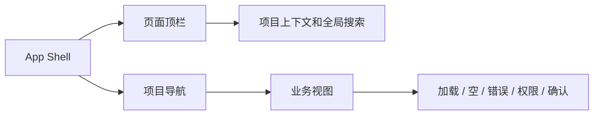

# 前端开发与接口对接文档

## 1. 文档目标

本文档记录司契（Siqi）当前前端基线，覆盖：

- 前端目录和启动方式；
- 统一设计系统与 UI 优化原则；
- 10 个业务页面的路由和核心交互，以及 404 兜底；
- 真实 FastAPI 与 Mock 演示模式的并行使用方式；
- 前端验收和后续开发边界。

当前前端是“面向例外处理的高保真业务工作台”。前端通过 `VITE_DATA_SOURCE` 支持 `real` 与 `mock` 两种数据源，默认使用 `real`。`frontend/.env`（团队版验收/联调）置 `VITE_DATA_SOURCE=real`；离线开发如需，复制该文件并改 `VITE_DATA_SOURCE=mock`（仅在显式覆盖时走离线 mock，不影响默认 real）。认证、任务、计划、审批、索引和 Diff 生成链路已经通过服务层接入 FastAPI；Mock 数据仅用于演示、离线开发和外部依赖不可用时的页面回退，不改变真实接口契约。登录态现在由后端 `httpOnly` Cookie 会话控制，前端只保存当前用户信息，未登录访问内部页会自动回到登录页。

## 2. 启动方式

```powershell
cd frontend
npm install
npm run dev
```

生产构建：

```powershell
npm run build
npm run preview
```

由于 Windows 工作区路径包含特殊连字符，`package.json` 使用 Node 直接调用本地 CLI，避免 npm 的 `.cmd` 脚本解析异常。

## 3. 前端目录

```text
frontend/src/
|-- components/
|   |-- AppShell.vue       # 统一侧栏、顶栏和项目上下文
|   |-- EmptyPanel.vue     # 空状态
|   |-- StatusTag.vue      # 任务状态、风险和演示兜底标签
|-- router/
|   |-- index.ts           # 页面路由
|-- services/
|   |-- api.ts             # 带 Cookie 凭证的统一 API 请求和错误转换
|-- stores/
|   |-- auth.ts            # 登录态、当前用户、bootstrap 和权限判定
|   |-- workspace.ts       # 当前项目、任务、回放和 Diff 状态
|-- types/
|   |-- auth.ts            # 角色、权限、用户和登录响应类型
|   |-- domain.ts          # 任务领域类型与状态映射
|-- views/
|   |-- LoginView.vue
|   |-- DashboardView.vue
|   |-- TaskListView.vue
|   |-- CreateTaskView.vue
|   |-- TaskDetailView.vue
|   |-- ApprovalView.vue
|   |-- ReplayView.vue
|   |-- DiffView.vue
|   |-- IndexView.vue
|   |-- SettingsView.vue
|-- App.vue
|-- main.ts
|-- style.css
```

## 4. 设计系统

### 4.1 产品定位

前端定位为“可审计的 Agent 研发工作台”，不是营销页面。每个页面都围绕三个问题组织：

1. 当前任务处于哪个阶段？
2. 系统为什么停在这里？
3. 用户下一步可以做什么？

在当前版本里，前端还要额外满足一条原则：**默认自动跑，页面只把例外拎出来**。只要任务能自动流转，就不要要求用户重复点击；只要任务停住，就必须明确告诉用户是高风险、授权过期、上下文不足、命令被拦截还是并发冲突。

### 4.2 视觉令牌

| 类型 | 值 | 用途 |
| --- | --- | --- |
| 页面背景 | `#F4F6F8` | 让白色工作面从背景中分离 |
| 工作面 | `#FFFFFF` | 表格、抽屉、表单和详情区 |
| 主文字 | `#172033` | 标题和关键数据 |
| 辅助文字 | `#718096` | 说明、时间和次要信息 |
| 主操作 | `#2563EB` | 创建、进入、保存和主要跳转 |
| 成功 | `#15803D` | 完成、通过、可复用 |
| 警告 | `#B7791F` | 待审批、过期和风险提醒 |
| 危险 | `#C2413B` | 失败、拒绝和高风险 |
| 演示兜底 | `#6D28D9` | 仅标识模拟产物 |
| 边框 | `#E0E6ED` | 低对比度结构边界 |

原则：

- 不使用营销式 Hero、渐变背景和大面积装饰；
- 所有技术字段、路径、SHA、命令和代码使用等宽字体；
- 状态色只用于状态，不用于纯装饰；
- 容器统一 6-8px 圆角，表格内部使用细分隔线；
- 1280px 以下收缩三栏布局，保持内容可读和不重叠；
- 所有按钮提供清晰动作，图标只作为识别辅助。

### 4.3 页面共同结构



任务详情、审批中心、回放和 Diff 审核共用“主工作面 + 侧边上下文”的结构。它们不再使用独立品牌壳，避免用户在页面跳转时丢失位置感。

## 5. 路由与页面职责

| 路由 | 页面 | 关键交互 |
| --- | --- | --- |
| `/login` | 登录 | 表单校验、进入工作台 |
| `/dashboard` | 工作台 | 自动化率、节省工时、最近例外、趋势和日志 |
| `/tasks` | 任务列表 | 搜索、状态筛选、批量选择、右侧任务抽屉 |
| `/tasks/new` | 创建任务 | 最少字段创建、分支自动生成、一键创建任务 |
| `/tasks/:id` | 任务详情 | 阶段轨迹、AI 决策摘要、问题确认、计划和产物入口 |
| `/approvals` | 审批中心 | 高风险提示、自动流转、批量审批、通过/拒绝/重写 |
| `/replay/:id?` | 任务回放 | 时间线定位、输入输出、检索记录、审计信息 |
| `/diff/:id?` | Diff 审核 | 文件切换、前后对比、复制 Patch、提交审阅意见 |
| `/indexes` | 索引管理 | 索引状态、复用状态、重建确认弹窗 |
| `/settings` | 项目配置 | 仓库、模型、测试、审批和安全策略分组 |
| `/:pathMatch(.*)*` | 404 兜底 | 找不到页面时返回工作台入口 |

## 6. 真实 API 与 Mock 演示模式

数据源由 `frontend/src/services/dataSourceMode.ts` 统一控制：`real` 模式通过 `src/services/` 请求 FastAPI，`mock` 模式读取本地演示数据。页面和 Store 复用同一套领域类型，页面不直接拼接请求；真实接口失败时由页面展示明确错误，只有后端明确返回演示兜底产物时才显示“演示兜底”标记。

| 前端能力 | 真实接口 |
| --- | --- |
| 登录 | `POST /api/auth/login` |
| 当前用户 | `GET /api/auth/me` |
| 项目列表 | `GET /api/projects` |
| 任务列表 | `GET /api/tasks` |
| 创建任务 | `POST /api/tasks` |
| 任务详情 | `GET /api/tasks/{task_id}` |
| 任务事件 | `GET /api/tasks/{task_id}/events` |
| 任务时间线 | `GET /api/tasks/{task_id}/timeline` |
| RAG 上下文 | `GET /api/tasks/{task_id}/contexts` |
| 手动补充上下文 | `POST /api/tasks/{task_id}/contexts/manual` |
| 任务取消 | `POST /api/tasks/{task_id}/cancel` |
| 失败重试 | `POST /api/tasks/{task_id}/retry` |
| 生成修改计划 | `POST /api/tasks/{task_id}/plans`（任务 `ANALYZED` 后） |
| 计划列表 / 详情 | `GET /api/tasks/{task_id}/plans`、`GET /api/tasks/{task_id}/plans/{plan_id}` |
| 审批通过（可调风险） | `POST /api/tasks/{task_id}/plans/{plan_id}/approve` |
| 拒绝 / 要求重写 | `POST /api/tasks/{task_id}/plans/{plan_id}/reject`、`POST /api/tasks/{task_id}/plans/{plan_id}/rewrite` |
| 低风险一键通过 | 对风险为 `low` 的待审批计划逐项调用 approve（无独立批量端点） |
| 生成 Diff | `POST /api/tasks/{task_id}/diffs/generate`（仅最新 `APPROVED` 计划） |
| Diff 产物列表 | `GET /api/tasks/{task_id}/diffs` |
| Diff 单文件详情 | `GET /api/tasks/{task_id}/diffs/{file_id}` |
| 测试记录 | `GET /api/tasks/{task_id}/tests` |
| 项目配置 | `GET /api/projects`、`POST /api/projects`、`GET/PUT /api/projects/{project_id}`（`ProjectPayload` 含 `default_test_command`，项目级默认测试命令） |
| 创建 / 重建索引 | `POST /api/repositories/{repository_id}/index`、`POST /api/repositories/{repository_id}/index/rebuild` |
| 索引历史与状态 | `GET /api/repositories/{repository_id}/indexes` |
| 索引详情 | `GET /api/repositories/{repository_id}/indexes/{index_id}` |
| 索引失败重试 | `POST /api/repositories/{repository_id}/indexes/{index_id}/retry` |
| 自动化统计 | `GET /api/dashboard/automation-summary` |

建议服务层统一返回：

```ts
interface ApiResponse<T> {
  code: number
  message: string
  data: T
}
```

错误码应在服务层转换成页面可读状态，页面只展示明确原因、重试入口和人工处理入口。页面主操作按钮优先跟随 `next_action`，避免同一任务上出现多个同义按钮。

任务、审批、索引和工作台接口建议统一返回以下联调字段：

```ts
interface AutomationState {
  automation_state: 'running' | 'blocked' | 'waiting_approval' | 'completed'
  manual_required: boolean
  manual_reason: 'high_risk' | 'auth_expired' | 'context_missing' | 'command_blocked' | 'conflict' | 'external_failed' | 'none'
  next_action: 'approve' | 'answer_question' | 'retry' | 'update_token' | 'view_diff' | 'none'
}
```

认证相关页面已经接入真实会话流程：

- 登录页通过 `POST /api/auth/login` 创建会话，`POST /api/auth/logout` 清理会话，`GET /api/auth/me` 在首屏恢复当前用户；
- 路由守卫会先 bootstrap 当前用户，再按 `permission` 拦截入口；
- App Shell 会根据当前角色过滤导航和按钮，避免未授权入口出现在界面里。
- 普通登录会话保持 8 小时，勾选“保持登录”后保持 7 天；
- 会话凭证只存在后端 `httpOnly` Cookie，前端不读取 JWT、不保存密码；
- 网络层瞬时失败会自动重试一次，刷新期间使用最近用户快照稳定展示角色和菜单；
- 退出登录会清理认证状态，但保留工作区任务快照，便于不同角色继续接力查看任务。

认证接口的完整请求、响应和 Cookie 约束见：

`docs/project-development/02-login-authentication.md`

## 7. 已完成的 UI 优化

- 统一所有页面的 App Shell，修复 Diff 页独立导航问题；
- 用任务阶段轨迹强化 Issue、检索、分析、审批、Diff、测试的顺序；
- 将审批风险提示放在操作前，高风险、拒绝和重写时强制填写意见；
- 将密钥字段改成别名、更新时间和可用状态，不回显明文；
- 为任务列表补充筛选、选中态和右侧摘要抽屉；
- 为回放补充节点输入、输出、检索结果和审计信息；
- 为 Diff 补充文件级切换、前后代码、复制 Patch 和审阅意见；
- 为索引重建补充影响说明、审计提示和二次确认；
- 为登录补充真实会话、退出登录、跳转回源地址和角色入口收口；
- 为登录补充 `httpOnly` Cookie、保持登录时长、当前用户恢复和权限门禁说明；
- 为任务详情、Diff 和回放补充按任务 id 取数，避免任务内容与路由错位；
- 为任务详情、审批、任务列表和索引页补充 `manual_required`、`manual_reason`、`next_action`、`automation_state` 视图字段，让页面能区分自动流转和人工例外；
- 使用紫色“演示兜底”标签隔离后端返回的模拟产物，避免和真实执行混淆；
- 为 Diff 生成接入真实接口，补充最新审批计划门禁、三类文件展示、Patch 复制、失败原因和回放标记；
- 项目配置页新增「项目级默认测试命令」输入（`Project.default_test_command`）：加载回显、创建/更新随 `ProjectPayload.default_test_command` 经 `POST /api/projects` / `PUT /api/projects/{id}` 提交、清空提交 `null`；提示语注明「仅当任务级和仓库级命令未提供时使用，须命中仓库命令白名单」，与仓库级命令视觉区分（DEV-018b）；
- 保留窄屏收缩规则，避免三栏页面在 1280px 以下发生重叠。

### 7.1 本轮继续收口

- 将全局搜索提示改成键帽样式，减少顶部栏的“模板感”；
- 将按钮、标签和确认弹窗统一为更克制的企业后台风格，降低塑料感；
- 将任务阶段条改成更清晰的步骤胶囊，强化当前态和已完成态差异；
- 将回放时间线改成统一的卡片点击态，避免文本光标和选中感干扰；
- 将设置页、创建任务页和登录页的次级操作收敛成更明确的按钮层级；
- 将登录页左侧信息区改成会话 / 权限 / 退出三层结构，避免内容过于单薄。

## 8. 前端验收清单

- [x] 10 个页面有真实路由；
- [x] 任务列表支持关键字和状态筛选；
- [x] 创建任务支持必填校验和工作分支预览；
- [x] 审批支持通过、拒绝、要求重写；
- [x] 高风险审批意见必填；
- [x] 低风险自动通过入口可用，且能返回自动处理记录；
- [x] 任务取消有二次确认；
- [x] 回放支持时间线节点切换；
- [x] Diff 支持文件切换和复制 Patch；
- [x] 索引重建有确认弹窗；
- [x] 配置页按模块切换且不回显密钥；
- [x] 登录/退出有会话门禁；
- [x] 登录失败、刷新恢复、角色权限和退出状态均有明确处理；
- [x] 404 路由兜底可返回工作台；
- [x] 状态、风险和演示兜底有统一标签；
- [x] `npm run build` 通过；
- [x] 认证、任务、计划、审批、索引和 Diff 生成链路接入真实 FastAPI 服务；
- [ ] 增加自动化端到端测试；
- [x] 增加登录页真实浏览器截图归档到 `docs/assets/`；
- [ ] 增加完整自动化端到端测试。

## 9. 当前仍待完成

- `mock` 模式仍保留本地演示数据，后续新增模块应优先复用真实 API 服务层，不再把全局 Store 作为唯一数据源；
- 测试执行已完成 MVP 接入（演示执行器 + 危险命令拦截 + 重试上限 + 运行中/拦截/失败记录展示）；真实 Docker 执行需宿主环境安装 Docker 并设置 `TEST_RUNNER_MODE=docker` 后联调验证，PR 描述正式生成仍待完成；
- 前端不得再把“未处理任务”和“可自动流转任务”混为一类展示；
- 还要补一轮跨分辨率浏览器截图，确认 1280px、1440px 和更宽屏下的间距一致；
- 如果后端确认字段稳定，再补一版字段级联动和空态文案收口。

## 10. 后续边界

`real` 模式不伪造真实执行结果；`mock` 模式只用于页面演示。Diff 模块在 Docker Runner 尚未接入时，后端可以返回带 `DEMO_FALLBACK` 和 `is_demo_fallback` 标记的演示产物，前端必须原样展示该标记，不得把它当作真实执行结果。接入后端时必须保留：

- 任务状态的后端权威来源；
- 审批并发冲突处理；
- Diff 生成前的审批门禁；
- 密钥不回显；
- 演示兜底与真实产物的区分；
- 审计事件只读展示。

## 11. 版本记录

| 版本 | 日期 | 说明 |
| --- | --- | --- |
| v0.1 | 2026-09-05 | 同步 DEV-011：明确 `real/mock` 双模式，补充 Diff 生成、列表和单文件接口，更新真实 FastAPI 接入状态及演示兜底边界。 |
| v0.2 | 2026-09-05 | 同步 DEV-012：任务状态新增 `TEST_RUNNING/TEST_FAILED`，Diff 页新增测试执行区（运行/重试按钮、attempt 记录、拦截与失败原因、stdout/stderr），任务详情页新增测试摘要，回放页新增 `TEST_RUN_STARTED/PASSED/FAILED/BLOCKED` 事件标记；测试记录接口 `GET/POST /tests(/{id})` 接入 store `loadTests/runTests`。 |
| v0.3 | 2026-09-09 | 同步 DEV-018b：项目配置入口新增项目级默认测试命令（`Project.default_test_command`），回显/创建/更新/清空提交 null；项目配置接口修正为 `POST /api/projects`、`GET/PUT /api/projects/{id}`；前端专项 `SettingsAutoCreate.spec.ts` DEV-018b 6 例通过；真实项目配置页截图待补。 |
