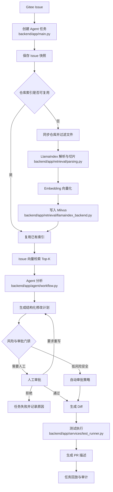

# 司契（Siqi）面试参考手册

> 名称出自《道德经》「有德司契」：Agent 拟契、人成契，每一步都留底可查；「执契不苛，落笔有据」。

> 用途：帮助项目成员理解项目、准备简历面试和技术追问。  
> 口径：本文档以当前仓库代码和现有技术文档为准。面试时优先讲真实实现，不把规划能力说成已经完成。

## 1. 项目一句话介绍

司契（Siqi）是一个面向企业研发团队的 AI Agent 研发协作平台。它以 Gitee Issue 作为任务入口，通过代码 RAG 为 Agent 提供相关上下文，再经过分析、修改计划、风险判断、人工审批、Diff、测试和任务回放，形成一条可控、可审计的研发闭环。

## 2. 面试开场介绍

### 30 秒版本

> 这个项目主要面向企业研发团队，解决 AI 编程过程中修改范围不可控、结果难以审核和过程无法追溯的问题。用户从 Gitee Issue 创建任务，系统同步 Issue 和仓库代码，通过 LlamaIndex 加 Milvus 做代码 RAG，检索相关上下文后由 Agent 生成分析和结构化修改计划。计划经过风险判断和人工审批后，系统才生成 Diff、执行测试并生成 PR 描述，整个过程都会记录到任务事件和审计日志中。

### 90 秒版本

> 项目的入口是 Gitee Issue。用户提交任务后，后端会保存 Issue 快照，包括标题、正文、评论和标签，避免外部 Issue 后续变化影响任务回放。
>
> 接下来系统检查仓库是否存在可复用且新鲜的代码索引。如果没有索引，或者索引对应的 Commit 已经过期，就同步仓库源码，过滤 `.env`、密钥、依赖目录、构建产物和二进制文件。然后使用 LlamaIndex 把代码转换为 Document，并使用 CodeSplitter 或 SentenceSplitter 进行切片。Embedding 模型把 Issue 和代码片段转换成向量，向量写入 Milvus，文件路径、行号、Commit、chunk_id 等来源元数据保存在业务数据库中。
>
> Agent 分析时，会根据 Issue 生成查询，在 Milvus 中检索 Top-K 相关代码片段，再基于带来源的上下文生成需求分析和结构化修改计划。计划不会直接执行，而是先经过风险策略和人工审批。审批通过后才能生成 Diff，并在受控 Runner 中执行测试。最后生成 PR 描述，并把每个关键节点写入事件日志，支持任务回放、审计和问题定位。

## 3. 为什么做这个项目

传统 AI 编程工具通常关注“生成代码”，但企业研发更关心以下问题：

| 企业痛点 | 项目解决方式 |
| --- | --- |
| AI 不知道真实代码结构 | 使用代码 RAG 检索相关文件、函数和代码片段 |
| 修改范围不可控 | 先生成结构化修改计划，再审批和生成 Diff |
| 高风险操作可能被直接执行 | 风险判断、人工审批、命令白名单和 Runner 隔离 |
| 出错后不知道 Agent 做了什么 | 记录任务事件、执行步骤、产物和测试结果 |
| Issue、代码、测试和 PR 分散 | 以任务为中心聚合完整研发流程 |
| 已解决的问题无法复用 | 保存历史任务摘要，为后续任务提供参考 |

## 4. 核心业务流程



### 4.1 任务状态主链

```text
CREATED
→ ISSUE_FETCHED
→ CONTEXT_INDEXED
→ ANALYSIS_QUEUED
→ ANALYZED
→ WAITING_APPROVAL
→ APPROVED
→ DIFF_GENERATED
→ TEST_RUNNING
→ TESTED
→ COMPLETED
```

异常状态主要包括：

```text
FAILED、CANCELLED、TEST_FAILED
```

### 4.2 为什么 Agent 不能直接改代码

面试回答：

> 因为模型输出具有不确定性，可能误判业务逻辑、修改敏感文件或者生成危险命令。项目把“生成建议”和“执行变更”拆开：Agent 先生成结构化修改计划，系统做风险判断，人工审批通过后才生成 Diff 和执行测试。同时通过文件范围、命令白名单、危险命令拦截和 Docker Runner 限制执行边界，最后保留完整审计记录。

## 5. 技术架构与职责

| 技术 | 项目中的职责 | 面试关键词 |
| --- | --- | --- |
| Vue 3 + TypeScript | 任务列表、详情、审批、Diff、测试和回放页面 | 前后端分离 |
| FastAPI | REST API、参数校验、权限校验和业务状态流转 | 高性能 Web 框架、类型校验 |
| Pydantic | 请求、响应和业务模型校验 | 数据契约、结构化数据 |
| SQLAlchemy | 用户、项目、任务、审批、事件和产物持久化 | ORM、事务、MySQL/SQLite |
| Redis | Celery Broker/Backend、分布式锁和短期状态 | 消息中间件、并发控制 |
| Celery | 仓库同步、索引、Agent、测试等长任务异步执行 | Worker、重试、解耦 HTTP |
| LangGraph | Agent 节点编排、状态路由、暂停和恢复 | StateGraph、状态机 |
| LangChain | 模型调用和模型适配 | LLM 抽象、结构化输出 |
| DeepAgents | 在配置模型时封装深度 Agent 调用 | Agent 能力层 |
| LlamaIndex | Document、代码切片、TextNode 和 Retriever 编排 | RAG 数据处理 |
| Embedding | 把 Issue 和代码片段转换到同一向量空间 | 语义向量 |
| Milvus | 向量存储和相似度检索 | Top-K、向量数据库 |
| Docker Runner | 在隔离工作区执行测试 | 沙箱、超时、目录清理 |
| Gitee OpenAPI | Issue、仓库和 PR 相关外部系统接入 | 外部系统适配 |

## 6. RAG 全链路

### 6.1 一次完整检索流程

```text
Issue 标题/正文/评论
→ 构造查询文本
→ Query Embedding
→ Milvus 相似度检索
→ Top-K 代码片段
→ 元数据和权限校验
→ 来源去重与新鲜度判断
→ 注入 Agent 上下文
```

### 6.2 仓库索引流程

```text
获取 Commit SHA
→ 同步仓库
→ 过滤敏感文件和低价值文件
→ Document
→ CodeSplitter/SentenceSplitter
→ TextNode
→ 补充文件路径、行号、符号名、Commit
→ Embedding
→ Milvus
→ MySQL 保存索引和切片元数据
```

### 6.3 LlamaIndex、Embedding、Milvus 的区别

面试标准答案：

> LlamaIndex 负责 RAG 数据处理和检索编排，例如把代码文件转换成 Document，进行代码解析和切片，构建 TextNode 并组织 Retriever。Embedding 模型负责把 Issue 和代码片段转换成同一向量空间中的数值向量。Milvus 是向量数据库，负责保存向量并根据查询向量进行相似度检索。三者分别对应“流程编排、向量化、向量存储与检索”。

记忆：

```text
LlamaIndex：负责加工和组织
Embedding：负责向量化
Milvus：负责存储和查找
```

### 6.4 为什么不能直接把整个仓库交给大模型

不要说“会丢失上下文”，更准确的说法是：

> 整个仓库可能超过模型上下文窗口，也会包含大量无关代码，导致 Token 成本和延迟增加，模型难以关注真正相关的文件。同时敏感文件可能被误传，且模型很难说明结论来自哪个文件和哪个版本。RAG 通过先检索再生成，减少无关信息，并保留文件路径、行号和 Commit 等来源。

### 6.5 为什么代码切片后保存元数据

文件路径、起止行号、Commit SHA 和 chunk_id 主要用于：

- 让 Agent 和用户知道上下文来自哪里；
- 在前端展示可定位的代码来源；
- 防止使用过期 Commit 的代码；
- 关联 MySQL 元数据和 Milvus 向量；
- 支持任务回放、审计和问题排查；
- 对检索结果去重、过滤和权限校验。

### 6.6 为什么先过滤 `.env`、密钥和依赖目录

> `.env`、Token、证书和私钥可能包含数据库密码、API Key 或内部地址。如果进入向量库，后续检索可能把敏感内容发送给模型，造成泄露。`node_modules`、`dist` 和 `build` 通常内容量大、相关性低，会增加索引成本并干扰召回。因此项目在切片前先进行路径、扩展名、文件大小和行数过滤。

对应实现：`backend/app/retrieval/parsing.py` 的 `path_blocked()`。

### 6.7 Milvus 不可用怎么办

当前项目有明确的环境边界：

- 本地或测试环境：`RAG_MOCK_FALLBACK=true` 时允许显式降级；
- 降级后来源标记为 `fallback/manual`，日志会记录，不伪装成 Milvus；
- 生产环境：`RAG_MOCK_FALLBACK=false` 时检索失败直接报错，不静默降级；
- Milvus 重启或跨进程查询时，会先尝试加载已有 Collection。

面试表达：

> 兜底可以保证本地测试继续跑通，但不能让生产环境无感降级，否则会掩盖检索质量和基础设施问题。因此项目把降级开关、来源字段和日志都做了显式区分。

### 6.8 MySQL 和 Milvus 为什么要分开

> MySQL 保存用户、项目、任务、审批、权限、测试记录、审计事件和代码切片元数据，适合事务和条件查询。Milvus 负责向量存储和相似度检索。Milvus 不能替代 MySQL，因为它不适合承载任务状态、审批关系和业务事务。两者通过 chunk_id、index_id、repository_id 和 commit_sha 关联。

## 7. Agent 与工作流

### 7.1 Agent、LLM 和工作流的区别

> LLM 负责根据输入生成文本或结构化结果；Agent 是在 LLM 基础上增加状态、工具、目标和执行策略的系统；工作流负责把多个确定的业务节点按规则连接起来。在本项目中，LangGraph 管理任务状态和节点路由，DeepAgents 参与分析，业务服务负责计划、审批、Diff 和测试等具体动作。

### 7.2 LangGraph 在项目中解决什么问题

> LangGraph 用 StateGraph 把任务拆成多个节点，例如上下文准备、AI 分析、计划生成、审批等待、Diff、测试和 PR 描述。每个节点读取和更新统一状态，路由函数根据任务状态决定下一步。审批等待时可以保存 checkpoint，审批完成后再恢复流程，比在一个函数里写大量 if/else 更容易维护、重试和回放。

对应文件：`backend/app/agent/workflow.py`。

### 7.3 当前工作流主要节点

| 节点 | 作用 |
| --- | --- |
| `prepare_context` | 等待索引、补齐上下文和准备分析 |
| `ai_analyze` | 调用 DeepAgent 或规则分析 |
| `generate_plan` | 生成结构化修改计划 |
| `wait_approval` | 等待审批并保存 checkpoint |
| `generate_diff` | 根据审批通过的计划生成 Diff |
| `run_test` | 执行测试并记录结果 |
| `generate_pr_description` | 生成版本化 PR 描述 |
| `finish` | 结束本轮流程 |

### 7.4 模型失败时怎么处理

当前分析链路中：

- 配置 LLM 时，`ai_analyze` 尝试调用 DeepAgents；
- 输出必须解析成约定 JSON；
- 输出非法、模型异常或未配置 Key 时，显式回退到规则分析；
- 规则负责风险、阻塞问题、来源和安全决策，模型主要负责叙述字段；
- 日志记录实际 Provider 和回退原因。

面试表达：

> 模型不应该直接决定所有安全字段。项目把模型生成和规则决策分开，模型负责生成分析描述，风险等级、敏感文件、危险命令和审批门禁由确定性规则判断。

### 7.5 为什么需要 checkpoint

审批不是一次函数调用能完成的动作。Agent 生成计划后可能要等待几分钟甚至几小时，期间 Worker 可以结束。保存 checkpoint 后，系统可以保留当前节点、任务状态和下一步动作，审批完成后再恢复，不需要从头执行整个流程。

## 8. Redis、Celery 和异步任务

### 8.1 为什么不能在 FastAPI 请求里直接执行全部流程

仓库同步、代码解析、批量 Embedding、Milvus 写入、模型调用和测试都可能耗时较长。如果在 HTTP 请求线程中执行：

- 请求容易超时；
- Worker 资源被长任务占满；
- 用户无法实时查看状态；
- 失败和重试边界不清晰；
- 多实例部署困难。

所以接口负责创建任务和返回状态，长任务交给 Redis + Celery Worker。

### 8.2 Redis 和 Celery 分别负责什么

> Redis 是消息代理和结果后端，也用于短期状态和分布式锁。Celery 是异步任务执行框架，负责把任务投递给 Worker，并提供重试、退避和任务状态管理。Redis 本身不负责执行业务逻辑。

### 8.3 Worker 重试怎么设计

当前长任务使用自动重试和指数退避。非最后一次失败时，任务保持可恢复状态，不立即把业务任务标记为最终失败；重试耗尽后，才记录失败节点、失败原因和审计事件。

这可以避免：

- 临时网络异常直接导致业务终态失败；
- Worker 重启后任务状态丢失；
- 用户看到失败，但系统其实还会继续重试。

对应文件：`backend/app/workers/tasks.py`、`backend/app/workers/runtime.py`。

### 8.4 为什么要做幂等

Celery 任务可能因为网络、Worker 重试或用户重复点击而执行多次。项目需要通过任务状态、任务版本、索引 Commit、Diff 版本和已有产物判断是否已经处理过，避免重复创建任务、重复写入索引或覆盖历史产物。

## 9. Python 和后端高频问题

### 9.1 Pydantic 和 SQLAlchemy 的区别

> Pydantic 主要负责数据校验和序列化，例如校验 API 请求、响应和任务业务结构。SQLAlchemy 负责 ORM 映射和数据库持久化，例如把任务、用户和审计事件映射到 MySQL 或 SQLite。Pydantic 解决数据契约问题，SQLAlchemy 解决数据存储问题。

### 9.2 `async` 能解决什么问题

> `async` 适合处理等待网络、数据库或其他 IO 的场景，可以提升单个进程对并发请求的处理能力。但它不能自动让 CPU 密集任务变快，也不能替代 Celery。代码解析、批量向量化和测试这类长任务仍应放到 Worker。

### 9.3 抽象类和接口有什么作用

项目中的模型客户端定义了 `TextModelClient` 和 `EmbeddingClient` 抽象接口。这样业务层依赖统一方法，而不是绑定某一个模型供应商，后续可以替换 DeepSeek、智谱或其他 OpenAI 兼容服务，也方便测试时注入 Mock。

### 9.4 为什么需要统一异常

不同模型客户端的网络异常、超时、鉴权失败和限流错误格式不同。项目统一转换成 `ModelClientError`，上层可以根据 `provider` 和 `stage` 判断是否重试，同时对错误信息脱敏，避免 API Key 出现在日志和响应里。

### 9.5 重试哪些错误，哪些不重试

通常网络错误、超时、服务端 5xx 和限流 429 可以重试；鉴权失败 401、参数错误和结构化输出错误一般不应该盲目重试，应提示检查配置或修正输入。

### 9.6 `list`、`tuple`、`set`、`dict` 的区别

| 类型 | 特点 | 常见用途 |
| --- | --- | --- |
| `list` | 有序、可重复、可修改 | 任务步骤、代码片段列表 |
| `tuple` | 有序、不可修改 | 固定配置、返回多个值 |
| `set` | 无序、元素唯一 | 去重、集合运算 |
| `dict` | 键值映射 | JSON、配置、索引元数据 |

### 9.7 浅拷贝和深拷贝

> 浅拷贝只复制外层容器，内部嵌套对象仍然共享；深拷贝会递归复制嵌套对象。处理任务状态、计划和嵌套 JSON 时，如果要避免修改原对象，应注意引用共享问题。

### 9.8 生成器有什么优点

> 生成器通过 `yield` 惰性产生数据，不需要一次性把所有数据放入内存。处理大量仓库文件或日志时，可以降低内存占用。但生成器只能消费一次，调试和重复遍历时要注意。

### 9.9 GIL 是什么

> CPython 的 GIL 同一时刻只允许一个线程执行 Python 字节码，因此多线程不适合纯 CPU 密集型计算；但线程在等待网络和文件 IO 时仍然有价值。CPU 密集任务可以考虑多进程或分布式 Worker。

## 10. 安全与可靠性问题

### 10.1 RAG 安全

- 索引前过滤 `.env`、证书、私钥、Token 和二进制；
- 检索绑定项目、仓库、索引版本和 Commit；
- RAG 内容只能作为参考资料，不能覆盖系统规则；
- 返回结果必须带文件路径、行号和版本；
- 生产环境 Milvus 失败时不静默降级。

### 10.2 测试命令安全

项目有两道防线：

1. 仓库测试命令必须命中命令白名单；
2. 测试执行前再次检查危险命令，例如 `rm -rf`、格式化磁盘、关机重启、`curl | sh`、`iwr | iex` 和宿主机目录挂载。

### 10.3 Docker Runner

真实 Docker 模式下：

- 使用临时工作区；
- 只写入允许的 Diff 内容；
- 通过容器执行测试；
- 设置超时；
- 执行结束后清理临时目录；
- Docker 不可用时记录 `skipped`，不伪装成测试通过。

注意当前默认测试模式是 `mocked_runner`，面试时应诚实说明：

> 当前本地演示默认使用显式模拟执行器，真实环境通过 `TEST_RUNNER_MODE=docker` 使用隔离容器执行。

## 11. MCP 应该怎么回答

### 11.1 MCP 是什么

> MCP，也就是 Model Context Protocol，是一种让模型以统一协议发现和调用外部工具、资源和提示模板的协议。它可以把 Gitee、代码搜索、数据库查询、测试执行等能力标准化暴露给 Agent。

### 11.2 本项目当前是否已经实现 MCP

当前仓库没有真正的 MCP Server 或 MCP Client 实现。已有的是：

- Agent 工作流；
- 内部业务服务函数；
- Gitee、RAG、测试和审计模块；
- 工具调用和执行过程的记录规划。

面试时建议这样说：

> 当前版本主要通过内部服务函数和 LangGraph 节点完成工具编排，还没有把这些能力封装成标准 MCP Server。后续可以将 Gitee Issue 查询、代码检索、Diff 生成和测试执行抽象成 MCP Tools，并统一权限、参数校验、超时和审计。

不要说：

```text
项目已经完整实现 MCP 工具调用。
```

## 12. 项目难点和解决方案

### 难点一：模型输出不稳定

解决方式：

- 约束 JSON 输出格式；
- 对模型返回内容做解析和校验；
- 模型异常时显式回退规则分析；
- 安全字段由规则计算，不完全相信模型。

### 难点二：长任务阻塞接口

解决方式：

- FastAPI 只创建任务和返回状态；
- Redis + Celery 执行索引、Agent 和测试；
- Worker 统一恢复数据库运行时；
- 失败时按重试次数处理。

### 难点三：审批等待导致流程中断

解决方式：

- 使用 LangGraph 状态图；
- 审批节点保存 checkpoint；
- 审批后根据当前状态恢复；
- 计划版本化，重写不会覆盖旧计划。

### 难点四：向量库和业务数据库职责混淆

解决方式：

- MySQL 保存业务真源；
- Milvus 保存向量和检索字段；
- 使用 `chunk_id`、`index_id`、`commit_sha` 建立关联；
- 检索结果保留完整来源。

### 难点五：AI 可能执行危险操作

解决方式：

- 计划审批门禁；
- 敏感文件检查；
- 命令白名单；
- 危险命令黑名单；
- Docker 隔离；
- 事件日志和测试结果留存。

## 13. 需要牢记的真实边界

| 能力 | 当前真实口径 |
| --- | --- |
| LlamaIndex | 已用于 Document、切片、TextNode 和 Retriever |
| Milvus | 已接入，生产优先；本地可以使用 Milvus Lite |
| Embedding | 配置智谱 Key 时走真实服务，否则 token-hash 兜底 |
| DeepAgents | 配置 LLM 时进入分析主链；异常时规则回退 |
| Celery | 配置 Redis 时由 Worker 执行；本地无 Redis 可 eager 降级 |
| Docker | 支持真实 Runner，但本地默认测试是 mocked_runner |
| MCP | 当前没有真实 MCP Server/Client 实现 |
| 混合检索 | 目前主要是向量检索，混合检索和重排序属于后续增强 |
| 自动创建 Gitee PR | 当前主要生成 PR 描述，是否真正创建远端 PR 取决于配置 |

## 14. 面试回答模板

### 不知道时

> 这个问题我目前还在补充，但结合项目实现，我理解它主要解决的是……在本项目中对应的代码位置是……后续我会再验证具体细节。

### 没有完整实操时

> 这部分我目前还没有独立完整跑过一遍，但我理解的设计链路是……我已经能对应到项目中的模块，下一步需要通过真实运行把接口、索引和检索结果再验证一遍。

### 被追问代码位置时

可以按下面回答：

```text
Agent 工作流：backend/app/agent/workflow.py
RAG 解析切片：backend/app/retrieval/parsing.py
Milvus 适配：backend/app/retrieval/llamaindex_backend.py
Embedding：backend/app/services/embedding_service.py
Celery 任务：backend/app/workers/tasks.py
测试执行：backend/app/services/test_runner.py
数据库 ORM：backend/app/models/orm.py
```

## 15. 学习顺序

建议按以下顺序熟悉，不要一开始同时背所有概念：

1. 背熟 30 秒项目介绍。
2. 能画出 Gitee Issue 到测试完成的主流程。
3. 讲清 LlamaIndex、Embedding、Milvus 的职责。
4. 讲清 MySQL、Milvus、Redis、Celery 的边界。
5. 讲清为什么要审批、为什么要 Docker 和命令拦截。
6. 阅读 `workflow.py`，理解状态、节点和路由。
7. 阅读 `parsing.py` 和 `llamaindex_backend.py`，理解 RAG 真实链路。
8. 阅读 `workers/tasks.py`，理解重试和 Worker 恢复。
9. 再补 Python 八股。
10. 最后进行模拟面试和连续追问。

## 16. 自测清单

能够不看文档回答下面问题，就说明已经完成第一轮准备：

- 这个项目解决什么问题？
- 一次 Issue 从创建到完成经过哪些阶段？
- 为什么不能让 Agent 直接修改和执行代码？
- RAG 解决什么问题？
- LlamaIndex、Embedding、Milvus 分别做什么？
- MySQL 为什么不能被 Milvus 替代？
- 为什么代码进入向量库前要过滤 `.env`？
- 为什么要保存文件路径、行号和 Commit？
- LangGraph 在项目中解决什么问题？
- Redis 和 Celery 分别做什么？
- Worker 失败后为什么不能直接把任务标记为最终失败？
- 当前项目是否已经实现 MCP？
- 当前项目哪些地方是显式兜底？

---

### 复习原则

面试时不需要把所有代码逐行背下来，但要做到：

```text
能说清业务目标
→ 能画出主链路
→ 能解释技术选型
→ 能定位关键源码
→ 能说明异常和安全边界
→ 能诚实区分已实现与规划
```
