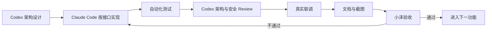

# 企业版开发计划

## 1. 目标

在不破坏团队版现有功能的前提下，逐阶段完成企业版的组织治理、企业级 RAG、Multi-Agent 协同、安全合规和私有化交付能力。

## 2. 开发原则

- 先固化边界和数据模型，再实现业务功能。
- 每次只推进一个可独立验收的功能。
- 核心业务逻辑采用 Red -> Green -> Refactor。
- 前后端以接口契约联调，禁止只完成单端页面。
- 每个写操作都要考虑幂等、权限、审计和失败恢复。
- 企业版新能力默认关闭或通过兼容层接入，确保团队版回归可用。

## 3. 阶段拆分

| 阶段 | 目标 | 主要交付物 | 验收门槛 |
| --- | --- | --- | --- |
| E0 | 企业版架构准备 | 租户上下文、错误码、事件模型、迁移策略 | 方案和接口评审通过 |
| E1 | 多租户与权限 | Tenant、组织、成员、RBAC、项目隔离 | 跨租户测试通过 |
| E2 | 审批与治理 | 风险规则、审批链、门禁、审计 | 高风险操作不能绕过审批 |
| E3 | 企业级 RAG | Filters、BM25、RRF、Rerank、评测集 | 指标不低于团队版基线 |
| E4 | Multi-Agent Runtime | Orchestrator、checkpoint、重试、人工接管 | 端到端任务链路通过 |
| E5 | 企业前端 | 企业工作台、审批、审计、安全和运维页面 | 真实页面联调通过 |
| E6 | 私有化交付 | HTTPS、监控、备份、升级、回滚 | 空环境部署和恢复演练通过 |
| E7 | 商业试点 | 演示数据、交付包、SLA 和客户手册 | 试点验收通过 |

> **E4 阶段进度（2026-09-20，已闭环标 DONE）**：确定性编排核心 + 真实 MySQL 持久化（Alembic `e5f6071a2b3c` + repositories 写透 + bootstrap 启动恢复）+
> **跨进程重启恢复** + **DB 原子租约单赢家** + **真实 E2 审批接线**（runtime.execute 操作/校验器/approve·reject 回写）+ 失败→重试→waiting_human→人工接管 +
> 跨租户 403+审计 + checkpoint 脱敏。真实闭环证据 `scripts/e4_runtime_real_loop.py`；`test_enterprise_e4_runtime.py` 19 passed、
> E4+migrations+E2 gov/hardening 71 passed、后端全量 776 passed/16 skipped。残余（如实）：Redis 已起但租约原子性在 DB、未用 Celery 字面双 worker、
> 未做生产级多副本压测/长稳、无前端页面。详见 `docs/project-development/110-enterprise-e4-01-runtime.md`。

## 4. 模块边界

| 模块 | 责任 | 禁止越界 |
| --- | --- | --- |
| Tenant/Auth | 认证、租户上下文、成员和角色 | 不直接执行 Agent 工具 |
| Governance | 风险判断、审批和门禁 | 不生成业务代码 |
| Agent Runtime | 调度、状态、重试、checkpoint | 不绕过治理直接发布 |
| Enterprise RAG | 解析、检索、过滤、重排和评测 | 不决定用户权限 |
| Runner | 隔离工作区、代码修改和测试 | 不直接访问未授权仓库 |
| Audit/Observability | 事件、指标、追踪和导出 | 不保存明文密钥 |
| Frontend Enterprise | 展示状态、操作和审批 | 不在前端决定最终权限 |

## 5. 统一接口签名

```text
TenantContext resolve_tenant_context(request) -> TenantContext
PermissionDecision authorize(context, resource, action) -> PermissionDecision
Task create_agent_task(context, request, idempotency_key) -> Task
AgentResult run_agent_step(step_context) -> AgentResult
RagResult search_enterprise_rag(context, query, filters) -> RagResult
ApprovalDecision decide_approval(context, action, risk) -> ApprovalDecision
AuditEvent append_audit_event(context, event) -> AuditEvent
```

## 6. 完成定义

功能只有同时满足以下条件才能标记为完成：

1. 需求、接口、状态和权限边界已评审。
2. 核心逻辑测试先失败后通过。
3. 前后端真实联调通过。
4. 正常、异常、越权和重复请求场景通过。
5. 文档包含 Mermaid 图、源码位置、联调注意点和真实截图。
6. 团队版回归测试没有退化。
7. 目标部署环境完成一次可复现验证。

## 7. 协作方式



## 8. 当前边界

企业版文档已经完成设计基线，但文档完成不等于企业版源码完成。Multi-Agent、强多租户、企业级 RAG、HTTPS 和商业试点仍需按阶段实现并提供真实验收证据。
