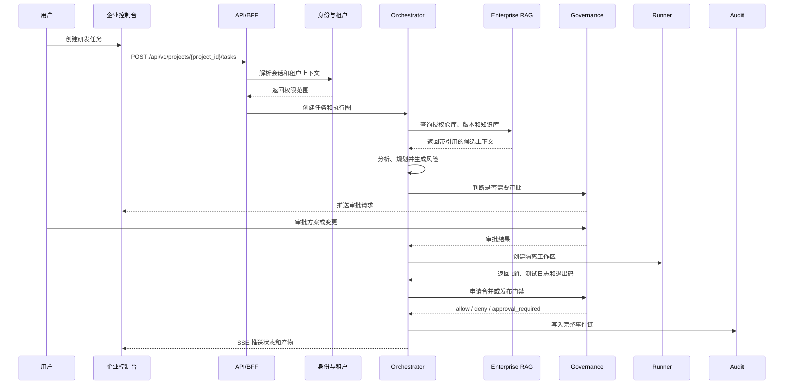
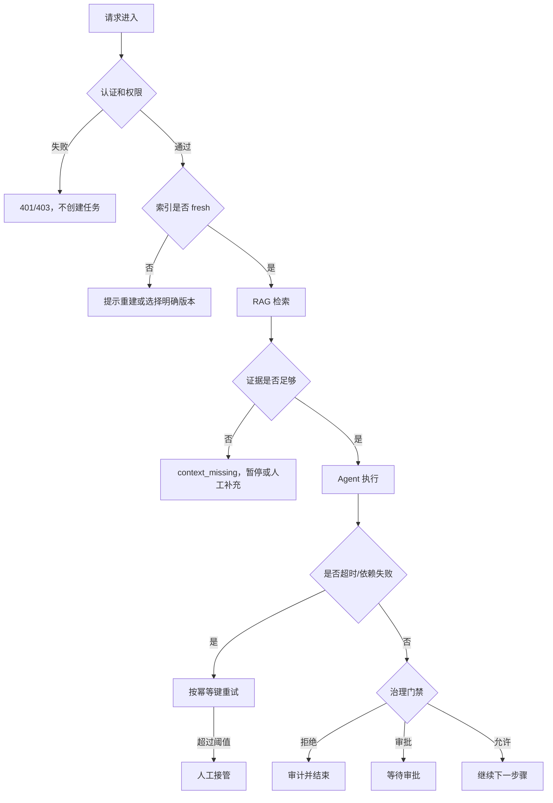
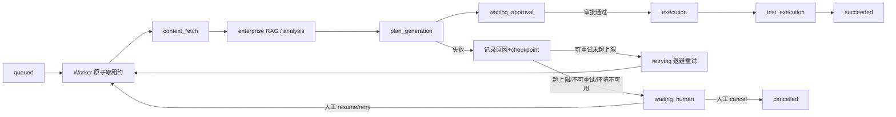

# 企业版业务流程与状态

## 1. 主业务流程



## 2. 任务状态

| 状态 | 进入条件 | 可转移状态 |
| --- | --- | --- |
| `CREATED` | 创建请求通过权限校验 | `ANALYZING`、`CANCELLED` |
| `ANALYZING` | 需求和上下文分析中 | `PLANNING`、`PAUSED`、`FAILED` |
| `PLANNING` | 生成结构化方案 | `WAITING_APPROVAL`、`CHANGING`、`PAUSED` |
| `WAITING_APPROVAL` | 需要人工确认 | `CHANGING`、`CANCELLED`、`PAUSED` |
| `CHANGING` | 隔离工作区中生成变更 | `REVIEWING`、`PAUSED`、`FAILED` |
| `REVIEWING` | 安全和代码审查 | `TESTING`、`WAITING_APPROVAL`、`FAILED` |
| `TESTING` | 执行测试计划 | `READY_TO_MERGE`、`FAILED`、`PAUSED` |
| `READY_TO_MERGE` | 测试通过且产物齐全 | `RELEASED`、`WAITING_APPROVAL` |
| `PAUSED` | 超时、依赖异常或人工暂停 | `RESUMING`、`CANCELLED` |
| `FAILED` | 步骤不可恢复失败 | `RETRYING`、`CANCELLED` |
| `RELEASED` | 合并或发布完成 | 终态 |
| `CANCELLED` | 用户取消或审批拒绝 | 终态 |

## 3. 异常分流



## 4. SSE 事件

事件必须包含：

```json
{
  "event_id": "event-id",
  "task_id": "task-id",
  "step_id": "step-id",
  "event_type": "STEP_STARTED",
  "status": "RUNNING",
  "message": "safe summary",
  "created_at": "2026-09-14T00:00:00Z"
}
```

禁止通过 SSE 推送密码、Token、完整私有配置、未经授权的代码或内部异常堆栈。

## 5. 联调注意点

- 前端不能根据本地按钮状态推断审批结果，必须重新请求后端状态。
- 事件丢失后，前端必须通过任务详情和事件游标补偿。
- 页面切换租户或项目后，旧任务流必须取消订阅并重新校验上下文。
- 任务恢复必须携带 checkpoint 版本，过期 checkpoint 必须拒绝。

## 6. 企业版 Runtime（E4-01）主链与失败分支



- 状态转换集中在 `enterprise_runtime/state_machine.py`；checkpoint 版本化 + 脱敏；租约条件抢占（同一步骤单赢家）；
  跨租户读取/恢复/重试/接管 403 + 审计；人工接管不能跳过审批。
- 真实闭环已落地（DONE）：真实 MySQL 持久化 + 跨进程重启恢复 + DB 原子租约单赢家 + 真实 E2 审批接线（runtime.execute 操作/校验器/回写）+
  失败→重试→waiting_human→人工接管；真实证据见 `scripts/e4_runtime_real_loop.py` 与
  `docs/project-development/110-enterprise-e4-01-runtime.md`。残余：Redis 已起但租约原子性在 DB、未用 Celery 字面双 worker、无前端页面。
