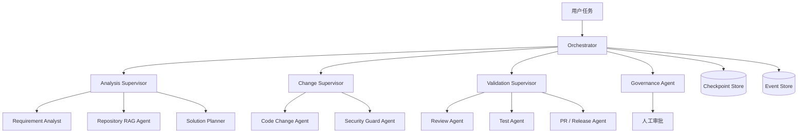

# 企业版 Multi-Agent 设计

## 1. 设计目标

Multi-Agent 负责把研发任务拆成可观察、可恢复、可审批的步骤。企业版不采用 Agent 之间无限自由调用的模式，所有调用由 Orchestrator 统一调度。

## 2. Agent 拓扑



## 3. 职责和工具权限

| Agent | 允许读取 | 允许写入 | 禁止操作 |
| --- | --- | --- | --- |
| Requirement Analyst | 需求、授权历史任务 | 分析产物 | 代码和发布 |
| Repository RAG | 授权索引和元数据 | 检索记录 | 越权跨项目查询 |
| Solution Planner | 需求、RAG 引用 | 方案草稿 | 直接修改代码 |
| Code Change | 审批方案、隔离工作区 | 隔离工作区 patch | 主分支、生产配置 |
| Security Guard | patch、依赖、策略 | 风险报告 | 修改风险结论 |
| Review | diff、方案、测试 | 审查报告 | 绕过审批 |
| Test | 隔离工作区、测试计划 | 测试报告 | 访问生产数据 |
| PR/Release | 审批和测试证据 | PR 或发布候选 | 未审批合并发布 |

## 4. 统一输入输出

```json
{
  "task_id": "task-id",
  "run_id": "run-id",
  "step_id": "step-id",
  "tenant_id": "tenant-id",
  "project_id": "project-id",
  "agent_type": "solution_planner",
  "input_refs": ["artifact://task/analysis/v1"],
  "policy_context": {
    "risk_level": "L1",
    "allowed_tools": ["rag.search", "artifact.write"]
  },
  "idempotency_key": "task-id:step-id:attempt-1"
}
```

```json
{
  "status": "succeeded",
  "output_refs": ["artifact://task/plan/v1"],
  "citations": [],
  "risks": [],
  "usage": {
    "model": "configured-model",
    "input_tokens": 0,
    "output_tokens": 0,
    "duration_ms": 0
  },
  "next_actions": ["request_approval"]
}
```

## 5. 调度与恢复

- Orchestrator 为每个步骤生成唯一 `step_id` 和 `idempotency_key`。
- 成功步骤先持久化结果，再发布后续事件。
- 重试不重复执行已经成功的外部写操作。
- 单步骤默认最多重试 2 次，模型超时、网络失败和策略拒绝分开统计。
- 连续失败、checkpoint 损坏、权限变化和人工取消进入暂停或终止状态。
- 任务恢复时重新校验用户、租户、项目权限和仓库版本。

## 6. 关键验收

- 任一专业 Agent 失败不会导致 API 进程崩溃。
- 任务能从中断前的 checkpoint 恢复。
- Code Agent 无法直接写入主分支。
- PR/Release Agent 在缺少审批或测试证据时必须被门禁拦截。
- Agent 输入、输出、工具调用和 Token 用量能按 `trace_id` 查询。
