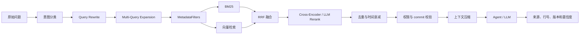

# 企业版 RAG 设计

## 1. 目标与边界

企业版 RAG 必须在“授权正确”的前提下提高召回率、排序质量、新鲜度和证据可解释性。RAG 不负责替代权限系统，也不允许因为召回为空而跨项目搜索。

## 2. 检索流程



## 3. 索引内容

| 来源 | 切片单位 | 必须保存的元数据 |
| --- | --- | --- |
| 代码 | 文件、类、函数和窗口 | 仓库、分支、commit、路径、语言、符号、行号 |
| 文档 | 标题、章节和段落 | 文档类型、版本、更新时间、权限标签 |
| Issue | 标题、描述、评论 | Issue ID、状态、作者、项目和时间 |
| 提交记录 | commit 摘要和变更文件 | commit、作者、时间、路径和关联任务 |

敏感文件默认排除：`.env`、私钥、证书、密钥目录、构建产物、依赖缓存和大二进制文件。

## 4. 查询过滤

```json
{
  "tenant_id": "tenant-id",
  "organization_id": "organization-id",
  "project_id": "project-id",
  "repository_id": "repository-id",
  "ref": "main",
  "commit_sha": "commit-sha",
  "source_types": ["code", "document", "issue"],
  "metadata_filters": {
    "language": ["python", "typescript"],
    "path_prefix": ["backend/app"]
  }
}
```

缺少 `tenant_id`、`project_id` 或有效版本范围时拒绝查询。客户端传入的租户字段不能覆盖认证上下文。

## 5. 评分与融合

- BM25 解决函数名、类名、错误码、接口名和精确术语召回。
- 向量检索解决自然语言描述和语义相似召回。
- RRF 解决不同检索分数不可直接比较的问题。
- Rerank 对融合后的候选进行精排，输出最终上下文顺序。
- 同一文件、函数、窗口和内容指纹按规则去重。
- 新鲜度校验优先于相似度分数，过期索引必须显式标记。

## 6. 离线评测

每个核心项目建立不少于 50 条真实研发问题的评测集，覆盖：

- 精确符号和路径查询；
- 自然语言需求；
- 错误排查；
- 跨文件依赖；
- 版本差异；
- 无答案和权限边界。

输出指标：

| 指标 | 作用 |
| --- | --- |
| Recall@K | 期望证据是否进入候选集 |
| Precision@K | 候选集中相关结果占比 |
| MRR | 第一个正确结果的位置 |
| NDCG | 结果排序质量 |
| Freshness Rate | 返回结果与目标 commit 一致的比例 |
| Citation Coverage | 最终回答是否有可验证引用 |

## 7. 在线观测

每次检索记录：

- 查询类型和是否改写；
- 实际过滤条件；
- BM25、向量、融合、重排各阶段候选数；
- 命中来源、分数、版本和耗时；
- 是否发生降级、空结果或过期拦截。

不得记录完整 Token、敏感原文或未授权代码。

## 8. 验收标准

- Hybrid 检索对精确符号和自然语言问题均可返回期望证据。
- 过滤条件缺失时拒绝查询，不能回退全库。
- Rerank 开关关闭时结果仍可解释，开启时有独立指标对比。
- 离线评测可重复运行并保存报告。
- 团队版 RAG 主链路和 `source`、`fresh` 语义不退化。

## 9. E3-01 基线落地

E3-01 已落地企业模式检索基线（详见 `docs/project-development/101-enterprise-e3-01-rag-hybrid-retrieval.md`）：

- 服务端 `TenantContext` 为 tenant 唯一来源，请求体/URL/Header 伪造 `tenant_id` 无效；
- 企业端点额外要求 `rag:search`：tenant owner、tenant admin、security admin、project owner、developer、reviewer 可检索；
  auditor 默认仅保留审计只读能力，不能检索租户代码；
- `project/repository/commit|ref` 边界缺失即拒绝，不放行全库检索；跨租户 403 + 租户归属审计；
- 统一 `RAGMetadataFilters`（tenant/project/repository/commit/ref/source_type/index）在**候选生成阶段**同时限制 BM25 与向量；
- enterprise 向量查询直接下推 repository/index/commit/source_type 到 Milvus/LlamaIndex，并保留受限
  `scoped_ids` 交集作为第二道边界；
- 企业严格过滤不支持时，不允许退回无过滤的向量全集查询：仅可显式降级到已受限候选子集的关键词检索；
  已存在的旧向量索引若缺少 `source_type` 元数据，需重建索引后才能使用 source type 下推过滤；
- BM25 + 向量双路召回、RRF 融合、按 chunk 去重，输出统一契约（`retrieval_source=vector/bm25/hybrid` + `contributions`）；
- `fresh/stale` 标记与过期提示（企业模式默认不静默用明显过期索引）；
- `vector_top_k / bm25_top_k / final_top_k` 集中在后端配置层。
- **暂未落地**：Query Rewrite、Cross-Encoder/LLM Rerank、离线评测集（Recall/MRR/NDCG）与检索前端，见 101 文档“范围外/残余风险”。

## 10. E3-02 基线落地

E3-02 已落地企业模式 Query Rewrite + 多路 Query Expansion（详见 `docs/project-development/102-enterprise-e3-02-query-rewrite-expansion.md`）：

- 原始 query 恒在 `query_variants[0]`；复用 `query_expansion.expand_query`（LLM 优先、失败确定性回退）；
- 确定性技术术语扩展覆盖函数/类/错误码（`ERR_401`）/接口路径（`/api/orders/{id}`）/文件路径/点分配置项/
  下划线符号，并桥接 `payment.callback.retry` ↔ `payment_callback_retry`（不改团队 BM25 tokenizer，避免回归）；
- 每个 query variant 复用同一份 enterprise `RAGMetadataFilters`，扩展 query 不绕过 `rag:search`/tenant/
  project/repo/commit·ref/source_type/index 边界；
- `security_admin` 已纳入 `rag:search` 权限，满足安全管理员做企业检索排障；auditor 仍不授予检索权限；
- 多路 RRF：逐变体 BM25+向量、原 query 权重最高、扩展按 `variant_decay` 衰减、全局按 chunk 去重；
- 响应新增 `query_variants / variant_count / retrieval_trace`（不含敏感代码）；
- 配置 `RAG_QUERY_REWRITE_ENABLED / MAX_VARIANTS / LLM / VARIANT_DECAY`（安全默认，LLM 默认关）。
- **仍未落地**：Cross-Encoder/LLM Rerank、离线评测集（Recall/MRR/NDCG）与检索前端，见 102 文档“范围外/残余风险”。

## 11. E3-03 基线落地

E3-03 已落地企业模式 Rerank 精排基线（详见 `docs/project-development/103-enterprise-e3-03-rag-rerank.md`）：

- 默认 deterministic heuristic：精确符号/路径/错误码/函数名命中优先、fresh 优先、保留 hybrid 原始分数为基础分；
  只对 top N 重排、不删除候选（其余原序追加）；
- 可预留 `provider=llm` 摘要精排（仅 file/symbol，不发代码正文）；`RAG_RERANK_TIMEOUT_SECONDS`
  真实透传给模型客户端，模型不可用/超时/非法输出稳定回退 heuristic；
- 配置 `RAG_RERANK_ENABLED/PROVIDER/TOP_N/TIMEOUT_SECONDS`（安全默认：关 / heuristic / 8 / 5）；
- 响应新增 `rerank_enabled/rerank_provider/rerank_trace`，每结果 `original_rank/reranked_rank/rerank_score/rerank_reason`；
- 只重排受限子集召回后的候选，不改变 tenant/project/repo/commit·ref/source_type/index 过滤与 `rag:search`（auditor 仍拒）。
- **仍未落地**：离线评测集 Recall@K/MRR/NDCG、前端检索页面、云端真实 Milvus 链路（见 103 文档“范围外/残余风险”）。

## 12. E3-04 基线落地

E3-04 已落地企业 RAG 离线评测基线（详见 `docs/project-development/104-enterprise-e3-04-rag-offline-evaluation.md`）：

- 评估集结构（query/project/repo/commit|ref/expected_chunk_ids/expected_file_paths/source_types/tags/difficulty/expected_status）；
- JSON/JSONL 读取 + 字段/版本/状态校验，清晰错误；指标 Recall@K、Precision@K、MRR、NDCG@K、Freshness、Empty Rate、Unauthorized Pass Rate；
- 评测**复用 enterprise_rag_search**（授权 + MetadataFilters + Hybrid），不新写绕过过滤的检索；入口要求 rag:search；
- 输出 summary/per_case/failed/metrics_by_tag/config_snapshot，报告脱敏无代码正文/token/凭据；
- dry-run / 内存态可测，不依赖真实 Milvus / 外部模型。
- **仍未落地/未验证**：云端真实 Milvus 端到端与多副本并发、前端评测控制台、模型级精排（Cross-Encoder）指标对比（见 104 文档“范围外/残余风险”）。
- E3-04-HARDEN-01（延续 E3-04，非 E3-05）：`evaluate_case` 增设 `rag:search` 纵深校验；期望真值去空串/去重防 recall 放大；`
  retrieval_passed` 厘清 200 空结果的语义（status_passed=true/passed=false）；`metrics_by_tag` 增补 `precision_at_k`。

## 13. E3-05 基线落地

E3-05 已落地真实脱敏评测集与质量基线报告（详见 `docs/project-development/105-enterprise-e3-05-rag-quality-baseline.md`）：

- 评测集 `evaluation/enterprise_rag/e3_05_baseline.jsonl`（32 条，case_id 唯一）覆盖精确符号/错误码/API 路径/文件路径/自然语言/跨文件/stale/fresh/403/422 边界/无答案/source_type；脱敏无真实商业代码正文；
- 脱敏合成 demo 仓库种子（内存态）驱动 `enterprise_rag_search` 真实检索；复用 E3-04 评价主链路；
- 基线报告含 summary/metrics_by_tag/failed_cases/config_snapshot/dataset_size/recommended_thresholds/needs_improvement；
- 推荐阈值只标记 needs_improvement，不硬说达标、不让脚本伪通过；
- 内存态基线（K=8）：recall 0.8750 / mrr 0.8281 / ndcg 0.8519 / precision 0.1172 / freshness 0.967 / empty 0.067 / unauthorized 1.0（脱敏合成语料，非生产达标证据）。
- **仍未落地/未验证**：云端真实 Milvus 端到端与多副本并发、前端评测控制台、Cross-Encoder 对比、真实生产评测集达标分数（见 105 文档“范围外/残余风险”）。


## 14. E3-06 基线落地与真实 Milvus 验证

E3-06 落地多种检索模式与真实 Milvus 门禁的评测框架，并已对真实 health-middle 仓库完成本机容器 verified 验证（详见 `docs/project-development/106-enterprise-e3-06-real-repository-quality.md`）：

- 四种模式（bm25/vector/hybrid/rerank）复用同一企业授权与过滤链，不复制无权限检索；
- 报告 schema 增 `vector_backend/milvus_verified/fallback_used/validation_status` + recall@5/10、precision@5、ndcg@5、latency；
- `--require-milvus`：Milvus 不可用即 blocked（退出非0），绝不静默回退冒充云端质量；
- 无真实 Milvus → `local_only`（内存/降级仅作本地参考，不是云端结论）；
- 已验证：真实目标仓库 `health-middle`（commit 73e7e54）+ 企业独立 Milvus collection
  `enterprise_code_idx_health_middle_73e7e54` + `zhipu/embedding-3` 2048 维；
  `--require-milvus --all-modes` 退出 0，`validation_status=verified`，双次非时间字段对拍 `differences=0`。
- **仍未完成**：生产云端多副本压测、前端评测台、Cross-Encoder 对比，以及质量门调优。当前报告
  `needs_improvement=true`，不能写成生产质量达标。

## 15. E3-07 baseline 落地

E3-07 已落地企业 RAG 代码检索 precision 调优，并已用**真实 Milvus verified 复跑收口**（详见
`docs/project-development/107-enterprise-e3-07-rag-quality-tuning.md` §7；`--all-modes` 的四模式全部 verified，生产默认
hybrid 门 `needs_improvement=false`）：

- 新增 `RAG_SYMBOL_BOOST`（精确符号定义优先）：query token 与 `chunk.symbol_name` 完全一致时，对 BM25 分数与
  Hybrid RRF 融合分数加权，让函数/类/接口的「定义块」优先于「仅引用该符号的调用块」；只重排受限子集内的候选，
  不引新候选、不删候选、不绕过 rag:search/tenant/project/repo/commit·ref/source_type/index 过滤。
- 团队 `retrieve_bm25(symbol_boost=0.0)` 默认 0，行为不变；`RAG_SYMBOL_BOOST` 仅企业检索路径按配置生效。
- 真实 health-middle（commit 73e7e54）内存态 bm25 前后对比（boost=0→1.0）：recall 0.8731→0.8881、
  mrr 0.8072→0.8632、ndcg 0.8227→0.8620、precision@5 0.3045→0.3134；precision@K 0.2015→0.2034（受单符号
  gold 的 1/K 结构上限钳制，不伪报达标）。
- 质量门如实形态：`--all-modes` 主报告为 bm25，其 precision@K 仍 `needs_improvement=true`；**生产默认 hybrid
  的 precision@K=0.3377 已过 0.3**。二者均如实报告，不把 bm25 未达标写成达标（也不调低推荐阈值）。
- **仍未完成**：真实 Milvus verified 调优复跑已在 107 §7 闭环（Docker 起企业独立 Milvus + 真实 `zhipu/embedding-3`，
  `--require-milvus --all-modes` 四模式 verified、同环境对拍差异 0、生产默认 hybrid 门 `needs_improvement=false`）；
  仍待：生产云端多副本压测、前端评测台、Cross-Encoder 模型级精排对比。

## 16. E3-08 企业 RAG 检索与评测前端控制台（落地）

E3-08 已把企业 RAG 检索与离线评测报告接到前端控制台（详见 `docs/project-development/108-enterprise-e3-08-rag-evaluation-ui.md`）：

- 后端新增 `GET /api/enterprise/rag/reports`（列表）与 `GET /api/enterprise/rag/reports/{name}`（详情投影），
  均强 `rag:search`；报告目录限定 + 正则/`resolve()` 路径穿越防护；详情投影脱敏（不含代码正文/token/per_case）。
- 前端新增 `/enterprise/rag` 控制台（`RagConsoleView.vue` + `stores/rag.ts` + `services/rag.ts` + `types/rag.ts`）；
  双面板：检索（query/project/repo/commit/ref/source_type/模式，实时渲染 results/variants/traces）与评测报告
  （列表 + summary/metrics_by_tag/mode_comparison/failed_cases + verified/local_only/blocked 徽章 + needs_improvement 提示）；
  loading/empty/error/403/401、响应式、键盘 focus。
- 权限：AppShell 侧栏「企业 RAG」入口与路由守卫均 `['rag:search']`（auditor 无入口、直达被重定向、后端仍 403 兜底）；
  前端仅展示层，不决定最终授权。
- 测试：后端专项 8 passed；前端专项 10 passed；前端全量 250 passed；后端全量 741 passed, 16 skipped；
  `vue-tsc -b` 0 错；`vite build` 通过；真实浏览器截图见 `assets/e308/e308_01..03*.png`。
- 残余：在线触发评测/运行入口未做（仅报告查看）；检索向量腿需真实索引/Milvus 才有结果。

## 17. E3-09 Cross-Encoder 模型级精排对比（落地）

E3-09 已落地 Cross-Encoder 精排 provider 与真实对比（详见 `docs/project-development/109-enterprise-e3-09-cross-encoder.md`）：

- 新增 `cross_encoder.py`（本地/私有模型优先；batch 推理、超时、长度/候选上限、`_MODEL_CACHE` 跨请求缓存；
  打分只用 file/symbol 摘要、不发代码正文；不可用/超时/异常稳定回退 heuristic 并记录 fallback_reason，不冒充 CE）。
- `RAG_CROSS_ENCODER_*` 配置安全默认全关/空模型/cpu，同步 runtime_config / env.example；本轮提交报告的 `config_snapshot` 仍为空对象，
  CE 超参尚未完整固化，已登记为后续报告契约加固项；
  `requirements-e3-09.txt` 固定 `sentence-transformers==3.3.1`；模型 `cross-encoder/ms-marco-MiniLM-L-6-v2`（Apache-2.0，hf-mirror 拉取并缓存）。
- CLI 新增 `--rerank-compare`：同数据集/commit/collection/embedding/top-k/过滤/权限下对比 baseline / heuristic / llm / cross_encoder，
  产出 `e3_09_health_middle_rerank_comparison.json`（+_repro 复跑）。
- 真实指标（真实 Milvus + zhipu/embedding-3 2048 + top-k 8）：baseline MRR .8172/NDCG .7981、heuristic .8116/.7934、
  llm .7668–.7873/.7812–.7961（随机波动）、**cross_encoder .8507/.8090（executed，四档最优）**；recall/prec@K 各档一致
  （重排不改召回）；CE 缓存后每 case p50 331ms（首跑未缓存 7251ms）；两次对拍 CE/heuristic/baseline 差异 0、仅 LLM 随机波动。
- 测试：E3-09 专项 17 passed；E3-01..09 组合 78 passed；后端全量 758 passed/16 skipped；前端全量 250 passed（本轮未改前端）；
  vue-tsc 0 错、vite build 通过、git diff --check 干净。
- 诚实边界：未改 E3-08 页面（无新 UI 截图）；LLM rerank 非位级可复现；不宣称企业 RAG 已彻底完成。
- 报告契约观察项：本轮提交报告 `config_snapshot` 仍为空对象，尚未完整固化 Cross-Encoder 的 batch size、timeout、max candidates；
  不影响本轮真实模型执行与对比结论，后续需纳入配置快照及 hash。
