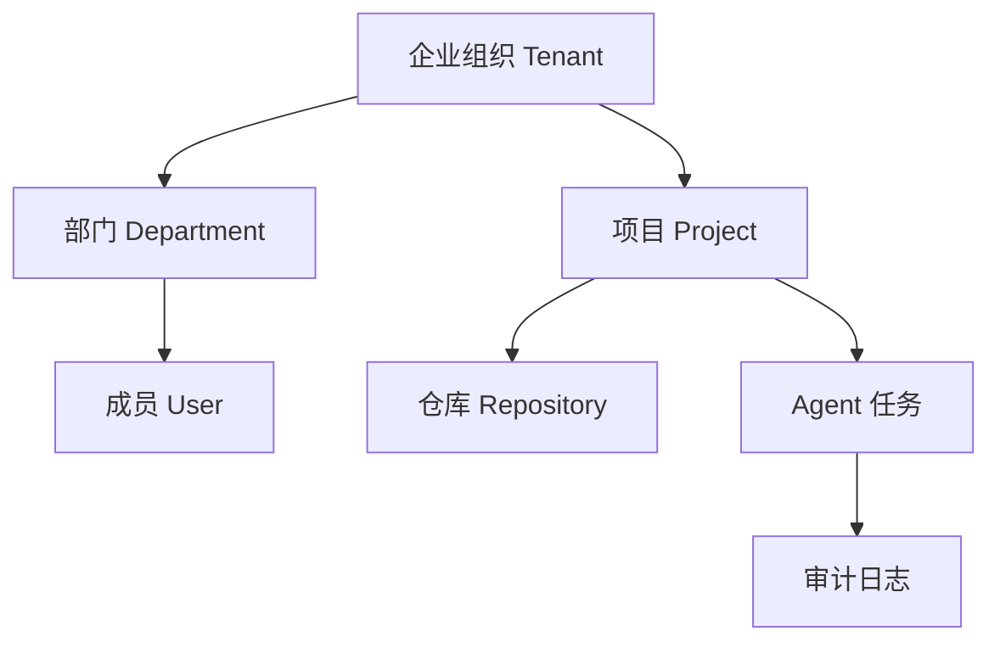
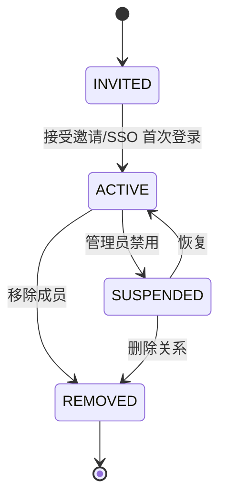
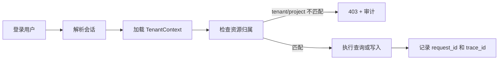

# 企业版多租户、权限与安全合规文档

## 1. 文档定位

本文档定义企业版的组织隔离、权限模型、安全策略和合规要求。

## 2. 多租户模型

## 3. 数据隔离原则

- 所有业务数据必须带 `tenant_id`。
- 项目、仓库、任务、审批、日志、索引元数据都必须归属组织。
- 查询接口必须默认按 `tenant_id` 过滤。
- Milvus Collection 需要按组织或项目隔离。
- 文件存储路径需要包含组织和项目标识。

## 4. 企业权限模型

**本节为权威口径**，与 `backend/app/tenancy/models.py` 的 `EnterpriseRole`（7 类）和
`backend/app/tenancy/permissions.py` 的 `ENT_ROLE_PERMISSIONS` 保持一致。
PRD §7.1 中的 `Tech Lead` / `Operator` 属**设计目标、尚未实现**，不在下表。

| 角色 | 代码枚举值 | 说明 | 权限点 |
| --- | --- | --- | --- |
| 租户所有者 | `tenant_owner` | 管理租户、组织、成员与全局策略 | `tenant:context` `tenant:switch` `tenant:create` `member:view` `member:manage` `org:view` `org:manage` `audit:view` `rag:search` `approval:view` `approval:submit` `approval:approve` `approval:manage` `governance:manage` |
| 企业管理员 | `tenant_admin` | 管理组织、部门、成员、项目与模型配置 | 同租户所有者，但**不含** `tenant:create` 与 `governance:manage` |
| 安全管理员 | `security_admin` | 管理审计、风险规则与治理决策 | `member:view` `org:view` `audit:view` `rag:search` `approval:view` `approval:approve` `approval:manage` `governance:manage` |
| 项目负责人 | `project_owner` | 管理项目成员、仓库与审批策略 | `member:view` `org:view` `rag:search` `approval:view` `approval:submit` `approval:approve` |
| 开发人员 | `developer` | 创建任务、查看授权代码、执行受限 Agent | `rag:search` `approval:view` `approval:submit` |
| 审查人 | `reviewer` | 代码审查、安全审查、测试结果确认 | `rag:search` `approval:view` |
| 审计人员 | `auditor` | 只读查看审计与回放；**默认不含代码检索** | `member:view` `org:view` `audit:view` `approval:view`（**无** `rag:search`） |

- 全员基础权限：`tenant:context`（读自己的租户上下文）、`tenant:switch`（切换到所属租户）。
- 判定入口：`require_tenant_permission(context, permission)`；不满足抛 403 并写 `tenant.permission.<permission>` 审计。
- 前端权限只做展示与路由收敛，**最终授权一律以后端判定为准**。

## 5. 审批链规则

- 低风险任务可走单人审批。
- 中风险任务至少需要项目审批人审批。
- 高风险任务需要项目审批人和安全管理员审批。
- 涉及命令白名单外操作时，必须阻断并进入人工确认。

## 6. 密钥与敏感信息

- Gitee Token、模型 Key、数据库密码不得明文回显。
- 密钥必须加密存储或接入企业 KMS。
- 日志中不得输出密钥、Token、私钥、Cookie。
- RAG 入库前必须过滤 `.env`、证书、私钥和构建产物。

## 7. 审计与留存

| 数据 | 默认留存 |
| --- | --- |
| 操作审计 | 180 天 |
| 审批记录 | 365 天 |
| 模型调用摘要 | 90 天 |
| 任务回放事件 | 180 天 |
| 安全告警 | 365 天 |

## 8. 验收标准

- 不同组织用户不能互查数据。
- 高风险任务能触发多级审批。
- 密钥字段不在接口和页面明文返回。
- 审计日志能导出。
- 敏感文件不会进入 RAG 索引。

## 9. 组织与成员生命周期

- 邀请必须绑定租户、组织、部门、角色和过期时间。
- 禁用成员后立即阻断新请求，已有任务按租户策略暂停或转交。
- 删除成员关系不删除其历史审计和审批记录。
- 一个用户属于多个租户时，前端必须显示当前激活租户，后端不能接受任意客户端租户切换。

## 10. 权限矩阵

| 操作 | Tenant Admin | Security Admin | Project Owner | Developer | Reviewer | Auditor |
| --- | --- | --- | --- | --- | --- | --- |
| 管理成员 | 允许 | 只读/策略相关 | 项目成员 | 禁止 | 禁止 | 只读 |
| 配置项目 | 允许 | 只读 | 允许 | 受限 | 受限 | 只读 |
| 查询 RAG | 按授权范围 | 按授权范围 | 项目范围 | 项目范围 | 项目范围 | 按审计授权 |
| 修改代码 | 禁止直接修改 | 禁止直接修改 | 审批 | 发起 | 审查 | 禁止 |
| 审批高风险操作 | 视策略 | 必须参与 | 可参与 | 不可自审 | 可参与 | 只读 |
| 导出审计 | 允许 | 允许 | 项目范围 | 禁止 | 禁止 | 允许 |

## 11. 隔离验收流程

## 12. 相关源码与联调注意点

正式实现后应在这里补充真实源码路径、迁移版本和运行截图。当前团队版相关基线包括：

- 认证和会话：`backend/app/auth`；
- 业务权限：`backend/app/services` 及现有项目权限模块；
- 数据持久化：`backend/app/db`；
- RAG 索引隔离：`backend/app/retrieval`。

企业版联调时，所有接口测试必须携带租户上下文，并至少准备两个租户、两个项目和两个角色进行交叉访问验证。
