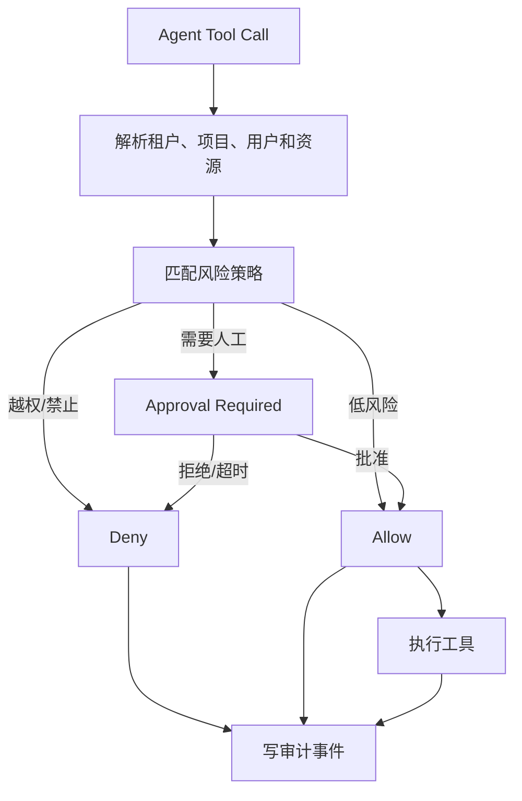

# 企业版安全、治理与审计

## 1. 风险分级

| 等级 | 示例 | 默认策略 |
| --- | --- | --- |
| L0 | 查看授权知识、只读问答 | 自动执行并记录 |
| L1 | 生成分析、方案和测试计划 | 自动执行，结果可追溯 |
| L2 | 修改代码、配置或索引 | 项目负责人审批 |
| L3 | 合并主分支、生产配置和发布 | 多人审批 + 测试门禁 |
| L4 | 删除数据、导出敏感数据、修改安全策略 | 安全管理员审批 + 二次确认 |

## 2. 治理门禁



策略判断必须在后端执行。前端隐藏按钮不是安全控制。

E2-01 当前已落地的治理门禁：

- `/api/enterprise/approvals` 提交、审批、拒绝、取消、执行均由后端状态机校验；
- `/api/enterprise/governance/decide` dry-run 与正式提交共用真实资源校验；
- `APP_ENV=enterprise` 下，团队版旧入口 `/api/repositories/{repository_id}/index/rebuild` 与
  `/api/team/requests/{request_id}/sync-gitee` 会先创建审批申请，审批执行前不触发旧入口副作用；
- 团队模式保留旧接口直通语义，避免破坏团队版演示链路；
- 审批摘要和审计事件递归清洗敏感字段，禁止落入密码、Token、Cookie、JWT、恢复码和私钥。

## 3. 密钥治理

- 密钥通过环境变量、密钥管理服务或短期凭据注入。
- 数据库只保存密钥引用、用途、范围、状态和轮换时间。
- 页面、日志、SSE、异常和审计导出统一脱敏。
- 支持创建、轮换、禁用、过期和使用记录。
- 代码扫描发现疑似密钥时阻断提交或生成安全告警。
- 文档、截图、测试夹具和演示环境不得使用真实生产凭据。

## 4. 审计事件

```json
{
  "event_id": "event-id",
  "trace_id": "trace-id",
  "tenant_id": "tenant-id",
  "actor_type": "user|agent|system",
  "actor_id": "actor-id",
  "action": "agent.tool.call",
  "resource_type": "task",
  "resource_id": "task-id",
  "risk_level": "L2",
  "decision": "allowed|denied|approval_required",
  "result": "succeeded|failed",
  "created_at": "2026-09-14T00:00:00Z"
}
```

## 5. 审计查询与留存

支持按租户、组织、项目、用户、Agent、操作、风险、结果、时间和 `trace_id` 查询。默认建议：

E2-01 审批执行侧要求：审批/拒绝/取消/过期/抢占/执行失败均写入带 `tenant_id + approval_id +
operation + result` 的审计事件；执行失败记 `execution_error` 与 `retry_count` 供追踪；审计与 Worker
参数不包含敏感字段（`token/password/jwt/cookie/recovery/secret/private_key` 递归清洗）。
多副本执行通过条件 UPDATE 原子抢占，只有抢到执行权的实例触发业务副作用并回写审计。

E1-01 当前已落地的审计查询收敛门为：

- 团队版 `project:manage` 或企业版 `audit:view` 任一满足即可读取 `/api/audit-events`；
- 后端始终使用服务端解析的激活租户进行 `tenant_id` 过滤；
- developer/reviewer 无 `audit:view` 时返回 `403`；
- 跨租户拒绝事件和成员操作事件必须写入当前 `tenant_id`，不能回落到默认租户。

| 数据 | 默认留存 | 可配置 |
| --- | --- | --- |
| 操作审计 | 180 天 | 是 |
| 审批记录 | 365 天 | 是 |
| 安全告警 | 365 天 | 是 |
| 模型调用摘要 | 90 天 | 是 |
| 任务回放事件 | 180 天 | 是 |

## 6. 可观测性

必须提供 API、Agent、RAG、Runner、数据库、Redis、向量库和外部模型的健康状态、耗时、错误率和关键计数器。

一次任务至少能关联：

```text
request_id -> trace_id -> task_id -> run_id -> step_id -> audit_event_id
```

## 7. 安全验收

- API、页面、缓存、文件、向量和审计接口均通过跨租户越权测试。
- Runner 不能访问宿主机未授权目录和生产网络。
- 工具调用无法绕过风险策略。
- Prompt Injection 不会改变系统权限和工具白名单。
- 真实密钥不会出现在日志、响应、截图和文档中。
- E2-01 本地验收：审批专项 `31 passed`、后端全量 `570 passed, 16 skipped`、前端全量 `236 passed`。
