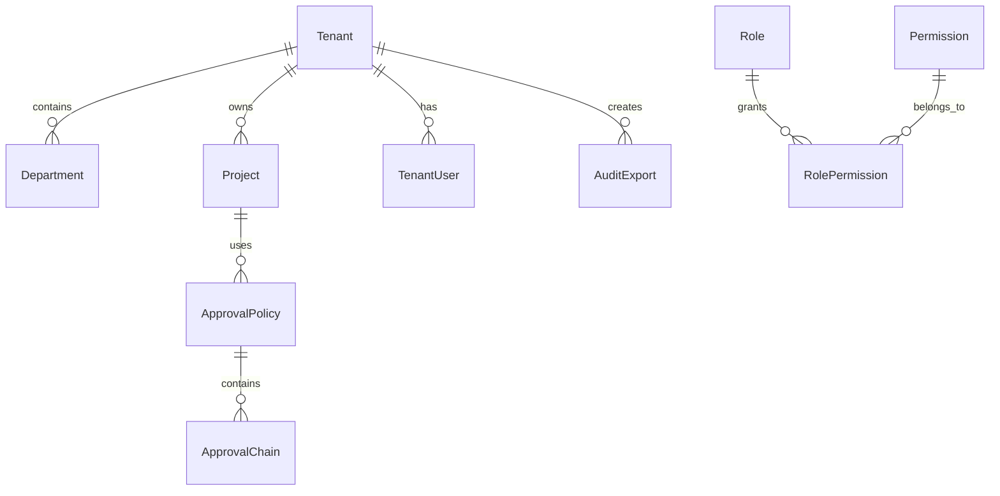
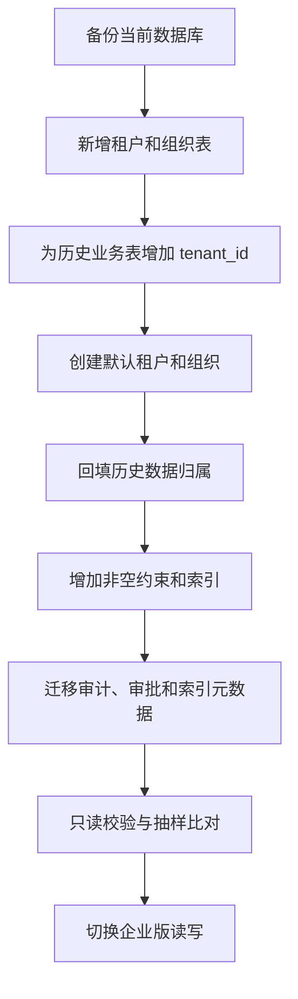

# 企业版 API、数据库与迁移文档

## 1. 文档定位

本文档记录企业版相对 MVP 和团队版新增的接口、数据对象和迁移原则。

## 2. 新增数据对象

| 对象 | 说明 |
| --- | --- |
| Tenant | 企业组织 |
| Department | 部门 |
| TenantUser | 组织成员关系 |
| Role | 角色 |
| Permission | 权限点 |
| RolePermission | 角色权限关系 |
| ApprovalPolicy | 审批策略 |
| ApprovalChain | 审批链 |
| ApprovalApplication | E2-01 已实现的审批申请，承载风险决策、审批状态、执行结果和幂等键 |
| SecurityPolicy | 安全策略 |
| AuditExport | 审计导出任务 |

## 3. 企业版核心关系



## 4. 新增 API

| 方法 | 路径 | 说明 |
| --- | --- | --- |
| GET | `/api/tenants` | 获取组织列表 |
| POST | `/api/tenants` | 创建组织 |
| GET | `/api/tenants/{tenant_id}/departments` | 获取部门 |
| POST | `/api/tenants/{tenant_id}/departments` | 创建部门 |
| GET | `/api/roles` | 获取角色 |
| POST | `/api/roles` | 创建角色 |
| PATCH | `/api/roles/{role_id}/permissions` | 修改角色权限 |
| GET | `/api/audit-logs` | 查询审计日志 |
| POST | `/api/audit-logs/export` | 创建审计导出任务 |
| GET | `/api/security/policies` | 查询安全策略 |
| PATCH | `/api/security/policies/{policy_id}` | 修改安全策略 |

### 4.1 企业版 Runtime 控制面（E4-01，/api/enterprise/runtime，tenant-scoped + 审计）

| 方法 | 路径 | 说明 |
| --- | --- | --- |
| POST | `/tasks` | 创建 Runtime 任务（幂等键；重复提交返回同一任务） |
| GET | `/tasks` | 当前租户 Runtime 任务列表 |
| GET | `/tasks/{task_id}` | 查询/从 checkpoint 恢复（跨租户 403） |
| POST | `/tasks/{task_id}/retry` | 请求重试 `{step_id, reason}` |
| POST | `/tasks/{task_id}/takeover` | 请求人工接管 `{step_id, reason}` |
| POST | `/tasks/{task_id}/takeover/complete` | `{action: resume\|retry\|cancel}`（权限 + 审批门禁；auditor 403） |

> Runtime 记录已由 Alembic `e5f6071a2b3c` + ORM/repositories 写透（真实 MySQL 跨进程/重启恢复已闭环）；`USE_SQLALCHEMY=false` 时走内存真源（测试）。

## 5. 迁移原则

- MVP 表结构向企业版演进时，优先新增字段，不破坏历史数据。
- 企业版核心业务表需要补 `tenant_id`。
- 所有迁移脚本必须可重复检查。
- 迁移前必须备份数据库。
- 大字段和日志表迁移需要分批执行。

## 6. 验收标准

- 企业版新增接口都带租户权限校验。
- 旧 MVP 数据可以迁移到默认组织。
- 审计导出任务可查询进度和下载结果。
- 数据库迁移过程可回滚或可恢复。

## 7. 统一响应和错误码

成功响应：

```json
{
  "request_id": "request-id",
  "data": {},
  "meta": {}
}
```

失败响应：

```json
{
  "request_id": "request-id",
  "error": {
    "code": "TENANT_SCOPE_REQUIRED",
    "message": "tenant context is required",
    "details": {}
  }
}
```

基础错误码：

| 错误码 | HTTP | 说明 |
| --- | --- | --- |
| `AUTH_REQUIRED` | 401 | 未登录或会话失效 |
| `FORBIDDEN` | 403 | 无资源或操作权限 |
| `TENANT_SCOPE_REQUIRED` | 400 | 缺少租户上下文 |
| `RESOURCE_NOT_FOUND` | 404 | 资源不存在或不可见 |
| `STALE_VERSION` | 409 | 资源版本或索引版本过期 |
| `IDEMPOTENCY_CONFLICT` | 409 | 幂等键对应的请求正在执行或结果冲突 |
| `APPROVAL_REQUIRED` | 409 | 操作需要审批 |
| `DEPENDENCY_UNAVAILABLE` | 503 | 外部依赖不可用 |

## 8. 迁移顺序



要求：

- 迁移脚本支持重复执行和中途重试。
- 回填期间不得让数据出现无租户归属的可读状态。
- 大表采用分批回填，记录批次、耗时和失败行。
- 切换前必须完成行数、唯一键、外键和权限抽样校验。
- 团队版旧接口通过兼容层映射到默认租户，不直接绕过新权限服务。
- E2-01 中 `/api/repositories/{repository_id}/index/rebuild` 与
  `/api/team/requests/{request_id}/sync-gitee` 在 `APP_ENV=enterprise` 下通过兼容层创建审批申请；
  团队模式保持原路径语义。

## 9. 关键索引和约束

- `tenant_id + id` 作为常用访问边界。
- `tenant_id + project_id + status` 支持任务和审批查询。
- `tenant_id + repository_id + commit_sha` 保证索引版本定位。
- `tenant_id + trace_id + created_at` 支持审计追踪。
- 业务唯一键不得只使用全局名称，必须包含租户或项目范围。
- `approval_applications` 使用 `UniqueConstraint(tenant_id, idempotency_key)`；持久化写入遇到唯一键冲突时读回既有审批单并返回幂等成功，避免多副本缓存缺失时生成重复审批。

## 10. 相关源码与联调注意点

E2-01 已落地源码：

- Alembic：`backend/migrations/versions/b3c4d5e6f708_add_approval_applications.py`
- Alembic：`backend/migrations/versions/c4d5e6f7089a_add_approval_execution_tracking.py`（E2-01 多副本执行追踪：`execution_attempt_id/async_result_id/retry_count/started_at/finished_at/execution_error`，纯追加可空列）
- ORM：`backend/app/models/orm.py::ApprovalApplicationORM`
- 持久化：`backend/app/db/repositories.py::upsert_approval`
- 多副本抢占：`backend/app/db/repositories.py::claim_approval_execution / settle_approval_execution`（条件 UPDATE，`version` 参与条件）
- 审批接口：`backend/app/approvals/routes.py`
- 审批状态机：`backend/app/approvals/service.py`
- 旧入口兼容门禁：`backend/app/main.py::_enterprise_approval_for_legacy_operation`

联调时重点验证：

- 前端不传或篡改 `tenant_id` 时，后端仍使用认证上下文；
- 重复提交带相同 `Idempotency-Key` 时不会重复创建任务；
- 迁移前后的团队版任务、审批和 RAG 索引引用保持可读；
- 删除或隐藏资源后，旧 URL 不能绕过权限读取。
- 企业云部署时必须用真实 MySQL 再补一次多副本幂等和执行并发压测。
