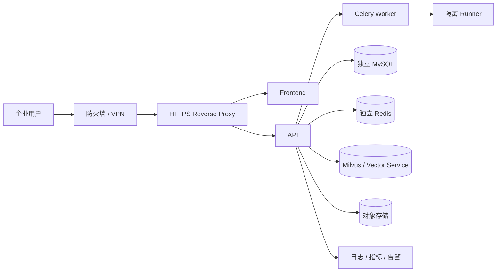
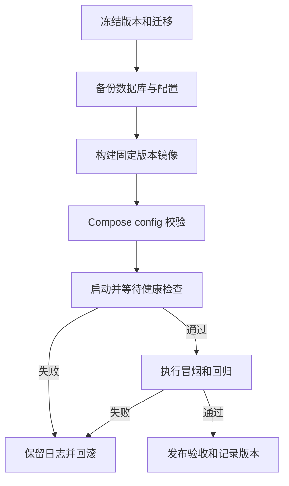
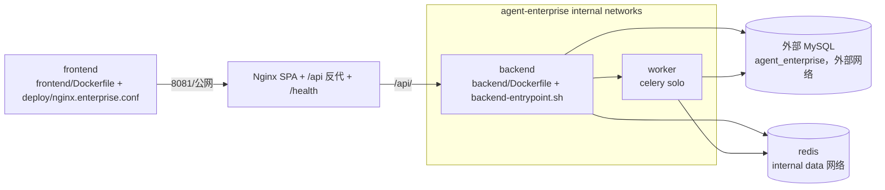

# 企业版部署架构与运维文档

## 1. 文档定位

本文档面向企业版私有化部署、运维、监控、备份和升级。

## 2. 部署形态

| 形态 | 说明 | 适用阶段 |
| --- | --- | --- |
| 单机 Docker Compose | 所有服务部署在一台云服务器 | MVP、团队版、小规模企业试点 |
| 分离式部署 | 应用、数据库、Redis、Milvus 分开部署 | 企业版推荐 |
| 内网私有化 | 不暴露公网，只在企业内网访问 | 企业正式交付 |

## 3. 企业版公网预留

没有域名时，企业版先使用：

```text
http://<server-ip>:8081
```

默认端口来自企业 Compose 的 `${ENTERPRISE_PUBLIC_PORT:-8081}`。团队版仍使用独立的 `8080` 入口。

后续有域名后可切换为：

```text
https://enterprise.<domain>
```

## 4. 企业版组件

| 组件 | 企业版要求 |
| --- | --- |
| 前端 | 支持独立构建和企业配置 |
| 后端 | 支持 `APP_ENV=enterprise` |
| MySQL | 独立实例或独立库 |
| Redis | 独立实例或独立 DB |
| Milvus | 独立 Collection 或独立实例 |
| Nginx | 统一入口、反向代理、上传限制、超时配置 |
| 日志 | 结构化输出，支持采集 |

## 5. 监控指标

- API 错误率。
- API 响应时间。
- Celery 队列积压。
- Agent 任务失败率。
- Embedding 失败率。
- Milvus 检索耗时。
- MySQL 慢查询。
- Redis 连接状态。

## 6. 备份恢复

| 对象 | 策略 |
| --- | --- |
| MySQL | 每日备份，保留 7 到 30 天 |
| Milvus | 定期快照或按 Collection 备份 |
| 配置文件 | 每次发布前备份 |
| 审计日志 | 独立归档 |

## 7. 升级与回滚

- 发布前记录当前版本号和镜像号。
- 发布前备份数据库。
- 发布后执行健康检查。
- 失败时回滚镜像和配置。
- 数据库迁移必须可追溯。

## 8. 验收标准

- 企业版可通过独立端口启动。
- 关键组件健康状态可检查。
- 数据备份可恢复到测试环境。
- 发布失败有回滚路径。
- `APP_ENV=enterprise` 必须确认生效，否则旧同步入口会保持团队版直通语义。
- E2-01 云端验收必须覆盖旧入口门禁、审批执行、审计查询、MySQL 重启恢复和多副本幂等。

## 9. 推荐生产拓扑



第一阶段单机 Compose 可以合并组件，但仍然必须保留网络隔离、持久化卷、健康检查和外部备份。

## 10. 环境变量分层

| 配置类别 | 示例 | 管理要求 |
| --- | --- | --- |
| 应用 | `APP_ENV`、`PUBLIC_BASE_URL` | 版本化模板 |
| 数据库 | `DATABASE_URL` | 密钥注入，不入库 |
| 队列 | `REDIS_URL`、Celery 配置 | 独立命名空间 |
| RAG | Milvus 地址、Embedding 配置 | 记录模型和索引版本 |
| 认证 | JWT、Cookie、SSO 配置 | 密钥管理和轮换 |
| Runner | 镜像、CPU、内存、网络 | 最小权限 |

## 11. 发布流程



## 12. 运维手册最低要求

- 服务启动、停止、重启和查看日志；
- 健康检查和依赖故障判断；
- 数据库、向量库和对象存储备份；
- 任务卡住、Worker 异常和 Runner 失败处理；
- 证书更新、密钥轮换和权限撤销；
- 升级、回滚和恢复演练；
- 事故记录、影响范围和后续修复。

## 13. 企业版独立 Compose 部署（E2-01 云端准备）

团队版用 `deploy/docker-compose.team.yml`（`agent-team`）；企业版为**独立栈** `deploy/docker-compose.enterprise.yml`
（`agent-enterprise`），复用同一 backend/frontend 镜像但 `APP_ENV=enterprise`，与团队版在项目名、网络、数据卷、端口上完全隔离，不影响已运行团队版的 8080。

### 13.1 部署链路（Mermaid + 源码位置）


- 编排：`deploy/docker-compose.enterprise.yml`；Nginx 配置 `deploy/nginx.enterprise.conf`（`frontend/Dockerfile` 以 `NGINX_CONF` 构建参数选择，默认仍为 `nginx.team.conf`）。 
- 启动门：`deploy/backend-entrypoint.sh`（`APP_ENV=enterprise` 强制 MySQL/SQLAlchemy/Celery/JWT/恢复码/CORS/Milvus）；进程内 `backend/app/core/runtime_config.py`（企业版入 `_PROD_ENVS`，强制 MySQL + `celery_required`）。
- 运行加固：worker 健康检查 `deploy/worker-healthcheck.sh`（控制面 ping，见 §13.2）；frontend 非 root（`deploy/nginx.master.conf` + `frontend/Dockerfile` 的 `USER nginx`），站点配置 `deploy/nginx.enterprise.conf`。
- Worker 只校验迁移版本（`ensure_worker_runtime_ready` → `ensure_schema_current(upgrade=False)`），不并发跑迁移；迁移由后端 API 执行（compose 设 worker `RUN_ALEMBIC_UPGRADE=false`）。

### 13.2 服务矩阵（2 vCPU / 2 GB 预算）

| 服务 | 公网 | 内部网络 | 资源上限 | healthcheck |
| --- | --- | --- | --- | --- |
| frontend | `8081:8080` | public | .2c / 96m | `wget .../health` |
| backend | 否（仅 expose） | public+data+mysql | .9c / 512m | `curl .../api/health` |
| worker | 否 | data+mysql | .7c / 450m | `worker-healthcheck.sh`：celery `inspect ping --destination=celery@<host>`（反映 worker 应答 + broker 可用） |
| redis | 否 | data(internal) | .15c / 128m | `redis-cli ping` |
| MySQL | 外接（外部网络 `projectdream_backend_net`） | mysql(external) | 运维提供 | — |
backend / worker 以 `agent` 非 root 用户（uid 10001）运行；Redis 使用官方镜像运行模型。frontend 镜像已**非 root 化**（`USER nginx`，`deploy/nginx.master.conf` 移除了 setuid 指令、pid 落 `/tmp/nginx.pid`、临时/缓存目录落 `/tmp/nginx_*` 并 `chown nginx:nginx`，静态资源 `/usr/share/nginx/html` 同样授权），站点内部仍 `listen 8080`；团队版与企业版共用该镜像并按 `NGINX_CONF` 选择站点配置。数据卷为 `agent_enterprise_data` / `agent_enterprise_redis_data`。

worker healthcheck 使用 `deploy/worker-healthcheck.sh`（`/usr/local/bin/worker-healthcheck.sh`，随 backend 镜像构建）：`celery -A app.workers.celery_app inspect ping --destination=celery@<host>` 经 broker 双向应答，预热期（uptime < `WORKER_HEALTH_START_GRACE`，默认 60s）与 compose `start_period: 60s` 双保险防误判，脚本内重试 3 次容忍 Redis 短暂抖动；interval 60s 避免高频探测。仅只读控制面，不投递业务任务、不删/重置审批/索引/同步、不跑迁移（worker 保持 `RUN_ALEMBIC_UPGRADE=false`）。

### 13.3 环境变量与防火墙

- 副本：`cp deploy/env/enterprise.env.example deploy/env/enterprise.env`，**必须替换**：`DATABASE_URL`（真实 MySQL 地址/账号）、`AUTH_JWT_SECRET`（≥32 随机）、`AUTH_RECOVERY_CODE`（≥16 随机）、`FRONTEND_CORS_ORIGINS`（公网地址）；`GITEE_TOKEN`/`LLM_API_KEY`/`ZHIPU_API_KEY` 按需。
- 防火墙/安全组仅放行公网端口 **8081（或 ENTERPRISE_PUBLIC_PORT）** 与 22；MySQL(3306)/Redis(6379)/Redis Worker 端口不对公网开放；后端 8000 仅内部网络。
- 不提交真实 Token/密码/JWT/恢复码/连接串（示例均为被启动校验拒绝的占位符）。

### 13.4 云端部署 / 健康检查 / 备份 / 回滚

发布前先冻结可追溯版本：提交或记录 Git commit/tag，备份 MySQL 与当前配置，再将该固定版本同步到云端。不要直接把本地混杂、未提交的工作区作为发布源；升级和回滚过程禁止使用 `docker compose down -v`，避免误删持久化卷。

```bash
# 部署
cp deploy/env/enterprise.env.example deploy/env/enterprise.env   # 替换真实值
docker compose -f deploy/docker-compose.enterprise.yml --env-file deploy/env/enterprise.env up -d --build
docker compose -f deploy/docker-compose.enterprise.yml ps
# 健康检查
curl -fsS http://<server-ip>:8081/health
curl -fsS http://<server-ip>:8081/api/health
docker compose -f deploy/docker-compose.enterprise.yml exec backend curl -fsS http://localhost:8000/api/health
# 关键日志
docker compose -f deploy/docker-compose.enterprise.yml logs -f backend worker frontend
# 备份（MySQL 由运维外部备份；此处备份数据卷中非 DB 工件）
docker run --rm -v agent_enterprise_data:/data -v $(pwd):/backup alpine tar czf /backup/agent_enterprise_data_$(date +%F).tgz -C /data .
# 升级
docker compose -f deploy/docker-compose.enterprise.yml build
docker compose -f deploy/docker-compose.enterprise.yml up -d
# 回滚
docker compose -f deploy/docker-compose.enterprise.yml up -d --no-deps <service>   # 按需回滚到上一构建 tag
```
> 迁移：由后端 API 单实例执行（`RUN_ALEMBIC_UPGRADE=true` 默认），worker 仅检查版本，避免并发锁。

### 13.5 E2-01 云端验收项与诚实边界

本地已验证：企业版启动配置校验（缺 MySQL/JWT/恢复码/Celery/Redis/CORS 启动拒绝）、worker 只校验迁移、
worker healthcheck 路径与镜像一致、frontend 非 root 配置断言、enterprise/team Compose 渲染、
部署专项 `22 passed`、后端全量 `609 passed, 16 skipped`、前端类型检查与生产构建通过。
**云端尚未验证（不宣称通过）**：真实 MySQL/Redis/Celery Worker 多副本并发压测；tenant owner、tenant admin、security admin、auditor 的租户切换与 RBAC 边界浏览器走查；审批单的提交 → 非自审审批 → 执行主链、状态与审计回写；旧入口门禁；HTTPS；备份恢复和回滚演练。本 compose 栈未内置 Milvus（`USE_MILVUS=false` 默认），需向量检索须外接并置 `USE_MILVUS=true + MILVUS_URI`。

## 14. 真实验收证据

企业版正式交付时必须在此补充：

- 空环境部署命令和版本；
- `/health`、`/api/health` 结果；
- 容器状态和关键日志；
- HTTPS 页面截图；
- tenant/RBAC 角色矩阵与跨租户拒绝的浏览器或接口证据；
- 审批提交 → 非自审通过 → 执行、审计记录和 Worker 投递证据；
- 备份恢复和升级回滚记录。

当前内容是部署设计，不代表企业版已经完成生产部署。

E2-01 本地已完成源码和自动化验收，但尚未完成云服务器部署验证。云端发布前必须补充：

- 本轮本机无 Docker daemon，因此 `docker compose up`、frontend 非 root 实际启动、worker 对真实 Redis/broker 的 `inspect ping`、`/health`、`/api`、SPA 反代可达性均未运行态验证；
- `APP_ENV=enterprise`、`USE_SQLALCHEMY=true`、MySQL、Redis/Celery、Milvus 配置截图或脱敏配置摘要；
- `/api/repositories/{repository_id}/index/rebuild` 在企业模式下返回审批单，不提前触发索引重建；
- `/api/team/requests/{request_id}/sync-gitee` 在企业模式下返回审批单，不提前改 `SYNCING`；
- tenant owner、tenant admin、security admin、auditor 的权限边界、切换租户刷新和跨租户拒绝；
- 由不同用户完成审批单提交 → 非自审审批 → 执行，确认审批状态、审计事件和 Worker 投递一致；
- 服务重启后审批单仍可查询、审批和执行；
- 双副本并发提交同一幂等键只保留一个审批单；
- **双副本并发执行同一已审批单仅一次真实副作用**（本地已由 `test_enterprise_e2_hardening.py`
  覆盖条件 UPDATE 抢占，多副本=数据库条件更新，SQLite 已验证；云端 MySQL 压测待执行）；
- 审计事件不包含真实凭据。
> 企业 RAG 检索与离线评测（E3-01..E3-06）：本机真实 Docker 环境已跑通企业独立 Milvus +
> `zhipu/embedding-3` + health-middle 四模式 `--require-milvus --all-modes` verified 报告；
> 生产云端多副本压测、长期稳定性与质量达标调优仍需继续补证据。
- E3-06-CLOUD-HEALTH-MIDDLE（真实仓库 health-middle）：已产出 67 条真实评测集 + 303 真实切片；
  verified 报告为 `validation_status=verified / vector_backend=milvus / milvus_verified=true /
  fallback_used=false / embedding_dimension=2048`，两次非时间字段对拍 `differences=0`。注意：
  报告 `needs_improvement=true`，主报告 precision 未过推荐阈值，不能宣称生产质量达标。

### 14.1 企业专用 Milvus 运行要求

企业 Compose 已内置独立 `etcd-enterprise`、`minio-enterprise`、`milvus-enterprise`，并使用。启用同机内置 Milvus 时建议至少 4 vCPU / 8 GB；2 vCPU / 2 GB 仅适用于应用-only 栈，低配服务器应将 Milvus 拆到独立内网主机。

- 独立服务名：`milvus-enterprise`；
- 独立网络：`agent_enterprise_milvus`、`agent_enterprise_milvus_internal`；
- 独立数据卷：`agent_enterprise_milvus_data`、`agent_enterprise_milvus_etcd_data`、`agent_enterprise_milvus_minio_data`；
- 独立集合前缀：`MILVUS_COLLECTION_PREFIX=enterprise`；
- 仅内部 DNS 访问 `http://milvus-enterprise:19530`，不对公网发布 19530/2379/9000/9001。

首次启动前必须替换 `ENTERPRISE_MINIO_ROOT_PASSWORD` 和 `ZHIPU_API_KEY`。企业评测命令会先调用 `zhipu / embedding-3` 探测真实向量维度，再创建 collection；返回维度与 `EMBEDDING_DIMENSIONS` 不一致会直接失败。这一步是为了防止“Milvus 已启动但向量维度不匹配”的假成功。
