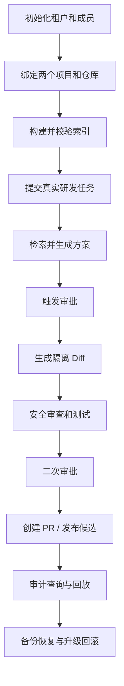

# 企业版测试、验收与交付文档

## 1. 文档定位

本文档用于企业版上线前验收、私有化交付和客户交付检查。

## 2. 测试范围

| 类型 | 重点 |
| --- | --- |
| 功能测试 | 多租户、组织、权限、审批链、审计导出 |
| 安全测试 | 越权访问、密钥回显、敏感文件过滤 |
| 性能测试 | 任务列表、RAG 检索、队列处理、审计查询 |
| 部署测试 | 独立环境启动、健康检查、备份恢复 |
| 回归测试 | MVP 主流程和团队版协作流程不被破坏 |

## 3. 企业版验收场景

| 场景 | 操作 | 通过标准 |
| --- | --- | --- |
| 租户隔离 | A 组织用户访问 B 组织任务 | 接口拒绝，页面不可见 |
| 多级审批 | 创建高风险任务 | 进入审批链，不可绕过 |
| 审计导出 | 按时间导出操作日志 | 文件可下载，内容完整 |
| 密钥保护 | 查看配置页和接口响应 | 不出现明文密钥 |
| 私有化部署 | 在独立环境启动企业版 | 前端、后端、MySQL、Redis、Milvus 正常 |
| 备份恢复 | 备份后恢复到测试库 | 核心数据一致 |

## 4. 交付清单

- 部署文档。
- 环境变量模板。
- Docker Compose 或部署脚本。
- 数据库迁移脚本。
- 管理员初始化说明。
- 测试账号和演示数据。
- 运维监控说明。
- 备份恢复说明。
- 常见问题文档。

## 5. 交付验收标准

- 客户环境能独立访问企业版入口。
- 管理员能完成组织、成员、项目初始化。
- 真实 Gitee Issue 能走通分析、检索、审批、Diff、测试和回放。
- 高风险任务不能绕过审批链。
- 审计日志可查询、可导出、可追溯。

## 6. 测试矩阵

| 领域 | 最低测试项 | 通过标准 |
| --- | --- | --- |
| 功能 | 租户、组织、项目、任务、审批、回放 | 主流程和异常状态正确 |
| 权限 | API、页面、缓存、文件、向量和审计 | 无跨租户数据泄漏 |
| RAG | BM25、向量、RRF、Rerank、Freshness | 评测指标达到版本门槛 |
| Agent | 幂等、重试、暂停、恢复、人工接管 | 不重复执行成功写操作 |
| 安全 | 注入、命令、路径、SSRF、密钥泄漏 | 阻断或告警符合策略 |
| 性能 | API、RAG、队列、Runner 并发 | 达到 PRD P95 基线 |
| 部署 | 空环境、重启、备份、恢复、回滚 | 按文档可重复完成 |
| 回归 | 团队版登录、任务、索引、审批、测试 | 原有测试不退化 |

## 7. 端到端验收流程

## 8. RAG 评测验收

- 每个核心项目至少 50 条真实问题；
- 保存期望文件、符号、文档或行号；
- 输出 Recall@5、Precision@5、MRR、NDCG、Freshness Rate；
- 对团队版向量模式和企业版 Hybrid 模式做同数据对比；
- 失败样本可以定位到查询改写、过滤、召回、融合、重排或引用阶段；
- 模型、Embedding、切片或权重变化必须触发回归评测。

## 9. 交付证据规则

每个已经标记完成的企业版功能必须附：

1. 测试命令和通过结果；
2. 接口请求/响应或操作步骤；
3. 真实页面、接口或服务器控制台截图；
4. 版本号、数据库迁移版本和部署环境；
5. 已知限制和未覆盖风险。

截图必须来自当前运行版本，不能用设计稿、编造数据或未运行页面替代。
