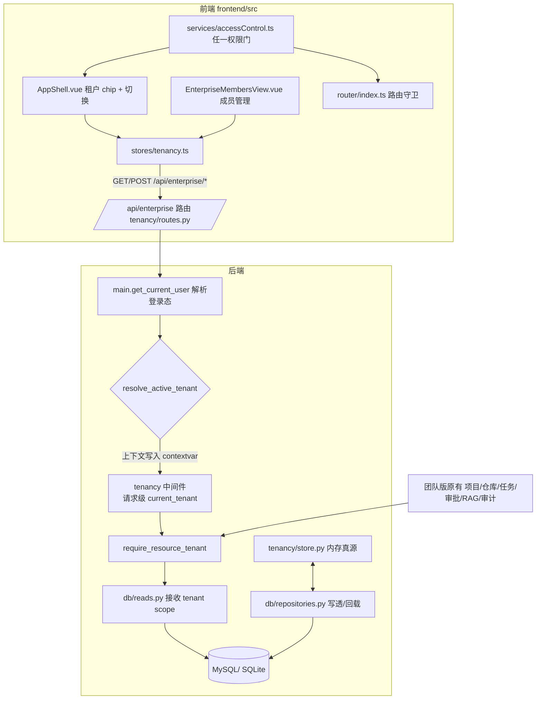

# E1-01 多租户 / 组织成员 / RBAC / 项目隔离 —— 开发文档

> 阶段：E1（多租户与权限）
> 链接设计：`docs/enterprise/00-enterprise-development-plan.md`、`docs/enterprise/01-enterprise-prd.md §7`、
> `docs/enterprise/05-tenant-permission-security.md`
> 验收依据：跨租户隔离测试 + 团队版全量回归（`539 passed, 16 skipped`）+ 前端 `232 passed` + 已有真实浏览器联调截图。
> 范围外（本阶段不实现）：部门层级、SSO/LDAP、ABAC、计费、复杂审批门禁、Multi-Agent Runtime。

## 1. 目标

在**不破坏团队版链路**的前提下，为平台增加强多租户能力：

- 企业数据模型（Tenant / Organization / TenantMembership）与 7 种企业角色；并保留团队版
  `ApiRole / ROLE_PERMISSIONS`，通过**企业权限适配层**接入，默认租户下团队版行为不变。
- 请求级 **TenantContext（服务端解析激活租户）**，跨租户资源访问返回 `403` 并记审计。
- 业务资源（项目/仓库/任务/团队需求/索引元数据/检索记录/审计）补齐 `tenant_id`，历史数据经 migration 回填到默认租户。
- 成员可安全切换所属租户；禁用即阻断新请求；仅 Web 层展示、后端最终授权。
- 前端企业权限与团队版权限兼容：审计中心支持 `project:manage` 或 `audit:view`，成员管理支持
  `project:manage` 或 `member:view`，避免企业角色后端已放行但页面被旧权限挡住。

## 2. 架构

**关键取舍（集中式接入）**

1. **租户上下文放 HTTP 中间件而非依赖**：FastAPI 同步依赖跑线程池，contextvar 变更不会回传
   请求上下文；改用 `app.middleware("http")`（`main.py`）在请求上下文 `set/reset`，使所有
   handler 内联的 `require_resource_tenant` / 读层 `scoped` 可靠读到。
2. **任务类接口由 `task_for_mutation`（main.py）伞形覆盖**：约 41 个任务 mutating handler
   无需逐个改签名即被租户门覆盖。
3. **企业权限适配层**（`tenancy/permissions.py`）：新增企业角色→权限集 + `authorize()` /
   `require_tenant_permission()`，不推翻团队版权限口径。
4. **worker/后台无请求上下文 → 不强制租户**：保证团队版 worker 流程与既有 529 测试不退化。
5. **前端权限采用任一满足即放行**：团队版 `project:manage` 与企业版
   `audit:view` / `member:view` 并行生效；前端仅用于导航和体验，后端仍是最终授权源。

## 3. 数据模型

| 表 | 说明 | 关键字段 |
| --- | --- | --- |
| `tenants` | 租户 | id, name, status |
| `organizations` | 组织（归属唯一租户） | id, tenant_id, name |
| `tenant_memberships` | 成员关系（生命周期 + 服务端激活位） | tenant_id, user_id, role, status, **is_active**；`(tenant_id,user_id)` 唯一 |
| 既有 8 张业务表 | `projects/repositories/tasks/team_requests/repository_indexes/retrieval_records/audit_events/code_chunks` | 新增 `tenant_id`，历史行回填 `tenant_default` |

企业角色（`ENTERPRISE_ROLE`）：`tenant_owner / tenant_admin / security_admin / project_owner /
developer / reviewer / auditor`。种子适配：admin→tenant_owner、lead→project_owner、approver→reviewer、
developer→developer、observer→auditor（默认租户下团队角色行为不变）。

## 4. 接口契约（`/api/enterprise`）

| 方法 | 路径 | 说明 | 需企业权限 |
| --- | --- | --- | --- |
| GET | `/tenant-context` | 激活租户 + 可切换租户列表 + 角色/权限 | 全员 |
| POST | `/tenant-context/switch` | `{tenant_id}` 切换；仅限自己是该租户 active 成员 | 全员 |
| GET | `/members` | 激活租户成员列表 | member:view |
| POST | `/members` | `{user_id, role}` 加成员（`(tenant,user)` 幂等） | member:manage |
| PATCH | `/members/{id}` | `{enabled?, role?}` 改启用/角色；保留最后一名管理员 | member:manage |
| GET | `/organizations` | 组织列表 | org:view |
| POST | `/organizations` | `{name}` 建组织（按租户名幂等） | org:manage |
| POST | `/tenants` | `{name}` 建租户+默认组织+创建者即 owner | tenant:create |

响应统一 `{code, message, data}`；失败 `code` 与 `message`；跨租户统一 `403`；写操作幂等并审计。

## 5. 源码位置

| 职责 | 文件 |
| --- | --- |
| 企业模型（pydantic） | `backend/app/tenancy/models.py` |
| 企业 RBAC / 权限集 | `backend/app/tenancy/permissions.py` |
| 租户上下文 / 资源归属门 / 审计 | `backend/app/tenancy/context.py` |
| 内存真源 + 种子 + DB 回载 | `backend/app/tenancy/store.py` |
| `/api/enterprise` 路由 | `backend/app/tenancy/routes.py` |
| ORM（新增 3 表 + tenant_id 列） | `backend/app/models/orm.py` |
| 持久化 upsert/load + tenancy 读写 | `backend/app/db/repositories.py` |
| 读层 tenant scope | `backend/app/db/reads.py` |
| 启动恢复 + 默认租户种子 | `backend/app/db/bootstrap.py` |
| 中间件 / get_current_user 解析 / 各资源门 | `backend/app/main.py` |
| 迁移（建表 + 回填） | `backend/migrations/versions/a1b2c3d4e5f6_add_enterprise_tenancy.py` |
| 隔离测试 | `backend/tests/test_enterprise_e1_tenancy.py` |
| 前端租户 store | `frontend/src/stores/tenancy.ts` + `types/tenancy.ts` |
| 租户 chip / 切换 | `frontend/src/components/AppShell.vue` |
| 成员管理页 | `frontend/src/views/EnterpriseMembersView.vue` |
| 前端权限兼容门 | `frontend/src/services/accessControl.ts` |
| 路由与企业入口 | `frontend/src/router/index.ts` + `frontend/src/components/AppShell.vue` |
| 前端权限回归 | `frontend/src/views/__tests__/AuditCenterView.spec.ts` + `frontend/src/components/__tests__/AppShell.spec.ts` |

## 6. 收敛门（跨租户 403 覆盖的核心资源）

`require_resource_tenant(resource_tenant_id)`（`tenancy/context.py`）在 `main.py` 各 get/put 点调用，
并在读层 list 函数传 `tenant_id` 过滤。覆盖：项目、仓库、任务（含 `task_for_mutation`）、团队需求
（`find_team_request`）、索引元数据、检索记录、审计列表。
审计列表 `/api/audit-events` 由 `require_audit_view`（main.py）把关：团队 `project:manage` 或企业
`audit:view` 任一生效，保证 enterprise auditor / security_admin / tenant_admin / tenant_owner 可按
权限矩阵读审计，普通成员（developer/reviewer）仍拒绝（H1 修正）。
越权拒绝事件和成员操作事件显式写入 `ctx.tenant_id`，避免持久化模式下落到默认租户。

前端 `/audit` 和 `/enterprise/members` 路由、侧栏入口与页面加载均复用任一权限门：

- 审计中心：`project:manage` 或 `audit:view`；
- 成员管理：`project:manage` 或 `member:view`；
- 企业角色不再出现“后端 200、前端路由/导航被旧团队权限挡住”的不一致。

## 7. 真实联调

环境：后端 `uvicorn app.main:app :8020`（内存态 `USE_SQLALCHEMY=false`）+ 前端 Vite `:5173`
（`VITE_API_PROXY_TARGET=http://127.0.0.1:8020`）+ CDP 浏览器登录 `admin@company.com`。

1. 登录后工作台顶栏显示当前租户 chip「默认租户」，侧栏含「成员管理」入口：
   [附图 1：工作台租户 chip](assets/e1-01/e1-01-dashboard-tenant.png)。经 `GET /api/enterprise/tenant-context` 返回
   `active_tenant.id=tenant_default, role=tenant_owner`。
2. 创建第二个租户 `TenantB`（`tenant_2d2dad98edef`），重新加载后租户下拉同时列出两个租户：
   [附图 2：租户切换下拉](assets/e1-01/e1-01-tenant-switcher.png)。
3. 默认租户成员页展示 5 名成员（角色/启用开关）：
   [附图 3：成员管理（默认租户）](assets/e1-01/e1-01-members-default.png)。
4. 切换到 `TenantB` 后 chip 变为「TenantB」，其成员页仅展示所有者「林岚」：
   [附图 4：TenantB 隔离视图](assets/e1-01/e1-01-members-tenantB.png)。

## 8. 联调注意点

- **必须带租户上下文**：所有新接口/业务接口联调都要在已登录会话下进行；手动 `curl` 需先
  `POST /api/auth/login` 并携带 `Set-Cookie`，否则 `401 / 403`。
- **服务端解析激活租户**：请求不得携带不可信 `tenant_id`/`X-Tenant-Id`；切租户调用
  `POST /api/enterprise/tenant-context/switch`，服务端改写成员 `is_active` 位。
- **默认租户兼容**：历史数据在 `tenant_default`；团队版登录用户都已种子为该租户 active 成员，
  团队接口在默认租户下行为与以前一致。若手工把某用户默认租户成员禁用，该用户全局请求会立即 401。
- **Vite 代理**：前端需把 API 代理指到本功能联调的 backend 端口（`VITE_API_PROXY_TARGET`）。
- **多副本注意**（未在本次验证）：租户 context 放内存 + DB，`is_active` 位已落库可信；
  多 worker 副本各自解析成员关系，一致。SSO/MFA 为后续阶段。

## 9. 测试证据

- 隔离专项（`test_enterprise_e1_tenancy.py`，9 passed）：
  双租户/双项目隔离、切已加入/拒未加入、跨租户读/改/建任务/仓库·索引 403、禁用成员即拒、
  owner/admin 边界与「最后一名管理员不可降级」、组织幂等、**auditor 可读审计而普通成员 403（H1 回归）**、
  **拒绝审计事件保留激活租户归属**。
- 迁移回填：`test_migrations_upgrade.py` 4 passed（含 `3274ebaca315 -> a1b2c3d4e5f6`）。
- 团队版回归：全量 `539 passed, 16 skipped`（Audit 鉴权、租户审计归属均无回归）。
- 前端：`vitest 232 passed`，`vue-tsc -b` 通过，`vite build` 成功。

## 10. 未覆盖风险（如实声明）

- **持久化 SQL 层隔离**：应用读层做 tenant scope 过滤；未做「数据库层投影分隔」。跨租户合法数据
  仍在同一物理表，靠应用层强制。SSO 前足够；若需更强隔离可后续用 RLS/分区。
- **worker 中台自动任务**：由团队请求在 worker 内自动创建的任务缺默认请求上下文 →
  `_stamp_tenant` 会落 `tenant_default`。请求边界内的创建已隔离；worker 侧自动创建未在本次强制到
  各租户，已在 main.stamp 保留可扩展口。
- **多副本并发**：`is_active` 位写透 DB，但从 DB 回载在 `restore_from_db`；未做跨进程租户上下文
  广播。生产多副本需 Redis 或 DB 通知兜底（后续阶段）。
- **本轮增量尚未云端验证**：前端企业权限门和越权审计租户归属已在本地测试验证，尚未同步到云服务器
  做真实浏览器角色切换验收；既有云端审计页面验收证据仍对应此前版本。
- **部门/组织树 UI、SSO/LDAP、ABAC、计费**为 E1-01 明确范围外。
- 截图来自本机内存态真实运行版本，非示意图；生产 MySQL 持久化联调待正式部署环境。
