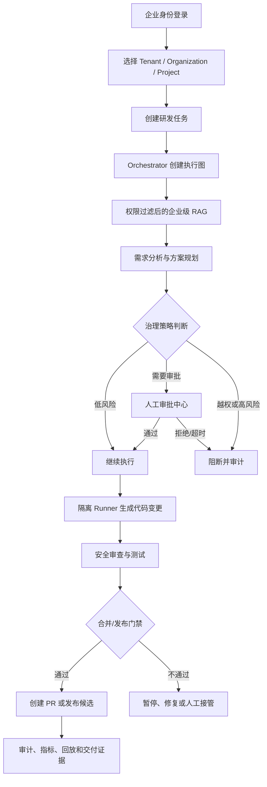

# 企业版文档索引

## 版本定位

司契（Siqi）企业版建立在团队版可运行基线之上，目标是交付具备多租户、企业权限、受治理 Multi-Agent、企业级 RAG、审批审计、安全合规和私有化运维能力的研发协作平台。

本目录是企业版文档的正式维护入口。根目录下的 `17-enterprise-prd.md` 到 `21-enterprise-test-and-delivery.md` 保留为历史兼容入口，后续新增和更新内容统一写入本目录。

文档状态说明：

| 标识 | 含义 |
| --- | --- |
| 已验证基线 | 团队版已经真实运行或测试验证的能力 |
| 企业版设计 | 企业版已确定的产品和架构要求 |
| 待开发 | 需要实现、联调和验收的企业版能力 |
| 后续规划 | 不作为企业版第一阶段上线门槛 |

## 推荐阅读顺序

| 顺序 | 文档 | 说明 |
| --- | --- | --- |
| 00 | `00-enterprise-development-plan.md` | 企业版阶段、任务拆分、协作边界和完成定义 |
| 01 | `01-enterprise-prd.md` | 企业版完整产品需求、角色、模块和验收标准 |
| 02 | `02-enterprise-workflow.md` | 租户、任务、审批、Agent 和异常流程 |
| 03 | `03-multi-agent-design.md` | Orchestrator、Supervisor、专业 Agent 和状态机 |
| 04 | `04-enterprise-rag-design.md` | Hybrid RAG、过滤、重排、评测和索引治理 |
| 05 | `05-tenant-permission-security.md` | 组织、租户、RBAC、SSO、MFA 和隔离 |
| E1-01 | `10-e1-01-tenant-permission.md` | **已完成并取证**：多租户/组织成员/RBAC/项目隔离；企业角色前端权限兼容、增量云端 auditor 走查和越权审计均已完成 |
| 06 | `06-security-governance-audit.md` | 风险分级、治理门禁、密钥、审计和可观测性 |
| 07 | `07-api-database-migration.md` | API、数据模型、迁移和团队版兼容 |
| 08 | `08-deployment-ops.md` | 私有化部署、HTTPS、监控、备份、升级和回滚 |
| 09 | `09-test-delivery.md` | 测试矩阵、验收场景、交付清单和真实截图要求 |
| 10 | `10-commercialization-and-sla.md` | 商业试点、配额、SLA、客户交付和后续商业化 |
| E7 | `10-pilot/README.md` | **商业试点交付包**：演示数据/走查脚本、客户部署运维手册、SLA、交付清单、试点验收脚本、边界与免责声明 |

> **前端（E5-01，DONE）**：7 个企业页面已完成真实数据、权限、响应式和运维入口收口；共享组件库（StatusBadge/PageHeader/AsyncState/DetailDrawer/ConfirmDialog/PermissionGate）、Runtime/RAG 控制台、角色走查、390px 响应式扫描、真实浏览器截图、`npm run test`、`vue-tsc -b` 和 `vite build` 均已完成。详见 `docs/project-development/111-enterprise-e5-01-frontend.md`。

## 企业版总链路

## 文档维护规则

- 企业版每完成一个功能，必须同步更新相关设计文档和开发记录。
- Mermaid 图必须覆盖主链路、接口、状态和异常分流。
- 尚未真实运行的功能不得写“已完成”，应标记为“待开发”或“待验收”。
- 截图必须来自当前代码真实运行页面、接口或运维控制台，不使用示意图冒充验收证据。
- 文档和配置中禁止出现真实密码、Token、JWT 密钥、恢复码和私钥。
