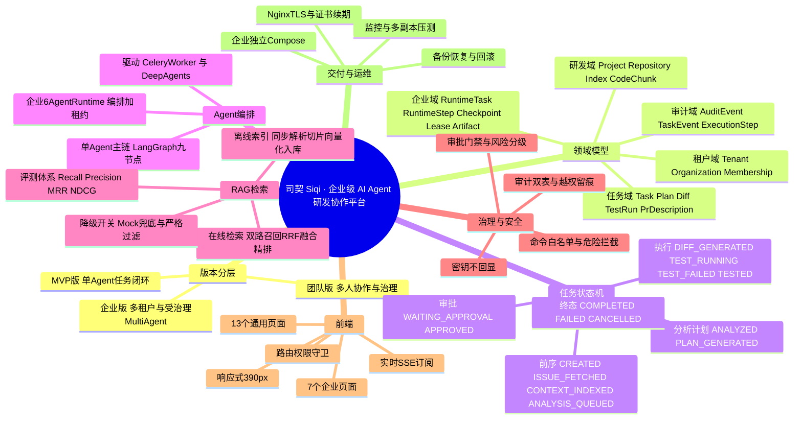
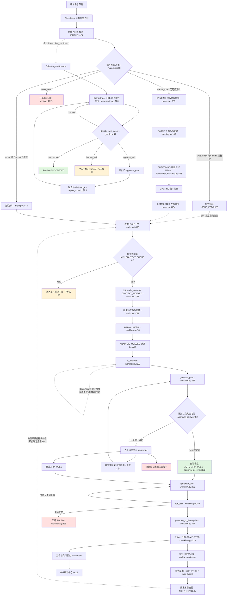
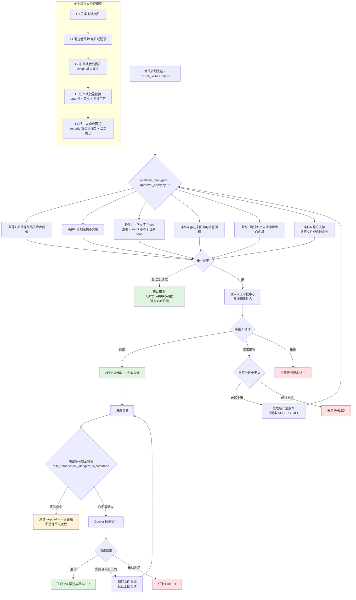
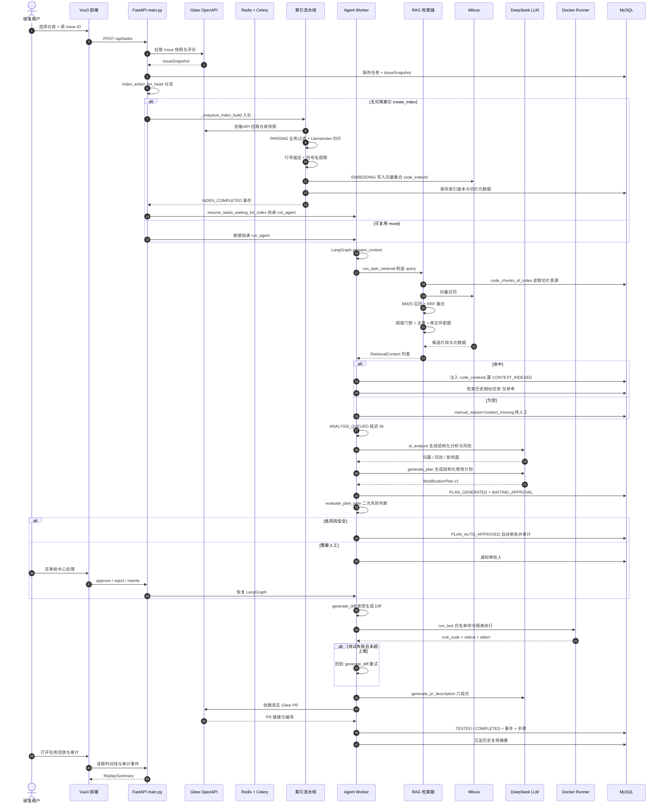
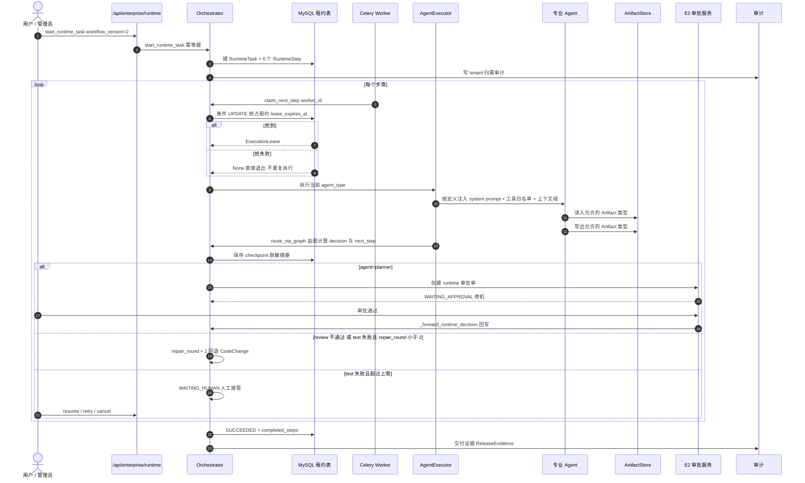
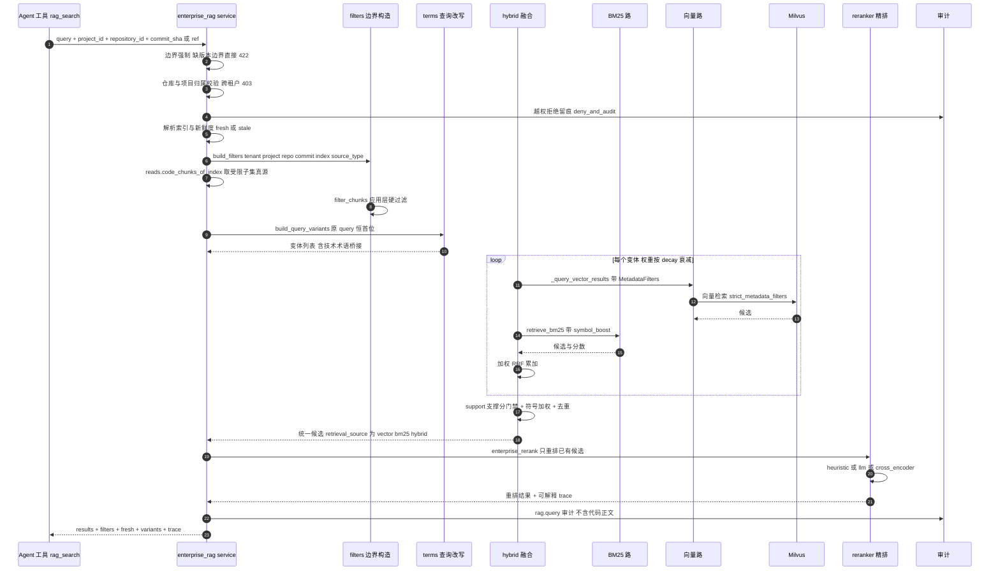

# 司契（Siqi）项目全景图 · 思维导图 / 业务流程图 / 时序图

> 交付对象：小泽（项目作者）
> 产出方式：基于当前仓库真实源码与文档通读，**不含推测**。代码引用格式 `模块:行号`。
> 生成日期：2026-09-24

---

## 0. 一句话讲清这个项目

> **把 AI Agent 塞进企业真实研发流程里，做成一条「可解释、可审批、可回放、可追责」的任务流水线。**

它和「AI 帮我写代码」的工具本质区别在于：**约束在前，生成在后**。

| 维度 | 普通 AI 编码工具 | 本项目 |
| --- | --- | --- |
| 输入 | 你随口说的一句话 | Gitee Issue（有编号、有验收标准、可追溯） |
| 上下文 | 模型自己猜 / 全仓塞 | 代码 RAG 检索，带 file / 行号 / commit / 索引版本 |
| 产出 | 直接改文件 | 结构化修改计划 → 人工审批 → 才允许生成 Diff |
| 执行 | 本地随便跑 | 白名单命令 + 危险命令拦截 + Docker 隔离 Runner |
| 事后 | 无 | 任务回放、审计双表、ReleaseEvidence、PR 链接 |
| 复用 | 无 | 完成任务的复用摘要 + 历史相似任务参考（不自动套用旧 Diff） |

### 渲染图索引（已导出 PNG，可直接看）

**图分三类，用途完全不同——先看「回答什么问题」这一列选图。**

| 文件 | 图类型 | 回答什么问题 | 覆盖范围 |
| --- | --- | --- | --- |
| [01-mindmap.png](./assets/01-mindmap.png) | 思维导图 | 这个项目有哪 8 大块？ | 只到两层，一眼看完 |
| [02-flow.png](./assets/02-flow.png) | 分层索引图 | 每块里面具体有什么？ | 全量细节，从左往右读 |
| [03-flow.png](./assets/03-flow.png) | 业务流程图 · 图 A | 一次任务从生到死怎么走？ | 主干 happy path + 主要分支 |
| [04-flow.png](./assets/04-flow.png) | 业务流程图 · 图 B | 什么情况下必须人工？失败了怎么办？ | 门禁条件与异常分流 |
| [05-sequence.png](./assets/05-sequence.png) | 时序图 · 主链路 | 谁在第几步调用谁？ | 跨进程交互顺序（12 个参与方） |
| [06-sequence.png](./assets/06-sequence.png) | 时序图 · 企业 6-Agent | 多 Agent 是怎么被编排的？ | Runtime 租约 / checkpoint / 审批回写 |
| [07-sequence.png](./assets/07-sequence.png) | 时序图 · RAG 内部 | 一次检索内部经过哪几道？ | 强过滤检索链（10 个环节） |

> **读图提示**：`01`/`02` 是**分类图**（没有先后，只有「属于」关系）；`03`/`04` 有箭头方向（**流程**）；`05`~`07` 横向是时间轴（**交互顺序**）。
> 重新生成：`python docs/mentor/render_mermaid.py docs/mentor/01-project-master-map.md docs/mentor/assets`

---

## 1. 项目结构图（两张配合看）

> **怎么读**：第 1 张是**精简导图**（只看两层，回答「这个项目有哪几块」）；
> 第 2 张是**分层索引图**（从左到右读，回答「每块里面具体有什么」）。
> 两张都是**分类图，不是流程图**——没有先后顺序，只有「属于」关系。

### 1.1 精简导图（8 大块 · 两层）



### 1.2 分层索引图（全量细节 · 从左往右读）

```mermaid
flowchart LR
    ROOT["司契 Siqi<br/>企业级 AI Agent<br/>研发协作平台"]

    ROOT --> V["① 版本分层"]
    ROOT --> M["② 领域模型"]
    ROOT --> S["③ 任务状态机"]
    ROOT --> A["④ Agent 编排"]
    ROOT --> R["⑤ RAG 检索"]
    ROOT --> G["⑥ 治理与安全"]
    ROOT --> F["⑦ 前端"]
    ROOT --> O["⑧ 交付与运维"]

    V --> V1["MVP 版<br/>单 Agent 任务闭环 · 规则兜底 · SQLite"]
    V --> V2["团队版<br/>MySQL + Redis + Celery + Milvus + Runner"]
    V --> V3["企业版<br/>多租户 + 6-Agent + 企业级 Hybrid RAG"]

    M --> M1["租户域<br/>Tenant / Organization / Membership"]
    M --> M2["研发域<br/>Project / Repository / RepositoryIndex / CodeChunk"]
    M --> M3["任务域<br/>Task / IssueSnapshot / Plan / Diff / TestRun / PR"]
    M --> M4["企业域<br/>RuntimeTask / RuntimeStep / Checkpoint / Lease / Artifact"]
    M --> M5["审计域<br/>AuditEvent / TaskEvent / ExecutionStep"]

    S --> S1["前序<br/>CREATED → ISSUE_FETCHED → CONTEXT_INDEXED → ANALYSIS_QUEUED"]
    S --> S2["分析计划<br/>ANALYZED → PLAN_GENERATED"]
    S --> S3["审批<br/>WAITING_APPROVAL → APPROVED"]
    S --> S4["执行<br/>DIFF_GENERATED → TEST_RUNNING → TEST_FAILED / TESTED"]
    S --> S5["终态<br/>COMPLETED / FAILED / CANCELLED"]

    A --> A1["单 Agent 主链<br/>LangGraph 九节点 · workflow.py"]
    A --> A2["企业 6-Agent<br/>Orchestrator + DB 租约 + Checkpoint"]
    A --> A3["驱动与增强<br/>Celery Worker · DeepAgents 叙述"]

    R --> R1["离线索引<br/>同步 → 解析切片 → 向量化 → 写 Milvus"]
    R --> R2["在线检索<br/>向量 + BM25 → 加权 RRF → 精排 → 门禁"]
    R --> R3["评测体系<br/>Recall / Precision / MRR / NDCG / Freshness"]
    R --> R4["降级与开关<br/>RAG_MOCK_FALLBACK · 严格元数据过滤"]

    G --> G1["审批门禁与风险分级<br/>7 判定二次门禁 · L0 – L4"]
    G --> G2["命令白名单与危险拦截<br/>test_runner.check_dangerous_command"]
    G --> G3["审计双表与越权留痕<br/>audit_events + task_events"]
    G --> G4["密钥不回显<br/>Token / API Key / JWT 不入响应与日志"]

    F --> F1["页面<br/>13 个通用页面 + 7 个企业页面"]
    F --> F2["路由权限守卫<br/>meta.permission + PermissionGate"]
    F --> F3["实时 SSE 订阅<br/>Redis Pub/Sub → 前端重取"]
    F --> F4["响应式<br/>桌面 / 768 / 390px"]

    O --> O1["企业独立 Docker Compose<br/>agent-enterprise · 公网 8081"]
    O --> O2["Nginx TLS 与证书续期<br/>80 → 308 → 443"]
    O --> O3["备份恢复与回滚<br/>fail-closed 迁移 · 单一回滚点"]
    O --> O4["监控与多副本压测<br/>Prometheus metrics · 告警"]
```




## 2. 总业务流程图

> 拆成两张看：**图 A 是主干**（一条主线走完，含索引与检索），**图 B 是治理门禁与异常分流**。
> 每个关键节点都标了源码位置，可按图找代码。状态名与 `app/main.py:312` 的 `TaskStatus` 字面量完全一致。

### 图 A｜主干链路



### 图 B｜治理门禁与异常分流



---

## 3. 时序图

### 3.1 主链路时序（Issue → 索引 → 检索 → 分析 → 审批 → Diff → 测试 → PR）



### 3.2 企业版 6-Agent Runtime 时序



### 3.3 RAG 在线检索内部时序（企业强过滤链）



---

## 4. 重点模块拆解（导师视角）

### 4.1 Agent 编排：**两套并存，不要混着看**

| | 单 Agent 主链 | 企业 6-Agent Runtime |
| --- | --- | --- |
| 代码 | `app/agent/workflow.py` | `app/enterprise_runtime/` |
| 拓扑 | 9 节点，条件边 `_router` 单一出口 | 6 个 Agent 链 + 审批门 + 回退边 |
| 路由真源 | `_router`（`workflow.py:336`） | `decide_next_agent`（`graph.py:41`），图与 Orchestrator 共享 |
| 暂停恢复 | `AgentCheckpointORM` 落 checkpoint | `RuntimeCheckpoint` + DB 租约 |
| 适用 | 团队版 / v1 主链 | 企业版 `workflow_version=2` |
| 关键约束 | 节点只做「状态流转」，业务复用 `main.py` 既有函数 | Agent 只通过 ArtifactStore 交互，工具白名单硬隔离 |

**这条设计最值得学**：`workflow.py:9-12` 明确写了职责边界——**图负责流转，服务负责业务，Chain/DeepAgents 负责模型调用**。三层不互相越界，所以后面换成 6-Agent 时老链没被改坏。

### 4.2 RAG：一条链，四个「必须能解释清楚」的点

1. **离线切片多诚实就有多好用**
   `parsing.py:3-10` 的注释直接写明了归属口径：解析切片归 LlamaIndex，业务元数据增强归 `CodeMetadataAdapter`。
   `_assign_line_ranges`（`parsing.py:138`）用原文件行序回填 `start_line/end_line` —— 这是**引用能点到行**的前提。
   chunk_id 用 `repository:commit:path:start_line` 做 md5（`parsing.py:212`）→ 同一份代码在不同索引版本里 id 稳定，跨版本对比不会串。

2. **在线检索是「多路 + 融合 + 精排 + 门禁」四段式**
   ```
   向量召回 ─┐
             ├─ 加权 RRF ─→ support 门禁 ─→ symbol_boost ─→ 去重/单文件配额 ─→ Rerank
   BM25 召回 ─┘
   ```
   - RRF 常数 `RRF_K = 60`，变体权重 `decay^index`（`llamaindex_backend.py:50-53`）
   - 团队版是固定权重 0.6/0.4；企业版是**纯 RRF + support 放大**（`enterprise_rag/hybrid.py:128`），策略不同，别记混
   - `_dedupe_and_diversify`（`llamaindex_backend.py:119`）限制单文件最多 2 片 —— 防止一个文件把上下文挤满

3. **过滤是「候选生成阶段」就生效的，不是事后筛**
   `filter_chunks` 先切子集，**BM25 和向量都只在这份子集里召回**（`hybrid.py:59`）。
   `strict_metadata_filters=True` 时（企业链），过滤不可用**直接抛错**而不是退回无过滤全量查询（`llamaindex_backend.py:222-224`）。这是安全边界的正确写法。

4. **降级必须显式、不许谎报来源**
   `SOURCE_MILVUS / SOURCE_FALLBACK / SOURCE_HYBRID` 三态是显式字段（`llamaindex_backend.py:44-46`）。
   `RAG_MOCK_FALLBACK=false` 时 Milvus 失败即抛错（第 240 行）。**「降级了就说降级了」**——这个工程习惯比 RAG 算法本身更值钱。

5. **评测闭环是真的做了**
   `enterprise_rag/evaluation.py` 实现了 Recall@K / Precision@K / MRR / nDCG@K + Freshness / Empty / Unauthorized 指标。
   真实仓库 `health-middle @ 73e7e54` 上跑过 `--require-milvus --all-modes`，报告 `milvus_verified=true`。
   调优 `RAG_SYMBOL_BOOST`（精确符号定义优先）**只改排序不改召回** —— 对比数字：hybrid recall .8806→.8955、MRR .7649→.8172、prec@K .3377→.3396。
   Cross-Encoder（`ms-marco-MiniLM-L-6-v2`）MRR .8507 / NDCG .8090，四档最优。

   > 注意这里的一个**科研诚实性**：`--all-modes` 的 bm25 报告 `needs_improvement` 仍为 true，因为单符号 gold 结构上限就是 1/K。**没有被粉饰成达标。** 这是我在这份项目里看到的最专业的处理。

### 4.3 RAG 实测数字（真实仓库 health-middle @ 73e7e54，67 条评测集，303 切片，Milvus verified）

**四档 Rerank 对比（top-k 8）** —— 这张表是全项目最有价值的证据：

| 提供方 | recall@K | precision@K | MRR | NDCG@K | 每 case p50 延迟 |
| --- | ---: | ---: | ---: | ---: | ---: |
| baseline（hybrid 无重排） | 0.8955 | 0.3396 | 0.8172 | 0.7981 | 290ms |
| heuristic rerank | 0.8955 | 0.3396 | 0.8116 | 0.7934 | 227ms |
| **llm rerank（DeepSeek 摘要级）** | 0.8955 | 0.3396 | **0.7668–0.7873** | 0.7812–0.7961 | **4425ms** |
| **cross_encoder（ms-marco-MiniLM-L-6-v2）** | 0.8955 | 0.3396 | **0.8507** | **0.8090** | 331ms（首跑未缓存 7251ms） |

**三个反直觉但极其重要的结论**（这才是「真做过」和「只写过」的分界线）：

1. **LLM rerank 比不重排还差**（MRR 0.7668 < 0.8172），而且慢 15 倍、还不可复现（两次跑 MRR 从 0.7873 掉到 0.7668）。→ 「上大模型一定更好」是错觉。
2. **heuristic rerank 在这份数据上也略低于 baseline**。→ 说明「加了 rerank」不等于「变好了」，必须有 A/B 才敢说。
3. **Cross-Encoder 才是真正赢家**，且确定性可复现（两次对拍差异 0）。→ 精排该用小模型，不该用大模型。

**`RAG_SYMBOL_BOOST` 调优（hybrid 模式）**：recall .8806→.8955、MRR .7649→.8172、NDCG .7706→.7981、prec@K .3377→.3396。
关键在于**只改排序、不改召回边界**，而且 **recall 是同步上升的，不是牺牲召回换排序**——这是「没刷指标」的证据。

**必须诚实标注的两条**：
- `--all-modes` 的 bm25 报告 `prec@K=0.2034` 仍 `needs_improvement=true`。原因是单符号 gold 的结构上限就是 `1/8=0.125`~`1/K`，**排序优化突破不了这个天花板**。文档没有粉饰。
- `e3_05_baseline` 的 recall .875 / MRR .828 是**脱敏合成语料**上的数字，**不能当生产达标证据**。

**Query Expansion 的实测结论**：`hybrid+QE+rerank` 与 `hybrid+rerank` 三项指标**完全相同**（1.0 / 1.0 / 1.0），只「小幅改善排序，不提升 Top 3 召回」，还额外增加时延。所以 `RAG_QUERY_EXPANSION` 默认 `false` —— **这是用数据把功能关掉的正确决策**。

### 4.4 我在代码与文档里发现的 4 个口径缺口（这些正是你该补的）

> 这些不是「做错了」，而是**文档时序不一致**与**配置漂移**造成的隐患。对外汇报时说不清，会被追问。

**缺口 1｜实测最优配置 ≠ 生产默认配置**
- 实测最优是 **cross_encoder**（MRR .8507 / NDCG .8090，四档第一）
- 但 `deploy/env/enterprise.env.example:48` 是 `RAG_RERANK_ENABLED=false`，`:56` 是 `RAG_CROSS_ENCODER_ENABLED=false`
- 也就是说：**你花力气证明有效的那个配置，生产模板里是关着的**。
- 建议：要么把 CE 开起来（先确认 CPU 单机延迟可接受：缓存后 p50 331ms），要么在文档里明确写「CE 为可选增强，默认关是成本权衡」。现在是**沉默的漂移**，最容易被问倒。

**缺口 2｜团队版与企业版的 rerank 默认值口径不一致**
- `docs/06-rag-design.md` §8.2 写「团队版默认 hybrid + rerank」
- `docs/95` §4.3 写团队/企业模板 `RAG_RERANK_ENABLED=true`
- `docs/103` §6 写企业 rerank「安全默认关」
- 代码事实：`enterprise.env.example` 是 `false`
- → **三份文档三个说法**。建议统一为「代码事实」并注明团队模板 vs 企业模板的差异。

**缺口 3｜`docs/92` 的结论已过时**
`92-rag-llamaindex-interview-review.md`（核实日期 2026-09-09）写「还没有完整的离线评测集」「还不是完整的混合检索」，并提示「面试时不要说已经实现了完整 Hybrid RAG」。
但后续 E3-01~E3-09 已经把 Hybrid / 评测 / Rerank / CE 全做了。
→ **引用这份文档必须带时点**，否则会低估你自己。建议在 `92` 顶部加一行「本文时点说明，后续进展见 101-109」。

**缺口 4｜`--all-modes` 的质量门结论取决于报告顺序**
`--all-modes` 的 `reports[0]` 是 bm25，其 `prec@K=0.2034` 受 `1/K` 结构上限钳制 → `needs_improvement=true`。
而**生产默认模式是 hybrid**（`.env` 里 `RAG_RETRIEVAL_MODE=hybrid`），其 `prec@K=0.3396 ≥ 0.3` → 通过。
→ 同一份报告，看第一行和看 hybrid 行会得到**相反结论**。这是必须主动说明的，不然验收方会拿 bm25 那行说你没达标。
（`docs/107` §8 已经写了「由验收方按生产默认模式判定」，但这条得放在报告首页，不能藏在 §8。）

### 4.5 治理门禁：**低风险自动、高风险必拦**的分级逻辑

`approval_policy.py:82` 的 `evaluate_plan_gate` 是单一策略真源，**7 个判定任一命中就必须人工**
（返回 `(decision, reason)`，`decision ∈ {auto_approve, require_manual}`）：

| # | 判定 | 代码位置 |
| --- | --- | --- |
| 1 | `plan.risk_level > repo.risk_threshold` | `:90-91` |
| 2 | 计划结构不完整（`validate_plan_structure`） | `:93-95` |
| 3 | 上下文不 fresh（`plan_context_gate`） | `:97-99` |
| 4 | 存在未回答的阻塞问题（`q.blocking and not q.answered`） | `:101-104` |
| 5 | 测试命令未命中仓库白名单（`command_allowed`） | `:106-107` |
| 6 | **敏感文件独立复核**（`_sensitive_file_hits`） | `:109-111` |
| 7 | **危险命令独立复核**（`_dangerous_command_hits`） | `:113-115` |

> **勘误（2026-10-08）**：本节原写「六个条件」，并把第 6、7 条合并表述。
> **代码事实是 7 个判定**。对外建议按「**5 个常规 + 2 个独立复核**」组织，更准确也更好记。

**第 6、7 条为什么叫「独立复核」**（`:109`、`:113` 注释原文）：
「不依赖索引过滤 / 执行期拦截」——即前面某一层被绕过时，审批门这里**还会再拦一次**。
这是纵深防御的正确姿势，也是这套门禁最该讲的设计点。

**敏感文件匹配口径**（`:18-21`）：13 个子串
（`.env` / `secret` / `credential` / `id_rsa` / `password` / `token` / `.pem` / `.key` /
`.p12` / `.pfx` / `private` / `credentials` / `vault`），对**小写化后的完整路径做子串包含判断**。
→ 保守性带来误报面：`private` / `credentials` 是子串匹配，`app/private_utils.py` 这类正常文件也会命中转人工。
**这是故意保守，但被追问「会不会误拦」时要答得出来。**

**企业版另有一套更严的风险模型**（`governance/risk.py:7`），别和团队的 low/medium/high 混：

| 等级 | 含义 | 审批模式 |
| --- | --- | --- |
| L0 | 只读 / 低风险，默认允许 | deny 之外默认放行 |
| L1 | 可逆低风险变更 | 允许或记录治理决策 |
| L2 | 影响项目 / 任务 / 知识库 / 代码资产 | `single` 单人审批 |
| L3 | 影响生产 / 发布 / 批量数据 | `dual` 多人审批 + 测试门禁 |
| L4 | 租户安全 / 权限 / 密钥 / 高危数据 | `security` 安全管理员 + 二次确认 |

`governance/operations.py:27` 有 **7 个受治理操作码**，每个都绑定「资源类型 + 默认风险 + 业务权限 + 审批模式 + 是否允许自审」：

```
repository.index.rebuild      L2  single    index:manage
team_request.sync_gitee       L2  single    request:create
runtime.execute               L2  single    task:execute      ← 见下方勘误
repository.archive            L3  dual      project:manage
repository.delete             L4  security  project:manage
audit.export                  L4  security  audit:view
tenant.member.role_change     L4  security  member:manage
```

**`allow_self_approve` 的准确口径（勘误 2026-10-08）**：默认 `False` 且
**7 个操作无一覆盖它** → 是「**全部禁止自审**」，
不只是本书原写的「高风险默认禁止」。**发起人不能自己批自己，对 7 个操作一律成立。**

> **`runtime.execute` 的已知缺陷（F8，2026-10-08 实测）**：
> ① `task:execute` 全仓**只出现 1 次**（就是上表这一行），**无角色拥有、无常量定义**；
> ② Runtime 实际路径走 `approve()`，而它**不校验 `required_permission`** → 所以能跑通，
> 但**该操作的业务权限约束实际未生效**；
> ③ 走 `execute()` 则**必然 403**（`approvals/service.py:562`）；
> ④ `governance/executor.py:19-38` **无 `runtime.execute` 分支** → 落到兜底
> `{"status": "ok", "summary": "已执行"}`（`:38`）——**未实现的操作会报「已执行」**。
> 详见 [`02-guided-tour-log.md`](./02-guided-tour-log.md) §11.5 与
> [`05-findings-and-remediation-plan.md`](./05-findings-and-remediation-plan.md) §3。

### 4.6 多租户：**tenant 只来自服务端上下文**

`enterprise_rag/service.py:26` 的注释一句话点透：

> tenant 只来自 `ctx`，**绝不信任请求体 / URL / Header 里传的 tenant_id**。

配套的三件事都做了：跨租户访问 `deny_and_audit` 留痕、`require_resource_tenant` 二次校验、审计事件带活跃租户归属。

---

## 5. 三个版本的真实边界（对照表）

| 维度 | MVP 版 | 团队版 | 企业版 |
| --- | --- | --- | --- |
| 定位 | 打通「Issue → 任务闭环」 | 多人协作与治理 | 多租户、受治理、可私有化交付 |
| 入口 | Gitee Issue 直接建任务 | **入口反转**：平台内写 REQ-* 需求草稿 → 同步 Gitee Issue → 自动建任务 | 企业身份 → 选 Tenant/Org/Project → 建任务 |
| 任务状态机 | **15 态**（`CREATED`…`CANCELLED`，实测 `main.py:312-328`）| + 需求状态机 `DRAFT/SYNCING/SYNCED/SYNC_FAILED/TASK_CREATED/CLOSED` | + Runtime 状态机 `queued/running/waiting_approval/waiting_human/retrying/succeeded/failed/cancelled` |
| 持久化 | SQLite（`.data/app.db`） | MySQL 8 | MySQL 8（独立库 `agent_enterprise`） |
| 异步 | 可 eager 内联 | Redis + Celery 必须 | 同团队版，且 **禁止静默 eager** |
| 向量库 | 内存 / Milvus Lite 兜底 | Milvus | **企业独立 Milvus**（etcd + MinIO + standalone） |
| 检索模式 | 关键词重合兜底 | vector（可开 hybrid） | **hybrid 为默认** + Query Rewrite + Rerank + Cross-Encoder |
| 过滤 | 应用层范围兜底 | metadata filter 可兼容回退 | **strict_metadata_filters，拒绝无过滤全量查询** |
| Agent | 单 Agent 9 节点 | 同 MVP（图驱动 + Worker） | **6-Agent Runtime（workflow_version=2）** |
| 风险模型 | `low / medium / high` | 同 MVP + **7 判定**自动推进 | **`L0–L4` + `single/dual/security` 审批模式 + 7 个操作码** |
| 权限 | 4 角色（admin/approver/developer/lead） | 角色 + `ALL_PERMISSIONS` 细粒度 | **7 类企业角色 + 租户/组织/成员生命周期 + `audit:view` `rag:search` `governance:manage`** |
| 多租户 | 无（`tenant_default`） | 无（明确排除） | **Tenant / Organization / Membership 三层隔离 + 服务端 TenantContext 唯一来源** |
| 实时协作 | 无 | Redis Pub/Sub + SSE | 同团队版 |
| 审计 | 事件 + 回放 | 双表 + 评论/通知/催办 | **企业审计中心 `/audit` + 越权留痕 + ReleaseEvidence** |
| 部署 | `start-dev.ps1` | `docker-compose.team.yml` 公网 8080 | **`docker-compose.enterprise.yml` 公网 8081 → HTTPS 443，资源完全隔离** |
| SLA | 明确「不作为商用 SLA」 | 仅非功能要求表，无 SLA | **E7 试点交付包：SLA / 手册 / 验收脚本 / 边界免责**（正式 SLA 需签署） |
| 完成度 | 已完成 | 已完成 | **E1–E7 全部 DONE（34/34，100%）** |

> 一个容易踩的坑：**企业版角色数量在你的文档里有三个版本**——PRD 写 9 类、`docs/enterprise/05` 写 6 类、代码里 `ENTERPRISE_ROLE` 实现 7 个（无 `tech_lead` / `operator`）。
> 对外一律以代码为准：**7 类**。这个不一致建议尽快统一，否则权限矩阵评审时对不上。

---

## 6. 当前真实边界（不要对外说过头）

| 项 | 真实状态 |
| --- | --- |
| 生产质量达标 | **唯一成立的口径**是 hybrid 模式 `prec@K .3396 ≥ 0.3` 且 `needs_improvement=false`；`--all-modes` 的 bm25 主报告 `prec@K .2034` 仍 `needs_improvement=true`（1/K 结构上限），两者**不可混用** |
| Cross-Encoder | 真实执行过、四档最优（MRR .8507 / NDCG .8090）；但**默认全关**，`RAG_CROSS_ENCODER_MODEL` 为空 |
| LLM rerank | 实测**弱于 baseline**（MRR .7668–.7873 < .8172）且不可位级复现，延迟 4425ms。**不要对外说「上了 LLM 精排」** |
| Query Expansion | 与仅 rerank 指标完全相同（1.0/1.0/1.0），无额外收益。默认 `false` 是数据支撑的决策 |
| 在线触发评测 | `/enterprise/rag` **只能看报告，不能在线跑评测**（E3-08 残余） |
| 报告契约 | `config_snapshot` 在本轮报告中仍为空对象，CE 超参未完整固化；`routes.REPORTS_DIR` 硬编码 |
| 行号精度 | `_assign_line_ranges` 是**近似映射**（回原文件行序顺序查找首行），不是 AST 精确偏移 |
| 增量索引 | 未实现，只做全量索引 + 版本记录 |
| Embedding 生命周期 | Collection 未记录实际 provider/model/dimension，**不同维度混写同一 Collection 未做强制拦截** |
| 平台适配 | 只支持 Gitee，GitHub / GitLab 未做 |
| 审计遗留 | 审计导出 / 时间范围分页 / 字段级脱敏未做；企业查询审计粒度只到计数与边界 |
| 多租户遗留 | 未做数据库 RLS / 分区 / 物理分库；worker 自动创建任务可能落 `tenant_default`；多副本租户上下文无跨进程广播 |
| 治理遗留 | 过期/卡死回收是惰性无定时清扫；`credential.access` 默认 deny 但无轮换 UI |
| 回滚 | 生产受支持回滚点 = `e6-rollback-compat-61a6752`；**原始 legacy 镜像不支持跨 schema 回滚**；`ALLOW_UNKNOWN_MIGRATION_REVISION` 禁止生产开启 |
| 试点 | 交付包已产出；**试点现场执行与客户走查截图仍属交付后优化池** |
| 多副本 | 真实压测过（qps 97 / p50 107.7ms）；**Celery 字面双 Worker 长稳测试未做** |
| 已知 flaky | `test_dev015_concurrency` 偶发 1 个 `None.status_code`，已标 known-flaky，**不要宣称全量 100% 无 flaky** |

### 6.1 文档不一致清单（建议尽快统一，否则评审会被追问）

| # | 问题 | 现状 |
| --- | --- | --- |
| 1 | 企业角色数量 | PRD 9 类 vs `enterprise/05` 6 类 vs 代码 7 个 → **以代码 7 个为准** |
| 2 | 端口口径 | `docs/16`/`docs/19` 写团队 8002 / 企业 8003；`team/05`/`enterprise/08` 写团队 8080 / 企业 8081 → **以落地 8080 / 8081→443 为准** |
| 3 | rerank 默认值 | `06` §8.2「团队默认 hybrid+rerank」 vs `95` §4.3「模板 RERANK=true」 vs `103` §6「企业安全默认关」 vs 代码 `false` |
| 4 | `docs/92` 结论过时 | 核实日期 2026-09-09，称「尚未实现完整 Hybrid / 无完整离线评测」，已被 E3 系列推翻 |
| 5 | `PROJECT_PROGRESS.md` vs `project-development/README.md` | E5-01 前者 DONE、后者 IN PROGRESS |
| 6 | `docs/17-21` 与 `docs/enterprise/01,05,07,08,09` 的关系 | **17 与 `enterprise/01` 字节级完全一致**；18/19/20/21 是**更短的早期草稿**（非重复文件），已被 `enterprise/05,08,07,09` 取代，但 README 里没标「旧入口」 |
| 7 | `02-prd` §12.1 状态枚举 | 缺 `TEST_RUNNING` / `TEST_FAILED` / `ANALYSIS_QUEUED`，与 §9.10/§11.1 不同步 |
| 8 | `02-prd` §9.7 交叉引用错误 | 写「Issue 分析（9.6）和 RAG 代码上下文（9.6.1）」，实际应为 §9.5 / §9.6 |

> **上述 8 条已于 2026-09-24 全部同步修正**，详见 §9 更新记录。

---

## 7. 我的建议：接下来该练什么

### 7.1 先过「能力体检」——12 个必须能自己讲清的问题

按难度分四档。**能不看代码讲出 10 个以上，说明你真的掌握了自己的项目**；讲不出 3 个以上的，就去把对应源码再读一遍。

**A 档 · 基础（必须全对）**

1. 一个任务从 Gitee Issue 到 COMPLETED，中间经过哪几个状态？分别在哪个文件哪一行被改写？
2. 索引的五个阶段（PENDING→…→COMPLETED）各自做了什么？失败时怎么落到 FAILED 并保留 `error_stage`？
3. `code_contexts` 是在哪一步注入的？为空时为什么**不判任务失败**？

**B 档 · RAG 核心（这是你的主战场）**

4. 一个 chunk 的 `chunk_id` 是怎么算出来的？为什么用这个组合？（提示：`parsing.py:212`）
5. `MAX_CONTEXT_CHUNKS=8` 和 `DEFAULT_MAX_CHUNKS_PER_FILE=2` 分别防的是什么问题？
6. RRF 为什么要用 `1/(K+rank)` 而不是直接把两路分数加权求和？`K=60` 大了小了分别会怎样？
7. 团队版和企业版的 hybrid 融合公式**不一样**，差在哪？为什么企业版要多一个 `support` 放大项？
8. `strict_metadata_filters=True` 时过滤不可用会怎样？为什么这里**不能**降级？

**C 档 · 质量与诚实性（最加分）**

9. 为什么 LLM rerank 在你这份数据上**比不重排还差**？你从这件事学到了什么？
10. `prec@K` 的 `1/K` 结构上限是什么？为什么 bm25 那份报告永远过不了 0.3？
11. `verified` 和 `needs_improvement=false` 分别代表什么？为什么这两个不能混为一谈？

**D 档 · 架构（决定你能不能带团队）**

12. 为什么 `decide_next_agent` 要做成图与 Orchestrator 的共享真源？如果两边各写一套会怎样？

### 7.2 补真实缺口（按性价比排序）

| 优先级 | 缺什么 | 为什么值得做 |
| --- | --- | --- |
| ★★★ | `/enterprise/rag` 的**在线触发评测入口** | 全链路唯一断点。现在评测只能命令行跑，产品化程度差一口气。建议做成异步任务 + 轮询/SSE |
| ★★★ | **打开 Cross-Encoder** 或明确写下「默认关是成本权衡」 | 实测最优的配置在生产模板里是关的，这是**沉默的漂移**，最容易被问倒 |
| ★★ | `config_snapshot` 补齐（CE 超参 + hash） | 报告不可完整复现 = 结论不可信。这是科研级严谨性的最后一环 |
| ★★ | 评测集扩到 2–3 个不同技术栈仓库 | 验证 `RAG_SYMBOL_BOOST` 是否跨语言泛化。单一仓库的结论不能代表通用能力 |
| ★ | 文档口径统一（见 §6.1 七条） | 现在同一件事三份文档三种说法，评审时会被逐个追问 |
| ★ | Embedding 维度生命周期加固 | Collection 未记录 provider/model/dimension，不同维度混写没拦截。这是个真实隐患 |

### 7.3 能力迁移（把「做过」变成「能复用」）

- **把 6-Agent 的可解释性做成前端「Agent 视角回放」**：现在有 11 个 Artifact 和完整执行链，但前端只展示了状态。企业客户最愿意为「看得见的可控」买单。
- **抽一个可复用的 RAG 评测框架**：你已经有一套完整的 `evaluation.py`（7 个指标 + 质量门 + 三态标注），这套东西换个领域（比如文档问答）几乎能直接用。
- **把「诚实降级」沉淀成团队规范**：`SOURCE_MILVUS / SOURCE_FALLBACK`、`verified/local_only/blocked`、`fallback_used/fallback_reason` —— 这套「降级必须显式」的做法，比任何算法都更值得写进团队工程规范。

### 7.4 一句话复盘

你做对的最关键一件事：**没有让 AI 自由发挥**。
每一步都有边界（索引 commit 必须 fresh）、有门禁（计划必须审批）、有留痕（审计双表）、有兜底（降级必须标记）。

你做对的第二件事：**用数据把功能关掉**。
Query Expansion 测下来没收益，就默认 `false`；LLM rerank 测下来更差，就如实写在报告里。**这比多做一个功能难得多。**

接下来最该补的一件事：**把「实测最优」和「生产默认」对齐**，否则你辛苦测出来的结论，在生产里根本不生效。

---

## 8. 我作为导师，接下来可以怎么带你

告诉我你想往哪个方向深入，我按这个顺序带你走：

| 方向 | 我会带你看什么 |
| --- | --- |
| **A. RAG 深挖** | 逐行读 `hybrid.py` / `reranker.py` / `evaluation.py`，手推一遍 RRF 公式，然后用你的评测集做一次小实验（改 `RRF_K` 看指标怎么动） |
| **B. Agent 编排深挖** | 双图对照读 `workflow.py` 与 `graph.py`，画出「一次任务在 Worker 里的完整调用栈」，理解 checkpoint 与租约为什么必须落在 DB |
| **C. 架构评审** | 用 `review-agent` 技能对你的企业链做一次缺陷优先 review，产出可执行 finding 清单 |
| **D. 面试准备** | 按 §7.1 的 12 个问题逐个过，帮你把答案打磨成「30 秒能讲清、追问 3 层不崩」 |
| **E. 补缺口** | 直接上手做 §7.2 里的 ★★★ 两项，我陪跑 + review |
| **F. 文档收口** | 把 §6.1 的七条口径不一致逐条改掉，顺手把这份全景图登记进 `docs/README.md` |

---

## 9. 更新记录

### 2026-09-24 · 文档口径同步（8 处）

本次修改**只动文档、不动代码**，原则是「**以代码与配置事实为准**，历史入口只做标记不删改」。

| # | 文件 | 改了什么 |
| --- | --- | --- |
| 1 | `docs/enterprise/01-enterprise-prd.md` §7.1 | 角色表加「代码枚举值 + 实现状态」两列；标注 `Tech Lead` / `Operator` 为**未实现（规划中）**；指向 `permissions.py` 为权威清单 |
| 2 | `docs/enterprise/05-tenant-permission-security.md` §4 | 6 类模糊角色 → **7 类实际角色 + 完整权限点**；声明本节为权威口径；补判定入口与「后端权威」说明 |
| 3 | `docs/18-...security.md` | 顶部加「历史兼容入口（已冻结）」横幅；§4 旧 6 类角色表标注「已过时，不要用于接口/前端/验收」 |
| 4 | `docs/19-...deployment-ops.md` | 同横幅；§3 端口 `8003` 标注作废，补实际入口表（团队 8080 / 企业 8081 / 生产 80→308→443） |
| 5 | `docs/17-...prd.md`、`docs/20-...migration.md`、`docs/21-...delivery.md` | 各加「历史兼容入口（已冻结）」横幅 + 指向 `enterprise/` 对应文档 |
| 6 | `docs/16-team-deployment-and-acceptance.md` §1-2 | 把 `8001/8002/8003` 明确标注为**早期规划端口**，补「规划端口 vs 实际落地」对照表 |
| 7 | `docs/06-rag-design.md` §8.2 / §12 | 新增 **MVP / 团队 / 企业三份 env 默认值对照表**；把「团队/企业模板统一 hybrid + rerank」的旧口径**明确判定为不成立** |
| 8 | `docs/project-development/95-...rollout.md` §4.3 | 拆成团队模板 / 企业模板两份配置；标注旧口径有误并加告警 |
| 9 | `docs/project-development/92-...interview-review.md` | 顶部加**时点声明**（核实日期 2026-09-09）与「旧结论 → 当前事实 → 权威来源」对照表；§4.2/§4.3 就地标注已过时 |
| 10 | `docs/project-development/README.md` E5-01 行 | `IN PROGRESS` → **`Done`**，与 `111` 文档 §5 和 `PROJECT_PROGRESS.md` 对齐，并补 264 passed 等证据 |
| 11 | `docs/README.md` §项目文档清单 | 17-21 全部加「（旧入口）」并写清被哪份取代，与 14/15/16 的标注风格统一 |
| 12 | `docs/02-prd.md` §12.1 / §12.1.1 | `task_status` 枚举与中文映射补齐 `ANALYSIS_QUEUED` / `TEST_RUNNING` / `TEST_FAILED`，并澄清 `PR_DESC_GENERATED` 从不是任务状态 |
| 13 | `docs/02-prd.md` §9.7 | 交叉引用 `（9.6）和（9.6.1）` → `（9.5）和（9.6）` |

### 2026-09-24 · 结构图重做（可读性问题）

原来的单张 mindmap 塞了 100+ 节点，Mermaid 放射布局导致「同一颜色 ≠ 同一分支」，中心节点还压住了 `ANALYSIS_QUEUED` 的首字。已重做：

- `01-mindmap` 精简为**两层**（8 大块 + 直接子项），不再重叠，一眼能看完。
- 新增 `02-flow` **分层索引图**（`flowchart LR`），把原来第 3~4 层的细节全部搬到这张，**从左往右读**。
- 后续图顺延为 `03`~`07`，并在渲染图索引里加了「回答什么问题」和「读图提示」两列。

**验证**：`git diff --check` 退出码 0，无空白错误；15 个文件、+146/−45 行。

**未改（需你决策）**：
- `Tech Lead` / `Operator` 是**补实现**还是**从 PRD 删除**——我按「保留设计目标 + 标注未实现」处理，未删。
- 企业版 `RAG_RERANK_ENABLED=false` 是否要改成开启 Cross-Encoder——这是**产品决策**（涉及 CPU 成本），我只标注了漂移，没有替你改配置。

---

## 附：本文引用的关键源码位置

| 主题 | 文件 |
| --- | --- |
| 任务状态机与常量 | `backend/app/main.py:311-398` |
| LangGraph 单 Agent 主链 | `backend/app/agent/workflow.py` |
| 企业 6-Agent 拓扑与路由真源 | `backend/app/enterprise_runtime/graph.py` |
| 6 个 Agent 的 prompt / 白名单 / 产物权限 | `backend/app/enterprise_runtime/agents/agent_definitions.py` |
| 索引四阶段 | `backend/app/main.py:3056-3205` |
| 索引分流决策 | `backend/app/main.py:3518-3558` |
| 在线检索入口 | `backend/app/main.py:3585-3697` |
| 解析与切片 | `backend/app/retrieval/parsing.py` |
| 向量 / BM25 / RRF / 降级 | `backend/app/retrieval/llamaindex_backend.py` |
| 企业强过滤 | `backend/app/enterprise_rag/filters.py` |
| 企业 Hybrid 融合 | `backend/app/enterprise_rag/hybrid.py` |
| Query 改写与术语桥接 | `backend/app/enterprise_rag/terms.py` |
| Rerank 三档 provider | `backend/app/enterprise_rag/reranker.py` |
| RAG 评测指标 | `backend/app/enterprise_rag/evaluation.py` |
| 审批分级门禁 | `backend/app/services/approval_policy.py` |
| 企业风险分级 L0–L4 | `backend/app/governance/risk.py` |
| 受治理操作码注册表 | `backend/app/governance/operations.py` |
| 企业 Runtime 编排 | `backend/app/enterprise_runtime/orchestrator.py` |
| 企业 Runtime 数据模型 | `backend/app/enterprise_runtime/models.py` |
| 多租户模型与角色 | `backend/app/tenancy/models.py` |
| 运行时配置总入口 | `backend/app/core/runtime_config.py` |
| 企业 RAG 查询服务 | `backend/app/enterprise_rag/service.py` |
| 企业部署栈 | `deploy/docker-compose.enterprise.yml` |
| 企业环境变量模板 | `deploy/env/enterprise.env.example` |
| 交付进度看板 | `PROJECT_PROGRESS.md` |
