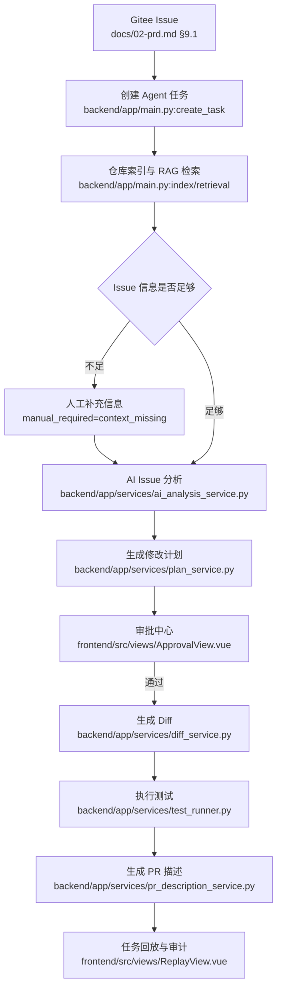

# MVP 版本文档索引

## 版本定位

MVP 当前冻结为 `v0.1 内测基线`，目标是验证从 Gitee Issue 到 PR 描述与任务回放的完整闭环。

MVP 可以用于演示和小范围内测，但不承诺团队级持久化、Issue 双向同步、真实代码执行和企业级高可用。

## MVP 已落地闭环

## 核心文档

| 文档 | 说明 |
| --- | --- |
| `../02-prd.md` | MVP 主 PRD，已记录 v1.2 版本变更 |
| `../03-mvp-workflow.md` | MVP 主流程与状态机 |
| `../04-technical-architecture.md` | 技术架构与模块边界 |
| `../06-rag-design.md` | RAG、索引、Embedding 与上下文检索 |
| `../07-ui-high-fidelity.md` | MVP 页面与交互规范 |
| `../08-api-design.md` | MVP API 设计与当前实现口径 |
| `../09-database-design.md` | MVP 数据对象与后续持久化设计 |
| `../10-ai-safety.md` | AI 安全、审批、命令与敏感信息边界 |
| `../11-test-and-demo.md` | 测试、演示和兜底策略 |
| `../project-development/README.md` | DEV-001 到 DEV-014 开发记录索引 |

## 当前验收结论

| 项目 | 结论 |
| --- | --- |
| 后端自动化测试 | 166 passed |
| 前端自动化测试 | 135 passed |
| 前端构建 | 通过 |
| 真实 Gitee 仓库读取 | 通过，公开仓库支持无 Token 拉取 |
| 空 Issue 边界 | 已改为 `manual_required=context_missing`，不再直接失败 |
| Diff 生成 | MVP 默认演示兜底，不伪装真实执行 |
| 测试执行 | 默认 `mocked_runner`，保留 Docker Runner 集成入口 |

## MVP 剩余约束

- 任务、索引、审计仍以内存态为主，服务重启后数据不作为生产持久化承诺。
- Diff 产物默认是演示兜底，不代表真实代码已修改或可直接合入。
- Docker Runner 真实执行路径已有接口和测试 seam，但仍需团队版完成集成部署和端到端验证。
- 码云 Issue 是 MVP 入口；平台内创建 Issue 并同步到 Gitee 属于团队版范围。
- Issue 内容越完整，分析、计划和 Diff 质量越高；空 Issue 会进入人工补充信息。

## 下一阶段

MVP 后进入团队版，详见 `../team/README.md`。
