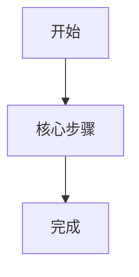

# 项目开发记录文档

## 1. 文档用途

本文档用于记录项目每个功能模块从开发到验收的真实过程。以后每完成一个功能模块，都要在这里补充一条记录，避免只留下代码，看不到过程、问题和验证结果。

每条记录至少包含：

- 真实内容截图。
- 相关模块功能。
- 遇到的问题。
- 问题如何解决。
- 测试与验收结果。

## 2. 截图存放约定

截图统一放在：

```text
docs/assets/
```

命名建议：

```text
模块名-页面或功能-real.png
```

示例：

```text
login-page-real.png
project-repository-config-real.png
gitee-issue-task-detail-success-real.png
```

## 3. 模块记录总表

主线功能文档使用 `01/02/03...` 排序；修复类文档使用 `90+` 排序，不插入主线链路。

| 编号 | 模块 | 状态 | 完成日期 | 关联文档 | 截图 | 备注 |
| --- | --- | --- | --- | --- | --- | --- |
| DEV-001 | 前端 UI 基线 | 已完成 | 2026-09-01 | `01-frontend-ui-baseline.md` | `docs/project-development/assets/screenshots/` | 建立工作台、任务、Diff、回放等基础页面 |
| DEV-002 | 登录认证与权限 | 已完成 | 2026-09-03 | `02-login-authentication.md` | `docs/assets/login-page-real.png` | 登录、会话恢复、退出、角色权限 |
| DEV-003 | 密码恢复与登录前协议 | 已完成（4 张截图 2026-10-16 重拍回填） | 2026-09-03 | `03-password-recovery-and-legal-pages.md` | `docs/assets/password-recovery-real.png`、`docs/assets/account-recovery-real.png`、`docs/assets/terms-real.png`、`docs/assets/privacy-real.png` | 普通账号找回、管理员应急恢复、服务协议、隐私政策 |
| DEV-004 | 项目与仓库配置 | 已完成 | 2026-09-03 | `04-project-repository-config.md` | `docs/assets/project-repository-config-real.png` | 项目、Gitee 仓库、Token、测试命令、审批策略、审计事件 |
| DEV-005 | Gitee Issue 接入与任务创建 | 已完成 | 2026-09-03 | `05-gitee-issue-task-creation.md` | `docs/assets/gitee-issue-task-detail-success-real.png` | 真实 Issue 拉取、快照保存、重复任务处理、分析队列入口 |
| DEV-006 | Agent 任务核心流转 | 已完成 | 2026-09-03 | `06-agent-task-module.md` | `docs/assets/agent-task-list-manual-filter-real.png` | 任务状态机、需处理优先级、列表筛选、取消、重试 |
| DEV-007 | AI Issue 分析 | 已完成（1 张截图待重截回填） | 2026-09-04 | `07-ai-issue-analysis.md` | `docs/assets/dev007-analysis-blocking-question-real.png`、`docs/assets/dev007-replay-task-8801-real.png`（阻塞问题面板 1 张与当前交互不一致，待下次联调重截） | 结构化分析、阻塞问题确认、分析重新生成、回放页真实拉取、注入告警、pytest 套件 |
| DEV-008 | 代码 RAG 与索引 | 已完成（截图已归档，异常分支 2 张如实声明未采集） | 2026-09-04 | `08-code-rag-index.md` | `docs/assets/dev008-index-list-real.png`、`docs/assets/dev008-code-context-real.png`（过期/失败异常分支截图已在 08 文档中说明未采集原因，不用编造图替代） | 仓库级索引复用、七态推进、检索上下文注入、过期门禁、失败重试、异步重建 |
| DEV-009 | 修改计划模块 | 已完成 | 2026-09-04 | `09-modification-plan.md` | `docs/assets/dev009-task-plan-real.png`、`docs/assets/dev009-approval-center-real.png` | 结构化计划、版本化、风险重算、进入待审批、历史版本查看 |
| DEV-010 | 审批模块 | 已完成 | 2026-09-04 | `10-approval-module.md` | `docs/assets/dev010-approval-queue-real.png`、`docs/assets/dev010-approval-owner-real.png` | 审批人指派/改派、owner 范围队列、通过/拒绝/重写、风险调整、审计记录 |
| DEV-011 | Diff 生成与展示 | 功能完成，待补真实截图验收 | 2026-09-05 | `11-diff-generation-and-display.md` | 待补真实截图 | 审批门禁、Diff 产物、三类文件展示、演示兜底边界、Patch 复制、回放事件 |
| DEV-012 | 测试执行模块 | 功能完成，待补真实截图验收 | 2026-09-05 | `12-test-execution.md` | 待补真实截图 | 测试命令白名单与回退、Docker 优先/不可用如实标记、危险命令拦截、失败重试上限、测试记录与回放事件 |
| DEV-013 | PR 描述生成 | 功能完成，待补真实截图验收 | 2026-09-05 | `13-pr-description.md` | 待补真实截图 | 六段式结构化描述、版本化保留、过期重算、复制全文、失败留痕、回放事件 |
| DEV-014 | 任务回放与审计模块 | 已完成 | 2026-09-05 | `14-task-replay-audit.md` | `docs/assets/dev014-replay-task-8837-real.png` | 事件/步骤分离、回放聚合、审批与产物关联、只读审计 |
| DEV-016-A | 平台需求/缺陷草稿创建 | 已完成 | 2026-09-06 | `16-team-request-draft.md` | `docs/assets/dev016-team-request-list-real.png`、`docs/assets/dev016-team-request-detail-real.png` | 团队版入口，平台内创建 `REQ-*` 草稿、字段校验、测试命令白名单、观察者只读和审计事件 |
| DEV-016-B | 平台需求同步 Gitee Issue | 已完成 | 2026-09-06 | `17-team-request-sync-gitee.md` | `docs/assets/dev016-team-request-detail-real.png`、`docs/assets/dev016-team-request-sync-failed-real.png` | 平台草稿同步创建 Gitee Issue、映射字段保存、失败重试、同步回放和审计事件 |
| DEV-016-C | Agent 任务自动创建 | 已完成 | 2026-09-07 | `18-team-request-create-task.md` | `docs/assets/dev016-team-request-detail-real.png`、`docs/assets/gitee-issue-task-detail-success-real.png` | 已同步需求一键创建 Agent 任务、同步后自动创建开关、任务复用、版本递增、人工补充和来源闭环 |
| DEV-017 | 自动上下文补齐 | 已完成 | 2026-09-07 | `19-team-context-fill.md` | `docs/assets/dev017-context-missing-real.png`、`docs/assets/dev017-context-followup-real.png` | 自动拉 Issue/Commit、索引 fresh 分流与过期重建、自动检索代码片段、历史相似任务参考、空检索转 context_missing、补充后恢复自动流转 |
| 团队 7.5 | AI 分析与修改计划增强 | 功能完成，待补截图验收 | 2026-09-07 | `20-team-analysis-plan.md` | 待补真实联调截图 | 分析输入补代码上下文/历史相似任务/项目默认规则四源、计划五要素结构化完整性门禁、版本重写上限、风险初判→重算与审批调整可见、历史任务仅参考不替代判断 |
| P0 | 业务数据持久化（SQLAlchemy 写透缓存） | 功能完成，待补截图验收 | 2026-09-07 | `21-business-persistence.md` | 待补截图（附真实命令日志） | 用户/项目/仓库/任务(计划/审批/Diff/测试/PR描述)/团队请求/审计全部落库；USE_SQLALCHEMY 开关；重启恢复 restore_from_db；302 测试全绿；两进程重启恢复演示 PASS |
| P1a | Celery 异步任务链路 | 功能完成，待补截图验收 | 2026-09-07 | `22-celery-async.md` | 待补截图 | 索引/同步/Embedding/Agent/测试拆出 Worker；enqueue_or_run 派发；无 Redis 仅 eager 降级并明确标记；真实任务体 eager 可验证；307 测试全绿 |
| P1b | LangGraph 任务状态机 | 功能完成，待补截图验收 | 2026-09-07 | `23-langgraph-workflow.md` | 待补截图 | 拆分 上下文聚合/分析/计划/审批等待/Diff/测试/完成/失败 节点；审批暂停 checkpoint 与恢复；失败分流；Celery run_agent 调图；312 测试全绿 |
| P2a | RAG/Milvus 真实化与持久化 | 功能完成，待补截图验收 | 2026-09-07 | `24-rag-milvus-reality.md` | 待补截图 | Milvus 生产首选；RAG_MOCK_FALLBACK 显式降级标注；检索 source 诚实(milvus/manual)不再撒谎；切片/索引/检索记录重启恢复；314 测试全绿 |
| P2b | 文档/配置/运行同步 | 功能完成，待补截图验收 | 2026-09-07 | `25-docs-config-sync.md` | 待补截图 | 修正 04/06 夸大表述；env 示例对齐 runtime_config；start-dev.ps1/dev-worker.ps1 导出运行环境；MVP/团队/生产差异说明 |
| P1 | 持久化加固：写透可观测 + 索引中间态恢复 | 功能完成，待补截图验收 | 2026-09-07 | `26-persistence-hardening.md` | 待补截图 | _persist_* 不再静默吞错（日志/错误码/指标 + PERSIST_STRICT）；index_snapshots 落库，PARSING 中断重启可恢复；326 测试全绿 |
| P-读 | 读路径收敛 + MySQL 生产形态 | 功能完成，待补截图验收 | 2026-09-07 | `27-read-convergence-and-mysql.md` | 待补截图 | 读路径统一走仓储读层(reads.py)；dict 为请求内一致缓存、DB 为持久真源；MySQL 形态校验+冒烟；336 测试全绿 |
| MySQL | 正式 MySQL 生产接入 | 功能完成，待补截图验收 | 2026-09-07 | `28-mysql-production.md` | 待补截图 | init_mysql 建库(utf8mb4)+create_all 建 18 表；mysql_e2e 全链路(API写入→MySQL→重启恢复)在真实 8.0.44 验证 PASS；MySQL 集成测试 5 条(无 env 跳过) |
| 异步 | 测试/Gitee同步/自动建任务 入 Worker | 功能完成，待补截图验收 | 2026-09-07 | `22-celery-async.md` | 待补截图 | run_test / sync_gitee_request 由 handler 在 Celery 模式投递；Worker 完成 create issue→SYNCED→审计→自动建任务(DEV-016-C)；eager 限定开发/测试并启动告警；341 测试全绿 |
| DEV-018 | 审批分级与自动推进 | 功能完成，待补截图验收 | 2026-09-08 | `30-approval-grading-auto-advance.md` | 待补截图 | 低风险安全自动审批并入 Diff；高危/敏感文件/危险命令走人工中心；自动审批双写 task_event+audit_event(actor=system:auto_approval，含 metadata)；人工 approve/reject/rewrite/改派/风险调整写全局审计(真实 user.id，admin 兜底标 fallback_admin_action)；lead 项目级可见；并发审批只接受首条有效动作(_APPROVAL_LOCK)；406 测试全绿 |
| DEV-018b | 项目级默认测试命令（任务>仓库>项目 三级） | 功能完成，待补真实截图验收 | 2026-09-09 | `12-test-execution.md` | 待补真实运行截图（本轮文档只补，未取真实页面截图） | `ProjectRecord.default_test_command` 补齐项目配置层（backend `main.py`、`models/orm.py`、`db/repositories.py` 持久化）；统一入口 `resolve_effective_test_command->ResolvedTestCommand(command/source/warnings)` 三级来源（任务>仓库>项目），所有来源须过仓库白名单、危险命令永远拒绝（422/409）；任务级未命中→策略允许回退仓库默认→仓库无安全默认→落项目默认；`projects.default_test_command` alembic/DB 落库 `upsert_project`/`load_projects` 重启 `restore_from_db` 恢复；fallback/reject 写 `TEST_COMMAND_FALLBACK_OR_REJECT` 全局审计、`TEST_COMMAND_SOURCE` 任务事件，执行阶段危险命令写 `TEST_COMMAND_BLOCKED` 全局审计；前端 SettingsView 项目级默认测试命令入口（回显/创建/更新/清空提交 null）；真实证据：后端 `tests/test_team_test_command_resolution.py` 20 passed、`tests/test_dev012_test_execution_module.py` 16 passed、前端 SettingsAutoCreate DEV-018b 6 passed；缺真实页面截图 |
| DEV-019 | 评论、通知与催办 | 已收口为「通过」（含实时同步） | 2026-09-09 | `31-comments-notifications-nudge.md` | 已补真实页面截图：`docs/assets/dev019-task-list-real.png`、`dev019-task-detail-comments-real.png`、`dev019-notifications-real.png`、`dev019-realtime-task-list-real.png` | 任务评论绑定任务+可关联计划/Diff/测试/回放事件；@提及生成 `MENTION` 通知（作者自提及不通知）；评论软删除保留记录与审计；`CommentRecord`/`NotificationRecord` 写透 MySQL；**收口**：①Alembic 迁移闭环；②统一通知服务；③前端通知中心只读 `/api/notifications`；④通知读权限严格化；⑤团队版实时同步：业务写入 MySQL 后由 Redis Pub/Sub 广播资源变化，SSE 推送给在线页面，前端收到 `team-update` 后重新请求真实 API，原轮询保留兜底；Redis 不可用时发出 `realtime.unavailable`。实时相关后端定向测试与迁移测试 `10 passed`，后端全量 `496 passed / 12 skipped`，前端全量 `202 passed`、构建通过；真实浏览器已验证 `/api/events/stream` 200、团队频道任务刷新和用户私有通知刷新。 |
| DEV-020 | 回放摘要与审计（DB 真源只读聚合） | 已完成 | 2026-09-09 | `32-replay-summary-audit.md` | `docs/assets/dev020-replay-summary-real.png`、`docs/assets/dev020-replay-permission-403-real.png`（+ `docs/assets/dev020-replay-network.json` 抓包证据） | 只读聚合 task_events/execution_steps/检索记录/AI 分析/计划及版本/审批/风险调整/Diff/测试/PR 描述/评论/自动推进/同步失败/重试/催办/失败节点；新增 `GET /api/tasks/{id}/replay` 与 `/replay/summary`，服务 `app/services/replay_service.py`（`build_task_replay`/`build_replay_summary`，diff_summary 解析事件-产物关联、occurred_at 升序+原序稳定去重、确定性摘要+输入指纹、回放与摘要 generated_at 对齐）；不推进会务状态、不改审计；失败/降级不伪装（unavailable→skipped+execution_env、DEMO_FALLBACK→摘要标注降级）；**权限=角色级 `replay:view` + 项目级 `_can_view_replay`（admin 全量、lead 仅本项目、其余仅创建者/指派审批人）**，与摘要同权限、GET-only 不改审计；前端 ReplayView.vue real 模式真实调用 `/replay`（DB 时间线+摘要+失败展开+复制摘要）；真实证据：`test_dev020_replay.py` 15 passed（全量数据源/稳定排序/去重/关联/失败节点/只读不改状态/摘要不改原始数据/DB 清内存真源/unavailable 不伪装/**项目级隔离：未参与用户 403、审批人可读、创建者正向 200、lead 仅本项目**/generated_at 对齐）、全量 pytest **467 passed / 15 skipped / 0 failed**（须在含 alembic 的 venv 执行）、前端 vitest **189 passed**（19 files）+ `vite build` 成功；真实环境（`agent_team` MySQL 8.0.44 + 真机 Chrome）已补录：admin 正例回放/摘要截图、非参与 developer 403 截图、CDP Network 抓包（`/replay`→200、`source=deterministic`、`fingerprint=1fac8655aa871494`、16 事件、artifacts 六类；`/replay/summary`→200 同指纹），`_can_view_replay` 项目级权限在真浏览器生效；详见 `32-replay-summary-audit.md` |
| DEV-021 | 历史任务复用索引 | 已完成 | 2026-09-09 | `33-history-task-reuse.md` | `docs/assets/dev021-history-history-panel-real.png`（真实任务详情历史相似任务区，含「支付回调重复入账幂等修复 66% · 历史任务参考」「退款单复核定时任务 39%」）、`docs/assets/dev021-history-references-real.png` | 完成任务沉淀知识资产：`COMPLETED` 后经 `advance_task` 挂 `_maybe_enqueue_history_summary` 自动生成复用摘要（`app/services/history_service.py`，真实数据：issue/context/analysis/plan/diff/test/pr/replay，缺失字段「暂无记录」，`summary_version` + 稳定 `searchable_text`，幂等）；摘要持久化 `historical_task_summaries` + `historical_task_indexes` 两表（ORM|repositories|reads|bootstrap|alembic `3a9e71d2b0c4`，DB 真源）；异步索引复用 Milvus 缝（`llamaindex_backend`，生产写 Milvus、不可用降级 memory(local) 显式标 provider），失败 `index_status=FAILED + failure_reason/failure_context + retry_count` 不阻断主链，`enqueue/retry/get_status` + Celery `backend.index_historical_summary`；API：`POST/GET /api/tasks/{id}/completed-summary`、`GET .../completed-summary/index`、`POST .../reindex`、`POST /api/history/search`（项目隔离/权限 `_can_view_replay`/排除自身/`minSimilarity` 阈值/`limit≤20`/排序；来源标「历史任务参考」）；前端任务详情+创建任务 `HistoricalTasksPanel.vue`（compact、现有 token、Loading/空/失败/正常、只读详情标注「不会自动应用旧 Diff」、打开跳历史任务，无 auto-apply 路径）；真实证据：`test_dev021_history.py` 11 passed（生成/缺失字段/幂等/索引成功+失败记录不阻断/重试/排除自身/空查询回退最近完成/项目隔离+权限/只读不改当前任务/不套旧 Diff）、前端 `HistoricalTasksPanel.spec` 6 passed、全量 pytest **482 passed / 0 failed**（venv）、vitest 全量 **195 passed**（20 files）+ `vue-tsc` 无错误 + `vite build` 成功；**P1 修复**：历史表 TEXT 列移除 `server_default`（兼容 MySQL 8 1101）+ `test_dev021_history_mysql.py`（MYSQL_TEST_URL 门控）；**P2 修复**：`query` 放宽可选 + 空查询回退最近完成 + `similarity=null` 显示「最近完成」+ 创建任务上下文（无 taskId）挂载；**真实验收（本机 venv + 真实 sqlite 库 + 真 Chrome/CDP）**：起后端 `:8015`（USE_SQLALCHEMY=true）+ vite `:5175`（real）→ 造 3 条完成任务+摘要+向量（INDEXED）→ developer 登录 → `/tasks/TASK-HIST2` 历史相似任务区真实渲染 2 张卡（支付幂等 66% / 退款复核 39%，来源「历史任务参考」）→ 截图落 `docs/assets/dev021-history-*`；`/api/history/search` 真实 200（`similarity=0.7846 / matchedSections=["plan"] / sourceLabel=历史任务参考`）；同链路对 MySQL 由 `test_dev021_history_mysql.py` 门控复验 |
| DEV-019-R | 团队版实时同步与通信选型 | 已完成 | 2026-09-10 | `34-realtime-sync-sse-pubsub-websocket.md` | `docs/assets/dev019-realtime-task-list-real.png` | 记录 Redis Pub/Sub、SSE、WebSocket 的层次区别与选型；业务写 MySQL 后发布变化事件，SSE 推送在线页面，前端重新请求真实 API；真实浏览器联调、Redis 频道、断线降级和面试回答已补齐 |
| DEV-095 | RAG 检索质量评测与企业灰度 | 已完成 | 2026-09-11 | `95-rag-quality-evaluation-and-rollout.md` | `docs/assets/rag-retrieval-quality-evaluation-real.png` | 版本绑定评测集、Recall/Precision/MRR/NDCG、同文件多 chunk 去重计分、真实仓库 6 条样本对比；结果显示 `hybrid + rerank` 达到 Recall@1/MRR/NDCG@5=1.0，团队/企业模板开启 hybrid 与 rerank，保持 Query Expansion 关闭；真实 JSON 报告截图已归档。 |

## 4. 单模块记录模板

复制下面模板，每完成一个模块就新增一节。

````markdown
## DEV-XXX 模块名称

### 1. 基本信息

| 项目 | 内容 |
| --- | --- |
| 模块名称 |  |
| 开发阶段 | MVP / 团队版 / 企业版 |
| 开始日期 |  |
| 完成日期 |  |
| 负责人 |  |
| 关联文档 |  |
| 关联接口 |  |
| 关联数据表 |  |

### 2. 真实内容截图

| 截图 | 说明 |
| --- | --- |
| `docs/project-development/assets/screenshots/xxx.png` |  |

### 3. 模块功能

- 

### 4. 实现流程



### 5. 遇到的问题

| 问题 | 原因 | 影响 |
| --- | --- | --- |
|  |  |  |

### 6. 解决方案

| 问题 | 解决方式 | 结果 |
| --- | --- | --- |
|  |  |  |

### 7. 测试与验收

| 验收项 | 操作 | 结果 |
| --- | --- | --- |
|  |  |  |

### 8. 复盘

- 做得好的地方：
- 需要加强的地方：
- 下次注意：
````

## 5. 记录规则

- 没有截图的模块不能标记为完成。
- 截图必须是真实运行页面、接口结果或控制台结果，不放概念图。
- 遇到的问题要写原因和解决方式，不只写“已修复”。
- 如果功能改了接口、数据库或 UI，要同步更新对应设计文档。
- 每次模块完成后，把模块记录总表状态改为“已完成”。
