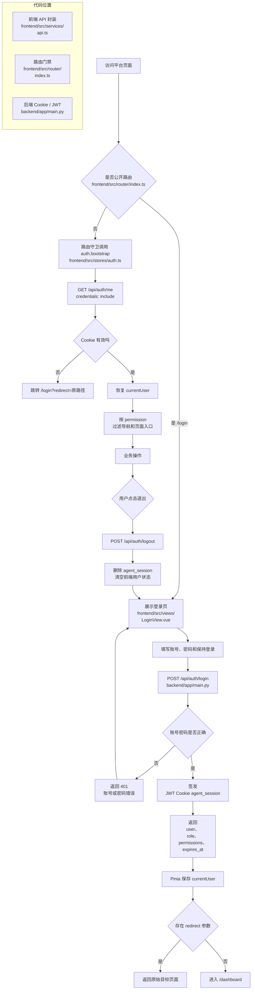
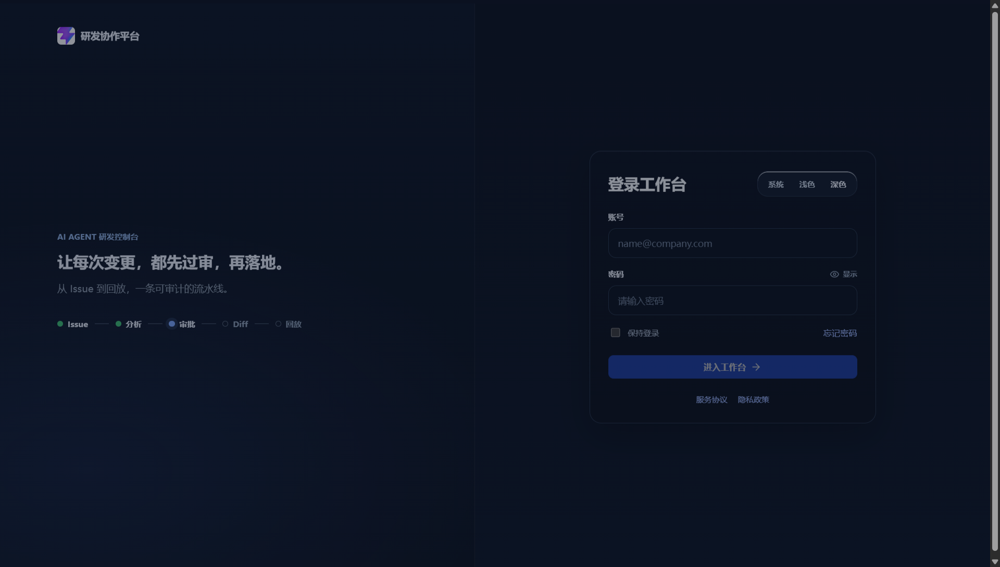

# DEV-002 登录与基础会话认证

> 文档类型：单功能开发记录  
> 适用范围：MVP / 前后端认证基础能力  
> 关联 PRD：`docs/02-prd.md`（9.1 登录与用户模块）  
> 关联 API：`docs/08-api-design.md`（4.1 认证与用户）  
> 文档状态：已跑通，已附真实运行截图

---

## 1. 功能目标与范围

### 1.1 功能目标

实现平台的基础登录闭环：

- 用户使用账号和密码登录；
- 后端校验账号，签发 JWT `httpOnly` Cookie；
- 前端根据登录结果进入原始目标页面或工作台；
- 刷新页面后通过当前用户接口恢复会话；
- 退出登录时清理服务端 Cookie 和前端用户状态；
- 根据角色和权限控制导航、页面入口和业务操作。

### 1.2 本次范围

**包含：**

- 登录页表单、密码显示/隐藏、保持登录、错误提示；
- `POST /api/auth/login`、`POST /api/auth/logout`、`GET /api/auth/me`；
- Vue Router 路由门禁；
- Pinia 鉴权 Store；
- 四类 MVP 角色及权限返回；
- 登录后刷新保持会话；
- 网络瞬时失败自动重试和刷新期间用户信息稳定展示。

**暂不包含：**

- LDAP、SAML、OIDC 或企业 SSO；
- 数据库用户表和密码轮换；
- 多租户组织级权限；
- 短信、邮箱验证码和多因素认证。

---

## 2. 业务流程



---

## 3. 接口契约

### 3.1 登录

`POST /api/auth/login`

请求：

```json
{
  "account": "developer@company.com",
  "password": "Dev123!",
  "remember_me": true
}
```

成功响应：

```json
{
  "code": 0,
  "message": "success",
  "data": {
    "user": {
      "id": "user_developer",
      "name": "周航",
      "email": "developer@company.com",
      "role": "developer",
      "role_label": "开发者",
      "permissions": [
        "dashboard:view",
        "task:view",
        "task:create",
        "task:operate",
        "diff:view",
        "replay:view",
        "index:view"
      ]
    },
    "expires_at": "2026-09-10T04:32:19.225568Z"
  }
}
```

失败响应：

```json
{
  "detail": {
    "code": 401,
    "message": "账号或密码错误",
    "data": null
  }
}
```

### 3.2 当前用户

`GET /api/auth/me`

- 浏览器自动携带 `agent_session` Cookie；
- 前端通过 `credentials: 'include'` 发起请求；
- Cookie 无效或缺失时返回 401；
- Cookie 有效时返回与登录响应相同结构的 `UserPublic`。

### 3.3 退出登录

`POST /api/auth/logout`

后端通过 `delete_cookie` 清理 `agent_session`，返回：

```json
{
  "code": 0,
  "message": "已退出登录",
  "data": null
}
```

### 3.4 会话策略

| 配置 | 普通登录 | 勾选保持登录 |
| --- | --- | --- |
| Cookie | `agent_session` | `agent_session` |
| JWT 算法 | HS256 | HS256 |
| 会话时长 | 8 小时 | 7 天 |
| HttpOnly | 是 | 是 |
| SameSite | `lax` | `lax` |
| Secure | 由 `AUTH_COOKIE_SECURE` 控制 | 由 `AUTH_COOKIE_SECURE` 控制 |
| Path | `/` | `/` |

---

## 4. 角色和权限

登录接口直接返回角色和权限，前端不自行扩展后端权限。

| 角色 | 角色标识 | 当前主要能力 |
| --- | --- | --- |
| 管理员 | `admin` | 查看任务、项目配置、索引查看、用户查看 |
| 审批人 | `approver` | 查看任务、审批、查看 Diff / 回放 / 索引 |
| 开发者 | `developer` | 创建和操作任务、查看 Diff / 回放 / 索引 |
| 研发负责人 | `lead` | 查看任务、审批信息、查看 Diff / 回放 / 索引 |

权限边界：

- 前端导航和按钮根据 `permissions` 控制可见性；
- 路由守卫对页面权限做二次拦截；
- 后端接口仍然必须做最终授权判断，不能把前端隐藏当作安全边界；
- 管理员不拥有审批通过、拒绝、要求重写和补充审批意见权限；
- 未授权访问会显示礼貌提示，例如“您暂无权限访问「审批中心」”。

---

## 5. 关键代码说明

### 5.1 后端认证

文件：`backend/app/main.py`

- `LoginRequest` 校验账号、密码和 `remember_me`；
- `hash_password()` 对 MVP 测试密码做带盐 SHA-256；
- `create_token()` 生成包含 `sub`、`iat`、`exp` 的 JWT；
- `set_session_cookie()` 以 `httpOnly` Cookie 写入浏览器；
- `get_current_user()` 解码 Cookie 并查找用户；
- `public_user()` 只返回前端需要的用户信息，不返回 `password_hash`。

生产环境必须通过环境变量设置高强度 `AUTH_JWT_SECRET`，并在 HTTPS 下设置：

```text
AUTH_COOKIE_SECURE=true
```

### 5.2 前端 API 封装

文件：`frontend/src/services/api.ts`

`apiRequest<T>()` 统一完成：

- `credentials: 'include'`；
- JSON 请求头；
- `ApiResponse<T>` 数据解包；
- 401、403、404 等 HTTP 错误转换为 `ApiError`；
- 将后端 `detail.message` 转换为页面可展示文案。

### 5.3 鉴权 Store

文件：`frontend/src/stores/auth.ts`

- `login()` 调用登录接口并保存 `currentUser`；
- `bootstrap()` 在应用启动后恢复当前用户；
- 模块级 Promise 缓存避免多个入口并发请求 `/api/auth/me`；
- 网络层瞬时失败自动重试一次；
- 最近一次用户信息写入 `frontend-last-auth-user`，只用于刷新期间稳定显示用户名称和菜单；
- 不保存密码，也不把 JWT 暴露给前端脚本；
- `logout()` 清空前端状态，同时保留工作区任务快照供不同角色接力查看。

### 5.4 路由门禁

文件：`frontend/src/router/index.ts`

执行顺序：

1. 首次进入内部页面时调用 `auth.bootstrap()`；
2. 没有有效会话时跳转到 `/login?redirect=原路径`；
3. 登录页成功后优先返回 `redirect`；
4. 有会话但没有页面权限时返回 `/dashboard` 并提示用户；
5. 已登录用户访问 `/login` 时返回工作台。

### 5.5 登录页

文件：`frontend/src/views/LoginView.vue`

- 账号和密码均为必填；
- 登录请求进行中禁用输入和提交按钮；
- 支持密码明文显示/隐藏；
- 支持保持登录；
- 登录失败展示后端错误；
- 登录成功后显示欢迎提示并跳转。

---

## 6. 相关源码文件位置

| 文件 | 职责 |
| --- | --- |
| `backend/app/main.py` | 用户、JWT、Cookie、登录/登出/当前用户接口 |
| `backend/main.py` | 后端服务启动入口 |
| `frontend/src/views/LoginView.vue` | 登录页表单和交互 |
| `frontend/src/stores/auth.ts` | 登录态、bootstrap、权限判定和退出 |
| `frontend/src/services/api.ts` | 统一 API 请求和错误转换 |
| `frontend/src/types/auth.ts` | 用户、角色、权限、登录响应类型 |
| `frontend/src/router/index.ts` | 公开路由、登录重定向和页面权限门禁 |
| `frontend/src/main.ts` | 主题、应用挂载和认证启动顺序 |
| `frontend/src/components/AppShell.vue` | 当前用户、角色和权限导航展示 |
| `frontend/src/utils/auth.ts` | 清理旧版本地认证残留 |

---

## 7. 联调注意点

1. 前端开发服务器通过 `frontend/vite.config.ts` 将 `/api` 代理到 `http://127.0.0.1:8000`。
2. Cookie 认证必须在前端请求中保留 `credentials: 'include'`。
3. CORS 开启凭证时不能使用 `allow_origins=["*"]`，必须配置明确的前端来源。
4. 开发环境可以使用 `Secure=false`，生产环境必须使用 HTTPS + `Secure=true`。
5. 账号密码错误返回 401；会话失效也返回 401，前端统一回到登录页。
6. 401 不应被当成普通页面权限不足；403 才表示已登录但没有业务权限。
7. 角色权限必须以后端返回为准，前端权限映射只作为当前 MVP 的界面兜底。
8. 当前用户和测试用户暂存在后端内存中，重启服务会重置运行态；正式环境需要数据库和密码哈希迁移。
9. 默认 JWT Secret 只是开发兜底，部署前必须显式覆盖 `AUTH_JWT_SECRET`，不要依赖仓库默认值。

---

## 8. 真实运行截图

### 8.1 登录页

操作：打开 `http://localhost:5173/login`，当前未登录状态。



截图文件：`docs/assets/login-page-real.png`

### 8.2 登录后工作台

登录成功后进入工作台，现有真实运行截图可参考：

- `docs/assets/auth-fix-before-refresh.png`
- `docs/assets/auth-fix-after-refresh.png`

上述截图同时证明登录后的 App Shell、角色信息和刷新会话恢复链路已经跑通。

---

## 9. 验收结果

| 验收项 | 结果 |
| --- | --- |
| 正确账号密码可以登录 | 通过 |
| 错误账号密码返回明确错误 | 通过 |
| 登录成功进入工作台 | 通过 |
| 带 redirect 参数登录后返回原始页面 | 通过 |
| 未登录访问内部路由跳转登录页 | 通过 |
| 刷新后 `/api/auth/me` 恢复当前用户 | 通过 |
| 退出登录清理 Cookie 和前端状态 | 通过 |
| 不同角色展示不同导航和操作 | 通过 |
| 管理员不能执行审批动作 | 通过 |
| `frontend` 执行 `npm run build` | 通过 |

验证命令：

```powershell
cd frontend
npm run build
```

验证结果：

```text
vite v8.2.2 building client environment for production...
✓ 3435 modules transformed.
✓ built in 725ms
```

---

## 10. 复盘

- 本次完成了从表单到 Cookie 会话、路由门禁、角色权限的完整登录闭环。
- 关键经验是把“认证成功”和“页面权限”分成两层：会话决定能否进入系统，权限决定能看到和操作什么。
- 刷新体验不能只验证最终状态，还要关注 bootstrap 期间的瞬态渲染，因此补了用户快照和网络重试。
- 下一步需要把内存用户替换成数据库用户，并补充自动化端到端测试覆盖登录、退出、刷新和四种角色。
