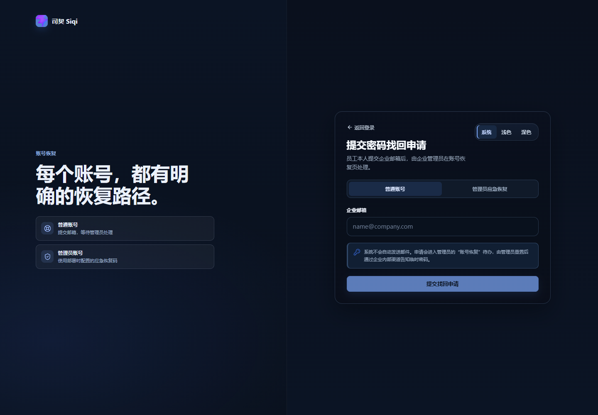
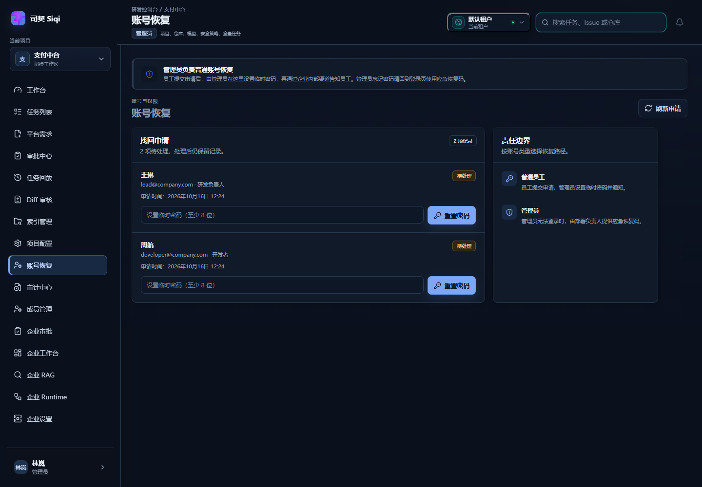
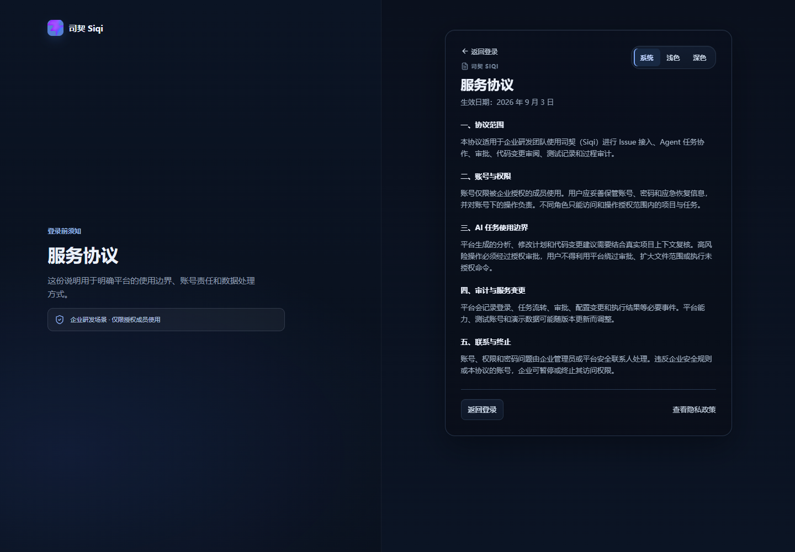
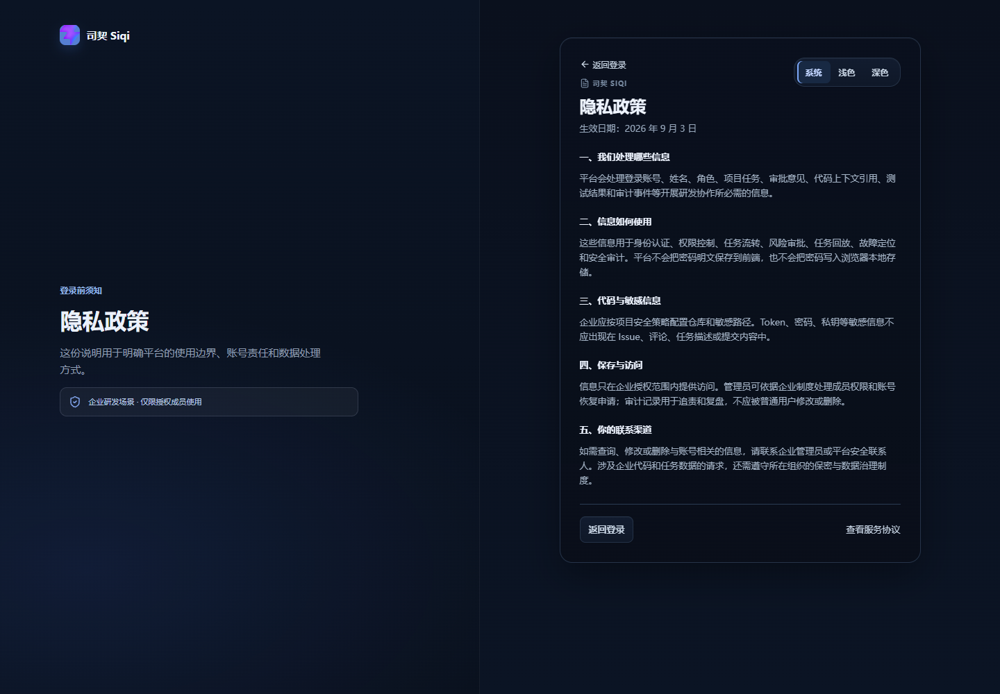

# DEV-003 密码恢复与登录前协议页面

## 功能目标与范围

本次功能明确密码恢复的操作责任，并补齐登录页的服务协议、隐私政策入口。

- 普通账号：用户本人提交企业邮箱，管理员负责重置；
- 管理员账号：无法登录时，由部署负责人或平台安全联系人提供 `AUTH_RECOVERY_CODE`；
- 登录前：可直接访问服务协议和隐私政策；
- 当前 MVP：不接入邮件自动发送，申请和用户数据暂存在后端内存。

## Mermaid 业务流程图

```mermaid
flowchart TD
    L[登录页<br/>frontend/src/views/LoginView.vue] --> F[忘记密码<br/>frontend/src/views/ForgotPasswordView.vue]
    L --> T[服务协议 / 隐私政策<br/>frontend/src/views/LegalDocumentView.vue]
    F --> M{账号类型}
    M -->|普通账号| A[POST /api/auth/password/forgot<br/>backend/app/api/auth.py]
    A --> Q[管理员账号恢复页<br/>frontend/src/views/AccountRecoveryView.vue]
    Q --> R[GET /api/auth/password/requests]
    R --> S[管理员设置临时密码]
    S --> U[POST /api/auth/password/requests/{request_id}/reset]
    U --> N[通过企业内部渠道通知员工]
    M -->|管理员| C[部署负责人提供 AUTH_RECOVERY_CODE]
    C --> E[POST /api/auth/password/emergency-reset]
    E --> I[管理员使用新密码登录]
```

## 关键代码说明

- `forgot_password` 不返回账号是否存在，避免账号枚举；
- `reset_requested_password` 只允许拥有 `user:view` 权限的管理员处理；
- `emergency_reset_password` 同时校验管理员账号、应急恢复码和新密码长度；
- 前端将普通恢复和管理员应急恢复放在同一页面的两个明确模式中，避免责任混淆；
- 协议和隐私政策使用公共路由，不要求登录。

## 相关源码文件位置

- `backend/app/api/auth.py`（login/logout/me/password 域；OPT-11 起从 `backend/app/main.py` 迁出）
- `frontend/src/router/index.ts`
- `frontend/src/views/LoginView.vue`
- `frontend/src/views/ForgotPasswordView.vue`
- `frontend/src/views/AccountRecoveryView.vue`
- `frontend/src/views/LegalDocumentView.vue`
- `frontend/src/components/AppShell.vue`
- `frontend/src/views/DashboardView.vue`
- `frontend/src/style.css`

## 联调注意点

- 生产环境必须设置非空的 `AUTH_RECOVERY_CODE`，并定期轮换；
- 账号恢复后的临时密码应通过企业内部安全渠道传递，不能在工单或聊天中公开；
- 当前 MVP 的用户、申请和密码修改都是内存态，服务重启后恢复初始演示数据；
- 正式环境需接入数据库、密码轮换、审计日志和企业通知系统。

## 真实运行截图

以下截图于 2026-10-16 用本地真实运行的前后端重拍归档（前端 dev server `localhost:5181`，后端隔离实例 `127.0.0.1:8021`，`USE_SQLALCHEMY=false` 内存态；品牌为定名后的「司契 Siqi」）：

| 截图 | 说明 |
| --- | --- |
| `docs/assets/password-recovery-real.png` | 找回密码页（公共）：普通账号找回与管理员应急恢复双模式 |
| `docs/assets/account-recovery-real.png` | 管理员登录后的账号恢复页：2 条真实提交的待处理申请、临时密码重置入口、责任边界面板 |
| `docs/assets/terms-real.png` | 服务协议页（公共，未登录可访问） |
| `docs/assets/privacy-real.png` | 隐私政策页（公共，未登录可访问） |









## 验收结果

- `npm run build`：通过；
- `python -m py_compile app/main.py`：通过；
- 普通账号找回申请、管理员处理、管理员应急恢复接口：通过；
- `/terms`、`/privacy` 未登录公共访问：通过。
