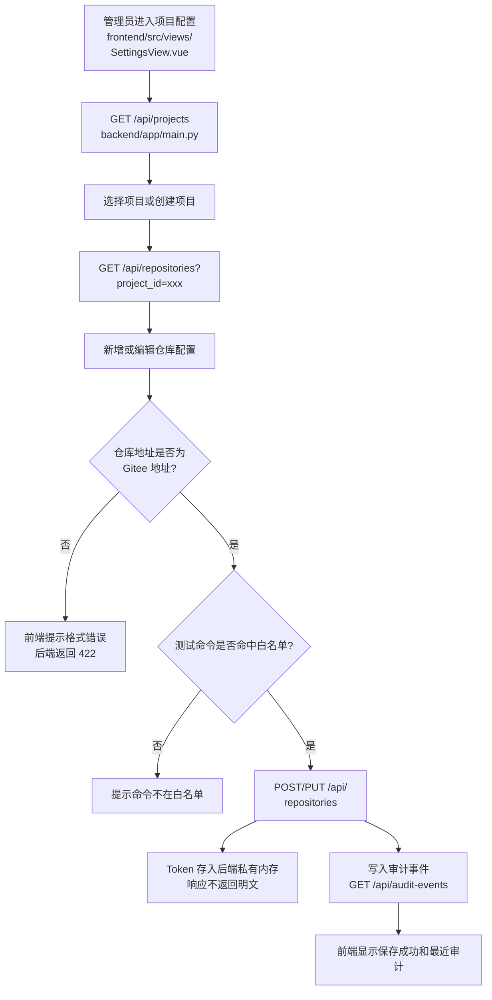
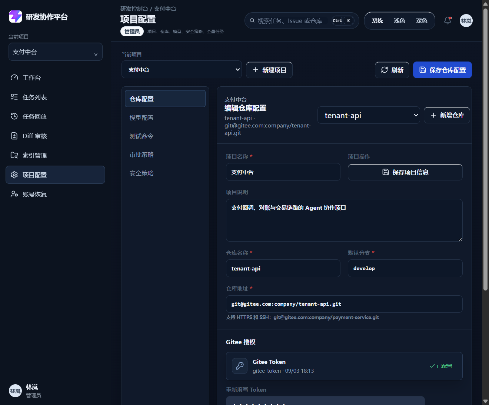

# DEV-004 项目与仓库配置模块开发记录

## 功能目标与范围

- 管理员可以创建和编辑项目。
- 管理员可以新增和编辑 Gitee 仓库配置。
- 仓库配置包含仓库地址、默认分支、Gitee Token、测试命令、命令白名单、默认审批人、审批模式和安全策略。
- Gitee Token 不在接口响应和前端页面中明文回显。
- 仓库地址、测试命令和命令白名单由前后端共同校验。
- 保存成功后写入审计事件。

## 业务流程图

## 关键代码说明

- `backend/app/main.py`：新增 `ProjectRecord`、`RepositoryConfigRecord`、`AuditEventRecord` 和后端私有 `REPOSITORY_TOKENS`，并提供项目、仓库和审计接口。
- `backend/app/main.py`：`validate_repository_url` 限制仓库地址只能是 Gitee HTTPS/SSH；`command_allowed` 保证默认测试命令必须匹配白名单。
- DEV-018b：项目级默认测试命令 `ProjectRecord.default_test_command` 是测试命令**三级来源（任务>仓库>项目）的最末级**，创建/更新项目经 `POST/PUT /api/projects` 落库（`ProjectORM.default_test_command`）、重启 `restore_from_db` 恢复；前端 SettingsView 项目表单可回显/创建/编辑/清空（提交 `null`）。任务创建统一经 `resolve_effective_test_command` 收敛（详见 `12-test-execution.md` 附录）。
- `frontend/src/views/SettingsView.vue`：页面从静态假数据改为真实 API 联调，支持项目创建、仓库新增/编辑、Token 一次性填写、审批策略和安全策略配置。
- `frontend/src/types/domain.ts`：补充项目、仓库配置、审计事件类型。
- `frontend/src/style.css`：补充配置页项目选择、仓库表单和审计列表样式。

## 相关源码文件位置

- `backend/app/main.py`
- `frontend/src/views/SettingsView.vue`
- `frontend/src/types/domain.ts`
- `frontend/src/style.css`
- `backend/README.md`
- `docs/08-api-design.md`

## 联调注意点

- 当前 MVP 仍是内存数据，服务重启后新增项目、仓库和审计事件会恢复为初始演示数据。
- Gitee Token 当前只保存在后端内存私有字典，接口和审计不回显；正式环境需要接入密钥管理或数据库加密字段。
- 后端接口会做权限校验，非管理员访问项目配置接口返回 403。
- 前端校验用于即时提示，后端校验是最终准入门禁。

## 真实运行截图

## 测试和验收

- `backend/.venv/Scripts/python.exe -c "from app.main import app; print(len(app.routes))"` 通过，当前 22 条路由。
- `npm.cmd run build` 通过。
- 管理员登录后可以读取项目和仓库配置。
- 非管理员访问 `/api/projects` 返回 403。
- 错误仓库地址 `https://github.com/company/repo.git` 返回 422。
- 新增 Gitee SSH 仓库成功，接口响应不包含 `gitee_token`。
- 新增仓库后 `/api/audit-events?resource_type=repository` 能查到审计事件。

## 复盘

- 这次练到的是“配置模块闭环”：表单不是难点，难点是权限、校验、密钥不回显和审计事件要一起闭合。
- 做得好的地方：前后端都做了校验，Token 没有从接口泄漏。
- 下次要加强：把内存态配置迁移到数据库，并把 Gitee Token 接入正式密钥管理。
