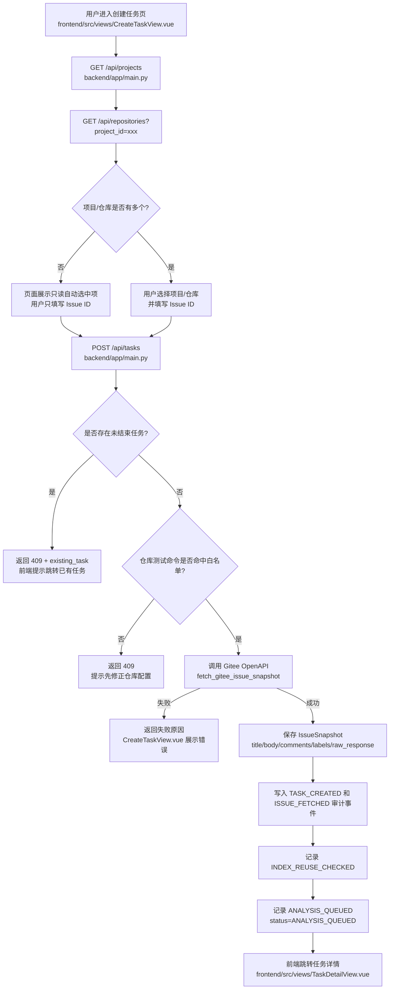
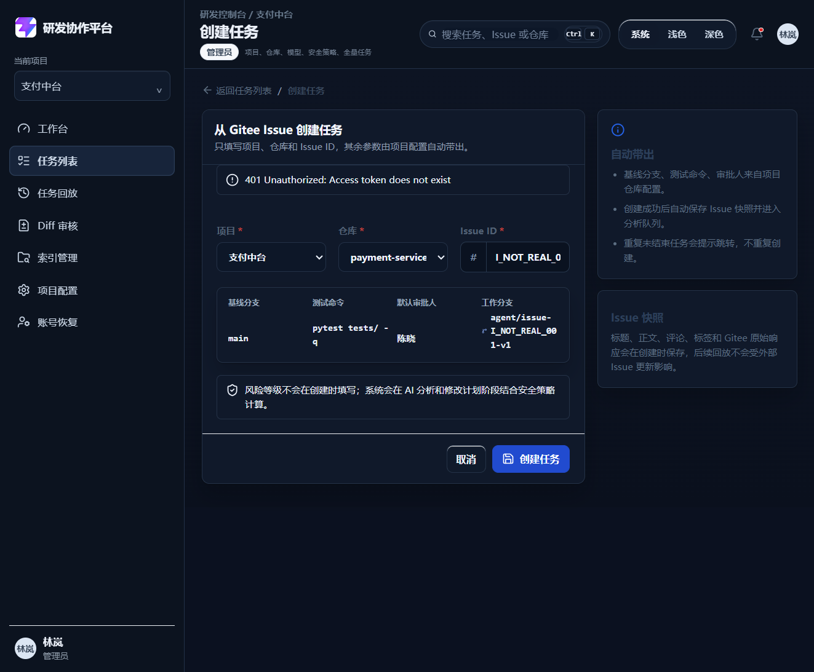
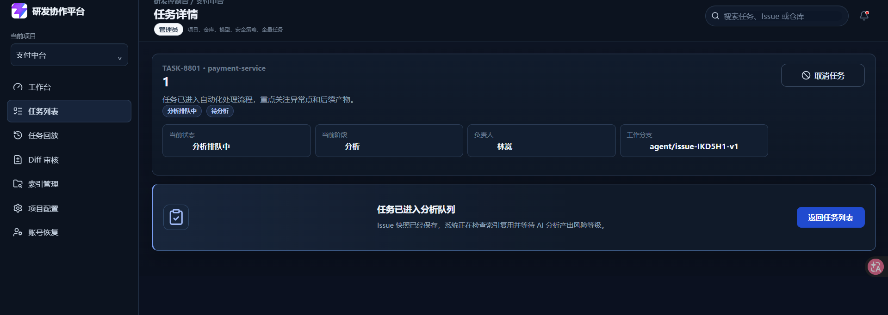

# DEV-005 Gitee Issue 创建任务模块开发记录

## 功能目标与范围

- 用户通过项目、仓库和 Issue ID 创建 Agent 任务。
- 项目和仓库来自已配置列表：只有多个选项时才需要选择；当前只有一个项目或仓库时，页面展示只读自动选中项。
- 创建页只让用户填写 Issue ID，不暴露风险等级、基线分支、测试命令、审批人和工作分支输入项。
- 基线分支、测试命令、默认审批人和工作分支由仓库配置自动带出。
- 后端调用 Gitee OpenAPI 拉取 Issue 标题、正文、评论和标签。
- Issue 内容保存为任务快照，包含标题、正文、评论、标签和 Gitee 原始响应。
- 同一仓库、同一 Issue 存在未结束任务时，默认提示跳转已有任务；已结束任务允许创建新版本。
- 创建成功后自动记录 Issue 拉取、索引复用检查和 AI 分析排队事件。

## 业务流程图

## 关键代码说明

- `backend/app/main.py`：新增 `TaskCreatePayload`、`IssueSnapshotRecord`、`IssueCommentSnapshot`、`TaskRecord`，并新增 `GET /api/tasks`、`GET /api/tasks/{task_id}`、`POST /api/tasks`。
- `backend/app/main.py`：`fetch_gitee_issue_snapshot` 负责解析 Gitee 仓库地址、读取仓库 Token、拉取 Issue 和评论，并保存原始响应。
- `backend/app/main.py`：`unfinished_task` 阻止重复创建未结束任务；`next_task_version` 允许已结束任务创建新版本。
- `frontend/src/views/CreateTaskView.vue`：创建表单将项目和仓库作为配置来源处理；单项目、单仓库时显示只读自动选中，多项目或多仓库时才显示下拉选择；用户只需要填写 Issue ID。
- `frontend/src/services/api.ts`：`ApiError` 支持携带 `detail.data`，用于前端读取重复任务里的 `existing_task`。
- `frontend/src/stores/workspace.ts`：把后端 `AgentTask` 映射成前端任务，并注册 Issue 快照占位产物。
- `frontend/src/views/TaskDetailView.vue`：支持 `ANALYSIS_QUEUED` 状态，展示“Issue 已保存，等待 AI 分析”的过渡态。

## 相关源码文件位置

- `backend/app/main.py`
- `frontend/src/views/CreateTaskView.vue`
- `frontend/src/views/TaskListView.vue`
- `frontend/src/views/TaskDetailView.vue`
- `frontend/src/stores/workspace.ts`
- `frontend/src/stores/auth.ts`
- `frontend/src/services/api.ts`
- `frontend/src/types/domain.ts`
- `frontend/src/style.css`
- `backend/README.md`
- `docs/08-api-design.md`

## 联调注意点

- 当前 MVP 使用内存态任务和 Token，服务重启后任务、配置和审计事件会恢复为初始演示状态。
- 默认演示仓库的 Token 是无效占位值，因此访问真实 Gitee 会返回授权失败；真实成功联调前，需要先在项目配置页保存有效 Gitee Token，并确保仓库地址与 Issue 所在仓库一致。
- Gitee Token 不会在前端明文回显，也不会进入任务响应。
- Issue ID 可以填写 `IKD5H1` 或 `#IKD5H1`，后端会自动去掉开头的 `#`。
- 风险等级创建时为空，后续由 AI 分析、修改计划和安全策略计算；人工覆盖只能在审批或计划复核阶段记录原因。
- 当前索引复用检查和分析队列是 MVP 队列节点记录，后续需要接入真实索引服务和 AI 分析 Worker。

## 真实运行截图

创建页支持单项目、单仓库自动选中，只要求填写 Issue ID。

真实 Gitee Issue 拉取成功后，系统自动进入任务详情和分析队列。

## 测试和验收

| 验收项 | 结果 |
| --- | --- |
| 可以成功拉取真实 Gitee Issue | 已通过，真实页面生成 `TASK-8801` 并进入任务详情 |
| 拉取失败时展示失败原因 | 已通过，无效 Token 时展示 `401 Unauthorized: Access token does not exist` |
| Issue 快照包含标题、正文、评论、标签和原始响应 | 已通过，后端桩测确认字段包含 `title`、`body`、`comments`、`labels`、`raw_response` |
| 重复创建同一 Issue 未结束任务时提示跳转已有任务 | 已通过，接口返回 `409` 和 `existing_task` |
| 已结束任务可创建新版本 | 已通过，旧任务置为 `COMPLETED` 后创建得到 `version=2` |
| 创建成功后自动进入后续队列 | 已通过，任务状态为 `ANALYSIS_QUEUED`，页面显示“任务已进入分析队列” |
| 创建页不得把风险等级作为必填项 | 已通过，创建页只展示风险计算说明，不提供风险等级输入 |
| 单项目、单仓库时不出现伪下拉 | 已通过，页面显示只读自动选中项 |

验证命令：

- `backend/.venv/Scripts/python.exe -m py_compile app/main.py` 通过。
- `backend/.venv/Scripts/python.exe -c "from app.main import app; print(len(app.routes))"` 通过，当前 25 条路由。
- `npm.cmd run build` 通过。

## 复盘

- 这次练的是“任务入口最小化”：用户只填业务必要信息，其余执行参数由项目配置托管。
- 做得好的地方：重复任务、快照保存、失败原因透传、风险等级后置、单选项自动选中都已经形成闭环。
- 下次要加强：接入真实索引服务和 AI 分析 Worker，让 `ANALYSIS_QUEUED` 后面的自动流转真正跑起来。
