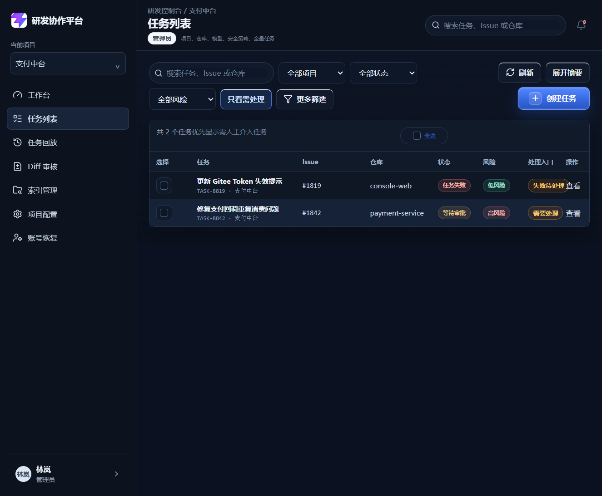

# DEV-006 Agent 任务核心流转模块

## 功能目标与范围

- 任务作为平台核心业务对象，贯穿 Issue 创建、索引、分析、计划、审批、Diff、测试和 PR 描述全过程。
- 后端任务对象返回 `manual_required`、`manual_reason`、`next_action` 和 `automation_state`，前端据此判断是否需要用户介入。
- 工作分支由系统根据 `base_branch`、`issue_id` 和 `task_version` 自动生成，格式为 `agent/{base_branch}/issue-{issue_id}-v{version}`。
- 任务列表支持项目、状态、风险、关键字、时间和“只看需处理”筛选。
- 任务列表默认把失败、高风险、授权过期、上下文不足、等待审批任务放在前面。
- 执行中、待审批和失败任务支持用户主动取消；失败任务支持重试。

## 业务流程图

```mermaid
flowchart TD
    A[用户从 Issue 创建任务<br/>frontend/src/views/CreateTaskView.vue] --> B[POST /api/tasks<br/>backend/app/main.py]
    B --> C[生成工作分支<br/>build_work_branch]
    C --> D[任务进入 ANALYSIS_QUEUED]
    D --> E[前端跳转任务详情<br/>TaskDetailView.vue]
    E --> F[GET /api/tasks/{task_id}<br/>读取时推进状态机]
    F --> G{Agent 状态机结果}
    G -- 低风险 --> H[自动流转<br/>PLAN_GENERATED / DIFF_GENERATED / TESTED / COMPLETED]
    G -- 高风险/审批策略 --> I[WAITING_APPROVAL<br/>manual_required=true]
    G -- 上下文不足/失败 --> J[FAILED<br/>failure_node + failure_reason]
    I --> K[任务列表置顶需处理<br/>TaskListView.vue]
    J --> K
    K --> L{用户操作}
    L -- 取消 --> M[POST /api/tasks/{task_id}/cancel<br/>status=CANCELLED]
    L -- 重试失败任务 --> N[POST /api/tasks/{task_id}/retry<br/>重新进入 ANALYSIS_QUEUED]
```

## 关键代码说明

- `backend/app/main.py`：`TaskRecord` 增加 `automation_state`、`manual_required`、`manual_reason`、`next_action`、`failure_node`、`failure_reason`、`retry_count`、`cancelled_at` 等字段。
- `backend/app/main.py`：`progress_task_automation` 在读取任务列表或详情时推进 MVP 状态机，模拟 Agent 后台执行。
- `backend/app/main.py`：`manual_sort_key` 让需人工处理任务排在前面，优先级为失败/授权过期、上下文不足、高风险、审批等待。
- `backend/app/main.py`：`POST /api/tasks/{task_id}/cancel` 将非终态任务取消为 `CANCELLED`。
- `backend/app/main.py`：`POST /api/tasks/{task_id}/retry` 只允许失败任务重试，重试后重新进入 `ANALYSIS_QUEUED`。
- `frontend/src/views/TaskListView.vue`：增加项目、状态、风险、关键字、时间、“只看需处理”筛选，并展示“处理入口”。
- `frontend/src/views/TaskDetailView.vue`：详情页打开时同步后端任务状态，并使用真实接口执行取消和重试。
- `frontend/src/stores/workspace.ts`：把后端 AgentTask 映射到前端 Task，保存任务的人工处理字段和失败信息。

## 相关源码文件位置

- `backend/app/main.py`
- `frontend/src/views/TaskListView.vue`
- `frontend/src/views/TaskDetailView.vue`
- `frontend/src/stores/workspace.ts`
- `frontend/src/types/domain.ts`
- `frontend/src/style.css`
- `docs/08-api-design.md`
- `backend/README.md`

## 联调注意点

- 当前 MVP 的 Agent 执行是轻量状态机模拟，真实 AI 分析、真实 Diff、真实测试执行会在后续模块接入。
- 状态推进发生在读取 `/api/tasks` 或 `/api/tasks/{task_id}` 时，避免当前阶段引入独立 Worker。
- 低风险任务不会要求用户逐条确认，只在列表中显示为自动运行状态。
- `FAILED`、`WAITING_APPROVAL`、`manual_required=true` 的任务会在列表中优先出现。
- 取消任务是终态操作，进入 `CANCELLED` 后不能重试。

## 真实运行截图

任务列表支持“只看需处理”，并将失败和等待审批任务优先展示。



## 测试和验收

| 验收项 | 结果 |
| --- | --- |
| 用户可以创建任务 | 已通过，复用 DEV-005 的 Issue 创建入口 |
| 创建成功后进入任务详情页 | 已通过，创建成功后跳转 `/tasks/{task_id}` |
| 工作分支自动生成且避免同名冲突 | 已通过，格式为 `agent/main/issue-IAGENT001-v1`，旧任务结束后版本递增 |
| 任务状态随 Agent 执行自动更新 | 已通过，读取任务时状态机自动推进 |
| 任务失败时展示失败节点、失败原因和重试入口 | 已通过，失败任务返回 `failure_node`、`failure_reason`，详情页展示重试 |
| 执行中、待审批和失败任务支持取消 | 已通过，`POST /api/tasks/{task_id}/cancel` 返回 `CANCELLED` |
| 任务列表支持项目、状态、风险、关键字和时间筛选 | 已通过，前端筛选已完成，后端支持状态、风险、关键字、时间和需处理筛选 |
| 任务列表支持只看需处理并优先排序 | 已通过，失败和等待审批任务排在自动运行任务前 |

验证命令：

- `backend/.venv/Scripts/python.exe -m py_compile app/main.py` 通过。
- `npm.cmd run build` 通过。
- 接口桩测通过：创建、自动推进、只看需处理、取消、失败重试。

## 复盘

- 这次练的是“业务对象闭环”：任务不是一条列表数据，而是连接 Issue、Agent 状态、人工介入和审计的核心对象。
- 做得好的地方：后端返回了前端真正需要决策的字段，列表不再要求用户逐条看自动运行任务。
- 下次要加强：把 MVP 状态机替换成真实 AI 分析 Worker，并把计划、风险和审批产物持久化。
