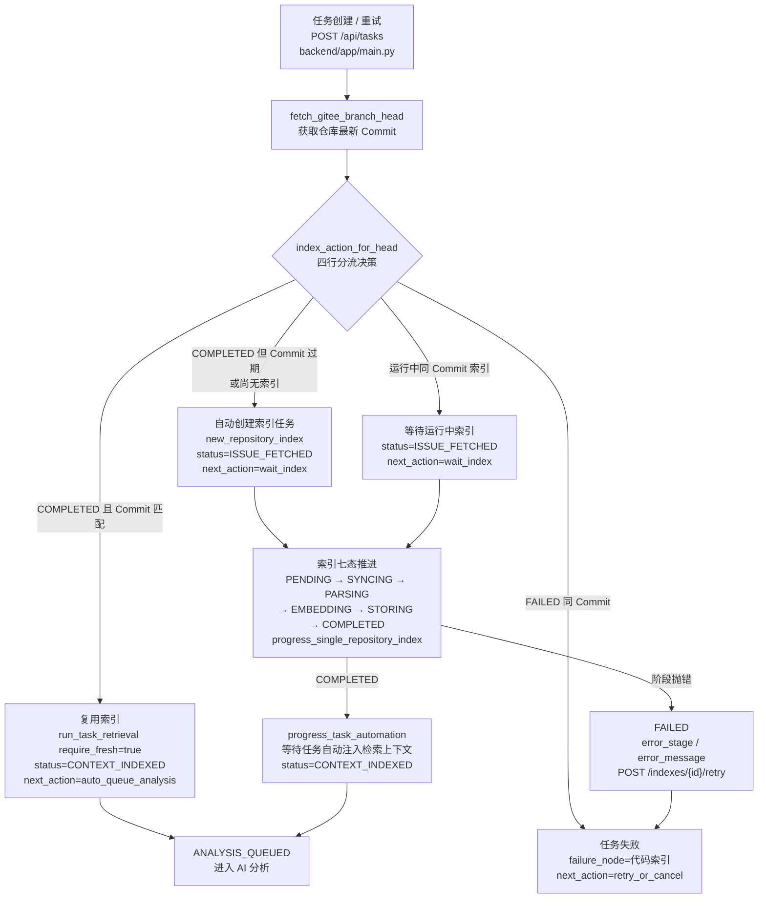
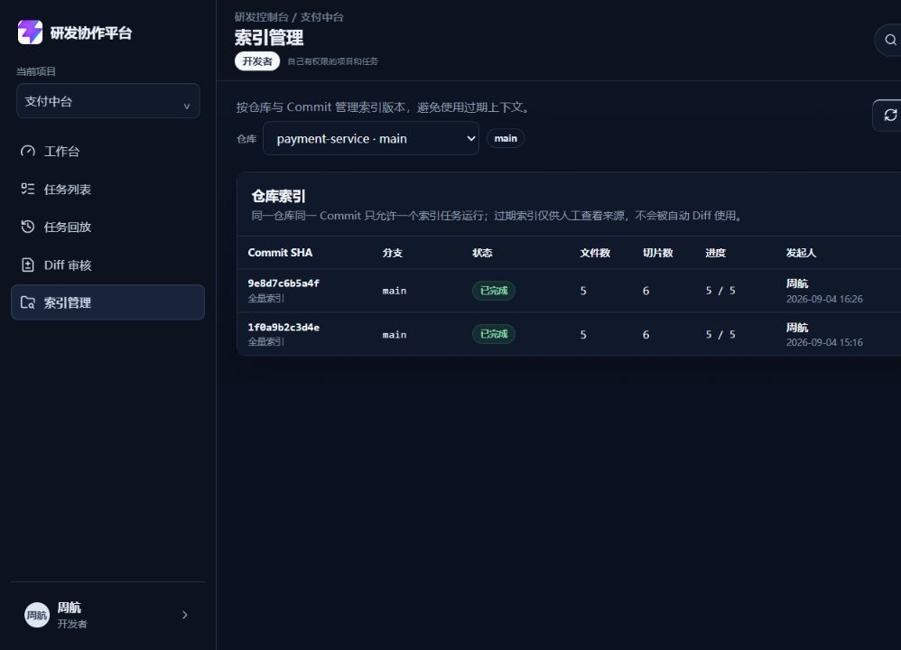
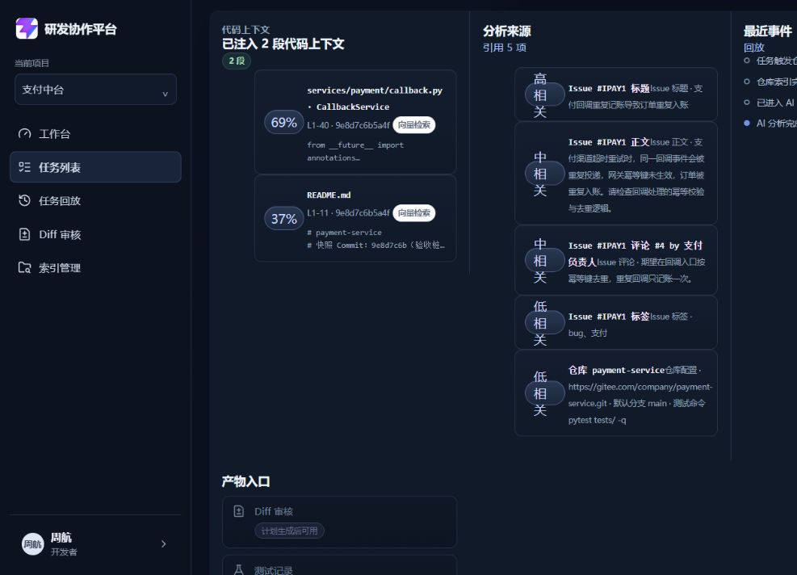

# DEV-008 代码 RAG 与索引模块

## 功能目标与范围

- 仓库级代码索引：同一仓库同一 Commit 只允许一个索引任务，索引完成后可被多个任务复用，避免每个任务重复全量索引。
- 任务创建/重试时按四行规则分流：`COMPLETED` 且 Commit 匹配 → 直接复用进入 `CONTEXT_INDEXED`；`COMPLETED` 但 Commit 过期 → 自动创建新索引并等待；运行中（PENDING/SYNCING/PARSING/EMBEDDING/STORING）→ 等待索引进度；`FAILED` → 任务失败并提示原因。
- 索引七态推进：`PENDING → SYNCING → PARSING → EMBEDDING → STORING → COMPLETED`，任一阶段抛错转入 `FAILED`，记录 `error_stage` 与 `error_message`。
- 检索结果逐条带 `file_path`、`start_line`/`end_line`、`commit_sha`、`score` 与 `source`，默认 Top-K=5，注入 Agent 的切片数上限 8。
- 召回为空或低于相似度阈值时返回明确 `empty_reason`，前端提供「重新检索 / 手动指定文件 / 重建索引」入口。
- 过期索引（Commit 落后于仓库 head）仅供人工查看来源，`assert_fresh_index_for_auto` 与 `require_fresh` 门禁禁止其进入自动 Diff 生成。
- 敏感文件不进入索引：`.env`、`secrets/`、`node_modules/`、`infra/` 等按仓库 `blocked_paths` 过滤。
- 索引失败可重试，重建默认异步排队，前端只展示进度、影响范围、失败原因和恢复入口。
- 本模块不包含：真实 Celery/Redis/Milvus 接入、增量索引；MVP 存储仍以内存态模拟。Embedding 已支持可选智谱 `embedding-3`，未配置 Key 或调用失败时回退本地 token-hash。

## 业务流程图

## 关键代码说明

- `backend/app/main.py`：`RepositoryIndexStatus` 七态枚举、`INDEX_STAGE_ORDER` 推进顺序、`RETRIEVAL_TOP_K_DEFAULT=5`、`MAX_CONTEXT_CHUNKS=8`、`MIN_CONTEXT_SCORE=0.3` 常量。
- `backend/app/main.py`：`RepositoryIndexRecord`（状态/Commit SHA/文件数/切片数/失败阶段与原因/重试次数）、`CodeChunkRecord`、`RetrievalContext`（路径/行号/Commit/相似度/来源/fresh）、`RetrievalRecord` 四个 Pydantic 模型；`TaskRecord` 增加 `base_commit_sha`、`related_index_id`、`code_contexts`。
- `backend/app/main.py`：`index_action_for_head` 四行分流——COMPLETED 且 Commit 匹配→reuse；运行中同 Commit→wait_index；FAILED 同 Commit→index_failed；否则创建新索引→create_index。
- `backend/app/main.py`：`progress_single_repository_index` 逐阶段推进，`run_index_stage_work` 执行 SYNCING/PARSING/EMBEDDING/STORING 各阶段工作；阶段抛错由 `fail_repository_index` 转为 FAILED。
- `backend/app/retrieval/parsing.py`：`parse_and_chunk` 将 `CodeFile` 转为 LlamaIndex `Document`，代码文件优先经 `CodeSplitter`（tree-sitter）切片，Markdown/文本经 `SentenceSplitter` 切片；tree-sitter 不可用时显式回退 `TokenTextSplitter`（仍为 LlamaIndex NodeParser）。`CodeMetadataAdapter` 回填 `start_line/end_line/symbol_name/chunk_index/checksum` 等业务元数据；`path_blocked` 按仓库 `blocked_paths` 过滤 `.env`/`secret`/`node_modules`/`infra/` 等敏感文件。
- `backend/app/main.py`：`run_task_retrieval` 按索引维度检索，`mode=auto + require_fresh` 时索引未完成或 Commit 不一致抛 409；`assert_fresh_index_for_auto` 作为自动代码修改门禁，禁止过期索引进入自动 Diff。
- `backend/app/main.py`：`apply_task_index_decision` 统一落盘四行结果（reuse→`CONTEXT_INDEXED`、create/wait→`ISSUE_FETCHED + wait_index`、failed→`mark_task_failed(node="代码索引")`），create_task 与 retry_task 共用。
- `backend/app/main.py`：索引端点——`POST /index`（含复用判断）、`POST /index/rebuild`（始终新建）、`GET /indexes`、`GET /indexes/{id}`、`POST /indexes/{id}/retry`（仅 FAILED 可重试，否则 409）；检索端点——`GET /tasks/{id}/contexts`、`POST /tasks/{id}/contexts/manual`（文件路径校验、去重、上限 8）。
- `frontend/src/views/IndexView.vue`：索引管理页——按仓库展示索引历史（Commit SHA/分支/状态/文件数/切片数/进度/发起人/失败原因），触发索引、重建索引、失败重试、详情弹窗，运行中任务 3 秒自动轮询。
- `frontend/src/components/CodeContextPanel.vue`：任务详情代码上下文面板——展示检索片段（路径/行号/Commit/相似度/来源标签），空结果面板提供重新检索、手动指定文件、重建索引入口，过期索引显示警示横幅（仅供人工核对），等待/失败态展示索引进度与重试入口。
- `frontend/src/stores/workspace.ts`：`registerAgentTaskArtifact` 映射 `code_contexts`，`indexById`/`mergeRepositoryIndex` 维护仓库索引记录缓存。

## 相关源码文件位置

- `backend/app/main.py`
- `backend/app/services/embedding_service.py`（智谱 embedding-3 与 token-hash 兜底切换）
- `backend/app/model_clients/zhipu_embedding_client.py`（智谱 `/embeddings` 客户端）
- `backend/app/core/model_config.py`（模型环境变量配置）
- `backend/tests/test_model_integration.py`（模型接入测试，14 个用例）
- `backend/tests/test_dev008_rag_index.py`（pytest 测试套件，29 个用例）
- `backend/tests/conftest.py`（测试夹具：内存态重置与登录客户端）
- `frontend/src/types/domain.ts`（`RepositoryIndex`、`CodeContext`、`TaskContextsResult` 等类型）
- `frontend/src/views/IndexView.vue`（索引管理页）
- `frontend/src/components/CodeContextPanel.vue`（任务详情代码上下文面板）
- `frontend/src/stores/workspace.ts`
- `frontend/src/views/TaskDetailView.vue`（集成 CodeContextPanel）
- `frontend/src/router/index.ts`（`/indexes` 路由）
- `frontend/src/components/__tests__/CodeContextPanel.spec.ts`（面板交互测试，7 个用例）
- `frontend/src/views/__tests__/IndexView.spec.ts`（索引管理页测试，7 个用例）
- `docs/02-prd.md`（§9.6 代码 RAG 与索引模块、§9.6.1 状态机规则）
- `docs/06-rag-design.md`
- `docs/08-api-design.md`

## 真实内容截图

以下截图来自本地真实运行页面，后端使用 `backend/acceptance_stub.py` 验收桩替换 Gitee 外部调用，产品代码未为截图做临时修改。

| 截图 | 说明 |
| --- | --- |
| `docs/assets/dev008-index-list-real.png` | 索引管理页：展示 `payment-service` 仓库两个完成索引版本，包含 Commit、分支、状态、文件数、切片数、进度和发起人 |
| `docs/assets/dev008-code-context-real.png` | 任务详情代码上下文面板：`TASK-8801` 已注入 2 段上下文，展示路径、行号、Commit、相似度和向量检索来源 |

异常分支截图说明：

- 过期索引警示横幅、索引失败重试入口已由后端 pytest 与前端 Vitest 覆盖，见测试与验收章节。
- 当前验收桩运行态没有强制制造 `FAILED` 索引和 `fresh=false` 任务的独立页面入口，本次不使用编造图替代真实截图；后续专项异常演示时补录 `dev008-stale-index-real.png` 与 `dev008-index-failed-retry-real.png`。

## 联调注意点

- MVP 异步是内存模拟：`INDEX_STAGE_SECONDS=2`，索引阶段在 `GET /api/tasks`、`GET /indexes` 等读取时由 `progress_repository_index_jobs` 驱动推进；真实环境应由 Celery Worker 异步执行（见 `06-rag-design.md` §5）。
- Embedding 已支持可选智谱 `embedding-3`（默认 2048 维，余弦相似度）；未配置 `ZHIPU_API_KEY` 或开启兜底且调用失败时，回退 `mvp-token-hash`（64 维）与关键词重合度。真实 Milvus 未接入。
- 索引状态 × 任务状态四行规则与 PRD 9.6.1 一致：`CONTEXT_INDEXED` 只表示任务已获得可用于分析的代码上下文，不等同于重新完成一次全量索引。
- 检索按项目/仓库/Commit 过滤是结构性保证：索引天然按 `repository_id` + `commit_sha` 维度隔离，检索只取 `chunk.index_id == index.id`，`fresh` 判定 Commit 与任务基线一致。
- 过期索引可人工查看（`GET /contexts` 返回 `fresh=false`），但 `assert_fresh_index_for_auto` / `require_fresh` 会 409 阻止其进入自动代码修改。
- 权限矩阵：触发/重建/重试需 `index:manage`，查看索引历史与检索上下文需 `index:view`；手动指定文件需 `task:operate`。
- 编号说明：本模块测试文件命名 `test_dev008_rag_index.py`，对应 DEV-008「代码 RAG 与索引」；原规划的「人工审批」顺延为 DEV-009。
- 敏感文件过滤按仓库 `blocked_paths` 执行，`.env`/证书/私钥/Token 文件不进入索引。

## 测试与验收

| 层 | 结果 |
| --- | --- |
| 后端 pytest | `tests/test_dev008_rag_index.py` 29/29 PASS；`tests/test_model_integration.py` 14/14 PASS（四行分流、七态推进、模型接入、失败兜底、检索字段/Top-K/过滤/空结果/fresh 门禁、权限矩阵、审计事件、敏感文件过滤） |
| 前端 Vitest | `CodeContextPanel.spec.ts` 7 + `IndexView.spec.ts` 7，全仓 6 文件 36/36 PASS |

## 复盘

- 做得好的地方：四行分流与七态推进的边界一次定死并在 create_task/retry_task 共用 `apply_task_index_decision`，前后端字段约定一致；`fresh` 门禁独立成函数，把「人工查看」和「自动修改」两条路径严格分开。
- 需要加强的地方：异步执行、Embedding、Milvus 目前全是内存模拟，后续替换真实 Worker 时要保证状态机推进入口不变。
- 下次注意：模块开发前先在开发总表登记编号，避免测试文件命名与规划编号冲突（本次 `test_dev008_rag_index.py` 与「人工审批」原占 DEV-008 撞号）。
