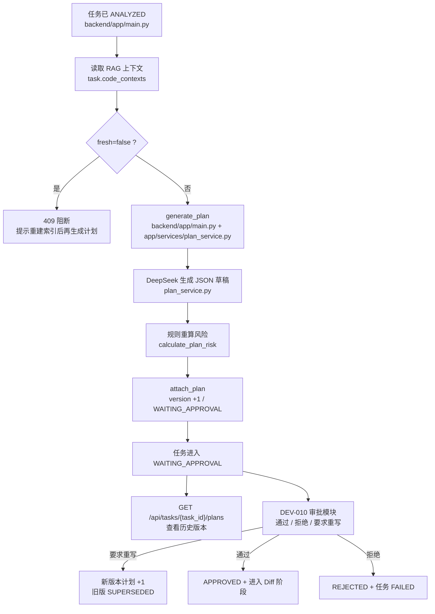
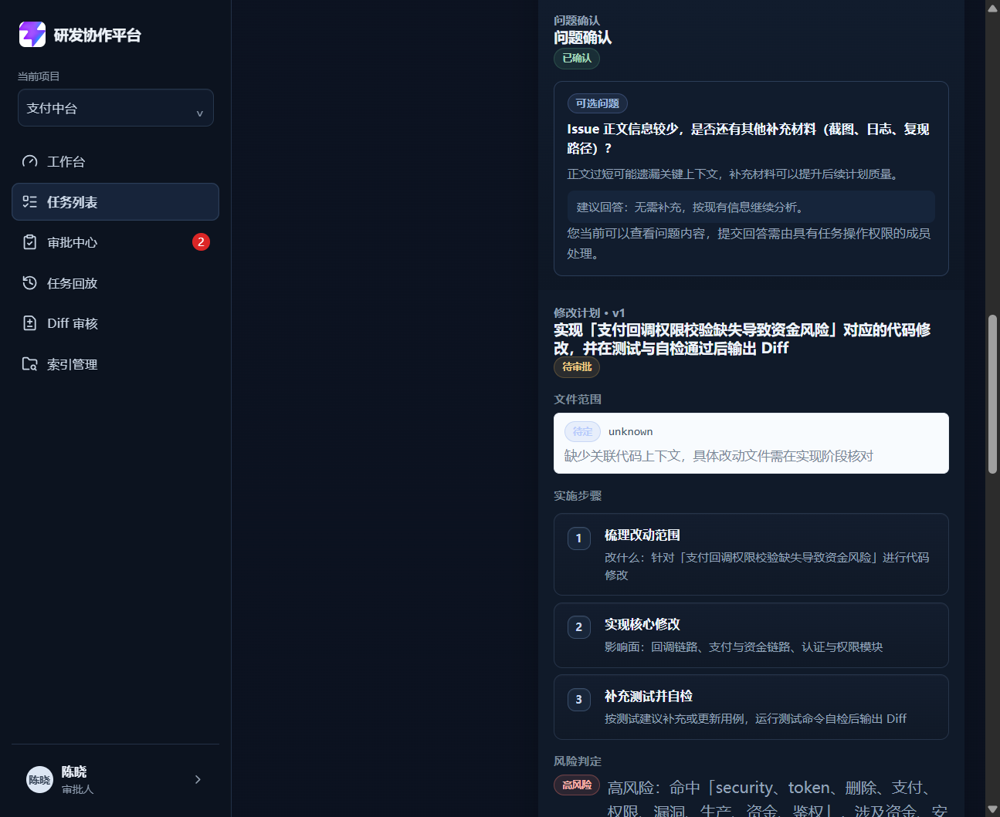
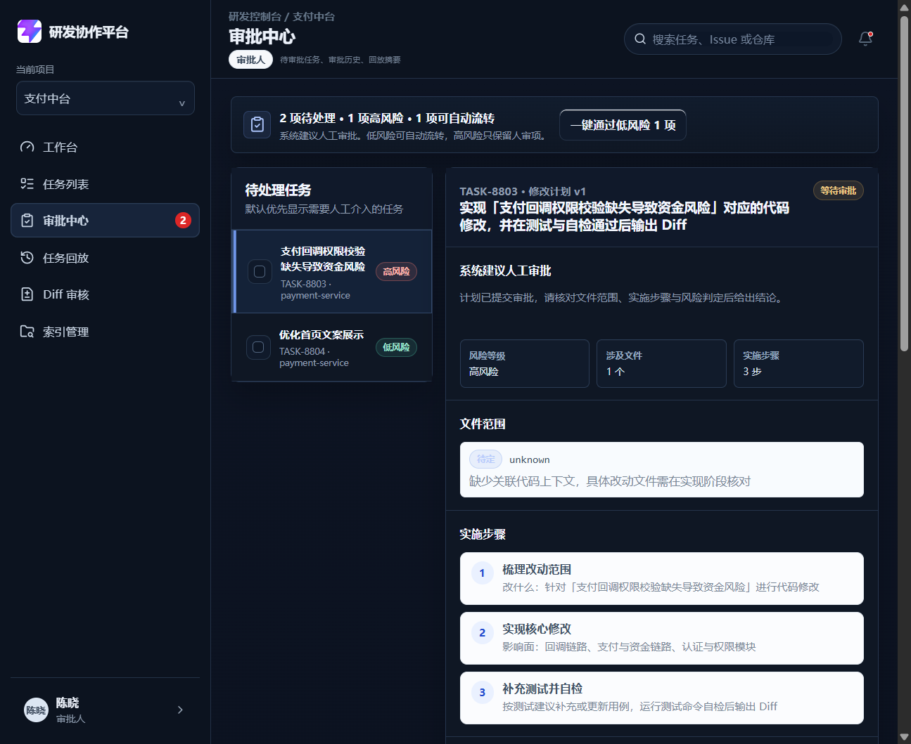

# DEV-009 修改计划模块

## 功能目标与范围

- 任务在 `ANALYZED` 后生成结构化修改计划。
- 计划生成后必须进入 `WAITING_APPROVAL`，交给 DEV-010 审批模块处理。
- 计划支持版本化，审批模块要求重写时会生成新版本，旧版本置 `SUPERSEDED`。
- 风险等级由计划模块重算；审批阶段的风险调整与审计留痕归 DEV-010。
- 计划历史版本可查看，只读回溯。

## 业务流程图

## 关键代码说明

- `backend/app/main.py`
  - `generate_task_plan`：计划生成入口，负责分析/上下文门禁。
  - `generate_plan`：优先调用 `plan_service.generate_plan_fields`，失败回退规则计划。
  - `calculate_plan_risk`：风险重算逻辑，不直接信任模型输出。
  - `attach_plan`：版本分配、旧版取代、任务切换到 `WAITING_APPROVAL`。
- `backend/app/services/plan_service.py`
  - 负责 DeepSeek 结构化计划草稿生成与 JSON 校验。
- `backend/tests/test_dev009_modification_plan.py`
  - 覆盖计划生成、版本化、审批、驳回、权限、风险重算与兜底。
- `frontend/src/components/ModificationPlanPanel.vue`
  - 展示当前计划、历史版本和进入审批前的生成入口。
- `frontend/src/views/TaskDetailView.vue`
  - 在任务详情页挂载修改计划面板。
- `frontend/src/views/ApprovalView.vue`
  - DEV-010 审批中心会消费本模块生成的 `WAITING_APPROVAL` 计划。

## 相关源码文件位置

- `backend/app/main.py`
- `backend/app/services/plan_service.py`
- `backend/tests/test_dev009_modification_plan.py`
- `frontend/src/components/ModificationPlanPanel.vue`
- `frontend/src/views/TaskDetailView.vue`
- `frontend/src/views/ApprovalView.vue`
- `frontend/src/stores/workspace.ts`
- `frontend/src/types/domain.ts`
- `docs/02-prd.md`
- `docs/08-api-design.md`
- `docs/04-technical-architecture.md`

## 联调注意点

- 只有任务处于 `ANALYZED` 且已有分析结果时才能生成计划。
- `fresh=false` 的上下文会直接阻断可审批计划生成。
- 计划生成后任务必须进入 `WAITING_APPROVAL`。
- 只有最新版本且处于 `WAITING_APPROVAL` 的计划会交给审批模块处理。
- 审批风险调整、审批意见、拒绝和要求重写规则见 `10-approval-module.md`。

## 真实运行截图

| 截图 | 说明 |
| --- | --- |
| `docs/assets/dev009-task-plan-real.png` | 任务详情页修改计划面板：展示目标、文件范围、步骤、风险、测试建议、历史版本入口 |
| `docs/assets/dev009-approval-center-real.png` | 审批中心：展示待审批计划、风险等级、审批意见与通过/拒绝/要求重写操作 |

