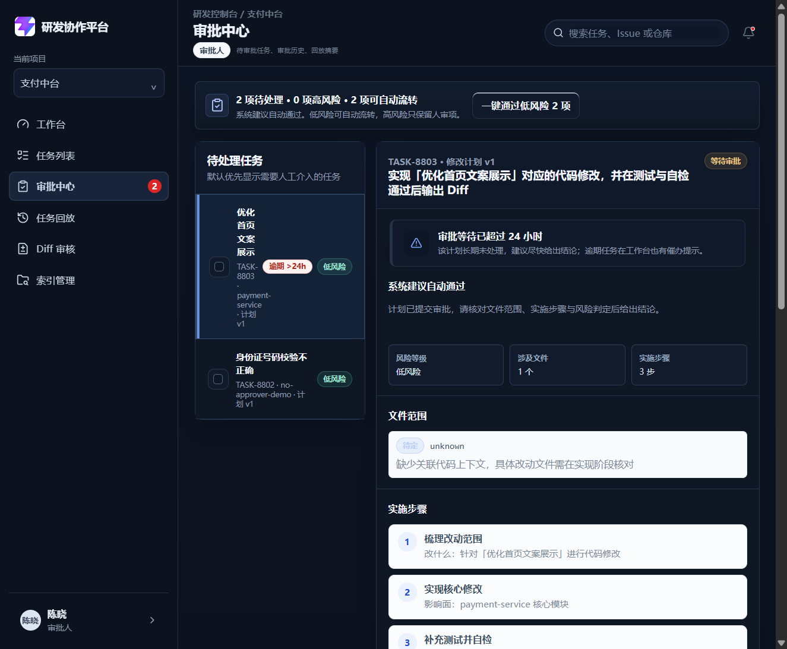
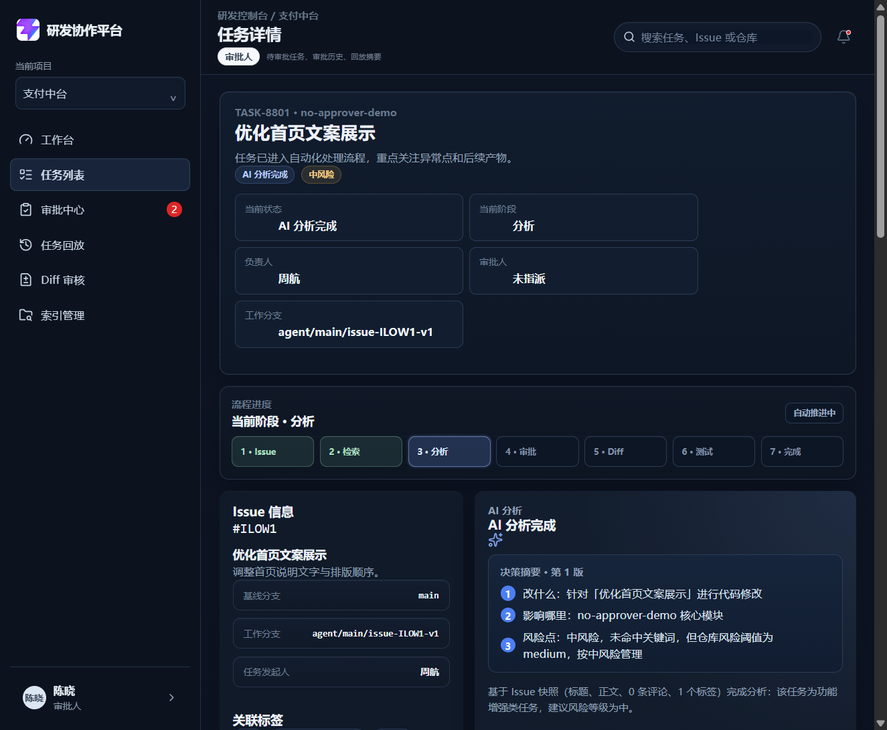
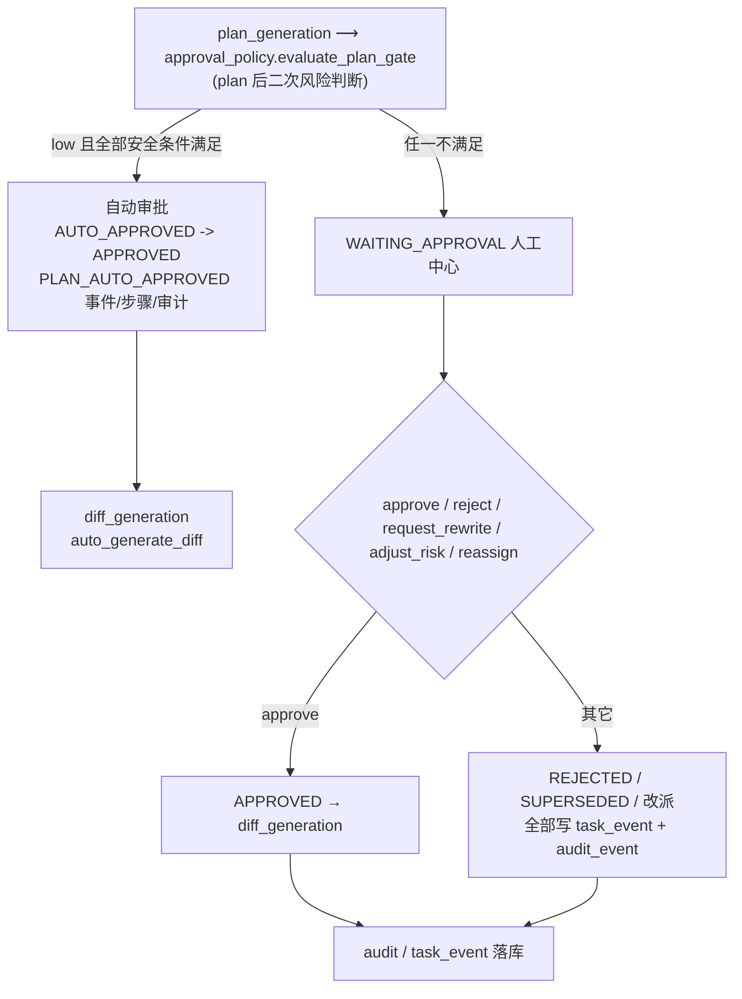

# DEV-010 审批模块

## 1. 基本信息

| 项目 | 内容 |
| --- | --- |
| 模块名称 | 审批模块 |
| 开发阶段 | MVP |
| 开始日期 | 2026-09-04 |
| 完成日期 | 2026-09-04 |
| 负责人 | Codex 架构复核，Qoder 实现，Claude/豆包验收 |
| 关联文档 | `docs/02-prd.md`、`docs/04-technical-architecture.md`、`docs/08-api-design.md` |
| 关联接口 | `/api/approvals/pending`、`/api/approvals/candidates`、`/api/tasks/{task_id}/approval-owner`、计划审批接口 |
| 关联数据 | `TaskRecord`、`ModificationPlan`、任务事件记录 |

## 2. 功能目标与范围

审批人审核 Agent 生成的最新修改计划，决定任务是否进入 Diff 生成阶段。MVP 使用项目级默认审批人，审批模式为 `single`，任一指定审批人完成审批后立即生效，暂不支持多人会签。

本模块覆盖：

- 项目默认审批人继承、无审批人时的管理员/研发负责人手动指派和改派。
- 审批中心按当前用户过滤待审批任务，管理员可查看全部待审批任务。
- 通过、拒绝、要求重写三种审批动作。
- 审批时风险等级调整及原因校验。
- 审批人、时间、意见、计划版本和风险调整记录留痕。
- 低风险一键通过和多选审批的逐项调用与结果汇总。
- 站内待办、任务列表高亮和超过 24 小时的催办提示。
- `/diff/:id` 对未审批任务的前端展示门禁；DEV-011 已在 Diff 生成端点补充后端门禁。

## 3. 业务流程

```mermaid
flowchart TD
    A[任务完成分析] --> B{是否有明确审批人}
    B -- 否 --> C[任务详情手动指派/改派]
    C --> D[POST /api/tasks/{task_id}/approval-owner<br/>backend/app/main.py（assign_task_approval_owner）]
    D --> E[记录 APPROVAL_OWNER_CHANGED 审计事件]
    B -- 是 --> F[生成修改计划]
    E --> F
    F --> G[POST /api/tasks/{task_id}/plans<br/>backend/app/main.py（generate_task_plan）]
    G --> H[WAITING_APPROVAL]
    H --> I[GET /api/approvals/pending<br/>backend/app/api/audit.py（list_pending_approvals）]
    I --> J{当前用户可审批}
    J -- 否 --> K[不返回任务/拒绝操作]
    J -- 是 --> L[审批中心展示摘要、文件、步骤、风险]
    L --> M{审批动作}
    M -- 通过 --> N[POST .../approve<br/>backend/app/main.py（approve_task_plan）]
    M -- 拒绝 --> O[POST .../reject<br/>backend/app/main.py（reject_task_plan）]
    M -- 要求重写 --> P[POST .../rewrite<br/>backend/app/main.py（rewrite_task_plan）]
    N --> Q[记录审批人/时间/意见/版本/风险调整]
    Q --> R[任务 APPROVED，允许进入 Diff 阶段]
    O --> S[计划 REJECTED，任务 FAILED]
    P --> T[旧计划 SUPERSEDED，新版本回到 WAITING_APPROVAL]
    R --> U[Diff 页面仅展示已通过及后续状态]
```

## 4. 实现说明

### 4.1 后端审批与归属

- `ensure_assigned_approver()` 统一校验审批动作归属；指定审批人可操作，管理员保留越权兜底能力。
- `GET /api/approvals/pending` 只返回当前用户有权处理的 `WAITING_APPROVAL` 任务，管理员返回全部待审批任务。
- `GET /api/approvals/candidates` 提供管理员和审批人候选，不向开发者暴露。
- `POST /api/tasks/{task_id}/approval-owner` 支持管理员和研发负责人指派/改派，并写入 `APPROVAL_OWNER_CHANGED` 事件。
- 无审批人时生成计划返回 `409`，完成指派后才允许继续生成计划。

### 4.2 审批状态与审计

- 通过：最新计划变为 `APPROVED`，任务变为 `APPROVED`，`next_action` 设置为 `auto_generate_diff`。
- 拒绝：计划变为 `REJECTED`，任务变为 `FAILED`，不会自动回到计划生成。
- 要求重写：仅允许当前最新计划仍为 `WAITING_APPROVAL` 时执行；旧版本变为 `SUPERSEDED`，新计划版本重新进入 `WAITING_APPROVAL`。
- 拒绝与要求重写必须填写意见。
- 调整风险等级时必须填写 `risk_adjust_reason`，否则返回 `422`；调整前等级、调整后等级和原因会写入计划及事件记录。
- 审批记录保留 `approved_by_id`、`approved_by_name`、`approved_at`、`approval_comment` 和计划版本，普通用户没有修改接口。

### 4.3 前端审批中心

- `ApprovalView.vue` 使用真实接口加载 owner 范围队列，排序优先级为逾期、高风险、更新时间。
- 低风险“一键通过”和多选审批均由前端对每个任务逐项调用审批接口，并分别汇总 `done`、`skipped`、`errors`，没有用全部待审批任务兜底替换用户选择。
- MVP 中风险调整只在单任务聚焦审批时提供；批量审批按每个计划已有风险执行，不提供批量内的单项风险编辑。这是当前 P2 约束，后续可扩展为逐项展开调整。
- 任务详情的 `ModificationPlanPanel.vue` 提供无审批人任务的指派入口、改派入口、审批历史和逾期提示。
- 审批完成后刷新队列和导航角标。团队版通过 Redis Pub/Sub + SSE 推送 `task.updated`、`notification.created` 等变化信号，在线页面收到后重新请求真实 API；邮件和 Webhook 仍不属于 MVP。

### 4.4 Diff 展示门禁

`DiffView.vue` 只允许 `APPROVED`、`DIFF_GENERATED`、`TESTED`、`COMPLETED` 状态进入 Diff 内容展示。未审批、失败或取消任务直达 `/diff/:id` 时显示门禁提示并返回任务详情。DEV-011 的 `POST /api/tasks/{task_id}/diffs/generate` 同样要求任务为 `APPROVED` 且计划为最新审批通过版本。

## 5. 相关源码位置

| 位置 | 作用 |
| --- | --- |
| `backend/app/main.py（ensure_assigned_approver）` | 审批人归属校验 |
| `backend/app/main.py（generate_task_plan）` | 生成计划及无审批人门禁 |
| `backend/app/main.py（rewrite_task_plan）` | 要求重写并生成新版本 |
| `backend/app/main.py（approve_task_plan）` | 通过、风险调整和审批记录 |
| `backend/app/main.py（reject_task_plan）` | 拒绝并终止任务 |
| `backend/app/api/audit.py（list_pending_approvals）` | 审批中心待办接口 |
| `backend/app/api/audit.py（list_approval_candidates）` | 审批人候选接口 |
| `backend/app/main.py（assign_task_approval_owner）` | 指派/改派审批人接口 |
| `frontend/src/views/ApprovalView.vue:30` | 队列、排序、单项与批量审批 |
| `frontend/src/components/ModificationPlanPanel.vue:44` | 指派/改派、计划审批操作与逾期提示 |
| `frontend/src/views/DiffView.vue:13` | Diff 状态门禁 |

## 6. 真实运行截图

| 截图 | 说明 |
| --- | --- |
| `docs/assets/dev010-approval-queue-real.png` | 陈晓登录后的审批中心，只展示指派给自己的 2 项待审批任务，包含 26 小时逾期提示和低风险一键通过入口。 |
| `docs/assets/dev010-approval-owner-real.png` | 无默认审批人的任务详情，展示“审批人未指派”和任务仍停留在分析阶段。 |

截图来自 `backend/dev_demo_dev010.py` 真实演示链路，未使用 mock 页面或示意图。





## 7. 联调注意点

- 演示脚本：`backend/dev_demo_dev010.py`。脚本文件已确认按 UTF-8 读取。
- 测试账号：审批人 `approver@company.com`，管理员 `admin@company.com`，研发负责人 `lead@company.com`。
- 任务进入 `WAITING_APPROVAL` 后必须已有明确审批人；ownerless 仓库先指派再生成计划。
- 审批中心不是全量任务列表：审批人只看自己的任务，研发负责人可指派但不直接审批，开发者无审批中心权限。
- 改派后原审批人不能继续处理该任务；管理员可以越权兜底，但审批记录署名仍为实际操作人。
- 批量操作必须保留每项成功、跳过和失败结果；非待审批任务不能被静默处理。
- 拒绝后的任务只能通过重试重建任务版本继续推进，不会自动重新生成计划。
- 前端 `/diff` 和后端 Diff 生成接口均已增加不可绕过的审批状态门禁。

## 8. 测试与验收结果

### 后端

```text
uv run pytest tests\test_dev010_approval_module.py tests\test_dev009_modification_plan.py
37 passed
```

覆盖 owner 范围、管理员越权、指派/改派、无审批人生成门禁、风险调整、审批记录和计划状态流转。

### 前端

```text
npm run test -- src/views/__tests__/DiffView.spec.ts src/views/__tests__/ApprovalView.spec.ts src/components/__tests__/ModificationPlanPanel.spec.ts src/views/__tests__/DashboardView.spec.ts
4 files passed
31 tests passed
```

新增/验证未审批任务直达 `/diff` 的门禁提示，不渲染 Diff 内容。

### 构建

```text
npm run build
passed
```

### 验收结论

- P0：无。
- DEV-010 核心审批链路：通过。
- P1 文档缺失：已补 `10-approval-module.md` 和真实截图。
- P2-1 `/diff` 状态守卫：前端展示门禁和后端生成门禁均已补齐。
- P2-2 批量风险调整：MVP 明确限定为单任务审批可调整，文档已同步。
- P2-3 演示脚本编码：已确认 UTF-8。

## 9. 复盘

- 本模块重点完成了从“计划生成”到“审批放行”的可审计闭环，并把审批人归属、风险调整和版本号绑定到审批记录。
- 本轮验证了接口权限、页面展示、批量逐项调用和 Diff 前端门禁，后续 Diff 模块要继续补后端状态门禁与真实生成链路。

## 附：DEV-018 审批分级与自动推进

> 完整文档见 `docs/project-development/30-approval-grading-auto-advance.md`。本节为 DEV-018 在审批模块中的落点摘要。



- **自动审批策略单一模块** `backend/app/services/approval_policy.py`：`evaluate_plan_gate`（approval_policy.py:82，二次风险判断）/ `apply_auto_approval`（:122）/ `evaluate_and_apply`（:165，幂等统一入口），HTTP 与 Worker/LangGraph 共用；LangGraph 在 `workflow.py:227 node_generate_plan` 计划生成后调用。
- **自动推进条件**：以下全部满足才 AUTO_APPROVE；任一不满足 → `WAITING_APPROVAL` 人工中心：
  1. 计划风险等级 ≤ 仓库 `risk_threshold`（默认 medium ⇒ 默认仅 low 自动推进）；
  2. 计划/模型输出结构完整（`validate_plan_structure` 五要素）；
  3. 检索上下文 fresh（`plan_context_gate` 无过期）；
  4. 无未回答阻塞问题；
  5. 测试命令命中仓库白名单；
  6. **敏感文件**（`sensitive_file_matched:<path>`）：计划 file_scope 命中 `blocked_paths` / 敏感扩展 / `.env`、`secrets`、`.pem/.key` 等路径；
  7. **危险命令**（`dangerous_command_matched:<cmd>`）：计划 test_suggestions / 测试命令含 `rm -rf`、`curl|sh`、`Invoke-WebRequest|iex` 等危险片段。
- **审计**：自动审批同时写 `task_event`（task_events 表）+ 全局 `audit_event`（audit_events 表，actor=`system:auto_approval`，diff_summary 含 task_id/plan_id/plan_version/risk_level/reasons/next_action）。
  人工 approve/reject/request_rewrite/改派/风险调整由真实 `user.id` 写 `PLAN_APPROVED/PLAN_REJECTED/PLAN_REWRITE_REQUESTED/APPROVAL_OWNER_CHANGED` 等事件（同落两表，含 metadata）；admin 越权代批（非其指派对象）时 diff_summary 追加 `fallback_admin_action=true`。
- **并发**：`approve`/`reject`/`rewrite` 均在 `backend/app/main.py（_APPROVAL_LOCK）` 内，只接受第一条有效动作（版本/状态门禁，重复触发 409）。
- **lead（项目负责人）项目级可见**：`backend/app/db/reads.py（list_pending_approvals）` —— admin 全量；lead 可见其默认审批的仓库所属项目下全部 `WAITING_APPROVAL`（即使未指派给自己）+ 指派给自己的；其余用户仅指派给自己。持久化开启走 DB 真源。
- **测试**：`python -m pytest backend/tests -q` → 406 passed, 14 skipped, 0 failed；`test_approval_policy` 覆盖自动审批/敏感/危险/lead 可见，`test_workflow_graph.py:86` 覆盖 LangGraph 自动越过 `WAITING_APPROVAL`。
