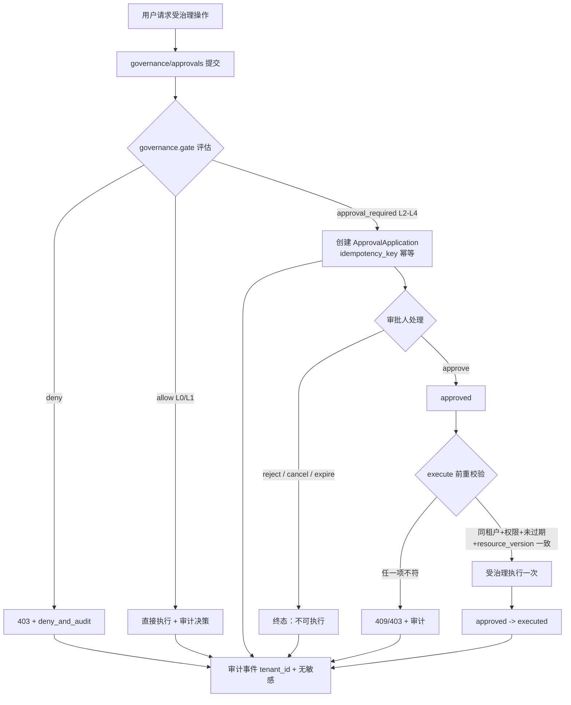
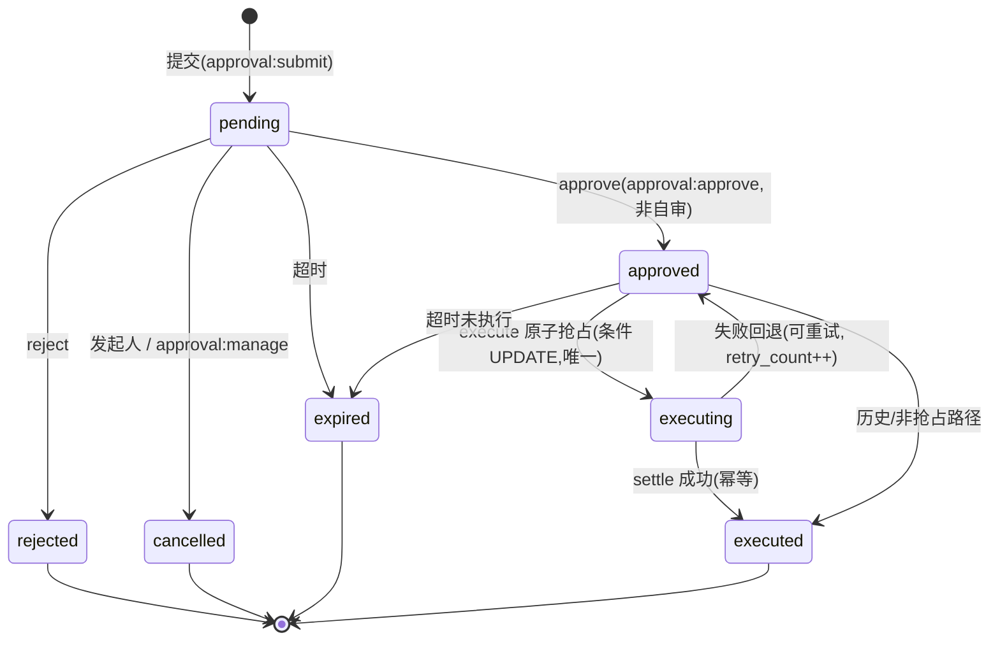
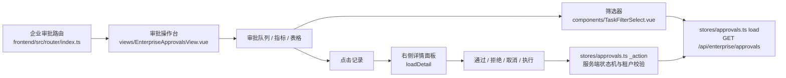
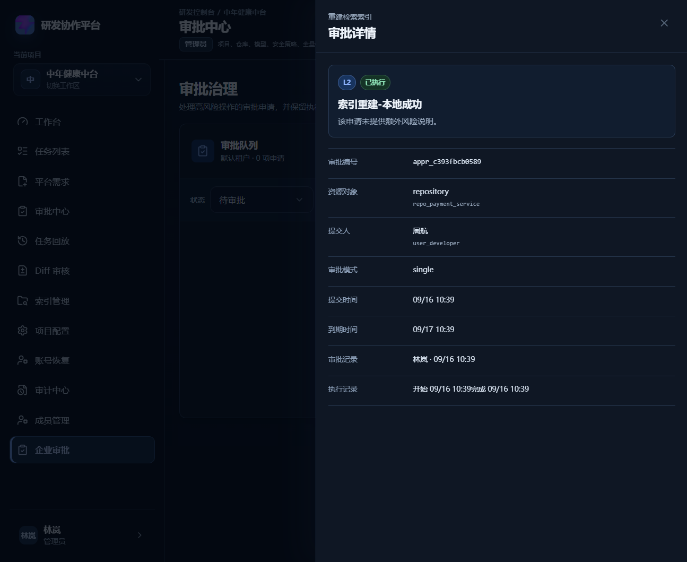

# E2-01 企业审批与治理门禁

> 阶段：E2（审批与治理）
> 前置：E1-01 多租户 / RBAC（`docs/enterprise/10-e1-01-tenant-permission.md`）
> 相关设计：`docs/enterprise/01-enterprise-prd.md §10 任务/审批/治理`、`docs/enterprise/06-security-governance-audit.md`
> 验收依据：E2 专项 31 passed + 加固专项 17 passed + 部署校验 22 passed + 后端全量 609 passed, 16 skipped + 前端全量 240 passed；浏览器截图来自本地真实启动联调。云服务器部署与云端浏览器验收尚未纳入本轮证据。

## 1. 功能目标与范围

为平台引入**通用风险治理与审批门禁**：风险分级 L0–L4、治理决策 `allow/deny/approval_required`、
独立审批申请生命周期（挂起/审批/拒绝/取消/过期/执行）、租户隔离、幂等、并发、执行前重校验与审计。
高风险操作必须经过后端治理判断，前端仅改善体验。

**范围内**
- L0–L4 风险分级与策略评估（`governance`）。
- 受治理操作注册表与审批申请实体（`approvals`）。
- 审批全生命周期与状态机、幂等、进程内并发锁、过期、执行一次。
- 持久化开启时审批详情、幂等查询和审批操作支持进程缓存缺失后的数据库回源。
- `repository.index.rebuild` 和 `team_request.sync_gitee` 审批执行会进入现有 Worker 派发链。
- 租户隔离、自审禁拒、auditor 只读、无权限 403、禁成员阻断。
- 审批/执行/审计事件（不含敏感凭据）。
- 企业审批中心前端（列表/筛选/详情/审批/拒绝/取消/执行/空态/错误/权限不足/真实刷新）。
- 团队版计划审批保持不变，并新增团队版回归保障。

**范围外**
- 不改造团队版计划/待办/候选人/负责人接口路径与语义（未动，全量回归通过）。
- 企业模式下旧同步高风险入口 `/api/repositories/{repository_id}/index/rebuild` 与
  `/api/team/requests/{request_id}/sync-gitee` 先创建治理审批申请，审批执行前不触发旧入口副作用；
  团队模式保持原路径语义。
- ABAC、SSO/MFA、密钥明文处理、动态多级审批链在线编排。
- 基础密钥轮换 UI（`credential.access` 默认拒绝）。

## 2. 业务主链路



## 3. 审批状态机



state 说明：`executing` 为多副本抢占后的瞬时执行态（其余副本读到即 409「执行中/已执行」）；
失败不引入 execution_failed，而是回退 `approved` 保持「409 + 可重试」既有合同，并在
`execution_error`/`retry_count` 记录可追踪。非法转换（终态再审批/执行）返回 `409` 且不改库。

## 4. 权限矩阵

新增企业权限（`tenancy/permissions.py`）：`approval:view / approval:submit / approval:approve /
approval:manage / governance:manage`（`audit:view`、`member:*` 复用 E1）。

| 角色 | view | submit | approve | manage | governance:manage | audit:view |
| --- | --- | --- | --- | --- | --- | --- |
| tenant_owner | ✔ | ✔ | ✔ | ✔ | ✔ | ✔ |
| tenant_admin | ✔ | ✔ | ✔ | ✔ | ─ | ✔ |
| security_admin | ✔ | ─ | L4 专用 | L4 专用 | ✔ | ✔ |
| project_owner | ✔ | ✔ | L2 项目 | ─ | ─ | ─ |
| developer | ✔ | ✔(不可自审自己 L2+) | ─ | ─ | ─ | ─ |
| reviewer | ✔ | ─ | ─ | ─ | ─ | ─ |
| auditor | ✔ | ─ | ─ | ─ | ─ | ✔ |

规则：审批人不能审批/拒绝自己提交的高风险申请（除非操作显式允许）；auditor 只读；无审批权限角色一律 403。

## 5. 受治理操作与风险映射（真实对象）

| 操作码 | 资源 | 风险 | 审批模式 | 必需业务权限 | 执行副作用 |
| --- | --- | --- | --- | --- | --- |
| `repository.index.rebuild` | repository | L2 | single | index:manage | 受理索引重建 |
| `team_request.sync_gitee` | team_request | L2 | single | request:create | 同步到 Gitee |
| `repository.archive` | repository | L3 | dual | project:manage | 真实归档（is_active=False） |
| `repository.delete` | repository | L4 | security | project:manage | 归档保留（非破坏） |
| `audit.export` | tenant | L4 | security | audit:view | 输出审计汇总 |
| `tenant.member.role_change` | tenant_member | L4 | security | member:manage | 真实改成员角色 |
| `credential.access` | credential | L4 | 默认 deny | — | 无密钥明文 |

## 6. 接口契约（`/api/enterprise`）

审批中心：
| 方法 | 路径 | 说明 | 权限 |
| --- | --- | --- | --- |
| GET | `/approvals?status=&risk=&scope=` | 审批列表（scope=all/mine/submitted） | approval:view |
| GET | `/approvals/{id}` | 详情（限本租户） | approval:view |
| POST | `/approvals` | 提交（服务端重算风险+决策，幂等键） | approval:submit |
| POST | `/approvals/{id}/approve` | 通过（dual 需累计所需人数） | approval:approve |
| POST | `/approvals/{id}/reject` | 拒绝 | approval:approve |
| POST | `/approvals/{id}/cancel` | 取消（发起人/manage） | actor/manage |
| POST | `/approvals/{id}/execute` | 执行（L4 需 secondary_confirmation=true） | approval:approve |

治理：
| 方法 | 路径 | 说明 | 权限 |
| --- | --- | --- | --- |
| POST | `/governance/decide` | 治理决策说明（dry-run 返回 allow/deny/approval_required） | approval:submit |
| GET | `/governance/operations` | 操作注册表说明 | governance:manage |

`tenant_id` 一律来自服务端会话上下文，不信任请求体/URL/`X-Tenant-Id`/前端。失败统一 `{code,message,data}`；
跨租户 `403+审计`；非法状态 `409`；L4 缺二次确认 `422`。

## 7. 数据模型与迁移

表 `approval_applications`（迁移 `migrations/versions/b3c4d5e6f708_add_approval_applications.py`，
down_revision=`a1b2c3d4e5f6`）：
`id, tenant_id(index), actor_id, actor_name, resource_type(index), resource_id(index), operation(index),
title, request_summary(JSON), risk_level, decision, approval_status(index), reason, idempotency_key,
created_by, created_at, updated_at, expires_at, approved_by_id, approved_by_name, approved_at,
executed_at, executed_by_id, executor_result(JSON), resource_version, allowed_approvers(JSON),
approval_mode, approval_meta(JSON), secondary_confirmation, version(乐观锁)，
unique(tenant_id, idempotency_key)`。

审批执行追踪（迁移 `migrations/versions/c4d5e6f7089a_add_approval_execution_tracking.py`，
down_revision=`b3c4d5e6f708`，纯追加可空列）：`execution_attempt_id, async_result_id,
retry_count, started_at, finished_at, execution_error`。

迁移纯增量、不改历史；`downgrade` 仅 drop 对应列/表。持久化沿 `db/repositories.py` 写透/读回 + `db/bootstrap.py` 回载。

## 8. 关键源码位置

| 职责 | 文件 |
| --- | --- |
| 风险分级 | `backend/app/governance/risk.py` |
| 操作注册表 | `backend/app/governance/operations.py` |
| 策略评估 | `backend/app/governance/policies.py` |
| 集中门 | `backend/app/governance/gate.py` |
| 受治理执行 | `backend/app/governance/executor.py` |
| 审批 pydantic | `backend/app/approvals/models.py` |
| 审批内存真源/持久化 | `backend/app/approvals/store.py` |
| 审批服务（状态机/幂等/并发/审计） | `backend/app/approvals/service.py` |
| 审批/治理路由 | `backend/app/approvals/routes.py` |
| 审批权限增补 | `backend/app/tenancy/permissions.py` |
| ORM / 持久化 / 回载 / 挂载 | `models/orm.py`、`db/repositories.py`、`db/bootstrap.py`、`main.py` |
| 旧入口企业门禁兼容层 | `backend/app/main.py::_enterprise_approval_for_legacy_operation` |
| 审批执行器与 Worker 派发 | `backend/app/governance/executor.py`、`backend/app/workers/dispatch.py`、`backend/app/workers/tasks.py` |
| E2 专项测试 | `backend/tests/test_enterprise_e2_governance.py` |
| 前端审批 store/类型/页面 | `stores/approvals.ts`、`types/approvals.ts`、`views/EnterpriseApprovalsView.vue` |
| 可访问自定义筛选器 / 页面回归 | `components/TaskFilterSelect.vue`、`views/__tests__/EnterpriseApprovalsView.spec.ts` |
| 路由 / 导航 | `frontend/src/router/index.ts`、`components/AppShell.vue` |

## 9. 关键代码说明

- `policies.evaluate`：L0/L1 → allow；L4 → security+二次确认；L3 → dual；L2 → 项目审批。业务权限不足 → deny。
- `service.create_approval`：先走 `governance.gate`（审计决策、deny 即 403），再按
  `(tenant_id, idempotency_key)` 幂等；`request_summary` 提交时清洗敏感字段。
- `service.approve`：行锁 `store.row_lock(id)` 内校验 pending + 非自审 + 安全角色；dual 累计不同审批人。
- `service.execute`：approved + 未过期 + `resource_version` 一致 + 业务权限仍在 + L4 二次确认 → 执行一次，
  executor 抛错则 409 不落执行。
- `repositories.upsert_approval`：数据库唯一键 `(tenant_id, idempotency_key)` 冲突时读回既有审批单，转换为幂等成功。
- `store.get/find_by_idempotency`：进程内缓存 miss 时按审批 ID 或幂等键从数据库回源，并回填本地缓存。
- `executor._rebuild_repository_index/_sync_team_request`：审批通过后复用既有索引/Gitee Worker 派发链；eager 执行返回失败时不标记审批为 executed。
- 并发：单进程内按 id 行锁 + `version` 乐观锁；多副本写入幂等已由 DB 唯一键冲突读回兜底，执行状态仍需 DB 行锁增强（见 §16）。

## 10. 错误码与异常处理

`403` 越权/跨租户/无审批权限；`401` 未登录/成员禁用；`404` 审批不存在（跨租户详情返回 403 防存在性探测）；
`409` 状态冲突/自审/资源已变更/重复执行/终态转换；`422` L4 缺二次确认、参数非法；`200` 成功/幂等命中。
所有异常不改库，审计始终带 `tenant_id` 且不含敏感字段。

## 11. 联调注意点

1. 所有接口必须登录并先取服务端 `tenant-context`；手动 `curl` 先 `POST /api/auth/login` 带 Cookie。
2. 跨租户需 `POST /api/enterprise/tenant-context/switch` 切换，不能伪造 tenant。
3. 审批 `submit` 需业务权限 + approval:submit；approve 的非自审约束要求提交者与审批者不同角色。
4. L4 提交者需 `member:manage`（种子中仅 owner/admin）；审批人需提升为 security_admin/tenant_admin。
5. 幂等键 `idempotency_key` 必须唯一；重复提交返回同一单号。
6. Vite 代理：`VITE_API_PROXY_TARGET` 指向联调后端端口。
7. 前端只发请求，成功以服务器返回状态为准；刷新后以 persisted 状态为准。

## 12. 测试命令与真实结果

```bash
cd backend && ./.venv/Scripts/python.exe -m pytest tests/test_enterprise_e2_governance.py -q   # 31 passed
cd backend && ./.venv/Scripts/python.exe -m pytest tests/test_enterprise_e2_hardening.py -q    # 17 passed（多副本/DB 一致性/故障降级/执行回收/特权治理 PATCH+POST）
cd backend && ./.venv/Scripts/python.exe -m pytest tests/test_enterprise_deploy.py -q           # 22 passed（启动拒绝 + worker healthcheck 路径/控制面 ping + frontend 非 root / 端口 / Nginx 配置断言）
cd backend && ./.venv/Scripts/python.exe -m pytest -q                                          # 609 passed, 16 skipped
cd deploy && echo "compose config: $(docker compose -f docker-compose.enterprise.yml --env-file env/enterprise.env.example config | head -1)"
cd backend && USE_SQLALCHEMY=true ./.venv/Scripts/python.exe -m pytest tests/test_migrations_upgrade.py -q  # 4 passed
cd backend && ./.venv/Scripts/python.exe -m pytest tests/test_celery_async_chains.py tests/test_celery_dispatch.py tests/test_celery_path.py tests/test_celery_retry_and_config.py -q  # 27 passed
cd frontend && node node_modules/vitest/vitest.mjs run src/views/__tests__/EnterpriseApprovalsView.spec.ts  # 4 passed
cd frontend && node node_modules/vitest/vitest.mjs run                                          # 240 passed
cd frontend && node node_modules/vue-tsc/bin/vue-tsc.js -b                                        # exit 0
cd frontend && node node_modules/vite/bin/vite.js build                                           # built ok
git diff --check                                                                                 # no output
```

E2 专项 31 项覆盖：L2 触发审批、L4 安全模式、auditor 只读/不可审批执行、自审高危禁决、
跨租户查询/审批/执行失败、approve→execute 一次、L2 单人、L3 双人+可观测一次执行、
重复提交幂等、拒绝/取消/过期不可执行、executed 终态不可再转换、L4 二次确认+真实改角色、
资源变化阻断旧审批、禁成员 401、审计无敏感字段、提交目标契约校验、治理 dry-run 目标契约校验、
嵌套敏感字段清洗、并发幂等键收敛、数据库幂等缓存缺失读回、缓存缺失后的详情读取与审批操作、
企业模式旧索引重建入口门禁、企业模式旧 Gitee 同步入口门禁、审批执行进入现有 Worker、
Worker 失败不误报审批成功、L4 安全管理员角色边界和 dual 审批人去重。

## 13. 真实运行页面截图

- 审批列表（待审批，developer 提交/admin 可审）：[e2-01-approvals-list-pending.png](../enterprise/assets/e2-01/e2-01-approvals-list-pending.png)
- 审批详情（展开 + 通过/拒绝/取消）：[e2-01-approvals-detail.png](../enterprise/assets/e2-01/e2-01-approvals-detail.png)
- 审批执行后（已执行）：[e2-01-approvals-executed.png](../enterprise/assets/e2-01/e2-01-approvals-executed.png)
- 多副本加固后的审批详情（含执行追踪行）：[e2-01-hardening-detail.png](../enterprise/assets/e2-01/e2-01-hardening-detail.png)
- 多副本加固后的执行完成（已执行）：[e2-01-hardening-executed.png](../enterprise/assets/e2-01/e2-01-hardening-executed.png)

联调方式：后端 `uvicorn :8021`（内存态）+ 前端 Vite `:5175`（`VITE_API_PROXY_TARGET=:8021`）+ CDP 浏览器；admin 登录后在企业审批中心对 developer 提交的 L2 单完成「通过→执行」，刷新后状态保持。截图来自本地真实运行页面，非示意图；云服务器尚未执行同等浏览器走查。

## 14. 集成范围说明（旧接口与门禁 + 成员管理的诚实边界）

按方案取舍：`repository.archive / delete / audit.export` 等**受治理操作不再支持绕过**——须经审批提交并执行；
`governance.gate` 为集中决策+审计入口。团队版既有同步端点默认仍保持原路径操作；在 `APP_ENV=enterprise` 下，
`/api/repositories/{repository_id}/index/rebuild` 与 `/api/team/requests/{request_id}/sync-gitee`
会先返回审批申请，审批通过并执行前不会触发拉取 Gitee、改 `SYNCING` 或投递旧任务。

**成员角色/启停管理边界（诚实重分类，勿与审批治理混淆）**：
`PATCH /api/enterprise/members/{id}` 是**租户管理员/所有者的成员直管能力**（`member:manage`，E1 既有），
**不是**审批门禁覆盖的操作集——它不产生审批单，而是以「特权角色仅租户所有者可授予/降级/启停 + 强审计」
作为其治理控制。为此：
- 特权角色（`tenant_owner / tenant_admin / security_admin`）的授予、降级、启用/禁用**仅限 tenant_owner**；
  该约束同时作用于 `PATCH /members/{id}`（权限变更/启停）与 `POST /members`（铸造特权成员）；
  普通成员角色/启停由 tenant_admin/owner（`member:manage`）管理。
- 角色变更写结构化强审计 `tenant.member.role_changed`（含 before→after、是否特权、操作者角色），
  状态变更写 `tenant.member.status_changed`，均 tenant-scoped。
- 审批注册表中的 `tenant.member.role_change` 是「审批执行链」视角下的角色变更（submit→approve→execute，
  独立安全审批人 + 二次确认），与成员页直管是两条不同路径；文档不再声称成员角色变更"经审批不可绕过"。

此项修复由独立验收评审（E2-01 第二轮/第三轮）发现并确认关闭：`member:manage` 持有着既不能通过 PATCH
也不能通过 POST 静默授予 `security_admin`。佐证 `test_privileged_role_elevation_is_owner_only_and_audited`
（PATCH）与 `test_create_privileged_member_is_owner_only`（POST）。

## 15. 本轮验收补强

- 提交和执行统一校验 `operation -> resource_type -> resource_id -> tenant_id`，防止伪造资源类型、未知资源和跨租户资源进入审批链。
- 治理 `dry-run` 与正式提交共用目标校验和治理门禁，避免对不存在或类型不匹配的资源返回误导性决策。
- L4 仅允许 `tenant_owner` / `security_admin` 审批与执行，`tenant_admin` 不再被当作安全管理员。
- dual 审批按审批人 ID 去重，同一审批人重复操作返回 409，不重复计票。
- 同租户同幂等键使用进程内创建锁串行化；持久化开启时，即使发生进程缓存缺失，也会通过数据库唯一键冲突读回原审批单并幂等返回。
- 审批锁表的惰性初始化由进程内保护锁串行化，避免多线程首次访问时生成不同锁实例。
- 企业模式下两个旧入口已接入兼容审批门禁；团队模式不受影响，后端全量回归通过。
- 索引重建和 Gitee 同步执行统一复用 `enqueue_or_run`；本地 eager 模式透传 Worker 结果，失败时保留审批为可重试状态。
- 审批申请嵌套 JSON 敏感字段递归清洗；审批审计时间使用实际事件时间。
- 前端 L4 执行增加真实二次确认，风险徽标使用 Vue 动态 class 正确渲染。

## 16. 多副本一致性加固（本轮）

为满足「企业多副本部署」的审批执行链，本轮落地：

- **原子抢占执行权**：`execute` 先经 `store.claim_execution` → 持久化开启时执行
  **条件 UPDATE**（`UPDATE ... SET approval_status='executing', version=version+1,
  execution_attempt_id=? WHERE id=? AND approval_status='approved' AND version=?`，
  `db/repositories.claim_approval_execution`）。`version` 真正参与数据库更新条件；
  **只有 rowcount=1 的副本能触发业务副作用**，其余副本读回状态后返回 409（执行中/已执行）。
- **executing 瞬时态**：抢占后置 `executing`，成功 `settle` 为 `executed`，失败回退 `approved`
  （保持「失败=409+状态 approved 可重试」既有合同，不引入 execution_failed）。
  `settle_approval_execution` 仅在 `executing 且 execution_attempt_id 匹配` 时生效，天然幂等。
- **执行追踪字段**：`execution_attempt_id / async_result_id / retry_count / started_at /
  finished_at / execution_error`（新增迁移 `c4d5e6f7089a_add_approval_execution_tracking.py`，
  down_revision=`b3c4d5e6f708`，纯追加可空列）。
- **失败可追踪可重试**：执行失败记 `execution_error` 并递增 `retry_count`，状态回到 approved；
  用户重试即再次抢占（新 attempt_id），不会重复执行已成功副作用（executed 终态拒绝再执行）。
- **DB 持久化/重启恢复**：审批创建、审批、执行均写透；`store.get/find_by_idempotency`
  缓存缺失时从 DB 回源；`APPROVALS` 清空后 `restore_from_db` 可恢复；唯一键冲突读回原单幂等。
- **校验依据**：`backend/tests/test_enterprise_e2_hardening.py`（17 passed）覆盖并发仅一成功、
  缓存空回源、唯一键幂等、抢失不执行、失败保持 approved/可重试、重试不重复副作用、重启恢复、
  企业旧入口门禁/团队兼容、跨租户、失败审计租户归属、敏感递归清洗、SQLite 字段往返、
  **DB 故障内存降级（不伪造 executed）**、**stale executing 超时回收**、**L4 全链路（提升 security_admin 后）**、
  **成员特权角色仅 owner 可授予/降级/启停（PATCH）+ 强审计**、**create 铸造特权成员仅 owner（POST）**。

### 16.1 executing 超时回收（验收中风险 #2）

抢占后若 Worker 执行/投递完成但 `settle` 写库恰好失败，DB 行可能停留在 `executing` 且无后续写入
恢复。新增 `service._recover_stale_executing`：读取/列表/审批/执行路径按 `started_at` 超时
（`EXECUTING_TIMEOUT_SECONDS=300`）回收 `executing -> approved`（可重试）并记 `execution_error`
「执行超时回收…」。测试 `test_stale_executing_recovered_on_read` 佐证，避免 DB 永久卡 executing。

### 16.2 DB 故障的内存降级（验收中风险 #1）

`store._persist` 对 `upsert_approval` 的 DB 异常吞掉后回落内存真源（与 E1 tenancy 同款
「内存真源 + 写透尽力而为」）。**已明确语义并补测**：DB 写入失败时提交仍返回 200（内存可用），
但**不会伪造 executed、不会假装持久化**（`test_db_failure_memory_downgrade_create_not_persisted`
断言缓存清空后 DB 读回为空）。判定：业务侧可接受的降级（审批仍可被审/执行，但生产必须保证
DB 可用并观测 `persistence_status` 指标）；不把内存成功当作持久化承诺。

## 17. 已知限制与残余风险

- 多副本抢占依赖**数据库条件 UPDATE**（SQLite/MySQL 均支持），已满足「仅一实例执行副作用」；
  若需更强隔离（DB 行锁 / 分布式锁 / 悲观并发），可作为进一步可选增强，非当前阻断。
- Worker 已复用 `enqueue_or_run`（CPU/索引/Gitee 长任务走 Celery；eager 降级内联），但云端真实
  Redis Worker 的重试、故障恢复和任务状态回写仍需部署后验收。
- **过期/卡死回收为惰性（读/操作时触发）**，无独立定时清扫后台任务；长期无人访问的 expired /
  卡死 executing 需依赖下一次访问触发回收。可新增定时清扫作为后续增强。
- **L4 默认种子不可开箱端到端演示**：`tenant_default` 无 security_admin 成员，而 L4 仅允许
  owner/security_admin 审批且自审禁批。**用法**：在企业「成员管理」把任一成员提升为
  security_admin 后即可走通；自动佐证见 `test_l4_full_chain_with_promoted_security_admin`。
- `credential.access` 默认 deny，无密钥明文轮换 UI。
- worker 无请求上下文时审批不强制（与 E1 一致），受治理执行仍要求请求内调用。
- 生产 MySQL 多副本并发压测待云端环境执行；本轮一致性用 SQLite 持久化替身验证。
- **仓库卫生**：本地产出的 `logs/*.log` 已加 `.gitignore`（见仓库根 `.gitignore`）；历史已跟踪的
  `logs/` 需一次性 `git rm --cached -r logs` 解除跟踪（保留工作区文件），不影响源码。

## 18. 审批操作台体验升级（2026-09-16）

原审批中心采用纵向折叠列表与浏览器原生下拉框：筛选标签在窄宽度下断行，深色主题会出现白底下拉菜单，
记录的风险、对象、状态和操作入口也无法横向对比。本次只升级前端信息架构与交互呈现，
不修改审批 API、Pinia 请求层、后端授权、租户隔离或状态机。

### 18.1 前端主链路



### 18.2 实现内容

- 页面改为“队列信号 + 横向筛选工具栏 + 可扫描表格 + 右侧详情面板”的企业操作台结构。
- 待审批、高风险、执行中采用同一数据源即时汇总；数值使用等宽数字，状态颜色只表达业务含义。
- 状态、风险、范围筛选统一复用 `TaskFilterSelect`，支持深色主题、鼠标外点击收起、键盘方向键、
  Enter/Space 选择、Escape 关闭和 `aria-label/listbox/option` 语义，不再使用浏览器原生 `select`。
- 表格行可鼠标点击、Enter 或 Space 打开详情；详情面板展示申请编号、资源对象、提交人、审批模式、
  时间、执行追踪、失败原因以及由后端授权的实际操作。
- 补齐 loading 骨架、可恢复错误、筛选空态、只读权限提示、按钮禁用和 `prefers-reduced-motion`。
- 所有页面操作仍调用 `stores/approvals.ts`；成功与失败均以服务端响应为准，刷新后重新读取列表。

### 18.3 联调与验收

- 本地联调地址：前端 `http://localhost:5175`，后端 `http://127.0.0.1:8021`。
- 实际浏览器走查：审批页读取到 4 条申请；“全部状态”筛选会重新请求队列；点击记录可打开详情面板。
- 自动化页面回归：概览和表格、可访问自定义筛选、详情面板、筛选空态共 4 项。
- `impeccable detect --json frontend/src/views/EnterpriseApprovalsView.vue` 返回 `[]`；目标源码和测试文件
  `git diff --check` 无输出。

### 18.4 真实运行截图

以下截图来自本机真实前后端联调的企业审批页面，展示当前代码的审批详情侧栏，不是示意图：



## 19. 云端部署（企业版 Compose）

企业版提供独立部署栈，详见 `docs/enterprise/08-deployment-ops.md §13 企业版独立 Compose 部署`。

- 编排：`deploy/docker-compose.enterprise.yml`（`agent-enterprise`，公网默认 8081，与团队版 8080 隔离）；
  Nginx `deploy/nginx.enterprise.conf`（SPA fallback + `/api` 反代 + `/health`）；frontend 镜像以 `NGINX_CONF` 构建参数选择。
- 启动门：`deploy/backend-entrypoint.sh` + `backend/app/core/runtime_config.py` 双保险（`APP_ENV=enterprise`
  强制 MySQL / USE_SQLALCHEMY / USE_CELERY+broker+result+REDIS_URL / JWT≥32 / 恢复码≥16 / CORS / Milvus-URI）；
  worker 只校验迁移版本（`RUN_ALEMBIC_UPGRADE=false`），迁移由后端 API 单执行。
- 环境模板：`deploy/env/enterprise.env.example`（不含真实凭据，占位值会被启动校验拒绝）。
- 验证命令与结果：
  - `docker compose -f deploy/docker-compose.enterprise.yml --env-file deploy/env/enterprise.env.example config` → 通过（渲染成功）
  - `pytest tests/test_enterprise_deploy.py -q` → `22 passed`（启动拒绝 + worker healthcheck 路径/控制面 ping / frontend 非 root / 8081 端口 / 团队兼容 / Nginx 配置断言）
  - 后端全量 `pytest -q` → `609 passed, 16 skipped`
  - 前端 `npm run build` → 通过
- **云端未验证（不宣称通过）**：本机无 Docker daemon，未执行容器运行态；真实 MySQL/Redis/Celery Worker 多副本并发、审批/旧入口门禁云端浏览器走查、HTTPS、备份恢复与回滚演练均待云端完成；本栈默认 `USE_MILVUS=false`（未内置 Milvus）。
- 云端验收闭环清单以 `docs/enterprise/08-deployment-ops.md §14` 为准，其中必须包含 tenant/RBAC 角色边界、审批提交→非自审通过→执行主链、旧入口门禁、多副本幂等、HTTPS 与恢复演练。
- 运行加固（本轮已完成、配置级验证）：worker 新增健康检查 `deploy/worker-healthcheck.sh`（`celery inspect ping --destination=celery@<host>` 反映 worker 应答 + broker 可用，预热期与 start_period 防误判、interval 60s 低噪、只读无副作用、保持 `RUN_ALEMBIC_UPGRADE=false`）；frontend 镜像非 root 化（`USER nginx` + `deploy/nginx.master.conf` 移除 setuid、pid/临时/缓存目录落 `/tmp/nginx_*` 并 chown，站点仍 `listen 8080`）。**容器运行时未实跑验证**（本机无 Docker daemon，仅静态/配置断言与 `compose config` 校验），不得写成容器非 root 或云端已运行。
