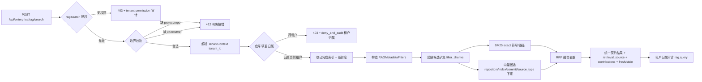

# E3-01 企业级 RAG 强过滤 + Hybrid Retrieval 基线

> 阶段：E3（企业级 RAG）
> 前置：E1-01 多租户/RBAC、E2-01 审批治理、团队版 RAG（源码 RAG + hybrid 检索）
> 相关设计：`docs/enterprise/04-enterprise-rag-design.md`、`docs/enterprise/01-enterprise-prd.md §9`

## 1. 功能目标与范围

企业模式下新增强制的检索边界与 Hybrid 检索基线：服务端把租户/项目/仓库/版本边界收拢为**候选生成阶段即受限**的
MetadataFilters，在受限子集上并行 BM25 + 向量召回，RRF 融合、按 chunk 去重，并输出**统一结果契约**
（含 `retrieval_source` 与每路贡献、fresh/stale 标记）。tenant 只来自服务端 `TenantContext`，
不信任请求体/URL/Header 里伪造的 tenant_id；跨租户/无界查询返回明确错误并写入租户归属审计。

**范围内**
- 企业 RAG 查询边界强制（project/repository/commit 或 ref 必填，缺边界不放行全库检索）。
- 企业检索授权 `rag:search`：tenant owner、tenant admin、security admin、project owner、developer、reviewer 可检索；
  auditor 默认拒绝代码检索（403 + 租户权限拒绝审计）。
- 统一 `RAGMetadataFilters`（tenant/project/repository/commit/ref/source_type/index），BM25 与向量候选双向受限。
- 向量候选查询直接下推 repository/index/commit/source_type，受限 `scoped_ids` 仍作为第二道硬交集。
- 企业严格过滤无法被向量后端接受时，只能显式降级到当前受限子集的关键词检索，禁止改为无过滤全集查询。
- BM25（精确符号/路径/错误码/配置 key）与向量双路召回 + RRF 融合 + chunk 去重 + 统一候选结构。
- 逐结果 `retrieval_source = vector / bm25 / hybrid`，hybrid 带 `contributions`（BM25/向量各自贡献）。
- fresh/stale 标记与过期提示（企业模式默认不静默用明显过期索引）。
- `vector_top_k / bm25_top_k / final_top_k` 集中在后端配置层（`runtime_config`）。
- 租户隔离：跨租户仓库/项目查询 403 + 审计；团队版 RAG 旧链路保持原样。

**范围外**（本轮不宣称完成）
- Query Rewrite、Cross-Encoder/LLM Rerank、多 Query 扩展、离线评测集 Recall/MRR/NDCG：未实现/未验证，不写成已完成。
- 前端检索页面与检索控制台：本轮为后端检索能力，**暂无页面截图**。

## 2. 主链路（Mermaid）



## 3. 关键代码说明

- `service.enterprise_rag_search`：项目/仓库/版本边界强制；用 `TenantContext.tenant_id` 校验仓库与项目归属，
  跨租户 `deny_and_audit` + 403；取已完成索引（按目标 commit 或 latest），过期索引标 `stale` + 提示重建；
  调用 hybrid 检索并写租户归属审计 `rag.query`（不含敏感信息）。
- `filters.build_filters / filter_chunks / to_llamaindex_filters`：构造统一过滤集；`filter_chunks` 在候选生成阶段对
  repository/id/commit/source_type 交集硬过滤，BM25 与向量都在这份子集里召回；向量腿还会把
  repository/index/commit/source_type 转成 LlamaIndex 过滤器下推给 Milvus，不做“先全库再看起来过滤”。
- `hybrid.enterprise_hybrid_retrieve`：受限子集并行 `retrieve_bm25`（真实 BM25，符号/路径双重加权）与
  `_query_vector_results`（向量腿，Milvus 不可用按团队链显式降级关键词）；按 hit 结果判定
  `retrieval_source=vector/bm25/hybrid`，写 `contributions`，按 chunk 去重、RRF 排序取 `final_top_k`。
- `routes.rag_search / tenancy.permissions`：路由在进入查询服务前执行 `require_tenant_permission(ctx, "rag:search")`；
  auditor 没有该权限，即使其具备 `audit:view` 也不能读取代码检索结果。
- `llamaindex_backend._query_vector_results`：企业严格过滤失败时拒绝无过滤向量回退；允许 mock fallback 时仅对
  已受限 `scoped_chunks` 运行关键词检索。新节点保存 `source_type` 元数据，旧索引需重建才能由向量库侧使用该维度。
- 配置：`runtime_config.RuntimeSettings` 新增 `RAG_VECTOR_TOP_K=20 / RAG_BM25_TOP_K=10 / RAG_FINAL_TOP_K=8`
  （集中在后端配置层，前端不写死）。

## 4. 源码位置

| 职责 | 文件 |
| --- | --- |
| 统一契约/输入 | `backend/app/enterprise_rag/models.py` |
| 过滤构造与应用 | `backend/app/enterprise_rag/filters.py` |
| Hybrid + RRF + 去重 | `backend/app/enterprise_rag/hybrid.py` |
| 查询服务/边界/审计 | `backend/app/enterprise_rag/service.py` |
| 路由挂载 | `backend/app/enterprise_rag/routes.py`、`backend/app/main.py`（include_router） |
| 企业检索权限 | `backend/app/tenancy/permissions.py` |
| 阶段候选数配置 | `backend/app/core/runtime_config.py` |
| 复用：BM25 / 向量 / 降级 | `backend/app/retrieval/bm25_backend.py`、`retrieval/llamaindex_backend.py` |
| 测试 | `backend/tests/test_enterprise_e3_rag.py` |

## 5. 接口契约

`POST /api/enterprise/rag/search`

请求体（tenant_id 不可传；传了也被忽略）：
```json
{ "query": "...", "project_id": "...", "repository_id": "...",
  "commit_sha": "sha" | "ref": "main", "source_types": ["code"] }
```
响应 `data`：
```json
{ "results": [ { "chunk_id", "source_type", "file_path", "start_line", "end_line",
                 "repository_id", "index_id", "commit_sha", "retrieval_source",
                 "score", "fresh", "contributions": {"vector": bool, "bm25": bool},
                 "metadata": {} } ],
  "filters": { "tenant_id", "project_id", "repository_id", "commit_sha", "ref", "source_type", "index_id" },
  "target_commit_sha", "index_commit_sha", "fresh", "stale", "notice",
  "retrieval_mode": "hybrid", "counts": {"vector","bm25","hybrid"} }
```
错误：`422` 缺边界/缺版本；`403` 跨租户/仓库不属于项目（含审计）；`404` 仓库/项目不存在；`409` 无可用索引。

## 6. 联调注意点

1. 必须先登录并取服务端 `tenant-context`，并具备 `rag:search`；`tenant_id` 一律来自服务端，请求体伪造无效（有测试佐证）。
2. 跨租户需先 `POST /api/enterprise/tenant-context/switch`；企业 RAG 会据服务端租户校验仓库/项目归属。
3. 目标仓库需有 `COMPLETED` 索引；无索引返回 409，缺 commit/ref 返回 422（不放行全库检索）。
4. 精确符号/路径命中依赖 `source_type` 与候选子集；结果 `retrieval_source` 可用于核实是 vector/bm25/hybrid 命中。
5. 向量腿单测用桩验证过滤对象和受限子集；真实 Milvus 检索能力由既有团队 RAG 链验证。携带
   `source_types` 查询前，应确保目标索引由包含 `source_type` metadata 的当前版本重建。

## 7. 真实测试证据（本条全部实跑）

- `pytest tests/test_enterprise_e3_rag.py -q` → **11 passed**
  （缺 project/repo 拒绝、缺 commit/ref 拒绝、伪造 tenant 无效、跨租户 403+租户审计、过滤同时作用 BM25/向量、
  BM25 精确符号在向量缺失时召回、RRF 融合/去重/hybrid 来源、stale 标记、团队 RAG 链可读、
  auditor 检索拒绝、向量候选收到 commit/source_type 下推过滤）
- 本轮安全回归：`pytest tests/test_enterprise_e3_rag.py tests/test_rag_retrieval_quality.py
  tests/test_enterprise_e1_tenancy.py tests/test_enterprise_e2_governance.py
  tests/test_enterprise_e2_hardening.py -q` → **80 passed**。
- 本轮后端全量：`pytest -q` → **612 passed, 24 skipped, 4 warnings**。warnings 为既有 Starlette
  `HTTP_422_UNPROCESSABLE_ENTITY` 与 TestClient cookie deprecation；无测试失败。此前 E3-01 基线记录
  `618 passed, 16 skipped` 为当时环境证据，不替代本轮实际结果。
- RAG + E1/E2 隔离：`pytest tests/test_rag_retrieval_quality.py tests/test_rag_persistence.py
  tests/test_dev008_rag_index.py tests/test_rag_parse_chain.py tests/test_rag_milvus_realtime.py
  tests/test_enterprise_e1_tenancy.py tests/test_enterprise_e2_governance.py tests/test_enterprise_e2_hardening.py
  tests/test_enterprise_e3_rag.py -q` → **117 passed, 5 skipped**
- 后端全量 `pytest -q` → **618 passed, 16 skipped**（团队版 RAG/fresh=true/source=hybrid 语义未退化）

## 8. 已知限制与残余风险

- 本轮为企业 RAG 检索基线，**无前端页面**，暂无页面截图（不伪造）。
- Query Rewrite、Rerank、离线评测集（Recall/MRR/NDCG）未实现，不写成已完成。
- 真实 Milvus 下向量候选的端到端检索与多副本并发未在本轮云端实测（沿用既有团队 RAG Milvus 链路）。
- 旧向量索引未携带 `source_type` metadata；仅在请求指定 `source_types` 时需要按当前节点结构重建索引，
  以启用向量库侧 source type 过滤。
- 企业端点查询审计只含计数/边界，不含敏感信息；如需更细观测请后续扩展。
