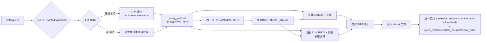

# E3-02 Query Rewrite + 多路 Query Expansion

> 阶段：E3（企业级 RAG）
> 前置：E3-01（`docs/project-development/101-enterprise-e3-01-rag-hybrid-retrieval.md`）
> 相关设计：`docs/enterprise/04-enterprise-rag-design.md`、`docs/enterprise/01-enterprise-prd.md §9`

## 1. 功能目标与范围

在不放宽 E3-01 的 tenant/project/repository/version 边界、`rag:search` 权限、MetadataFilters、BM25+向量、
RRF、fresh/stale 语义的前提下，为企业在检索前增加安全的 Query Rewrite 与多路 Query Expansion，
提升函数名/类名/错误码/接口路径/文件路径/点分配置项的召回能力。

**范围内**
- 原始 query 始终保留在 `query_variants[0]`。
- 复用 `app/retrieval/query_expansion.expand_query`（LLM 优先，模型不可用/超时/非法输出自动确定性回退），
  不再造一套不兼容改写逻辑。
- 确定性技术术语扩展：函数名/类名、错误码（`ERR_401`）、接口路径（`/api/orders/{id}`）、
  文件路径（`backend/app/main.py`）、点分配置项（`payment.callback.retry`）、下划线符号。
- 限制最大变体数、单条长度、总字符数；去重、清理空串，输出稳定可复现。
- 每个 query variant 复用**同一份** enterprise `RAGMetadataFilters`；扩展 query 不绕过
  `rag:search` / tenant / project / repo / commit·ref / source_type / index 过滤。
  `security_admin` 可执行企业检索，`auditor` 仍默认只能审计只读、不能检索代码。
- 多路 RRF：逐变体并行 BM25 + 向量，原 query 权重最高、扩展按 `variant_decay` 衰减，全局按 chunk 去重。
- 响应新增可解释字段：`query_variants / variant_count / retrieval_trace`（不含敏感代码）。
- 用户 query 一律视为数据，不当作指令执行（复用 query_expansion 的 anti-prompt-injection 系统提示）。

**范围外**（不宣称完成）
- Cross-Encoder / LLM Rerank：未实现。
- 离线评测集 Recall@K / MRR / NDCG：未实现。
- 本轮为后端检索能力，**无前端页面/云端截图**（不伪造）。

## 2. 主链路（Mermaid）



## 3. 关键代码说明

- `terms.build_query_variants`：`[原始, …]` 恒在原位；先 `expand_query`（LLM 优先、失败确定性回退），
  再叠加 `technical_variants`（点分/路径/下划线/驼峰桥接），去重、数量/单条长度/总字符受限。
  禁用时退化为单条原始 query。
- `terms.technical_variants`：抽取代码术语并派生点分/下划线/去皮变体，桥接 `payment.callback.retry`
  与符号 `payment_callback_retry`（团队 BM25 tokenizer 不改，避免团队检索回归）。
- `hybrid.enterprise_hybrid_retrieve`：新增 `query_variants/variant_decay/trace_out`；每个变体复用同
  一份 `filters`（`filter_chunks` 子集 + `metadata_filters=to_llamaindex_filters(filters)` + `strict_metadata_filters=True`），
  BM25 与向量的候选都受限；加权 RRF（原 query 权重 1.0、扩展按 `0.85**i` 衰减）、全局去重；
  `trace_out.per_variant` 记录每变体 vector/bm25 候选数。
- `service.enterprise_rag_search`：依后端配置构造变体，传入 hybrid 并读取 trace；返回
  `query_variants / variant_count / retrieval_trace`。每个变体不新增任何 bypass（仓库/项目归属、
  `rag:search` 在 routes 前置校验一次性完成，扩展只在受限子集内召回）。
- `tenancy.permissions`：`rag:search` 明确授予 tenant owner、tenant admin、security admin、project owner、
  developer、reviewer；auditor 不授予。新增回归用例保证 security admin 可搜、auditor 仍 403。

## 4. 源码位置

| 职责 | 文件 |
| --- | --- |
| 变体构造/技术术语 | `backend/app/enterprise_rag/terms.py` |
| 多路 Hybrid + RRF + trace | `backend/app/enterprise_rag/hybrid.py` |
| 查询服务接线/响应字段 | `backend/app/enterprise_rag/service.py` |
| 检索权限（前置） | `backend/app/enterprise_rag/routes.py`、`app/tenancy/permissions.py` |
| 复用改写/过滤器 | `backend/app/retrieval/query_expansion.py`、`enterprise_rag/filters.py` |
| 配置 | `backend/app/core/runtime_config.py` |
| 测试 | `backend/tests/test_enterprise_e3_02_rig.py` |

## 5. 接口契约（增量）

`POST /api/enterprise/rag/search`（请求体不变；tenant_id 仍不可传）
响应 `data` 新增：
```json
{ "query_variants": ["原始 query", "变体2", "…"],
  "variant_count": 3,
  "retrieval_trace": [ { "variant_idx": 0, "vector_candidates": 5, "bm25_candidates": 3 },
                       { "variant_idx": 1, "vector_candidates": 2, "bm25_candidates": 1 } ],
  "results": [ … E3-01 统一契约不变 … ],
  "filters": { … 同一份过滤条件 … },
  "fresh", "stale", "notice", "retrieval_mode", "counts" }
```

`retrieval_trace` 仅记变体序号 + 两路候选数，**不回显敏感代码/查询原文**。

## 6. 配置

后端 `runtime_config`（安全默认，前端不写死）：

| 环境变量 | 默认 | 说明 |
| --- | --- | --- |
| `RAG_QUERY_REWRITE_ENABLED` | `true` | 企业检索是否启用 Rewrite/Expansion |
| `RAG_QUERY_MAX_VARIANTS` | `3` | 最大变体数（1–8） |
| `RAG_QUERY_LLM` | `false` | 是否允许 LLM 改写（默认关，生产模型不可用稳定降级） |
| `RAG_QUERY_VARIANT_DECAY` | `0.85` | 扩展 query 相对原 query 的融合衰减 |

## 7. 联调注意点

1. 原始 query 恒在 `query_variants[0]`；多路召回按衰减融合，原 query 优先。
2. 扩展 query 不绕过任何边界：耗时/跨租户仍 403 + 租户审计；security admin 可检索；
   auditor（`audit:view`，无 `rag:search`）仍 403。
3. 目标仓库需有 `COMPLETED` 索引；缺 commit/ref 仍 422。
4. `RAG_QUERY_LLM=true` 时，模型不可用/超时/非法 JSON 会自动回退确定性扩展，不会使检索失败。
5. 调试来源用响应里的 `retrieval_source / contributions / retrieval_trace`。

## 8. 真实测试证据（全部实跑）

- `pytest tests/test_enterprise_e3_02_rig.py -q` → **10 passed**
  （原 query 首位、确定性技术术语扩展含点分/下划线/错误码/路径、LLM 不可用与非法 JSON 稳定回退、
  变体去重与数量/长度限制、响应暴露与 trace、security admin 可检索且 auditor 仍 403、
  BM25 命中 `ERR_401` 与
  `payment.callback.retry`→`payment_callback_retry` 桥接、多 query RRF 原 query 优先 + 全局去重、
  stale/跨租户不变）
- E3-01+E3-02+RAG+E1+E2 定向回归：`pytest tests/test_enterprise_e3_rag.py tests/test_enterprise_e3_02_rig.py
  tests/test_rag_retrieval_quality.py tests/test_enterprise_e1_tenancy.py tests/test_enterprise_e2_governance.py
  tests/test_enterprise_e2_hardening.py -q` → **90 passed**
- 后端全量 `pytest -q` → **622 passed, 24 skipped, 4 warnings**（本轮实跑；团队版 RAG/审批/隔离无回归）
- `git diff --check` → 无输出

## 9. 已知限制与残余风险

- 本轮为后端检索能力，**无前端页面/云端截图**（不伪造）。
- Cross-Encoder / LLM Rerank、离线评测集（Recall/MRR/NDCG）未实现，不写成已完成。
- 真实 Milvus 下多路向量候选端到端、云端多副本并发沿用既有团队 RAG 链路，未在本轮云端实测。
- 扩展 query 的 BM25 匹配依赖现有 tokenize 与术语变体桥接；极端符号仍可能召回有限，属后续可观测优化。
