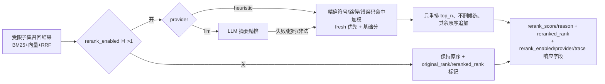

# E3-03 企业 RAG Rerank 精排基线

> 阶段：E3（企业级 RAG）
> 前置：E3-01（强过滤 + Hybrid）、E3-02（Query Rewrite + 多路 Expansion）
> 相关设计：`docs/enterprise/04-enterprise-rag-design.md`、`docs/enterprise/01-enterprise-prd.md §9`

## 1. 功能目标与范围

对 E3-01/E3-02 的 hybrid 候选做**精排基线**：只重排已有候选、不生成新上下文、不改变检索边界，提升
精确符号/路径/错误码/函数名命中的排序精度。默认 deterministic heuristic；可预留 LLM provider，
模型不可用/超时/非法输出时稳定回退 heuristic，不让检索失败。

**范围内**
- 默认 heuristic rerank：精确符号命中、文件/API 路径命中、错误码/函数名命中优先；`fresh` 优先；
  以 hybrid 原始分数为基础分；只对 top N 重排、不删除候选（其余保持原顺序）。
- 可配置 `RAG_RERANK_ENABLED / PROVIDER / TOP_N / TIMEOUT_SECONDS`（安全默认：关 / heuristic / 8 / 5）。
- LLM provider 预留接口，失败/不可用回退 heuristic；企业 LLM 精排只发 file/symbol 摘要、不发代码正文。
- 响应新增可解释字段：`rerank_enabled / rerank_provider / rerank_trace`；
  每个结果 `original_rank / reranked_rank / rerank_score / rerank_reason`。
- 边界安全：rerank 只发生在受限子集召回后，不改变 tenant/project/repo/commit·ref/source_type/index 过滤、
  不改变 `rag:search` 权限（auditor 仍拒绝）。

**范围外**（不宣称完成）
- 离线评测集 Recall@K / MRR / NDCG：未实现。
- 前端检索页面 / 云端真实 Milvus 链路：未验证。
- Cross-Encoder 精排模型：未实现；provider=llm 为摘要级 LLM 排序的可选路径。

## 2. 主链路（Mermaid）



## 3. 关键代码说明

- `reranker.enterprise_rerank(results, *, query_text, enabled, provider, top_n, timeout_seconds)`：
  先写 `original_rank`；`enabled=False` 或候选 <2 时保持原序并标记；否则 heuristic/LLM 重排。
  任何 provider 失败都以 heuristic 兜底（`provider_used` 反映实际生效路径）。
- `reranker._heuristic_score`：基础分 = hybrid score；符号命中 +0.40、路径命中 +0.30、`fresh` +0.10；
  写回 `rerank_score` 与 `rerank_reason`（形如 `base:0.32+符号:payment_callback_retry+fresh`）。
- `reranker._heuristic_rerank`：按 rerank_score 降序只排前 `top_n`，其余按原序追加（不删除候选）；
  trace 只含 `chunk_id + reason` 摘要，不含代码正文/凭据。
- `reranker._llm_rerank`：可选 LLM 摘要精排（仅 file/symbol），缺模型/超时/非法 JSON → None → heuristic；
  只重排已有 chunk_id、不编造；`RAG_RERANK_TIMEOUT_SECONDS` 会透传到 DeepSeek 客户端设置，避免配置只停留在字段层。
- 权重集中定义在 `_BOOST_*` 常量，前端/路由不散落。
- `service.enterprise_rag_search`：hybrid 之后调用 rerank 并回读 `rerank_trace`；响应加
  `rerank_enabled / rerank_provider / rerank_trace`。

## 4. 源码位置

| 职责 | 文件 |
| --- | --- |
| 企业 Rerank（heuristic/LLM/回退） | `backend/app/enterprise_rag/reranker.py` |
| 服务接线 + 响应字段 | `backend/app/enterprise_rag/service.py` |
| 可解释字段 | `backend/app/enterprise_rag/models.py` |
| 检索权限（前置） | `backend/app/enterprise_rag/routes.py`、`app/tenancy/permissions.py` |
| 配置 | `backend/app/core/runtime_config.py` |
| 测试 | `backend/tests/test_enterprise_e3_03_rerank.py` |

## 5. 接口契约（增量）

`POST /api/enterprise/rag/search`（请求体不变）响应新增：
```json
{ "rerank_enabled": true, "rerank_provider": "heuristic",
  "rerank_trace": { "enabled": true, "provider": "heuristic", "reranked": true,
                    "top_n": 8, "reasons": [{"chunk_id":"..","reason":".."}] },
  "results": [ { "chunk_id":"..", ..., "original_rank":3, "reranked_rank":1,
                 "rerank_score":0.72, "rerank_reason":"base:0.3+符号:..+fresh" }, ... ] }
```
`rerank_trace / rerank_reason` 仅记摘要，不含代码正文、token 或敏感配置。

## 6. 配置

| 环境变量 | 默认 | 说明 |
| --- | --- | --- |
| `RAG_RERANK_ENABLED` | `false` | 是否启用企业 Rerank（安全默认关） |
| `RAG_RERANK_PROVIDER` | `heuristic` | `heuristic` / `llm` |
| `RAG_RERANK_TOP_N` | `8` | 只重排前 N 个候选 |
| `RAG_RERANK_TIMEOUT_SECONDS` | `5` | LLM 精排超时（heuristic 不使用） |

## 7. 联调注意点

1. 缺省关闭；开启后只重排 top_n、不删除候选，其余按原序。
2. 任何 rerank provider 失败都不让检索失败：回退 heuristic，返回状态不变。
3. rerank 不改变边界：跨租户/无版本仍 422/403；auditor 仍 403；security_admin 可检索。
4. 调试用 `retrieval_source / contributions / rerank_reason / rerank_trace`。

## 8. 真实测试证据（全部实跑）

- `pytest tests/test_enterprise_e3_03_rerank.py -q` → **9 passed**
  （heuristic 精确符号命中升到首位、fresh 优先、disabled 保持原序、LLM 不可用回退 heuristic、
  LLM timeout 配置真实透传、trace 不含代码正文/凭据、auditor 403、security_admin 200 且带 rerank 字段、
  rerank 不改变过滤边界）
- E3-01+E3-02+E3-03+RAG+E1+E2+E2-hardening 定向回归 → **99 passed**
- 后端全量 `pytest -q` → **631 passed, 24 skipped, 4 warnings**（本轮实跑；团队版 RAG/审批/隔离无回归）
- `git diff --check` → 无输出

## 9. 已知限制与残余风险

- **离线评测集 Recall@K / MRR / NDCG 未实现**，不写成已完成。
- **前端检索页面 / 云端真实 Milvus 链路未验证**。
- provider=llm 为摘要级 LLM 排序（不发代码正文）；如需强精排可后续接 Cross-Encoder。
- 向量腿单测用桩确定；真实向量链由团队 RAG 全量回归间接覆盖。
