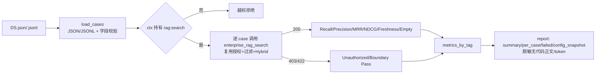

# E3-04 企业 RAG 离线评测基线

> 阶段：E3（企业级 RAG）
> 前置：E3-01（强过滤 + Hybrid）、E3-02（Query Rewrite/Expansion）、E3-03（Rerank）
> 相关设计：`docs/enterprise/04-enterprise-rag-design.md`、`docs/enterprise/01-enterprise-prd.md §9`

## 1. 功能目标与范围

提供可重复、可脱敏、不依赖真实外部模型/云服务的企业 RAG 离线评测能力，输出 Recall@K / Precision@K /
MRR / NDCG@K / Freshness Rate / Empty Result Rate / Unauthorized Case Pass Rate。**复用企业 RAG 搜索服务**
（授权 + MetadataFilters + Hybrid 链路），不新写一条绕过权限/过滤的检索。

**范围内**
- 评估集结构：query / project_id / repository_id / commit_sha|ref / expected_chunk_ids /
  expected_file_paths / source_types / tags / difficulty / expected_status（200/403/422）。
- JSON / JSONL 读取，未知字段/缺版本/非法状态给出清晰错误。
- 指标：Recall@K、Precision@K、MRR、NDCG@K、Freshness Rate、Empty Result Rate、Unauthorized Pass Rate。
- 输出：summary / per_case_results / failed_cases / metrics_by_tag / config_snapshot。
- dry-run / 内存态可测（默认不连真实 Milvus），可复现。
- 评测入口要求 ctx 持有 `rag:search`（复用 `require_tenant_permission`），否则越权拒绝。
- 报告不含代码正文 / token / cookie / password / JWT / 恢复码。

**范围外**（不宣称完成）
- 生产真实 Milvus 端到端、多副本并发的云端评测：未验证。
- 前端评测控制台 / 模型级精排（Cross-Encoder）指标对比：未实现。
- 不再新增检索链路：评测仅复用它。

## 2. 主链路（Mermaid）



## 3. 关键代码说明

- `evaluation.load_cases`：JSON(list/cases) 或 JSONL；白名单字段校验、`expected_status∈{200,403,422}`、
  `expected_status=200` 必须带版本边界；错误含精确下标与原因。
- 纯指标：`recall_at_k`（命中在 ≤K 内 / 目标数）、`precision_at_k`（≤K 命中 / K）、`mrr`（首个命中的倒数秩）、
  `ndcg_at_k`（DCG/IDCG）。均为确定性纯函数，可单测。
- `evaluation.evaluate_case`：构造 `EnterpriseRagSearchPayload` 调 `enterprise_rag_search`（同一授权+过滤链），
  捕获 HTTPException 记录 403/422 实际状态；按 `expected_chunk_ids/expected_file_paths` 判定命中并计算指标。
- `evaluation.evaluate_dataset`：先 `require_tenant_permission(ctx, RAG_SEARCH)`；聚合 summary、metrics_by_tag、
  failed_cases（`_non_sensitive` 仅保留元数据+指标）。报告全文不含代码正文/token/凭据。
- CLI `scripts/evaluate_enterprise_rag.py`：加载数据集、以指定激活成员（默认 user_admin）构建上下文、评测并
  `-o` 写报告。

## 4. 源码位置

| 职责 | 文件 |
| --- | --- |
| 评测集/指标/复用搜索评测 | `backend/app/enterprise_rag/evaluation.py` |
| CLI | `backend/scripts/evaluate_enterprise_rag.py` |
| 复用搜索服务/边界/权限 | `backend/app/enterprise_rag/service.py`、`routes.py`、`app/tenancy/permissions.py` |
| 测试 | `backend/tests/test_enterprise_e3_04_evaluation.py` |

## 5. 评测集结构（示例）

```json
{
  "query": "handle_payment_callback 在哪个文件？",
  "project_id": "proj_payment",
  "repository_id": "repo_payment_service",
  "commit_sha": "<sha>",
  "expected_chunk_ids": ["<chunk>"],
  "expected_file_paths": ["src/refund.py"],
  "source_types": ["code"],
  "tags": ["symbol"],
  "difficulty": "medium",
  "expected_status": 200
}
```
无答案/越权样本用 `expected_status=403`（跨租户仓库）或 `422`（缺版本边界）。

## 6. 报告输出

```json
{ "summary": { "total_cases","passed_cases","success_cases",
            "recall_at_k","precision_at_k","mrr","ndcg_at_k",
            "freshness_rate","empty_result_rate","unauthorized_pass_rate" },
  "per_case_results": [ { "case_index","query","project_id","repository_id","version","tags",
            "expected_status","actual_status","status_passed","empty","fresh","passed",
            "recall_at_k","precision_at_k","mrr","ndcg_at_k","matched" } ],
  "failed_cases": [ ... ],
  "metrics_by_tag": { "<tag>": { "count","recall_at_k","mrr","ndcg_at_k" } },
  "config_snapshot": { "top_k","retrieval_mode","dry_run_in_memory" } }
```

## 7. 联调注意点

1. 评测必须由持有 `rag:search` 的激活成员上下文执行（CLI 默认 `user_admin` = tenant owner）。
2. `expected_status=200` 样本必须带 commit_sha/ref；403/422 样本用于验证越权/边界拒绝确实生效。
3. 默认 dry-run/内存态不连真实 Milvus；需云端真实检索时按部署配置 `USE_MILVUS=true + MILVUS_URI`。
4. 报告与 per_case 不落代码正文/敏感字段；如需落地到审计需额外脱敏。
5. 评测只复用它搜索，不新增绕过过滤的检索。

## 8. 真实测试证据（全部实跑）

- `pytest tests/test_enterprise_e3_04_evaluation.py -q` → **11 passed**
  （Recall@K/MRR/NDCG@K/Precision@K 纯函数正确、JSONL 读取、缺失/坏 JSON/未知字段/缺版本报错、
  端到端复用搜索的命中+空结果+Empty Rate、freshness、403 边界 pass、multi-tag、报告无敏感字段）
- E3-01..E3-04+RAG+E1+E2+E2-hardening 定向回归 → **110 passed**
- 后端全量 `pytest -q` → **650 passed, 16 skipped**
- `git diff --check` → 无输出

## 9. 已知限制与残余风险

- **云端真实 Milvus 端到端 / 多副本并发：未验证**（本轮 dry-run/内存态；真实向量链由团队 RAG 全量间接覆盖）。
- **前端评测控制台、模型级精排（Cross-Encoder）指标对比：未实现**。
- 指标按 K=final_top_k 截断；不同 K 口径以 config_snapshot 记录。
- 评测依赖 mock 向量腿以获得确定性；生产评测请以真实 Milvus 结果为准。

## 10. E3-04-HARDEN-01（收口 L1–L4，不是 E3-05）

本轮**延续 E3-04 基线**做小范围加固，非新阶段：

- L3 纵深防御：`evaluate_case` 内部也执行 `require_tenant_permission(ctx, RAG_SEARCH)`；即使绕过
  `evaluate_dataset` 直接调用也越权拒绝（auditor 403，有测试）。
- L1 真值去重：`expected_chunk_ids / expected_file_paths` 规范化去空串/空白（集合天然去重），
  重复项与空串不再放大 recall 分母；id 与 path 两类目标均可命中（有测试）。
- L2 passed 语义清晰：新增 `retrieval_passed`（200 样本是否至少命中一个预期证据）。
  `passed = status_passed AND (retrieval_passed OR expected!=200)`；`expected_status=200` 且空结果时
  `status_passed=true / retrieval_passed=false / passed=false`，不再被误认为“召回成功”（有测试）。
- L4 tag 维度精确率：`metrics_by_tag` 增加 `precision_at_k`，保持 recall/mrr/ndcg 不回归（有测试）。

指标/报告不变：报告仍脱敏无代码正文/token/凭据。

测试证据（实跑）：`pytest tests/test_enterprise_e3_04_evaluation.py -q` → **15 passed**；
E3+RAG+E1+E2 定向回归 → **114 passed**；后端全量 → **654 passed, 16 skipped**；`git diff --check` 无输出。

**仍未完成（明示，不写成已完成）**：真实生产评测集（≥50 条问题 + Recall/MRR 达标分数）、云端真实 Milvus
端到端/多副本并发、前端评测控制台、Cross-Encoder 指标对比。
