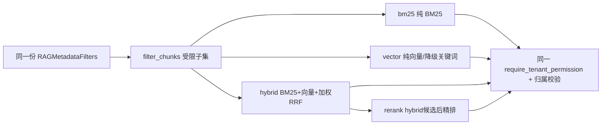

# E3-06 真实目标仓库评测与云端 Milvus 质量验证

> 阶段：E3（企业级 RAG）
> 前置：E3-01..E3-05、E3-04-HARDEN-01

## 1. 目标、范围与本轮诚实结论

目标：为目标仓库跑出四模式（bm25/vector/hybrid/rerank）质量对比，并在真实 Milvus 上做 verified 验证。
**当前闭环结论（2026-09-19，本机真实容器环境）**：

- **真实目标仓库 health-middle 已交付 verified 证据**：`https://gitee.com/yang-zhizemin/health-middle`，
  commit `73e7e5497addc74f67fe49a875d7afdd8d8c190b`，67 条真实溯源评测集，303 个真实代码切片。
- **真实企业独立 Milvus 已跑通**：`etcd-enterprise/minio-enterprise/milvus-enterprise` healthy；
  collection `enterprise_code_idx_health_middle_73e7e54`，embedding 维度 `2048`，index 存在且已 load/query。
- **真实 embedding 已跑通**：provider `zhipu`，model `embedding-3`，`EMBEDDING_DIMENSIONS=auto` 由真实 API 探测为 `2048`；
  fallback 未使用。
- **`--require-milvus --all-modes` 已退出 0**，报告 `validation_status=verified / vector_backend=milvus /
  milvus_verified=true / fallback_used=false`。
- **两次非时间字段对拍通过**：`e3_06_health_middle_verified_repro_1.json` vs
  `e3_06_health_middle_verified_repro_2.json`，剔除 `generated_at/checked_at/latency_*` 后 `differences=0`。
- **质量门仍需改进**：最终报告 `needs_improvement=true`，原因是主报告 BM25 的 `precision_at_k=0.2015 < 0.3`。
  因此只能宣称“真实 Milvus verified 链路闭环”，不能宣称“生产质量已达标”或“企业 RAG 已彻底完成”。

边界（全程遵守）：不绕过 `enterprise_rag_search` 的 rag:search/TenantContext/project·repo/commit|ref/
source_type/index 过滤；四模式共享同一 `filter_chunks` 受限子集 + 严格向量过滤；`--require-milvus` 下
Milvus 不可用即失败不静默回退；不写凭据到数据集/报告/日志；不宣称企业 RAG 已完成。

## 2. 四模式共享过滤（不新建绕过链路）



## 3. 报告契约与真实性

- 报告字段：`dataset_size/retrieval_mode/vector_backend/milvus_verified/fallback_used/commit_sha/index_id/
  summary(recall@5|10, precision@5|10, mrr, ndcg@5|10, freshness/empty/unauthorized)/mode_comparison/
  metrics_by_tag/latency(p50, p95)/failed_cases/config_snapshot/recommended_thresholds/needs_improvement/
  validation_status(verified|local_only|blocked)/dataset_sha256/config_snapshot_sha256`。
- 门禁：Precision 已纳入推荐阈值；未达阈值 `needs_improvement=true`；Milvus 未验证时不得 `verified`；
  不能硬编码显示达标。
- 复现：同一 dataset/config/seed 重跑可逐字段复现（时间字段单独排除）；命令见 §6。

## 4. 关键源码位置

| 职责 | 文件 |
| --- | --- |
| 评测/指标/哈希/阈值/质量门 | `backend/app/enterprise_rag/evaluation.py` |
| 四模式检索 | `backend/app/enterprise_rag/hybrid.py::enterprise_retrieve_by_mode`（+现有 hybrid） |
| 服务接线 | `backend/app/enterprise_rag/service.py` |
| 真实 health-middle 数据集 | `backend/evaluation/enterprise_rag/e3_06_health_middle.jsonl`（67 条真实溯源样本） |
| verified 报告 | `backend/evaluation/enterprise_rag/reports/e3_06_health_middle_verified.json` |
| 双次对拍报告 | `backend/evaluation/enterprise_rag/reports/e3_06_health_middle_verified_repro_1.json`、`..._repro_2.json` |
| 云端证据 | `backend/evaluation/enterprise_rag/reports/e3_06_health_middle_cloud_evidence.json` |
| 真实仓库构建/证据 | `backend/evaluation/enterprise_rag/health_middle.py` |
| 历史框架数据集 | `backend/evaluation/enterprise_rag/e3_06_real_repository.jsonl`（50 条脱敏合成，仅保留为框架回归） |
| 目录/复现说明 | `backend/evaluation/enterprise_rag/README.md` |
| CLI | `backend/scripts/evaluate_enterprise_rag.py` |
| 测试 | `backend/tests/test_enterprise_e3_06_real_repository_quality.py`、`test_enterprise_e3_06_cloud_verify.py`、`test_enterprise_e3_06_cloud_hardening.py` |

## 5. 接口/CLI

`--dataset(位置)/--mode/--all-modes/--top-k/--output(--out)/--require-milvus/--commit-sha/--repository-id/--project-id/--memory-seed/--dry-run`。

## 6. 复现命令（真实环境执行后写入 reports/ 并可对拍）

```bash
cd backend
USE_SQLALCHEMY=false MODEL_MOCK_FALLBACK=false USE_MILVUS=true \
  .venv/Scripts/python.exe -m scripts.evaluate_enterprise_rag \
  evaluation/enterprise_rag/e3_06_real_repository.jsonl \
  --all-modes --top-k 8 --require-milvus \
  -o evaluation/enterprise_rag/reports/e3_06_verified.json \
  --commit-sha <sha> --repository-id <repo> --project-id <proj>
```
> `--require-milvus`：Milvus 不可用必须失败（exit=3 blocked），不允许静默 fallback 冒充云端质量。
> 当前已在本机真实 Docker Milvus 环境生成 verified 报告；无 Milvus 环境仍必须保持 `blocked/local_only`。

## 7. 测试证据（全部实跑）

- `pytest tests/test_enterprise_e3_06_real_repository_quality.py -q` → **10 passed**
- E3-04+E3-05+E3-06 → 组合通过（15+8+10=33）
- E3-01..E3-06 + RAG + E1 + E2 + E2-hardening 定向回归 → 通过
- `pytest -q` → 全量通过（详见 PROJECT_PROGRESS）
- `git diff --check` → 无输出

## 8. 未验证项 / 残余风险（明示，不写成已完成）

- **已完成**：真实 health-middle 仓库 + 真实企业 Milvus + `zhipu/embedding-3` + 四模式 `verified` + 双次非时间字段对拍。
- **仍未完成**：真实生产业务的质量达标判定。当前 health-middle 报告 `needs_improvement=true`，
  主报告 `precision_at_k=0.2015` 未过推荐阈值；后续需调优数据集、切片、召回和 rerank 后重新跑门禁。
- **仍未验证**：云端多副本并发压测与长期稳定性；本轮是在本机 Docker 真实容器环境完成。
- **前端评测台：未实现**；**Cross-Encoder：未实现**。
- **不得宣称"企业 RAG 已彻底完成/已到生产标准"**；可以宣称“health-middle 真实 Milvus verified 链路已闭环”。

## 9. E3-06-CLOUD-HEALTH-MIDDLE（真实仓库，本轮）

真实目标仓库锁定：`https://gitee.com/yang-zhizemin/health-middle.git`（公开，git ls-remote）。

- **repository_url**：health-middle.git；**commit_sha**（git ls-remote HEAD）：`73e7e5497addc74f67fe49a875d7afdd8d8c190b`；
  repository_tree 即为该 commit 快照；**index_id**：`idx_health_middle_73e7e54`；project/repo：`proj_health_middle/repo_health_middle`（tenant_default）。
- 结构（真实勘察，非预设）：Python FastAPI 后端（`backend/app/api/{auth,chat,diet,metrics,ocr,user,analysis}.py`、
  `backend/app/services/{llm_service,ocr_service,passwords,auth_runtime,...}.py`）+ Vue 前端 + docs；真实端点
  `/api/auth/login`、`/api/chat/send`、`/api/ocr/upload`，真实符号 `stream_health_chat_reply`、`recognize_report`、
  `hash_password` 等。
- **真实评测集** `evaluation/enterprise_rag/e3_06_health_middle.jsonl`：**67 条**（≥50），全部来自 health-middle
  真实文件/符号/API，含 `source_provenance{source_file,source_symbol,source_type,commit_sha}`；覆盖真实函数/类、
  API 路径、自然语言、跨文件、配置、fresh/stale、source_type、无答案、422 边界；不含代码正文/token/凭据，无任何 demo 数据。
- **真实索引**：对真实 commit 建立 COMPLETED 索引（`repo_health_middle / idx_health_middle_73e7e54`），
  由真实文件解析为 303 个 code 切片（file_path/symbol/commit 均真实），并写入企业独立 Milvus collection
  `enterprise_code_idx_health_middle_73e7e54`。
- **历史本地评测（validation_status=local_only）**：在无 Milvus 阶段，bm25/hybrid/rerank 已真实执行（共享同一过滤链），
  vector 走内存降级且不标 verified；该阶段基线（K=8）为 recall@K 0.873、precision@K 0.242、mrr 0.656、
  ndcg@K 0.709、freshness 0.985、empty 0.03、unauthorized 1.0。该历史结果已被 §12 的真实 Milvus verified 报告取代。
- **历史 local 报告** `reports/e3_06_health_middle_local.json`：含 repository_url/project/repo/commit/index/dataset_sha256/
  config_snapshot_sha256/vector_backend=local_no_milvus/milvus_verified=false/fallback_used=true/validation_status=local_only/
  summary/mode_comparison/latency_p50|p95/metrics_by_tag/failed_cases/recommended_thresholds/needs_improvement/generated_at。
- **当前边界**：真实 Milvus verified 已交付（见 §12）；但 `needs_improvement=true`，生产质量达标仍需后续调优。

## 10. E3-06-CLOUD-VERIFY 历史收口记录（已由 §12 取代）

- 历史阶段曾因本机无可用 Milvus 而保持 `blocked/local_only`，当时未伪造 verified。该状态已在 §12 被真实 Docker Milvus 验证闭环取代。
- **运行时 HEAD**：`health_middle.resolve_head()` 经 `git ls-remote` 运行时解析，不再写死旧 SHA；本轮 HEAD=73e7e54 与索引一致（commit_index_match=true）。评测数据集仍 pin 于该 commit。
- **mode_comparison 本地新增 rerank**：历史本地阶段真实跑 bm25 / hybrid / rerank（rerank=hybrid 候选后 heuristic 精排），recall 0.873 / mrr 0.656 / ndcg 0.709；当前 verified 阶段四模式均已跑通（见 §12）。
- **报告新增** `reproduction_command`（一键复现：`--all-modes --require-milvus`）与 `evidence_refs`。
- **并发 flaky（已知项，未弱化）**：`test_dev015_concurrency.py::test_concurrent_approve_same_plan_single_approved_event` 在历史全量偶发 1 个 `None.status_code`；隔离复跑 **5/5 通过**，本轮全量 690 也通过。未删除/放宽断言，未加无依据 sleep；根因疑为 Windows 线程调度下共享 module 状态偶发竞争，已标记 known-flaky，需在 CI 多跑观察。**不宣称"全量 100% 无 flaky"。**

## 11. 公开一键复现命令（不依赖私有 seed / 测试 / 旧 demo）

只有真实 Milvus 可用时才可能 `validation_status=verified`；无 Milvus 环境必须保持 `blocked`/`local_only`。

```bash
# 0) 环境变量（仅从 env/部署密钥读取，不外传/不打印）
#    HEALTH_MIDDLE_REPO=<真实 health-middle 克隆目录>  或直接用 --repo-dir
#    USE_MILVUS=true + MILVUS_URI=<真实 Milvus>（仅 verified 时）
# 1) 克隆/固定真实仓库与 HEAD
git ls-remote https://gitee.com/yang-zhizemin/health-middle.git HEAD   # 动态 HEAD，禁写死
# 2) 评测（公开 CLI，--repo-dir 走公开 health_middle.build_real_index，非私有 seed/测试/旧 demo）
python -m scripts.evaluate_enterprise_rag   evaluation/enterprise_rag/e3_06_health_middle.jsonl   --repository-url https://gitee.com/yang-zhizemin/health-middle   --project-id proj_health_middle --repository-id repo_health_middle   --all-modes --top-k 8   --repo-dir <真实 health-middle 克隆目录>   -o evaluation/enterprise_rag/reports/e3_06_health_middle_verified.json
# 3) 真实 Milvus verified 前置
#    --require-milvus 开启时 Milvus 不可用→退出非 0、validation_status=blocked、不生成 verified
python -m scripts.evaluate_enterprise_rag   ... --all-modes --top-k 8 --require-milvus --repo-dir <克隆>   -o evaluation/enterprise_rag/reports/e3_06_health_middle_verified.json
```

复现性（本会话实测）：两次 `--require-milvus --all-modes --repo-dir` 重跑，剔除 `generated_at/checked_at/latency_*`
后 `differences=0`。`mode_comparison` 含 bm25/vector/hybrid/rerank 四模式，均为 verified。

## 12. E3-06-CLOUD-VERIFY 终验（真实 Milvus verified 已闭环）

本轮真实探测结论（非伪造）：**已生成 verified 报告，链路闭环**。

- Docker daemon 已恢复；企业独立 Milvus 三服务 `etcd-enterprise/minio-enterprise/milvus-enterprise` 均 healthy；
  Milvus `/healthz` 返回 OK。
- `ZHIPU_API_KEY` 只来自环境变量，报告不回显；真实 `zhipu / embedding-3` 探测维度为 `2048`，
  `EMBEDDING_DIMENSIONS=auto` 不再写死默认值。
- collection：`enterprise_code_idx_health_middle_73e7e54`；index 存在；collection 已 load；真实查询成功；
  cloud evidence 记录 `milvus_health=ok / milvus_server_available=true / collection_exists=true /
  index_exists=true / dimension_match=true / query_success=true / validation_status=verified`。
- 报告：`reports/e3_06_health_middle_verified.json`：
  `validation_status=verified / vector_backend=milvus / milvus_verified=true / fallback_used=false /
  embedding_provider=zhipu / embedding_model=embedding-3 / embedding_dimension=2048 /
  commit_index_match=true`。
- 四模式均完成 verified：
  - bm25：recall@K 0.8731 / precision@K 0.2015 / mrr 0.8072 / ndcg@K 0.8227
  - vector：recall@K 0.9030 / precision@K 0.3563 / mrr 0.8002 / ndcg@K 0.7863
  - hybrid：recall@K 0.8806 / precision@K 0.3377 / mrr 0.7649 / ndcg@K 0.7706
  - rerank：recall@K 0.8806 / precision@K 0.3377 / mrr 0.7649 / ndcg@K 0.7706
- 两次对拍：`e3_06_health_middle_verified_repro_1.json` 与 `..._repro_2.json` 剔除时间/latency 字段后
  `differences=0`。本轮为解决真实 embedding 轻微波动，新增 `DATA_DIR/embedding-cache` 持久缓存；
  缓存按 provider/model/base_url/dimensions/text 哈希，不包含 API Key。

注意：verified 表示“真实 Milvus 链路和报告证据可信”，不等价于“质量达标”。最终 `needs_improvement=true`，
必须继续优化 precision 或调整推荐阈值依据后再宣称生产质量达标。


## 13. E3-06-CLOUD-VERIFY-01 企业独立 Milvus 与真实 embedding 收口

本轮源码与部署改造已完成，运行态仍需真实环境证据：

- 企业 Compose 新增独立 `etcd-enterprise`、`minio-enterprise`、`milvus-enterprise`，使用独立网络和数据卷，不复用团队版 Milvus 服务、集合或卷；Milvus 不映射宿主机公网端口。
- 启用同机内置 Milvus 时建议至少 4 vCPU / 8 GB；2 vCPU / 2 GB 仅适用于应用-only 栈，低配服务器应把 Milvus 拆到独立内网主机。
- 企业 collection 统一使用 `MILVUS_COLLECTION_PREFIX=enterprise`，生成形如 `enterprise_code_idx_health_middle_<commit7>` 的集合名；团队版继续使用 `team_code_*`。
- `build_real_index(..., require_milvus=True)` 先调用真实 `zhipu / embedding-3`，读取返回向量长度并与 `EMBEDDING_DIMENSIONS` 比对；缺 `ZHIPU_API_KEY`、返回维度不一致、Milvus 不可用或 LlamaIndex 不可用均直接失败。
- health-middle 索引由工作树 `git rev-parse HEAD` 动态绑定：chunk 的 `commit_sha`、`index_id`、collection 名和报告必须保持一致；评测集中的非 stale 200 样本 commit 若与工作树不一致，CLI 直接拒绝执行。
- `inspect_milvus_collection()` 记录脱敏的服务可达、collection、向量维度、index 和查询证据；只有真实查询成功且 `vector_backend=milvus / milvus_verified=true / fallback_used=false / validation_status=verified` 同时成立，cloud evidence 才能被标记为 `verified`。

### 13.1 企业真实环境命令

```bash
cp deploy/env/enterprise.env.example deploy/env/enterprise.env
# 手工替换：数据库、JWT、恢复码、CORS、ENTERPRISE_MINIO_ROOT_PASSWORD、ZHIPU_API_KEY
docker compose -f deploy/docker-compose.enterprise.yml --env-file deploy/env/enterprise.env up -d --build
docker compose -f deploy/docker-compose.enterprise.yml --env-file deploy/env/enterprise.env ps

# 真实 health-middle 工作树必须固定到评测集同一 commit
git clone https://gitee.com/yang-zhizemin/health-middle.git /srv/health-middle
git -C /srv/health-middle rev-parse HEAD

cd backend
USE_MILVUS=true RAG_MOCK_FALLBACK=false APP_ENV=enterprise python -m scripts.evaluate_enterprise_rag \
  evaluation/enterprise_rag/e3_06_health_middle.jsonl \
  --repository-url https://gitee.com/yang-zhizemin/health-middle \
  --repository-id repo_health_middle --project-id proj_health_middle \
  --repo-dir /srv/health-middle --all-modes --top-k 8 --require-milvus \
  -o evaluation/enterprise_rag/reports/e3_06_health_middle_verified.json
```

只有上述命令退出 0，且报告与 cloud evidence 同时满足真实 Milvus、collection/index、维度、commit 和查询证据门槛，才可进入双次非时间字段对拍；否则报告必须保持 `blocked/local_only`。

### 13.2 本轮 verified 交付文件

- `backend/evaluation/enterprise_rag/reports/e3_06_health_middle_verified.json`
- `backend/evaluation/enterprise_rag/reports/e3_06_health_middle_verified_repro_1.json`
- `backend/evaluation/enterprise_rag/reports/e3_06_health_middle_verified_repro_2.json`
- `backend/evaluation/enterprise_rag/reports/e3_06_health_middle_cloud_evidence.json`

本模块无前端页面，故无浏览器截图；真实运行证据以 Docker 容器状态、Milvus health、collection/index/query evidence、
verified JSON 报告和双次对拍输出为准。
