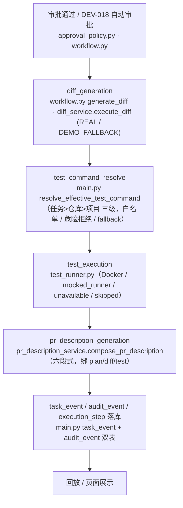

# Diff、测试和 PR 描述自动生成 —— Diff 生成

> 本文档与 `12-test-execution.md`、`13-pr-description.md` 同属「审批通过后的自动执行链路」，统一口径，按模块分卷。总览主流程见下节；本卷聚焦 Diff。

## 功能目标

本模块承接审批通过（含 DEV-018 自动审批）后的自动执行链路，负责把已批准的计划转化为可审阅的代码 Diff。系统现在以真实工作区改动为 Diff 主源；普通计划/未接入真实改动开关时，用显式标记的演示兜底产物，绝不把兜底冒充真实执行。

核心目标：

- 只有最新 `APPROVED` 计划能生成 Diff，其余一律 `409`。
- Diff 产物绑定任务、计划 ID、计划版本与执行步骤。
- 页面按文件展示 `add / modify / delete` 三类变更，支持复制当前文件 Patch。
- 真实执行失败与兜底原因分开保存，失败不覆盖已有成功 Diff。
- 每次生成写 `task_event` + `audit_event` + `execution_step`，回放可追踪。
- **Diff 产生后绑定当前测试命令来源**：任务 `test_command` 在创建时经 `resolve_effective_test_command`（任务 > 仓库 > 项目 三级）收敛并落库，Diff 生成即随任务生效，后续测试与 PR 描述沿用同一份最终命令与来源。

## 主流程



本卷（Diff）只负责 `A → B → F` 一段：审批通过后生成 Diff 产物并落库事件，供测试与 PR 描述消费。

## 执行门禁

- **未审批不能生成 Diff**：任务非 `APPROVED`、没有计划、最新计划非 `APPROVED`、或存在更新版本计划，都返回 `409`。
- **重复生成门禁**：同一计划版本已有非失败产物时拒绝重复，避免覆盖或重复创建。
- **产物不动赖于真实与否**：无论 REAL 还是 DEMO_FALLBACK，都写 `execution_mode` 与 `is_demo_fallback` 字段，页面与回放按此如实展示。
- **不覆盖原则**：真实执行失败时保留 `real_failure_reason`；测试失败或 Diff 重试都不覆盖已有成功 Diff。

## 核心能力

### Diff 生成

- 何时能生成：任务 `APPROVED` 且当前计划为最新审批通过版本。
- 数据关联：`DiffArtifact` 记录 `task_id / plan_id / plan_version / execution_step`，含每个文件的 `patch / before / after / added_lines / deleted_lines`。
- 真实路径：`diff_service.execute_diff` 基于真实工作区改动构造 unified diff，`execution_mode=REAL`（受 `ALLOW_SCRATCH_REAL_CHANGE` 与仓库白名单控制，产物来源如实标记）。
- 失败处理：真实失败写 `real_failure_reason`；构造演示兜底写 `fallback_reason`；两者都失败时任务进入 `FAILED` 并保留原因。

### 测试执行（对接 DOCTEST 12）

Diff 生成后 `next_action=auto_run_test`，把「测试命令解析 → 执行 → 结果落库」交给测试模块（见 `12-test-execution.md`）。

### PR 描述生成（对接 DOC-013）

测试完成后基于最新 Diff 与测试记录生成六段式 PR 描述（见 `13-pr-description.md`）。

## 数据与审计

| 产物 | 关联字段 |
| --- | --- |
| `DiffArtifact` | `task_id`、`plan_id`、`plan_version`、`execution_step` |
| 事件 | `DIFF_GENERATED` / `DIFF_GENERATION_FAILED`（含任务、计划版本、执行步骤、`REAL/DEMO_FALLBACK`、是否演示兜底、兜底与真实失败原因、变更文件数） |
| 落库 | `task_event`（任务时间线）+ `audit_event`（全局审计）双表 + `execution_step` |

回放页按事件内容显示 Diff 生成与兜底标记；失败事件只显示失败状态，不把失败误标成成功。

## 降级边界

- **演示兜底（DEMO_FALLBACK）**：固定构造一个 `modify` + 一个 `add` + 一个 `delete` 文件，均带 `patch/before/after/增删行数`；每条测试摘要与 PR 描述草案注明「演示兜底」。
- 兜底产物**不**视为真实代码已执行或已合入；回放与页面用醒目横幅标注。
- 真实 Runner 失败不会伪装成功：只保留失败原因，不返回泛化成功消息。

## 关键源码

| 文件 | 职责 |
| --- | --- |
| `backend/app/services/diff_service.py` | Diff 生成 seam：真实工作区改动 与 演示兜底产物 |
| `backend/app/agent/workflow.py` | `generate_diff` 图节点，LangGraph 主链内自动推进 |
| `backend/app/main.py` | `POST /api/tasks/{task_id}/diffs/generate`、门禁、`DiffArtifact` 模型、审计事件 |
| `backend/app/services/approval_policy.py` | 审批通过判定（前置） |
| `frontend/src/views/DiffView.vue` | Diff 展示、复制 Patch、兜底横幅、生成入口门禁 |

## 测试与验收

关键覆盖：生成门禁、权限、最新计划、重复生成、三类文件、Patch 统计、演示兜底、真实失败保留、双失败、列表/单文件接口、回放事件。

```text
python -m pytest backend/tests -q
406 passed, 14 skipped, 0 failed
```

后端专项与原前端专项见本文档对应 DEV-011 专测；全量套件在上一行体现。

## 当前结论

功能链路已通过源码与测试验收；真实工作区 Diff 为配置化能力（需 `ALLOW_SCRATCH_REAL_CHANGE` + 仓库白名单），页面真实截图待补。