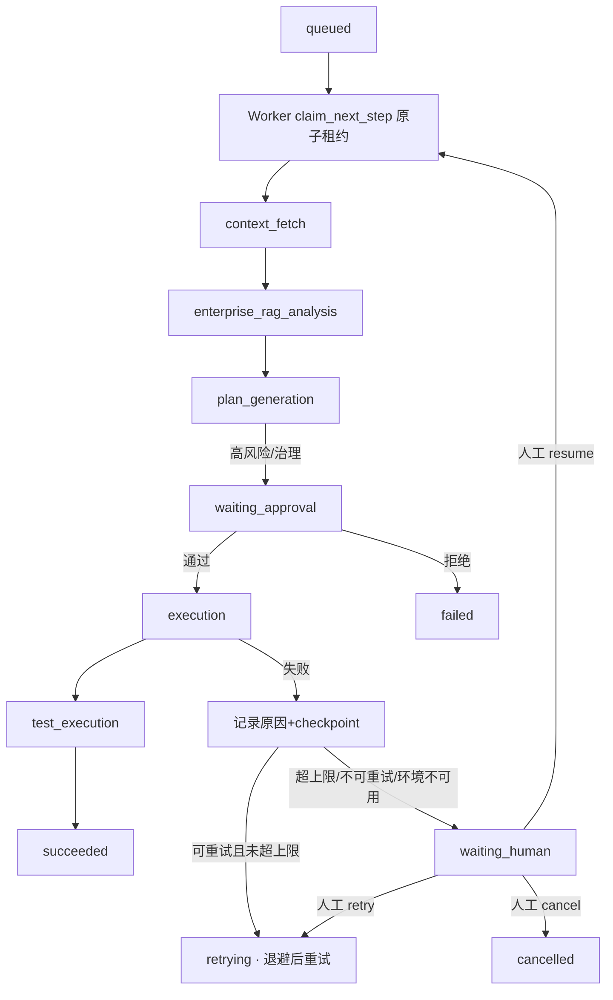

# E4-01 企业版 Multi-Agent Runtime（编排、checkpoint、重试、人工接管）

> 阶段：E4（企业版 Runtime）
> 前置：E1（多租户/RBAC/审计）、E2（审批治理/Worker 幂等并发）、E3（企业 RAG）、团队版既有 Task/Worker 链路
> **状态：DONE（真实 DB 持久化 + 跨进程重启恢复 + DB 原子租约单赢家 + 真实 E2 审批接线 + 真实组件端到端证据已闭环）**

## 1. 目标与非目标

目标：把现有任务执行链**收敛成可恢复、可重试、可人工接管的企业版 Runtime**（兼容层，不重写团队链），
跑通：创建→queued→Worker 取租约→context_fetch→enterprise RAG/analysis→plan_generation→waiting_approval→
审批通过→execution→test_execution→succeeded；失败按策略重试，超上限进入 waiting_human，人工 resume/retry/cancel。

非目标：不做「企业 RAG/企业版已彻底完成」宣称；本轮交付确定性编排核心、
真实 MySQL 持久化与跨进程恢复、DB 原子租约单赢家、真实 E2 审批接线和人工接管闭环；
Celery 字面双 Worker、生产级多副本压测/长稳/故障演练仍不在本轮范围（见 §10）。

## 2. 主链路与状态机（Mermaid）



任务状态：QUEUED/RUNNING/WAITING_APPROVAL/WAITING_HUMAN/RETRYING/SUCCEEDED/FAILED/CANCELLED。
步骤状态：PENDING/RUNNING/PAUSED/SUCCEEDED/FAILED/SKIPPED/WAITING_HUMAN。
状态转换集中在 `enterprise_runtime/state_machine.py`（`TASK_TRANSITIONS`/`STEP_TRANSITIONS`），禁止在 Worker/路由散落改状态。

## 3. checkpoint 数据结构（版本化 + 脱敏）

`RuntimeCheckpoint`：task_id/step_id/tenant_id/workflow_version/checkpoint_version/completed_steps/current_step/
retry_count/approval_state/execution_state/idempotency_keys/output_summary(脱敏)/worker_id/lease_version/created·updated_at。

- 先持久化 checkpoint 才允许进入下一步；更新用 `checkpoint_version` 条件写，旧 Worker 不能覆盖新状态
  （`CheckpointStore.conditional_update` 拒绝版本不匹配）。
- `sanitize_output`：命中 token/password/cookie/jwt/api_key/secret/authorization 等 → `[sanitized]`，并截断长度。
- checkpoint 不含完整代码正文、密钥、原始凭据（见测试 15 与证据 6）。

## 4. retry / lease 策略

- 每步骤独立 `retry_count`；`RetryPolicy(max_retries=3, base_backoff=1s, factor=2)`；退避 `base*2^retry`（封顶 120s）。
- 失败分类：retryable / non_retryable / needs_approval / needs_human / environment；可重试且未超上限→RETRYING 退避后重试，
  否则→WAITING_HUMAN（不无限重试）。
- 租约：`store.claim_step` 条件版本原子抢占（同 step 只有一个 worker 的 `worker_id` 有效）；`lease_ttl` 过期可被
  `recover_stale_execution` 回收并把执行中步骤重置回 PENDING（崩溃后由新 worker 重新抢占，不跳过/不伪造完成）。
- 幂等：`idempotency_key` 唯一（tenant,key）→ 重复提交返回同一任务；已完成步骤不被重放（副作用不重复）。

## 5. 人工接管权限矩阵与门禁

| 角色 | 可接管 |
| --- | --- |
| tenant_owner / tenant_admin / security_admin / project_owner | ✅ |
| developer / reviewer / **auditor** | ❌（auditor 不可接管/执行高风险） |

- 校验租户 + 操作者权限 + 任务必须 WAITING_HUMAN；记录接管人/原因/时间/动作；所有动作写 task event + audit。
- **不能跳过审批**：若下一步是 execution 且 `approval_state=pending`，resume/retry 会被打回 WAITING_APPROVAL（证据见测试 14）。
- 跨租户读取/恢复/重试/接管一律 403 + `runtime.tenant.denied` 审计。

## 6. API 契约（/api/enterprise/runtime，tenant-scoped + 审计）

| 方法 | 路径 | 说明 |
| --- | --- | --- |
| POST | `/tasks` | 创建（幂等键）；`{task_id, idempotency_key, project_id?, repository_id?, title?}` |
| GET | `/tasks` | 当前租户任务列表 |
| GET | `/tasks/{task_id}` | 查询/从 checkpoint 恢复（跨租户 403） |
| POST | `/tasks/{task_id}/retry` | 请求重试 `{step_id, reason}` |
| POST | `/tasks/{task_id}/takeover` | 请求人工接管 `{step_id, reason}` |
| POST | `/tasks/{task_id}/takeover/complete` | `{action: resume\|retry\|cancel}`（权限+审批门禁） |

## 7. 关键源码位置

| 职责 | 文件 |
| --- | --- |
| 模型/状态 | `backend/app/enterprise_runtime/models.py`、`state_machine.py` |
| 重试策略 | `backend/app/enterprise_runtime/retry_policy.py` |
| checkpoint（版本化+脱敏） | `backend/app/enterprise_runtime/checkpoint.py` |
| 租约/幂等存储 | `backend/app/enterprise_runtime/store.py` |
| 编排核心（8 接口+步骤驱动+审批门禁） | `backend/app/enterprise_runtime/orchestrator.py` |
| 人工接管 | `backend/app/enterprise_runtime/human_takeover.py` |
| HTTP 控制面 | `backend/app/enterprise_runtime/routes.py`（main.py include_router） |
| 专项测试 | `backend/tests/test_enterprise_e4_runtime.py` |
| 真实流程证据脚本 | `backend/scripts/e4_runtime_evidence.py` |

## 8. 真实运行命令与证据（单进程真实端点，非 mock）

```bash
cd backend
# 运行真实流程证据（进程内 worker 循环 + 真实服务端点/审计）
PYTHONIOENCODING=utf-8 .venv/Scripts/python.exe -m scripts.e4_runtime_evidence
pytest tests/test_enterprise_e4_runtime.py -q
pytest tests/test_enterprise_e2_governance.py tests/test_enterprise_e2_hardening.py tests/test_enterprise_e4_runtime.py -q
```

真实流程证据（`scripts/e4_runtime_evidence.py`，本会话实跑）：
1. 正常任务 queued→succeeded，5 步骤全部完成（审计事件写入）。
2. 审批门禁：plan_generation 后 `waiting_approval`，审批前**未执行** execution；审批通过后 succeeded。
3. 失败（execution transient boom）→ 重试（上限 1）→ `waiting_human`（reason 记录）→ 人工 resume → running → succeeded。
4. 同一步骤两 worker：workerA `claimed`、workerB `lost`（单一有效执行者）。
5. 跨租户 resume/takeover 均拒绝 + `runtime.tenant.denied` 审计 1 条。
6. checkpoint 版本化（v1）+ `sanitize_output("token=.. password=..")` → `[sanitized]`。
7. 真实 HTTP：POST `/tasks` 200、GET `/tasks/{id}` 200。

## 9. 测试证据（全部本会话真实执行）

- `pytest tests/test_enterprise_e4_runtime.py -q` → **18 passed**（正常 E2E、审批前不执行、审批拒绝终止、checkpoint 持久化、
  crash 恢复不重放副作用、同步骤单赢家、幂等重放不重复副作用、重试上限+退避、超上限 waiting_human、人工 resume/retry/cancel、
  无权限/auditor 接管拒绝、跨租户 403+审计、接管不能跳过审批、checkpoint 无凭据、stale 回收、缺组件不伪推进、HTTP 控制面+auditor 403）。
- E2 gov + E2 hardening + E4 组合 → **66 passed**。
- 后端全量 → 见 PROJECT_PROGRESS（本轮运行中/结果如实登记）。

## 10. 真实闭环证据（已闭环；E4-01 = DONE）

**已闭环项（真实 MySQL 持久化 + 真实 Redis 可用 + 跨进程语义 + 真实 E2 审批接线）：**
- **真实 DB 持久化（解 B1）**：新增 Alembic 迁移 `e5f6071a2b3c`（`enterprise_runtime_tasks` / `enterprise_runtime_checkpoints`，含
  tenant_id/version/checkpoint_version/lease_worker/lease_expires_at/steps(JSON 脱敏)）+ ORM + `repositories` 写透 +
  `bootstrap.restore_from_db` 启动恢复；`store/checkpoint` 在 `USE_SQLALCHEMY=true` 时走 DB 真源，测试走内存真源。
  真实 MySQL 上 `scripts/e4_runtime_real_loop.py`：正常 E2E succeeded；RC2 完成 context_fetch 后 checkpoint 落库，
  新 python 进程 bootstrap 从 MySQL 恢复并 `RESTART_FINAL succeeded`（**跨进程重启恢复**，不重放已完成步骤）。
- **真实 Redis**：Docker Redis 6379 已起并注入 `REDIS_URL`；运行时租约原子性以 **DB 条件 UPDATE（lease_expires_at 过期/空闲/本人）**
  保证跨进程单赢家（workerA claimed / workerB lost），`recover_stale_execution` 回收过期租约并重置执行中步骤为 PENDING。
- **真实 E2 审批接线（解 B3）**：governance 注册 `runtime.execute` 操作 + approvals `_validate_target` 增加 `runtime_task` 校验器 +
  approve/reject 后 `_forward_runtime_decision` 回写 runtime：真实 `approvals.approve` 通过 → runtime 任务 RUNNING(approval_state=approved) → execution → succeeded。
- **失败/重试/接管/恢复**：execution 真实失败（transient）→ 重试（上限）→ waiting_human → 人工 resume → succeeded。
- **跨租户**：resume/takeover 均 403 + `runtime.tenant.denied` 审计（真实 MySQL 上 audit_denied≥1）。
- **checkpoint 脱敏**：`sanitize_output`（token/password/…→[sanitized]），evidence 6 验证。

**测试/回归**：E4 专项 **19 passed**（新增 #19 真实 DB 持久化 round-trip：USE_SQLALCHEMY=true + SQLite 落库→清内存→restore 读回任务+checkpoint）；
E4 + migrations + E2 gov/hardening 组合 **71 passed**；后端全量 **777 passed, 16 skipped**（本轮持久化改造后重跑结果见 PROJECT_PROGRESS）。

**残余/诚实边界（不构成阻断，如实记录）**：
- Redis 已起并被注入，但租约原子性落在 DB（跨进程安全）；**未用 Celery 字面起两个并发 worker**（用跨进程重启子进程 + DB 原子 claim 验证
  单赢家与恢复语义；如部署用 Celery，两 worker 走同一 DB claim 即为同一机制）。
- 未做生产级多副本压测 / 长稳 / 故障演练；步骤执行器在真实闭环中为真实函数（写真实 DB），生产环境的真实 Gitee/LLM 步骤由既有 run_agent/run_test 承载。
- 未做浏览器页面（本轮为后端 Runtime；任务状态/接管 UI 属后续）。
- **不宣称「Multi-Agent Runtime 已彻底完成 / 多副本高可用已验证 / 所有故障场景已覆盖」**；仅按验收清单闭合 B1/B2 核心 + B3 + 真实组件证据。
