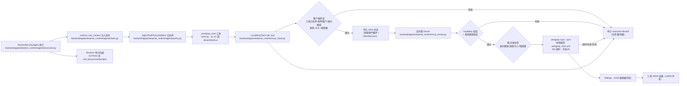

# OPT-01 本地 stdio MCP Client 与受控 Semgrep 工具

> 阶段：交付后优化池（OPT-01）
> 前置：E4-01/E4-02 Multi-Agent Runtime（review_security_agent 已在白名单模型中存在）；无外部服务依赖

## 1. 目标、范围与前缀依赖

目标：让企业 Agent Runtime 通过**真实 MCP Client → 自托管 stdio MCP Server** 调用一个受控的 Semgrep 文件扫描工具，
用本地规则在**隔离工作区**内做安全扫描；全程无远程扫描、无外部 API、无生产依赖。

范围内：
- MCP 协议：真实 `mcp` SDK（`ClientSession` + `stdio_client`），本地子进程、stdio 传输，工具发现（`list_tools`）与调用（`call_tools`）均为真实协议往返。
- 受控边界：工作区根路径唯一（必须等于配置的隔离根）、只接受相对路径、文件类型白名单、单文件大小上限、服务端并发上限、服务端 30s 扫描时限、客户端 40s 默认 deadline（覆盖服务端上限）。
- 身份与授权：租户/用户/角色/Agent 类型/task/run 多维校验；工具名白名单（仅 `semgrep_scan`）；缺失角色**保持缺失**并由客户端拒绝（不做默认放行）。
- 生命周期：超时、取消（显式 cancel 事件）、Server 异常、非法响应均返回可解释错误并写审计；取消/超时后会话关闭并可重建。
- 审计：`tenant_id / actor_id / agent_type / task_id / run_id / call_id / tool_name / outcome / duration_ms`；**不含参数、不含 capability 凭据**。

范围外：远程 Semgrep 服务、真实仓库扫描、生产数据、真实模型调用（默认 deterministic）。

## 2. 主链路（Mermaid）



## 3. 关键代码说明

- `backend/app/enterprise_runtime/mcp_policy.py`（新增）：客户端与服务端**共享**的扫描上限（纵深防御）——
  `ALLOWED_SCAN_SUFFIXES`（代码/配置类后缀白名单）、`MAX_SCAN_FILE_BYTES = 1 MiB`、
  `scan_target_violation(target, root)` 只返回**不含文件内容**的拒绝原因（非普通文件/越出隔离根/类型不允许/大小超限）。
- `backend/app/enterprise_runtime/mcp_client.py`：
  - `LocalMcpClient`：本地 stdio 客户端。`discover_tools()` 返回工具名集合（默认断言只有 `semgrep_scan`）；
    `call_tool(tool_name, arguments, identity, cancel_event=None)` 同步入口。
  - 授权 `_authorize`：工具名白名单 → `agent_type == review_security_agent` 且角色 ∈ {admin, reviewer, security_admin}
    → tenant/actor/task 非空 → 工作区必须**等于**配置的隔离根 → 相对路径（拒绝绝对路径）→ 目标 resolve 后仍在工作区内
    → 类型/大小（`mcp_policy`）→ 本地规则存在。任何一步失败 → `denied` + 审计。
  - 会话 `_PersistentMcpSession`：独立线程事件循环承载 `stdio_client` + `ClientSession`，跨调用复用；
    `call()` 以 0.1s 轮询兑现 `cancel_event` 与 deadline；取消/超时 → `future.cancel()`（MCP 层发出取消通知）→ 关闭会话并重建；
    `list_tools()` 用于发现。
  - 响应解析：`isError` → `server_error`（脱敏）；非 JSON 文本 → `invalid_response`（不携带原文）；非 dict JSON 包一层；
    空 structuredContent → `{"status":"ok"}`。
  - 审计 `_audit_event`：固定字段白名单（见 §1），`call_id = uuid4().hex`，**不入参、不入 capability**。
- `backend/app/enterprise_runtime/mcp_server.py`：
  - `FastMCP("enterprise-local-semgrep")`，仅注册 `semgrep_scan(relative_path, rules_path, capability)` 一个工具。
  - 校验链：`MCP_SESSION_TOKEN` 定时比较（`hmac.compare_digest`）→ `rules_path` 必须等于配置规则文件 →
    相对路径部分级检查（拒绝 `""/"."/".."` 与绝对路径）→ resolve 后类型/大小/隔离根复检（`mcp_policy`）。
  - 并发：模块级 `asyncio.Semaphore`（默认 2，`MCP_SEMGREP_MAX_CONCURRENT` 可调），`wait_for` 获取超时（默认 5s，
    `MCP_SEMGREP_ACQUIRE_TIMEOUT_SECONDS` 可调）→ `ScanConcurrencyLimitError` → `error/concurrency_limit`；
    获取成功走 `_run_semgrep(...)` 且 `finally` 释放。
  - `_run_semgrep`：`semgrep scan --json --metrics=off --config <本地规则> -- <目标>`（`SEMGREP_SEND_METRICS=off`，白名单环境变量），
    30s 超时 kill；`returncode ∈ {0,1}` 才算执行完成；JSON 解析失败 → `RuntimeError`；findings 截断至 100 条，
    只回传 `rule_id/severity/path/start_line/message(≤500)`。
  - 顶层工具函数把 `PermissionError/并发/超时/异常` 统一映射为 `{"status": ..., "error_type": ...}` JSON。
- `backend/app/enterprise_runtime/agents/tools.py`：`semgrep_scan` LangChain 工具的 runtime 实现——
  从 `runtime_tool_context` 取身份（不信任模型的自由声明），再过 `AgentToolPolicyValidator.assert_tool_allowed("review_security_agent", ...)`，
  构造 `McpIdentity`（含 `run_id`）调用真实客户端；异常 → `denied` + 审计；结果 JSON 截断 4000 字符。
- `backend/app/enterprise_runtime/agents/agent_definitions.py` / `definition.py`：`TOOL_SEMGREP_SCAN = "semgrep_scan"`，
  仅加入 `review_security_agent` 的 `tool_whitelist` 与 `readonly_tools`（其余 Agent 无此工具）。
- `backend/app/enterprise_runtime/semgrep_rules.yml`：本地规则（`dangerous-python-eval`、`hardcoded-python-secret`），不联网。
- `backend/pyproject.toml`：新增依赖 `mcp>=1.12.0,<2.0.0`。

## 4. 工具契约与限制

| 项 | 值 |
| --- | --- |
| 传输 | stdio（子进程），无网络监听 |
| 工具名 | 仅 `semgrep_scan`（发现接口返回同名集合） |
| 参数 | `relative_path`（相对路径，必填）；`rules_path`/`capability` 由客户端注入，模型不可见 |
| 隔离根 | 必须等于 `MCP_SCAN_ALLOWED_ROOT`（默认 `backend/.data/mcp-sandbox`） |
| 文件类型 | 后缀白名单（`.py/.js/.ts/.java/.go/.rs/.vue/.yaml/.json` 等 24 类，见 `mcp_policy.ALLOWED_SCAN_SUFFIXES`） |
| 文件大小 | ≤ 1 MiB |
| 并发 | 服务端 ≤ 2（可调），排队超过 5s → `concurrency_limit` |
| 执行时限 | 服务端 30s；客户端默认 40s deadline；取消事件可随时中断 |
| 结果上限 | ≤ 100 条 findings，字段 `rule_id/severity/path/start_line/message≤500` |
| 审计字段 | `event_type/tenant_id/actor_id/agent_type/task_id/run_id/call_id/tool_name/outcome/duration_ms` |

## 5. 权限矩阵（服务端权威）

| 角色 | review_security_agent + semgrep_scan |
| --- | --- |
| admin / reviewer / security_admin | ✅ |
| developer / auditor / 其他 | ❌ denied（错误类型 `permission_denied`，写审计） |
| 角色缺失（`role=""`） | ❌ denied（不做默认放行） |

## 6. 联调注意点

- 模型 Prompt 不是权限边界：即使模型声称自己是 reviewer，服务端仍按 `runtime_tool_context` 注入的真实身份判权（E4-02 C7 原则）。
- `semgrep` 可执行文件必须在服务端子进程的 `PATH` 中（本项目实测 `semgrep 1.181.0`）；缺失时返回 `server_error`（不伪造通过）。
- 在 Windows 下客户端仅透传 `PATH/SYSTEMROOT/WINDIR/TEMP/TMP/HOME/USERPROFILE/LOCALAPPDATA/PYTHONPATH` 等白名单环境变量，凭据类变量不进入子进程。
- 取消/超时后会话会被关闭并在下次调用时自动重建（测试覆盖），调用方无需处理会话状态。
- `MCP_SCAN_ALLOWED_ROOT` 与工具身份里的 `workspace_root` 必须一致；默认沙箱目录 `.data/mcp-sandbox` 仅放本地样例，不入库真实代码。

## 7. 源码文件位置

| 职责 | 文件 |
| --- | --- |
| 共享扫描策略/上限 | `backend/app/enterprise_runtime/mcp_policy.py` |
| MCP 客户端（授权/会话/审计） | `backend/app/enterprise_runtime/mcp_client.py` |
| 自托管 MCP Server（Semgrep） | `backend/app/enterprise_runtime/mcp_server.py` |
| 本地规则 | `backend/app/enterprise_runtime/semgrep_rules.yml` |
| Agent 工具接线 | `backend/app/enterprise_runtime/agents/tools.py`、`agent_definitions.py`、`definition.py` |
| 客户端/服务端专项测试 | `backend/tests/test_enterprise_mcp_client.py`、`backend/tests/test_enterprise_mcp_server.py` |
| 测试 stub Server | `backend/tests/mcp_stub_server.py` |
| 真实本地运行脚本 | `backend/scripts/mcp_semgrep_smoke.py` |
| 真实运行证据 | `docs/project-development/assets/opt01/mcp_semgrep_smoke.json` |

## 8. 测试证据（全部本会话真实执行）

```bash
cd backend
# OPT-01 专项（客户端 17 + 服务端 5）
.venv/Scripts/python.exe -m pytest tests/test_enterprise_mcp_client.py tests/test_enterprise_mcp_server.py -q
# → 21 passed in 13.63s

# OPT-01 + E4 Agent/Runtime 回归（仅排除需 Redis 的 Celery 投递测试，属 OPT-05 环境问题）
.venv/Scripts/python.exe -m pytest tests/test_enterprise_e4_agents.py tests/test_enterprise_mcp_client.py \
  tests/test_enterprise_mcp_server.py tests/test_enterprise_e4_runtime.py -q \
  --deselect tests/test_enterprise_e4_agents.py::test_celery_task_registered_and_submit_dispatch
# → 74 passed, 1 deselected in 51.94s
```

覆盖矩阵：成功调用 / 角色拒绝 / 缺失角色拒绝 / 工具名不在白名单 / 工作区不一致 / 路径逃逸（`..`、绝对路径、符号链接逃逸）/ 文件类型拒绝 /
大小超限 / 超时 / 取消（含取消后会话重建）/ Server 异常 / 非法 JSON 响应（脱敏）/ 审计字段白名单与参数脱敏 / 工具发现 / 服务端纵深复检 /
服务端 capability 与规则路径锁定 / 服务端并发上限。

## 9. 真实本地运行证据

运行命令与结果（真实执行，非模拟）：

```bash
cd backend
.venv/Scripts/python.exe scripts/mcp_semgrep_smoke.py \
  --out "../docs/project-development/assets/opt01/mcp_semgrep_smoke.json"
# discovered_tools=['semgrep_scan']
# clean={"status": "ok", "findings": [], "finding_count": 0}
# risky_findings=[{"rule_id": "...dangerous-python-eval", "severity": "ERROR", "path": "eval_sample.py",
#                  "start_line": 2, "message": "Avoid evaluating untrusted input with eval."}]
# path_escape={"status": "denied", "error_type": "permission_denied", ...}
# checks={"discovery_restricted": true, "clean_scan_ok": true, "eval_scan_detected": true,
#         "path_escape_denied": true, "audit_has_no_arguments": true, "audit_has_no_capability": true}
```

证据文件：`docs/project-development/assets/opt01/mcp_semgrep_smoke.json`（含环境版本 semgrep 1.181.0、发现结果、三组调用结果与审计事件；审计事件中无路径参数与 capability）。
本项为 CLI/协议类能力，无页面截图；以上终端输出与证据 JSON 为真实运行记录。

## 10. CLI 启动说明

- 常规使用：**不需要手动启动 Server**。`LocalMcpClient` 在首次调用时自动以
  `<venv>/python -m app.enterprise_runtime.mcp_server`（可用 `MCP_PYTHON` 覆盖）拉起 stdio 子进程，会话复用、进程随退出清理。
- 手动调试（验证 Server 可启动；stdio 模式无输出属正常，需客户端接入）：
  ```bash
  cd backend
  MCP_SESSION_TOKEN=demo MCP_SCAN_ALLOWED_ROOT="$(pwd)/.data/mcp-sandbox" \
    MCP_SEMGREP_RULES="$(pwd)/app/enterprise_runtime/semgrep_rules.yml" \
    .venv/Scripts/python.exe -m app.enterprise_runtime.mcp_server
  ```
- 推荐的本地真实验证入口：`scripts/mcp_semgrep_smoke.py`（见 §9），一条命令完成隔离目录创建、真实扫描与证据落盘。
- 相关环境变量：`MCP_SCAN_ALLOWED_ROOT`、`MCP_SEMGREP_RULES`、`MCP_SEMGREP_MAX_CONCURRENT`（默认 2）、
  `MCP_SEMGREP_ACQUIRE_TIMEOUT_SECONDS`（默认 5）、`MCP_PYTHON`。

## 11. 复盘与边界

- 关键技术选择：工具调用链“双端同策略”（客户端授权 + 服务端复检）避免单点绕过；发现接口与调用接口分离，白名单只影响调用；
  取消通过 `concurrent.futures` 取消传播（MCP 通知）实现，不引入额外协议轮子。
- 已知边界（如实记录）：并发上限是**单 Server 进程内**语义（每个客户端会话一个 Server 进程）；未做多进程/多租户压测（属 OPT-13 范围）；
  扫描范围目前是单文件（对齐“受控最小能力”），不是整仓扫描。
- 本次未触碰：远程扫描、真实仓库、生产服务、真实模型。
