# OPT-02 Agent 级 Eval 与版本回归

> 阶段：交付后优化池（OPT-02）
> 前置：E4-01/E4-02 Multi-Agent Runtime、E2 审批接线（均已在本地隔离环境可运行）

## 1. 目标、范围与前缀依赖

目标：为 6-Agent 企业工作流提供**离线、确定、可复现的 Agent 级评测与版本回归**能力：

- 固定任务集 + 期望产物/Agent 序列/审批边界/失败分类/精确工具名轨迹；
- 报告包含任务级与逐 Agent 的运行数、成功率、p50/p95、工具调用数、失败类别；
- 同一数据集 hash 下的报告可对拍，输出案例级与 Agent 级的回归/改善与指标 delta；
- 全程默认 deterministic/local、内存存储、固定隔离路径；真实模型运行只提供**显式 opt-in**，不默认执行；
- 未实际采集 token/成本时如实标注 `not_collected`，不估算冒充实测。

范围外：真实模型批量评测（仅实现开关）、生产数据、DB/Celery 连接（评测明确拒绝）。

## 2. 主链路（Mermaid）

```mermaid
flowchart LR
    DS["固定任务集<br>backend/evaluation/enterprise_agents/e4_agent_eval_v1.json<br>（期望产物/Agent序列/审批边界/失败分类）"] --> LD["load_agent_eval_dataset<br>evaluation.py · JSON 校验 + SHA-256"]
    LD --> CLI["CLI 隔离运行器<br>backend/scripts/evaluate_enterprise_agents.py"]
    CLI --> GR{"_guard_provider<br>默认强制 deterministic<br>--allow-real-model 才放行真实模型"}
    GR --> SB["固定隔离沙箱<br>backend/.data/agent-eval-sandbox<br>AGENT_WORKSPACE_ROOT / MCP_SCAN_ALLOWED_ROOT"]
    SB --> RUN["逐案例执行<br>orchestrator.run_agent_workflow（dispatch=False）<br>内存 store · 审批 approve/reject 由案例驱动"]
    RUN --> MET["逐 Agent 收集<br>executor.py：状态/耗时/工具名轨迹<br>agent_runs + tool_policy + approval_events"]
    MET --> EV["evaluate_agent_dataset<br>evaluation.py：案例判定 + 逐 Agent 汇总 p50/p95"]
    EV --> RPT["报告 JSON<br>dataset sha/versions/environment/summary/agent_metrics/cases"]
    RPT --> CMP["compare_agent_eval_reports<br>同 hash 对拍：案例与 Agent 回归/改善 + delta"]
```



## 3. 关键代码说明

- `backend/app/enterprise_runtime/evaluation.py`（新增）：
  - `load_agent_eval_dataset`：读取并校验任务集（`dataset_id`、`workflow_version>=2`、唯一 `case_id`、期望 `workflow_status`），返回 `(dataset, sha256)`。
  - `evaluate_agent_dataset(dataset, run_case, dataset_sha256, model_version, prompt_version, environment)`：
    逐案例调用执行器，判定 `workflow_status / agent_sequence / artifact_types / approval_boundary / tool_policy / tool_trace / failure_class` 七类检查；
    工具轨迹经 `_sanitize_tool_trace` **只保留 `tool_name`，剥离参数**（即 Issue 正文/代码正文/凭据都不会进报告）；
    逐 Agent 汇总 `runs/succeeded/failed/success_rate/latency_ms(p50,p95)/tool_calls/failure_classes`；
    `agent_runs` 保留每个 AgentRun 的真实状态、失败类别、`duration_ms`（非有限值记 `None`）与工具调用数；
    报告含 `environment` 块（provider/隔离路径/存储/DB/Celery/opt-in 标记）；成本固定 `{"status":"not_collected","value":null}`。
  - `compare_agent_eval_reports`：要求同一 `dataset_sha256` 且案例集合一致；输出案例级 `regressions/improvements`、
    `success_rate_delta/latency_p50_delta_ms` 与逐 Agent `agent_deltas`（runs/成功率/时延/工具调用/失败类别 delta）+ Agent 级回归/改善清单。
  - `write_agent_eval_report`：UTF-8 JSON 落盘（目录自建）。
- `backend/scripts/evaluate_enterprise_agents.py`（新增 CLI）：
  - 默认强制 `AGENT_PROVIDER=deterministic`（`_guard_provider` 拒绝其它 provider），并强制
    `USE_SQLALCHEMY=false / USE_CELERY=false / 空 broker`；任一 DB/Celery 连接尝试直接拒绝（`load_runtime_settings` 检查）。
  - 固定隔离沙箱 `backend/.data/agent-eval-sandbox`（cwd 无关），同时写入 `AGENT_WORKSPACE_ROOT` 与 `MCP_SCAN_ALLOWED_ROOT`。
  - `--allow-real-model`：**显式 opt-in** 才保留环境中的真实 provider；默认不触发真实模型（本项未实际运行真实模型评测）。
  - `--compare-with <基线报告>`：输出同数据集对拍 JSON；`--out` 必填；退出码 0 仅当全部案例通过。
- `backend/app/enterprise_runtime/agents/executor.py`：AgentRun 记录 `duration_ms` 与真实工具名轨迹
  （真实 LangChain 后端从消息 `tool_calls` 提取 `invoke_with_trace`；确定性后端无工具调用 → 空轨迹如实上报）；失败路径同样保留耗时/轨迹。
- `backend/app/enterprise_runtime/agents/factory.py`：`_RealLangchainAgent.invoke_with_trace` 返回 `(结构化输出, 工具名轨迹)`；`invoke` 保持兼容。
- `backend/evaluation/enterprise_agents/e4_agent_eval_v1.json`（固定集）：2 案例——审批通过全链路（6 Agent、11 类产物、`approved_before_code_change`）与审批拒绝（3 Agent 后终止、`rejected_before_code_change`、不出现 `code_change_agent`）。

## 4. 报告契约

| 字段 | 说明 |
| --- | --- |
| `schema_version` | 当前 1 |
| `dataset` | `dataset_id / dataset_sha256 / case_count / workflow_version` |
| `versions` | `model / prompt` 版本标签（由 CLI 参数注入） |
| `environment` | `agent_provider / workspace_root / stores / database / celery / real_model_opt_in` |
| `summary` | `total_cases / passed_cases / failed_cases / success_rate / latency_ms{p50,p95} / cost(not_collected)` |
| `agent_metrics[agent]` | `runs / succeeded / failed / success_rate / latency_ms / tool_calls / failure_classes` |
| `cases[]` | `passed / workflow_status / agent_types / artifact_types / tool_policy / tool_trace(仅工具名) / agent_runs / approval_events / approval_boundary / failure_class / failure_reasons / duration_ms / cost` |
| 对拍输出 | `regression_count/regressions / improvement_count/improvements / agent_regressions/agent_improvements / success_rate_delta / latency_p50_delta_ms / agent_deltas` |

脱敏边界：报告不含工具参数、Issue 正文、代码正文、凭据；不含数据库/网络地址。

## 5. 复现命令

```bash
cd backend
# 默认（deterministic/local/内存/固定沙箱）
.venv/Scripts/python.exe scripts/evaluate_enterprise_agents.py \
  --out evaluation/enterprise_agents/reports/agent_eval_local_v1_verified.json
# 对拍基线（同数据集 hash）
.venv/Scripts/python.exe scripts/evaluate_enterprise_agents.py \
  --out /tmp/agent_eval_repro.json \
  --compare-with evaluation/enterprise_agents/reports/agent_eval_v2_baseline.json
# 显式 opt-in（真实模型；默认不执行；需自行配置 LLM 环境）
.venv/Scripts/python.exe scripts/evaluate_enterprise_agents.py --allow-real-model \
  --out evaluation/enterprise_agents/reports/agent_eval_real_model.json
```

## 6. 测试证据（全部本会话真实执行）

```bash
cd backend
# OPT-02 专项（评测契约 14 + CLI 3）
.venv/Scripts/python.exe -m pytest tests/test_enterprise_agent_evaluation.py tests/test_enterprise_agent_evaluation_cli.py -q
# → 17 passed in 17.88s

# OPT-02 + E4 Agent/Runtime 回归（仅排除需 Redis 的 Celery 投递测试，归 OPT-05）
.venv/Scripts/python.exe -m pytest tests/test_enterprise_agent_evaluation.py tests/test_enterprise_agent_evaluation_cli.py \
  tests/test_enterprise_e4_agents.py tests/test_enterprise_e4_runtime.py -q \
  --deselect tests/test_enterprise_e4_agents.py::test_celery_task_registered_and_submit_dispatch
# → 70 passed, 1 deselected in 56.61s
```

覆盖矩阵：审批拒绝不出现 CodeChange / 审批先于代码变更 / 工具白名单违反 / 精确工具轨迹不一致 / 工具参数剥离（含 Issue 私密串不出现）/ 非有限时延剔除 /
同 hash 对拍（回归、改善、Agent 级 delta）/ 不同 hash 拒绝 / 空环境默认值 / 固定集任意 cwd 运行 / 两次运行非时间字段一致 /
CLI 默认压制真实 provider（`--allow-real-model` 守卫）/ 子进程隔离（DB/Celery 明确禁用且报告注明）。

## 7. 真实运行证据

```bash
# 从 backend/.data（非仓库根）运行，证明与 cwd 无关；并输出对拍
cd backend/.data
../.venv/Scripts/python.exe ../scripts/evaluate_enterprise_agents.py \
  --out ../evaluation/enterprise_agents/reports/agent_eval_local_v1_verified.json \
  --compare-with ../evaluation/enterprise_agents/reports/agent_eval_v2_baseline.json
# → Agent Eval: 2/2 cases passed；dataset_sha256=9789e0c0…（与数据集文件 SHA-256 一致）
```

对拍结果（由 `compare_agent_eval_reports` 计算并落盘）：

- `regression_count=0`、`improvement_count=0`、`success_rate_delta=0.0`、`agent_regressions=[]`、`agent_improvements=[]`；
- 逐 Agent `runs_delta=0 / tool_calls_delta=0 / failure_classes_delta=0`；时延 delta 为真实测量波动（毫秒级，不做“零波动”宣称）。

证据文件：`backend/evaluation/enterprise_agents/reports/agent_eval_local_v1_verified.json`（新 schema，含 environment 块）与
`backend/evaluation/enterprise_agents/reports/agent_eval_local_v1_comparison.json`（对拍结果）。
本项为 CLI/评测契约能力，无页面截图；以上命令输出与报告 JSON 为真实运行记录。

## 8. 联调注意点

- 评测必须从任意 cwd 运行：CLI 自动设置 `sys.path`、固定沙箱路径绝对化；报告中的 `workspace_root` 与机器路径一致但**不含凭据**。
- 确定性路径下 Review/Semgrep 等工具不会被真实调用 → 工具轨迹为空并如实记录；需要工具轨迹的评测应通过真实 provider（opt-in）或专用 stub 后端。
- `--compare-with` 仅接受同一 `dataset_sha256`；修改数据集后应将其视为新基线（旧报告不可混比）。
- 报告里的 `latency_ms` 属于真实测量值，会随机器波动；对拍时只对非时间字段做一致性判定（CLI 测试与 §7 均按此约定）。
- `agent_eval_v2_baseline.json` 为旧 schema 基线（无 environment 块），对拍逻辑不受影响；新报告请以 `*_verified.json` 为准。

## 9. 复盘与边界

- 关键技术选择：评测与执行解耦（`run_case` 回调注入运行器），使同一评测逻辑可服务 deterministic / 真实模型 / 未来 stub 三类执行；
  对拍只比较结构性字段，时延单列 delta，避免把机器抖动误报为回归。
- 已知边界（如实记录）：本轮**未执行**真实模型评测（仅实现显式 opt-in 通路）；成本/token `not_collected`（未接入可信 usage 上报）；
  确定性基线工具轨迹为空（无真实工具调用，不虚构轨迹）；对拍样本仅 2 案（契约验证为目的，不代表覆盖率）。
- 本次未触碰：真实 LLM 调用、DB/Celery、生产数据、外部服务。
