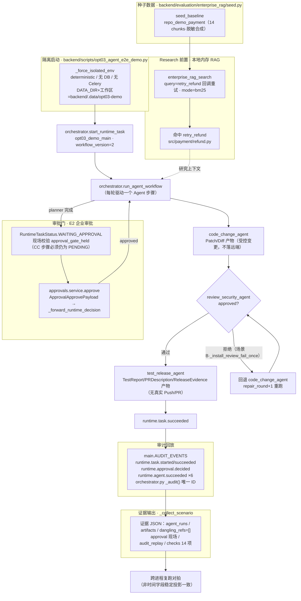

# OPT-03 可复现多 Agent 端到端演示

> 阶段：交付后优化池（OPT-03）
> 前置：E4-01/E4-02 Multi-Agent Runtime、E2 审批接线、E3 企业 RAG 内存检索（均已在本地隔离环境可运行）

## 1. 目标、范围与前缀依赖

目标：提供**一条命令、任意 cwd、默认全隔离**的多 Agent 端到端演示，覆盖
`Issue → Requirement → Research（本地 RAG）→ Planner → E2 人工审批门 → CodeChange（受控变更）→ Review → TestRelease → 审计回放`，
并附加**修复分支场景**（Review 首轮不通过 → 回退 CodeChange，`repair_round+1` → 复审通过 → 成功）。

- 隔离启动：脚本自身强制 `AGENT_PROVIDER=deterministic`、`USE_SQLALCHEMY=false`、`USE_CELERY=false`、清空 Celery broker/backend；
  即使外部环境注入敌对值（真实 provider、MySQL URL、Redis、Gitee token、LLM key）也会被压制；
- 种子数据：复用 `evaluation/enterprise_rag/seed.py` 的脱敏合成 demo 仓库（内存态），Research 环节执行**真实 BM25 检索**；
- 验收脚本：`checks` 逐项布尔（14 项），全部为运行时真实观测，退出码 0/2 如实报告，不伪造成功；
- 无外部写入：全程不加载 `app.services.enterprise_release_service`（Gitee PR 模块），证据中校验 `remote_write_module_loaded=false`；
- 真实模型仅 `--allow-real-model` 显式 opt-in（本项未执行）。

范围外：真实 Gitee/GitHub 写远端（归 E4 真实 PR 链路与 OPT-15）；真实模型运行；生产数据/DB/Redis/Milvus。

## 2. 主链路（Mermaid）



源码位置注解：隔离与环境 `_force_isolated_env`；驱动 `_drive`；审批 `_approve_via_e2`（走 `app/approvals/service.py`）；
证据收集 `_collect_scenario`；检查 `_run_scenarios`；入口 `main`——均在 `backend/scripts/opt03_agent_e2e_demo.py`。

## 3. 关键代码说明

- `backend/scripts/opt03_agent_e2e_demo.py`（新增，主交付物）：
  - `_force_isolated_env`：在 import app 模块**之前**压制环境（deterministic、无 DB/Celery、固定 `DATA_DIR` 与工作区
    `backend/.data/opt03-demo`），保证任意 cwd 复跑一致、且敌对环境变量不生效。
  - `_rag_leg`：`seed_baseline()` + `enterprise_rag_search`（`retrieval_mode="bm25"`，TenantContext 走 `permissions_for`），
    离线内存检索 `retry_refund` 真实命中（score≈0.88，`src/payment/refund.py`）。
  - `_drive`：循环 `run_agent_workflow`；在 `WAITING_APPROVAL` 现场记录 `approval_gate_held`
    （`code_change_agent` 步骤必须仍是 `PENDING` 且不在 `completed_steps`），再经 **E2 审批服务**批准（不直接改 RuntimeTask）。
  - `_approve_via_e2`：从 `approvals.store` 找 pending 审批单 → `approvals.service.approve(ctx, user, id, payload)`
    → 走既有 `_forward_runtime_decision` → `approve_runtime_task`，复用真实企业审批链路。
  - `_install_review_fail_once`：猴子补丁 `factory.DeterministicAgent.invoke`，仅第 1 次 review 返回 `approved=False`，
    驱动修复分支（测试/演示专用，不改变生产代码路径）。
  - `_collect_scenario` / `_run_scenarios`：收集 `agent_runs / artifacts / dangling_refs / approval / audit_replay`，
    输出 14 项 `checks`；`_run_order(run)` 以 `(started_at, agent_type, attempt, repair_round)` 稳定排序，
    `input_refs/output_refs` 排序后入证据——消除 store 集合顺序在不同进程间的非确定性，保证证据可复现。
  - `main`：`--out`（默认 `.data/opt03-demo/opt03_e2e_evidence.json`）与 `--allow-real-model`（显式 opt-in）；
    全部检查通过退出码 0，否则 2（如实报告失败检查清单）。
- `backend/app/enterprise_runtime/orchestrator.py`（修复）：`_audit()` 审计事件 ID 由“租户+事件+秒”改为
  `audit_{secrets.token_hex(6)}`——原实现在同一秒内同类事件 ID 相同会互相覆盖，
  导致 6 个 Agent 相继成功仅留下 1 条 `runtime.agent.succeeded`，审计回放不完整（TDD 红→绿修复）。
- 复用件（未改动）：`orchestrator.run_agent_workflow / approve_runtime_task`、`agents/executor.py`（产物链与 AgentRun 记录）、
  `agents/registry.py`、`app/approvals/service.py`、`app/enterprise_rag/service.py`、`evaluation/enterprise_rag/seed.py`。

## 4. 证据契约（报告字段）

| 字段 | 说明 |
| --- | --- |
| `environment` | `agent_provider / stores=in_memory / database=disabled / celery=disabled / workspace_root / data_dir / real_model_opt_in / remote_write_module_loaded` |
| `rag` | `query / mode=bm25 / commit_sha / hit_count / hits[{file,symbol,score}]`（进程内种子语料） |
| `scenario_main` | `final_status / repair_round / steps / agent_runs(含 refs) / artifacts / dangling_refs(须为 []) / approval / audit_replay` |
| `scenario_repair` | 同上 + `planner_run_count`（须为 1，验证修复不重跑 Planner） |
| `checks` | 14 项布尔 + `all_passed`：6 Agent 全成功、链序、审批门现场、E2 审批、审批后变更、产物无悬挂引用、RAG 命中、审计回放完整、终态成功、修复回环触发、Planner 不重跑、审批不重复、无远端写模块 |
| 稳定排序 | `agent_runs/artifacts` 及 `input_refs/output_refs` 均排序后入证；跨进程复跑仅时间字段不同 |

脱敏边界：无工具参数、无远端 token、无 Issue 以外私密串；`remote_write_module_loaded=false` 证明无 PR 写模块加载。

## 5. 复现命令

```bash
cd backend
# 默认隔离演示（任意 cwd 均可），证据落盘
.venv/Scripts/python.exe -m scripts.opt03_agent_e2e_demo \
  --out ../docs/project-development/assets/opt03/opt03_e2e_evidence.json
# 显式 opt-in（真实模型；默认不执行；需自行配置 LLM 环境）
.venv/Scripts/python.exe -m scripts.opt03_agent_e2e_demo --allow-real-model --out /tmp/opt03_real.json
```

## 6. 测试证据（全部本会话真实执行）

```bash
cd backend
# OPT-03 专项（审计回放完整性 + CLI 隔离验收 + 跨 cwd 复现对拍）
.venv/Scripts/python.exe -m pytest tests/test_opt03_e2e_demo.py -q
# → 3 passed in 23.65s（复跑两轮均过）

# OPT-02 + OPT-03 + E4 Agent/Runtime 回归（仅排除需 Redis 的 Celery 投递测试，归 OPT-05）
.venv/Scripts/python.exe -m pytest tests/test_enterprise_agent_evaluation.py tests/test_enterprise_agent_evaluation_cli.py \
  tests/test_enterprise_e4_agents.py tests/test_enterprise_e4_runtime.py tests/test_opt03_e2e_demo.py -q \
  --deselect tests/test_enterprise_e4_agents.py::test_celery_task_registered_and_submit_dispatch
# → 73 passed, 1 deselected in 81.66s
```

覆盖矩阵：`test_audit_replay_keeps_each_agent_event`（6 个 Agent 6 条独立审计事件，防 ID 覆盖回归，TDD 红→绿）/
`test_opt03_demo_cli_isolated_runs_and_all_checks_pass`（敌对环境子进程：真实 provider、MySQL URL、Redis、Gitee token、LLM key 全部被压制；
环境块断言；14 项 checks；主链 6 Agent 固定顺序；审批门后 CC 才启动；修复场景 repair_round≥1 且 Planner 仅 1 次）/
`test_opt03_demo_reproducible_across_cwd`（两个不同 cwd 各跑一次，去掉时间/ID 字段后的稳定投影完全一致）。

## 7. 真实运行证据

```bash
cd backend
.venv/Scripts/python.exe -m scripts.opt03_agent_e2e_demo \
  --out ../docs/project-development/assets/opt03/opt03_e2e_evidence.json
# → OPT-03 demo: main=succeeded repair=succeeded checks=14/14
```

证据文件 `docs/project-development/assets/opt03/opt03_e2e_evidence.json`（2026-10-15 生成）关键实测值：

- `environment`：`deterministic / in_memory / database=disabled / celery=disabled / real_model_opt_in=false / remote_write_module_loaded=false`；
- 主链：6 Agent 依序成功（requirement→research→planner→［审批门］→code_change→review→test_release），11 类产物，
  `dangling_refs=[]`；审批经 E2 服务（`appr_38a9da780611`，approved），`code_change_started_after_approval=true`；
- RAG：BM25 命中 `retry_refund`（`src/payment/refund.py`），真实评分；
- 审计回放：23 条事件，`agent.succeeded×6` + `task.started/succeeded` + `approval.decided` 等；
- 修复分支：`repair_round=1`，Agent 序列 `…review(round0) → code_change(round1) → review(round1) → test_release(round1)`，`planner_run_count=1`。

本项为 CLI/脚本能力，无页面截图；以上命令输出与证据 JSON 为真实运行记录。

## 8. 联调注意点

- 演示必须从任意 cwd 运行：脚本自行 `sys.path` 与绝对路径固定，禁止依赖调用者环境；
- `_install_review_fail_once` 只改测试/演示进程内补丁，**生产路径不含任何 deterministic 分支**（`DeterministicAgent` 仅在 `AGENT_PROVIDER=deterministic` 时构建）；
- 审批门顺序的证据口径：`approval_gate_held`（审批时 CC 仍 PENDING）为强序证据；`code_change_started_after_approval`
  在 Windows 微秒时钟粒度下允许“同刻相等”（`>=`），不得当强度序断言使用；
- 审计事件的 `created_at` 为真实时间，跨进程对拍须剔除时间字段后比较（测试已按此约定）；
- 演示全程内存态：重复运行互不影响；`backend/.data/opt03-demo` 仅存证据 JSON，不含业务数据。

## 9. 复盘与边界

- 关键技术选择：端到端演示不新增 Runtime 分支，全部复用现有 orchestrator/executor/审批/RAG 代码路径，
  仅以脚本驱动 + 现场断言；证据收集做稳定排序，使“可复现”可被跨进程对拍直接验证。
- 本次修复的真实缺陷：`orchestrator._audit` 事件 ID 冲突（同秒覆盖）——由 TDD 用例先红后绿暴露并修复，
  这是审计回放完整性的必要前提。
- 已知边界（如实记录）：确定性路径下 Semgrep/测试运行器等外部工具不真实执行（工具轨迹与外部沙箱归 OPT-06/OPT-13 用例）；
  本演示不覆盖多 Worker/Celery 投递（Redis 依赖归 OPT-05/OPT-13）；真实模型与真实远端写（Gitee/GitHub）未执行（opt-in/另行确认）。
- 本次未触碰：真实 LLM 调用、DB/Redis/Celery、Gitee 远端写、生产数据。
